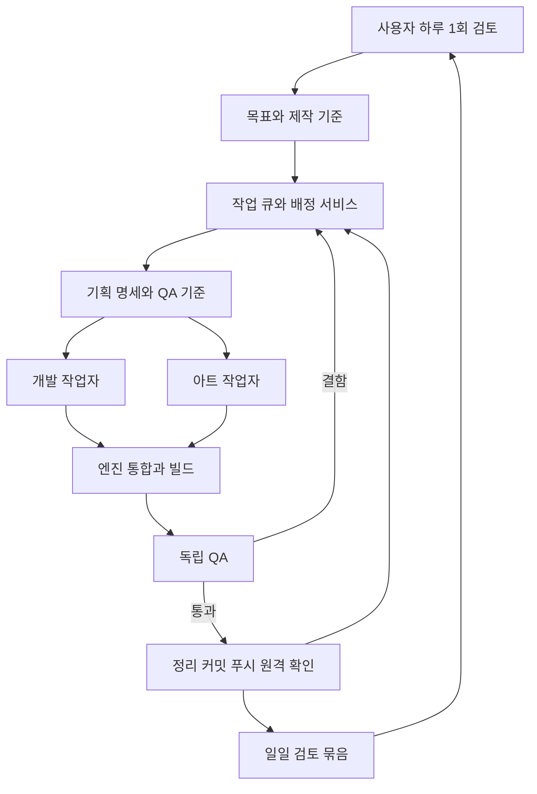

# Project RPG 24시간 게임 제작 파이프라인 구축 계획

2026-11-10 기준. 사용자가 하루 1회 결과를 검토하고, 그 사이에는 기획·아트·개발·통합·QA가 승인된 목표 안에서 제작과 수정을 이어가는 체계를 구축한다. 이 문서의 완료는 **계획 수립 완료**이며, 상시 서비스와 제작 작업자가 가동됐다는 뜻은 아니다.

하루 1회 검토는 사용자 확정 사항이다. 검토 시각은 미정이며 시간대는 Asia/Seoul, 검토 분량은 20~30분을 초기 제안으로 둔다. 월 비용 상한·생성 서비스 계정·자동 유료 생성 범위는 아직 미정이다. 아래 수치와 일정은 초기 운영 가설이며 첫 실측 후 조정한다.

## 성공 기준과 운영 범위

- 목표는 승인된 콘텐츠가 기획부터 실제 게임 적용과 QA까지 흐르고, 오류가 담당 공정으로 돌아가는 반복 제작이다.
- 최초 운영 성공은 서로 다른 작은 제작 항목 3개가 전체 공정을 통과하고, 재시작 복구 실험과 72시간 운영 관찰을 통과한 상태다. 처리량은 그때 측정하며 하루 기능 수를 미리 보장하지 않는다.
- 작업 가능한 항목이 없으면 Idle, 예산·자원·선택을 기다리면 해당 사유를 기록한다. 가동 시간을 채우기 위한 새 기획·재생성·테스트 반복을 만들지 않는다.
- 기존 [공동 작업 지침](../AGENTS.md)과 [로드맵 조율 표](Online_RPG_Development_Roadmap.md)의 예약·검증·기능별 커밋과 푸시·임시 산출물 정리 규칙을 적용한다.
- 시스템은 새 기능 범위를 임의로 확장하지 않는다. 승인된 목표의 세분화와 그 결과를 만족시키기 위한 수정은 자동 처리한다. 게임의 핵심 방향 변경은 다음 일일 검토에 올린다.

## 확인한 기반과 착수 전 확인할 사항

| 항목 | 현재 확인한 사실 | 계획에 반영할 내용 |
|---|---|---|
| 엔진 | [프로젝트 설정](../Project_RPG.uproject)의 EngineAssociation은 5.8 | 엔진·플러그인·빌드 도구 버전을 고정한 작업 환경 |
| 게임 서비스 | [백엔드 설명](../Backend/README.md), 실제 csproj는 net9.0 | 제작 관리 서비스는 게임 DB·기존 운영툴과 분리 |
| 에셋 작성 | [재료 작성 스크립트](../Scripts/Editor/CreateProgressionMaterialAssets.py)는 명시 옵션, 기존 에셋 보호, 검증을 갖춤 | 동일한 방식의 선언형 제작·임포트 어댑터 |
| 패키지 적용 | [재료 패키지 설치기](../Scripts/Editor/InstallProgressionMaterialPackage.ps1)는 경로·해시를 확인 | 승인된 원본과 엔진 에셋을 manifest로 연결 |
| 실행 QA | [훈련 플레이테스트](../Scripts/Tests/Run-TrainingPlaytest.ps1), [보스 다인 테스트](../Scripts/Network/Run-BossMapE2ETest.ps1) 존재 | 러너별 선행 모듈·고정 포트·경로·실제 검증 범위를 어댑터에서 명시 |
| 상호작용 | [InteractionInterface](../Source/Project_RPG/Public/Interface/InteractionInterface.h) 존재 | 시범 콘텐츠 착수 때 서버 요청 경로와 소유권 검사를 추가 조사 |
| 임시 정리 | [훈련 산출물 정리 함수](../Scripts/Tests/TrainingGuideArtifacts.ps1) 존재 | 자기 프로세스·자기 경로·링크 경계 원칙 재사용 |
| 저장소 | 현재 main, 원격 origin/main. 타 담당 소스·문서 변경 존재 | 작업별 격리, 공통 파일·Git 쓰기 순차 예약 |
| 장비 | 읽기 조회: 논리 CPU 16개, 물리 메모리 약 31GiB, RTX 4070 | 최초 무거운 작업 슬롯 1개, 측정 뒤 증설 |

위 확인은 코드·설정 읽기이며 러너의 현재 성공이나 계정 사용 가능성을 보증하지 않는다. 첫 단계에서 정상 설치 DLL과 게시 소스의 일치 여부, 전체 게임 링크/패키징, Server 타깃을 빌드할 엔진 구성, GPU 화면 캡처, Codex/이미지/3D 인증과 한도를 확인한다. 검증용 Editor 서버 실행과 배포용 Dedicated Server 패키지는 별도 결과로 기록한다.

## 제작 구조와 기술 선택

초기에는 다음 한 가지 구성으로 시작한다. 전체 서버·대시보드를 먼저 크게 만들지 않고 작업 한 개의 완료 경로부터 연결한다.

| 구성 요소 | 초기 선택 | 책임 |
|---|---|---|
| 제작 관리 | 독립 .NET Worker, 실행 API와 최소 로컬 화면 | 작업 상태·의존성·예약·비용·재시도·복구. 지원 중인 SDK 버전은 M0에서 고정 |
| 상태 저장 | 관리 서비스 전용 로컬 SQLite, 단일 writer | 작업·시도·임대·결과·이벤트·예산 예약. 작업자는 서비스 API로 접근 |
| AI 작업자 | Codex CLI의 비대화식 실행 어댑터 | 역할별 작업 지시, JSON 사건/결과 수집, 세션 ID 기록 |
| 2D 아트 | 교체 가능한 이미지 생성 API 어댑터 | 콘셉트·텍스처·아이콘 생성과 후보 관리. 실제 공급자는 M0에서 인증/비용 확인 후 고정 |
| 3D 아트 | Tripo CLI 어댑터 후보와 Blender Python 후처리 | 모델 후보, 실제 면 수·UV·축·크기·피벗·충돌 검사. 설치/인증/무인 실행 가능 여부를 M0에서 확인 |
| UE 통합 | 기존 PowerShell 러너, UE Python, 필요 시 Interchange | 에셋 임포트·맵 배치·검증·빌드·실행. 기존 러너를 작은 어댑터로 감쌈 |
| QA | 기존 native/HTTP/다인 러너와 새 콘텐츠 시나리오 | 판정 가능한 원본 결과, 재현 절차, GPU 화면, 성능 |
| 산출물 | Git/Git LFS, 별도 빌드·검토 결과 저장소 | 소스와 채택 에셋의 영속화, 일일 플레이 빌드 제공 |

[Codex 비대화식 모드](https://learn.chatgpt.com/docs/non-interactive-mode)는 스크립트 실행, JSONL 사건, 구조화 결과를 지원한다. 어댑터는 최종 자연어 응답 외에 종료 코드·실제 파일·검사 결과를 확인한다. 계정 인증과 처리량은 실행 환경에서 별도로 검증한다. SDK 전환은 여러 실행을 관리할 필요가 확인될 때 진행한다.

[SQLite](https://www.sqlite.org/whentouse.html)는 단일 호스트의 로컬 상태 관리에 맞춰 선택한다. DB 파일을 네트워크 공유 폴더에 두지 않는다. 여러 제작 노드가 필요해지면 관리 API는 유지하고 별도의 제작용 PostgreSQL로 옮긴다.

[Interchange](https://dev.epicgames.com/documentation/unreal-engine/interchange-framework-in-unreal-engine)는 Python/Blueprint로 임포트 파이프라인을 구성할 수 있다. [Gauntlet](https://dev.epicgames.com/documentation/unreal-engine/gauntlet-automation-framework-overview-in-unreal-engine)은 여러 게임 프로세스의 실행과 결과 검증을 지원한다. v1은 현재 러너를 재사용하고, 여러 장비/플랫폼 관리가 필요할 때 Gauntlet 연동을 확장한다.

관리 서비스는 부팅 후 복구하고, GPU·실제 UI 입력이 필요한 작업자는 별도 사용자 세션에서 실행한다. [Windows 서비스의 데스크톱 분리](https://learn.microsoft.com/en-us/windows/win32/services/interactive-services)를 고려해 잠금·로그오프·재부팅 때 실제 캡처와 입력이 가능한지 검증한다. 세션이 없으면 해당 작업만 자원 대기로 두고 기획·코드·비시각 QA를 계속한다.

## 담당별 입력과 산출물

| 담당 | 필수 입력 | 완료 산출물 | 결과를 돌려보내는 조건 |
|---|---|---|---|
| 제작 관리 | 승인 목표, 우선순위, 작업 현황 | 의존성 그래프, 실행할 작업, 예약 범위 | 범위 불명확, 자원 충돌, 예산 미정 |
| 기획 | 게임 방향, 기존 계약, 채택된 아트 기준 | 동작·수치·예외·범위·QA 항목을 담은 명세 | 기존 규칙과 모순, 완료 판정 불가능 |
| 아트 | 명세, 스타일 기준, 크기·재질·성능 예산 | 원본, 엔진용 파일, manifest, 프리뷰 | 기술 규격 실패, 스타일 불일치 |
| 개발 | 명세, 고정 기반 커밋, 수정 허용 경로 | 코드·설정·유지할 회귀 검사, 빌드 근거 | 컴파일/기능 실패, 공통 파일 인계 필요 |
| 통합 | 통과한 코드와 아트, 동일한 명세 revision | 엔진 에셋·테스트 맵·실행 빌드 | 누락 참조, 에셋 로드 실패, 입력 불일치 |
| QA | 고정 명세·검사 기준, 빌드 ID | 검사별 Pass/Fail/Blocked, 재현과 최소 증거 | 기능·화면·성능 결함 |

QA는 별도 실행 문맥에서 시작하고, 제작자가 테스트를 통과시키려고 명세·예상값을 낮추지 못하게 한다. 기준 변경은 사유를 남긴 새 명세 revision으로 처리한다. 테스트 도구 결함과 제품 결함은 구분한다.

논리 역할 수와 실제 동시 프로세스 수는 다르다. 기획·개발 등의 작업자는 필요할 때 시작하고 작업 종료 후 종료한다. 공통 파일 담당과 기존 외부 대화의 진행 상태는 조율 기록으로만 판단한다.

## 작업 카드와 복구 계약

각 작업 카드에는 다음 정보를 필수로 둔다.

- `task_id`, `parent_goal`, `role`, `priority`, `depends_on`, `spec_revision`, `base_commit`.
- 입력 파일·에셋·계약의 해시, 실제 수정 허용 경로, 필요한 자원과 검증 범위.
- 산출물 경로, 완료 조건, 검사 ID, 담당자, 결과를 넘길 다음 공정.
- 실행 시간·비용 상한, 최대 시도 횟수, 사용한 외부 생성 task ID.
- 작업 디렉터리·소유 프로세스·정리 대상·최소 증거 보존 위치.

상태는 `Proposed → Ready → Leased → Running → Checking → Publishing → Done`으로 둔다. 기술 검사 통과와 아트/게임플레이 채택 여부는 별도 필드로 기록한다. 기능 구현이 끝나면 약속한 작업 브랜치에 검증·정리·커밋·푸시·원격 확인까지 마치고, 디자인 채택이 필요한 결과는 일일 검토 목록에도 올린다.

예외 상태는 `RetryWaiting`, `Blocked`, `NeedsDirector`, `Canceled`다. 앞 단계 산출물 revision이 바뀌면 영향을 받는 하위 작업과 검증을 무효화하고 필요한 범위만 다시 수행한다.

초기 복구 정책은 다음과 같다.

1. 작업 claim과 자원 예약을 원자적으로 기록한다. 작업자 heartbeat는 30초, 180초 미갱신 시 회수 후보로 둔다.
2. heartbeat 만료만으로 새 작업자를 중복 실행하지 않는다. 기존 프로세스·외부 생성 task 상태를 확인하고 새 세대 번호로 이전 작업자의 게시를 차단한다. 살아 있는 소유 프로세스의 종료/격리가 확인될 때까지 같은 쓰기 범위를 재할당하지 않는다.
3. 동일 입력/단계의 키로 중복 실행을 식별한다. 생성 요청 응답 유실은 `Unknown`으로 남기고 기존 task를 조회한다. 결과가 불명확한 유료 요청을 새 요청으로 재전송하지 않는다.
4. 동일 결함의 자동 수정은 최초 실행 후 추가 2회까지, 일시적 네트워크 오류는 최대 3회 backoff를 초기값으로 둔다. 그 후 증거와 인계 조건을 남기고 독립 작업으로 이동한다.
5. 서비스 재시작 때 실행 중 작업, 남은 소유 프로세스, 진행 중 생성, 게시한 커밋, 임시 경로를 재조정한다. 이미 완료한 생성·커밋·푸시는 결과 조회로 복구한다.
6. 중지 명령은 새 작업 배정을 먼저 멈추고 실행 중 작업은 안전한 종료 지점에서 정리한다. 실행 가능한 작업이 없으면 다음 사건/일일 검토를 기다린다.

## 공유 작업 공간과 Git 운영

- 기존 사용자의 작업 공간을 상시 작업자의 쓰기 디렉터리로 사용하지 않는다. 고정 커밋의 별도 작업 디렉터리와 작업별 브랜치가 기본 설계다. 실제 브랜치 연결은 M0에서 현재 협업 방식과 맞춘다.
- worktree를 사용해도 Git refs와 일부 메타데이터는 공유된다. worktree 생성·브랜치 변경·통합·커밋/푸시를 관리 서비스가 순차 처리한다.
- 임시 디렉터리의 긴 경로와 UE 출력 충돌을 피하도록 루트를 짧게 둔다. D 드라이브 공간을 후보로 삼고 실제 위치는 M0에서 고정한다.
- `.uasset`와 `.umap`은 파일 단위 독점 예약을 적용한다. 에디터별 쓰기 가능한 Content를 분리하고 공유 읽기 링크를 통해 원본 에셋을 저장하지 않는다.
- 초기 동시 한도는 AI 작업 2개, 무거운 작업 1개, 유료 3D 생성 1개, Git 게시 1개다. 무거운 작업은 UE 빌드·GPU 렌더·다인 실행·로컬 3D 처리 중 하나다. 메모리 실측 후 조정한다.
- 조율 표의 다른 예약을 확인하고 서비스의 작업 예약을 반영한다. 조율 표를 시스템 도입만으로 폐기하지 않는다. 기계 임대 기록과 문서가 충돌하면 해당 파일은 인계 대기 처리한다.
- 완료 기능/문서/에셋은 그 단위로 게시한다. 검증만 한 작업의 전용 코드·로그·proof는 게시하지 않는다. 해당 기능에 직접 필요한 유지용 회귀 검사는 기능과 함께 게시할 수 있다.
- 게시 전 최신 diff와 index를 확인하고 자기 변경만 스테이징한다. 원격이 앞서면 차이를 통합하고 필요한 검증만 다시 수행한다. 강제 푸시는 사용하지 않는다.
- 완료 판정은 원격 ref 조회로 푸시한 커밋을 확인한 뒤 기록한다. 검증한 입력과 게시 입력이 바뀌면 이전 Pass를 재사용하지 않는다.

## 아트 제작과 채택 기준

아트는 `브리프 → 후보 → 기술 검사 → 후처리 → UE 임포트 → 엔진 프리뷰 → 일일 검토 → 채택`으로 진행한다. 스타일 기준을 통과한 반복 소품은 정해진 범위에서 자동 채택할 수 있도록 정책을 점진적으로 확장한다. 첫 스타일과 주요 캐릭터·보스는 일일 검토 대상이다.

최초 범위는 정적 소품, 아이콘, 단순 재질과 효과다. 다음에는 환경 묶음·모듈형 배치, 이후 캐릭터·리깅·애니메이션으로 넓힌다. 리깅 결과는 스켈레톤 호환, 루트 모션, 발 미끄러짐, 공격 타이밍을 엔진에서 통과해야 채택한다. 사운드는 초기에는 기존 사용 가능한 소재의 배치·볼륨 검사를 포함하고, 신규 생성/음성은 후속 어댑터로 둔다.

모든 채택 에셋은 다음 manifest를 갖는다.

- 에셋 ID와 version, 브리프 revision, 참조/원본 출처, 공급자·모델·task ID와 사용 조건 기록.
- 원본과 FBX/GLB/PNG의 해시, 실제 triangle 수, 텍스처 크기, 재질 슬롯 수.
- 단위·전방축·피벗, 충돌 방식, LOD, 사용 스켈레톤/애니메이션 조건.
- UE 패키지 경로, 임포트 설정, 새 프로세스 재로드 결과, 게임 안의 캡처.

생성 요청의 면 수를 실제 면 수로 간주하지 않는다. 생성·후처리·변환 각각의 결과를 검사하고 범위를 넘으면 재생성보다 필요한 후처리부터 수행한다. 후보 3개, 기술 수정 2회를 초기 상한으로 두고 비용 예산도 함께 적용한다.

원본은 `ArtSource/ProductionPilot/`, 엔진 에셋은 `Content/ProductionPilot/`을 예정 경로로 둔다. 기존 `.gitignore`가 `SourceArt`의 일부 이미지 확장자를 무시하므로 그 경로를 그대로 사용하지 않는다. 실제 에셋 추가 때 해당 신규 경로의 LFS 규칙을 함께 정한다. 채택 원본은 임시 산출물 정리 대상에서 제외한다.

Tripo를 쓸 경우 실행할 에셋 목록·입력·모델·API 단계·단계별 예상 비용을 묶어 하루 검토에서 확정하는 방식으로 시작한다. 기존 권한이 그 실행 범위를 이미 포함하면 재승인을 반복하지 않는다. 비용 상한 설정 자체를 미정 에셋의 무제한 생성 권한으로 해석하지 않는다. 실행 전 CLI dry-run과 계정 사용 가능 여부를 확인하고, 생성 완료 후 실제 청구와 task별 내역을 남긴다.

## 첫 시범 콘텐츠

첫 전체 공정의 대상은 개발 전용 맵의 **상호작용 봉인석 1종**이다. 기존 이야기·거래·탈것·성장 기능과 분리된 추가 콘텐츠로 제작한다. 기획 검토에서 방향을 바꾸면 작업 카드 revision을 올린다.

| 항목 | 초기 명세 |
|---|---|
| 맵 | `/Game/ProductionPilot/Maps/L_SealStonePilot` 신규 개발 전용 맵 |
| 아트 | 봉인석 mesh 1개, 재질 1개, 512px 아이콘 1개, 대기/활성 색상·발광 상태 |
| 규격 | 높이 150cm, 피벗 바닥 중앙, 최종 LOD0 최대 5,000 triangles, 재질 슬롯 1개, 최대 2K 텍스처, 단순 충돌 |
| 동작 | 200cm 이내에서 기존 상호작용 입력을 1초 유지하면 서버가 활성화. 10초 뒤 서버에서 초기화 |
| 다인 | 서버 1개/클라이언트 2개가 같은 상태를 관찰. 동시 요청은 한 번만 상태 전환, 중도 참가자는 현재 상태 수신 |
| UI | 상호작용 안내·진행 표시·완료 피드백. 초기에는 기존 표시 경로 활용 가능 여부부터 확인 |
| 범위 | 새 맵·소품·동작에 한정. 영구 보상·이야기 진도·게임 경제 변경 없음 |

필수 검사 ID는 다음과 같다.

| 검사 | 통과 기준 |
|---|---|
| P01 임포트 | 규격 충족, 누락 텍스처/참조 없음, 저장 후 새 UE 프로세스 재로드 성공 |
| P02 정상 조작 | 실제 클라이언트 입력 → 서버 판정 → 양쪽 상태 변경 확인 |
| P03 취소/범위 | 입력 취소·범위 이탈·잘못된 요청에서 상태 전환 없음 |
| P04 경합 | 두 클라이언트 동시 요청에도 동일 주기의 활성화는 1회 |
| P05 시간/재참가 | 서버 시간 10초 초기화, 중도 참가·새 클라이언트에서 현재 상태 일치 |
| P06 화면 | GPU로 촬영한 대기/진행/활성 상태와 아이콘 확인. NullRHI 결과를 화면 성공으로 표기하지 않음 |
| P07 성능 | 같은 장비·빌드 설정·카메라·해상도의 기준 장면과 p95 프레임 시간/메모리 비교. 수치 한도는 M0 기준 측정 뒤 동결 |
| P08 전달 | 빌드 ID와 소스·에셋 해시 일치, 실행 안내대로 별도 프로세스 기동, 소유 임시 파일 정리·기능 커밋/푸시·원격 확인 |

기존 상호작용 경로의 서버 권한이 부족하면 이를 자동으로 대수정하지 않는다. 필요한 공통 파일을 별도 예약하고 인계 조건을 기록한다. 독립된 아트·맵·관리 도구 작업을 계속한다. 실물 UI/입력이나 배포 패키지 검사가 막히면 해당 검사는 Blocked이며 전체 공정 완료로 표시하지 않는다.

## 단계별 구축과 완료 조건

기간은 착수 후 집중 작업일 기준의 추정이다. API 접근·패키징 기준선·공통 파일 인계가 확보되고, 초기 목표를 정적 소품으로 제한한다는 전제에서 MVP 구축 약 3~5주와 별도 72시간 관찰을 예상한다. 첫 두 단계 결과로 다시 산정한다.

| 단계 | 추정 | 구현 결과 | 다음 단계로 넘어가는 조건 |
|---|---|---|---|
| M0 환경과 제작 기준 | 1~2일 | 작업 환경·계정·예산·아트 기준·검토 시각, 정상 빌드 기준선과 검사 목록 | 실제 호출/기동 가능 확인, 현재 계약/예약 대조, 첫 시범 명세와 비용 한도 입력 |
| M1 작업 관리 기반 | 3~4일 | 영속 작업 큐, 의존성, 자원 예약, heartbeat, 재시도, 비용 예약, pause/resume | 중복 claim 차단, 작업자/관리자 종료 후 복구, 소유권 없는 파일·프로세스 보존 |
| M2 개발과 QA 연결 | 3~4일 | Codex 실행, 격리 작업 공간, 기존 러너 어댑터, 기능별 Git 게시 | 작은 실제 코드 변경이 검증·정리·게시 완료. 오류 수정 한도와 원격 선행 변경 처리 확인 |
| M3 아트와 UE 통합 | 3~5일 | 브리프/manifest, 생성·후처리·임포트·프리뷰, 비용 내역 | 새 소품과 아이콘이 실제 UE 맵에 적용되고 규격/재로드/화면 검사 통과 |
| M4 전체 제작 사이클 | 3~5일 | 봉인석 완성, 독립 QA와 결함 재배정, 일일 검토 묶음 | P01~P08 통과, 하루 1회 검토 결과가 다음 작업에 반영, 서로 다른 작은 제작 항목 3개 완료 |
| M5 상시 운영 검증 | 72시간 관찰 | 감시·복구·예산·정리·일일 보고 검증 | 아래 운영 기준 충족 후 24시간 운영 가능 범위를 명시 |

M5의 기준은 작업 유실 0, 중복 유료 제출 0, 무단 파일 덮어쓰기 0, 무효 검증 결과 재사용 0, 일일 비용 한도 초과 배정 0이다. 재시작·네트워크 단절·GPU 세션 부재를 각각 한 번 이상 시험하고 복구/대기 전환 근거를 남긴다. 자원이 가용할 때 신규 배정 재개 목표는 5분 이내이며 실제 소요 시간을 기록한다. 72시간 중 실제 운영 시간·작업 시간·대기 시간·수동 개입을 따로 집계한다.

## 구현 작업 목록과 예정 경로

아래는 후속 구현 단위다. 이번 계획 작성이 이 경로들의 활성 예약을 뜻하지 않는다. 착수 시 최신 조율 기록과 실제 diff를 다시 확인한다.

| ID | 작업 | 선행 | 예정 경로 | 검증/완료 단위 |
|---|---|---|---|---|
| PROD-01 | 제작 기준·작업/결과 schema | M0 확인 | `Production/Contracts/`, `Production/Policies/`, `Production/Briefs/` | 예제 작업의 필수 정보·의존성·완료 기준 검증 |
| PROD-02 | 상태 저장과 큐 | 01 | `Tools/Production/Coordinator/` | 재시작 후 작업/시도/이벤트 보존 |
| PROD-03 | 자원 임대와 복구 | 02 | `Tools/Production/Coordinator/`, `Tools/Production/Workers/` | 동시 claim·stale worker·소유 프로세스 정리 |
| PROD-04 | Codex 개발 작업자 | 03 | `Tools/Production/Workers/`, `Production/Roles/` | 구조화 결과, 시간 제한, 경로 위반 차단 |
| PROD-05 | 격리 작업 공간과 Git 게시 | 03, 04 | `Tools/Production/Git/` | 자기 변경만 게시, 원격 선행/응답 유실 복구 |
| PROD-06 | 기존 QA 러너 어댑터 | 01, 03 | `Scripts/Production/`, `Production/Validation/` | 종료0/보고서 Pass/검사 실행 수/입력 해시 교차 확인 |
| PROD-07 | 아트 생성과 기술 검사 | 01, 비용 범위 확정 | `Tools/Production/Art/`, `ArtSource/ProductionPilot/` | 외부 task 복구, 후보 평가, 실제 규격·비용 확인 |
| PROD-08 | UE 임포트와 프리뷰 | 06, 07 | `Scripts/Editor/Production/`, `Content/ProductionPilot/` | 저장/재로드/맵 표시/참조 검사 |
| PROD-09 | 봉인석 동작과 실제 QA | 05, 06, 08 | `Source/Project_RPG/{Public,Private}/ProductionPilot/`, `Scripts/Tests/Production/` | P01~P08, 기능에 직접 필요한 회귀 검사 포함 |
| PROD-10 | 일일 검토 화면과 의사결정 반영 | 02, 06, 08 | `Tools/Production/Review/` | 결과 링크, 채택/수정/보류, 다음 작업 반영 |
| PROD-11 | 상시 실행·비용·정리 운영 | 03, 05, 10 | `Tools/Production/Hosting/`, `Production/Policies/` | 부팅 복구, 예산 예약, 소유 임시 정리, 72시간 관찰 |

각 ID는 기능 완료 단위로 커밋·푸시한다. 72시간 검증 자체의 일회용 러너·결과는 로컬 기록으로 남긴다. 서비스에서 계속 사용할 복구·정리 코드는 해당 기능의 유지 소스로 게시한다.

## 하루 한 번의 검토

하루 검토 시각을 `T`로 정한다. T 이전 약 1시간은 새 대형 통합보다 검증 완료 후보의 정리와 빌드 준비에 우선 배정한다. 시간만 맞추기 위해 실패 빌드를 성공 후보로 승격하지 않는다.

일일 묶음은 다음을 포함한다.

1. 가장 최근에 검증을 통과한 플레이 빌드와 실행 안내. 새 후보 실패 시 이전 정상 빌드와 새 실패 사유를 함께 표시한다.
2. 바뀐 기획·게임 동작 3~5개, 채택을 기다리는 아트 프리뷰, 필요한 경우 짧은 플레이 영상.
3. 검사별 결과와 실제 실행 범위, 우선 결함, 재현 링크, 아직 실행하지 못한 검사.
4. 사용자가 판단할 항목 최대 3개와 다음 24시간의 우선순위. 많으면 낮은 우선순위를 보류한다.
5. 하루 실제 비용·진행 중 예약 비용·다음 배치 예상 비용, 완료 항목·개입 시간·재작업 비율.

검토 결과는 `채택`, `수정 지시`, `보류`로 기록한다. 사용자가 검토하지 않은 날에는 기존 승인 범위의 Ready 작업을 계속하고 새 방향 결정을 자동으로 승인하지 않는다. 작업 부족 시 Idle로 전환한다. 검토 일정 제안은 이 문서만으로 실제 예약 작업을 생성하지 않는다.

## 비용과 산출물 관리

월 상한 `B`와 일일 상한을 입력받고, 실제 청구액뿐 아니라 진행 중 작업의 최대 예상 비용을 먼저 예약한다. `실지출 + 예약액 + 다음 작업 예상액`이 한도를 넘으면 신규 유료 작업만 보류한다. 이미 제출된 작업은 추적해 실제 비용을 확정한다. 가격을 산정할 수 없는 작업은 자동 제출 대상에서 제외한다.

첫 표본에서는 기획/코드 호출 비용, 이미지 장당 비용, 3D 생성·후처리·변환별 비용, 빌드/QA 시간, 저장소 사용량을 측정한다. 초기 예산 배분안은 기획·코드 45%, 아트 35%, 인프라·저장 10%, 수정 여유 10%이며 실제 사용량으로 조정한다. 금액 미정 상태에서 유료 무인 운영을 시작하지 않는다.

작업별 임시 루트와 소유 프로세스를 먼저 기록한다. 종료·최종 실패·중단 뒤 자기 PCH/OBJ/DLL/PDB, RuntimeProject, 캐시, 큰 중복 로그를 정리하고 최소 증거만 보존한다. 재시작 때 누락된 정리를 이어간다. 링크/reparse point를 따라 원본 Content·Plugins를 삭제하지 않는다.

일일 검토 빌드·선택된 프리뷰는 사용자에게 전달할 결과물이므로 임시 검증 복사본과 구분한다. 초기 보존안은 최근 정상 빌드 2개와 검토 대기 후보 1개, 작은 결과/해시/명령 기록 30일이다. 실제 크기를 M0에서 측정해 별도 용량 한도를 정한다. 보존 한도에 도달하면 미검토 결과를 조용히 삭제하지 않고 신규 대형 산출물 생성을 보류한다. 채택 원본·유지 소스·사용자 작업·공유 DDC는 이 정리 대상이 아니다.

## 확정 사항과 남은 운영 입력

| 구분 | 결정 |
|---|---|
| 사용자 확정 | 기획·아트·개발·QA 전 공정을 포함, 하루 1회 검토 |
| 초기 설계 | 한 호스트, 논리 역할 분리, 무거운 작업 1개, 기존 도구 재사용, 봉인석 시범 콘텐츠 |
| 비용 입력 | 월 상한, 사용할 계정과 서비스, 유료 생성 배치/반복 허용 범위 미정 |
| 검토 입력 | 매일 검토 시각 미정. 검토 20~30분은 제안 |
| M0 확인 | 장비 전용 사용 시간, GPU 세션 지속 조건, 인증/한도, 정상 빌드와 패키징, 스타일 기준 |

다음 구현의 시작점은 PROD-01과 PROD-02다. 먼저 봉인석 작업 카드가 저장·복구·배정되는 경로를 만든 뒤, 실제 코드 변경과 기존 QA를 연결한다. 비용 확정이 필요한 아트 생성은 그 입력이 갖춰지면 연결한다.
