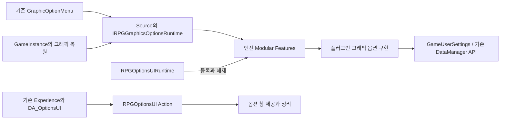

# GameFeature / Experience 기반

`Source/`의 기존 ExperienceDefinition과 ActionSet을 사용해 새 기능을 월드별로 선택한다.
기존 아이템·인벤토리·장비·스킬·던전·보상·백엔드·보스 행동트리 코드는 변경하지 않는다.
기본 Experience는 비어 있으므로 기존 맵의 시작 흐름은 그대로 실행된다.
현재 DefaultPawnData는 로딩 대상이며 Pawn 교체에는 사용하지 않는다.

## 구성

- `URPGExperienceManagerComponent`: GameState에 기본 부착. 서버의 선택 경로를 복제하고 각 월드가 기능과 에셋을 로드한다.
- `URPGExperienceSettings`: 전역 기본값과 맵별 Experience 선택. 빈 맵 항목은 전역 기본값을 제외한다.
- `RPGClientPresentation`: 첫 독립 GameFeature. 선택한 월드의 클라이언트 GameState에 컴포넌트를 주입해 분할 화면을 비활성화하며 종료 시 이전 설정을 복구한다.
- `DA_ClientPresentation`: 샘플 Experience와 ActionSet. GameFeatureData 자체에는 전역 Action을 넣지 않는다.

## 샘플 에셋

Editor를 닫고 다음 명령을 실행하면 없는 샘플 에셋만 생성한다. 기존 에셋은 저장하지 않는다.

```powershell
& 'D:/UE_5.8/Engine/Binaries/Win64/UnrealEditor-Cmd.exe' 'C:/UE5/Project_RPG/Project_RPG.uproject' '-run=Project_RPGEditor.RPGCreateExperienceAssets' -unattended -nop4 -nosplash -NullRHI
```

- `/RPGClientPresentation/RPGClientPresentation`
- `/Game/System/Experiences/ActionSets/DA_ClientPresentation`
- `/Game/System/Experiences/DA_ClientPresentation`
- `/RPGOptionsUI/RPGOptionsUI`
- `/Game/System/Experiences/ActionSets/DA_OptionsUI`
- `/Game/System/Experiences/DA_ClientPresentationAndOptions`
- `/RPGInputMapping/RPGInputMapping`
- `/RPGInputMapping/Input/IA_OptionsShortcut`
- `/RPGInputMapping/Input/IMC_OptionsShortcut`
- `/Game/System/Experiences/ActionSets/DA_OptionsShortcut`
- `/Game/System/Experiences/DA_ClientPresentationAndOptionsShortcut`
- `/RPGClientUI/RPGClientUI`
- `/Game/System/Experiences/ActionSets/DA_OptionsShortcutHint`
- `/Game/System/Experiences/DA_ClientPresentationAndOptionsHint`

Project Settings > Game > RPG Experiences의 `MapExperiences`에서 맵의 전체 패키지 경로(예: `/Game/Maps/Lobby`)와 Experience를 지정한다.
`DefaultExperience`를 비우면 지정하지 않은 맵은 Experience를 로드하지 않는다.
PIE 맵 접두사는 자동 제거한다.

서버 맵 URL의 `?RPGExperience=RPGExperienceDefinition:DA_ClientPresentation` 또는 Development 빌드의
`-RPGExperience=RPGExperienceDefinition:DA_ClientPresentation` 옵션도 사용할 수 있다.
전체 객체 경로도 허용한다. 클라이언트는 복제된 서버 선택을 따른다.
선택은 월드당 한 번이며 교체할 때는 새 월드로 이동한다.

정의, GameFeature 의존성, 역할별 Client/Server AssetBundle, Action을 순서대로 로드한다.
Action은 월드마다 복제하고, 종료/실패 시 역순으로 정리한다. 비동기 정리와 기능 로딩이 끝날 때까지
필요한 객체와 플러그인 사용 권한을 유지한다. 다른 PIE 월드의 PrimaryAsset은 전역 언로드하지 않는다.
새 기능은 `OnExperienceLoaded` 또는 `CallOrRegisterOnExperienceLoaded`에서 준비를 확인할 수 있다.
실패는 `GetLastError`와 `OnExperienceLoadFailed`로 확인한다. 기본 로드 제한 시간은 60초다.

## 확인 결과 (2026-10-03)

- UE 5.8.1 Project_RPGEditor / Win64 / Development 빌드 통과.
- 샘플 에셋 세 개 생성 완료. 생성 도구 재실행은 오류 0건이며 세 파일의 SHA256이 유지됐다.
- 기본 RPGGameModeBase와 /Engine/Maps/Entry에서 15초 Standalone 실행 완료.
- RPGClientPresentation의 Registered → Active 전환, RPG_PRESENTATION APPLIED, RPG_EXPERIENCE READY 로그 확인.
- 정상 월드 종료 및 프로세스 종료 코드 0 확인.
- 변경 파일의 git diff --check 통과.

재현 명령:

```powershell
& 'D:/UE_5.8/Engine/Binaries/Win64/UnrealEditor-Cmd.exe' 'C:/UE5/Project_RPG/Project_RPG.uproject' '/Engine/Maps/Entry?game=/Script/Project_RPG.RPGGameModeBase' -game -unattended -nop4 -nosplash -NullRHI -nosound -nosteam -seconds=15 '-RPGExperience=RPGExperienceDefinition:DA_ClientPresentation' '-abslog=C:/UE5/Project_RPG/Saved/Logs/RPGExperienceStandalone.log'
```

관련 로그는 Saved/Logs/RPGExperienceFoundationBuild.log,
RPGExperienceAssetVerification.log, RPGExperienceStandalone.log에 있다.
Standalone 실행에는 기존 CommonUI/로딩 화면 설정 및 엔진 Toolset Python 초기화 오류 로그가 함께 있었다.
새 Experience 로딩은 준비 완료까지 진행됐으므로 전체 게임의 오류 0건 실행을 검증한 결과로 해석하지 않는다.

다중 클라이언트 PIE, 늦은 접속, 맵 이동 중 로딩/비동기 Action 정리, 패키징은 아직 실행 검증하지 않았다.

## 구성 검사와 종료 진단 (2026-10-04)

Experience와 ActionSet의 에디터 데이터 검사에서 다음 구성을 확인한다.

- 비어 있거나 앞뒤 공백이 있는 GameFeature 이름: 오류.
- 현재 GameFeaturesSubsystem에 등록되지 않은 플러그인 이름: 오류.
- 같은 목록에 반복된 GameFeature 이름: 경고. 런타임은 같은 플러그인을 한 번 로드한다.
- Experience의 비어 있는 ActionSet 또는 반복된 ActionSet: 오류.
- 포함한 ActionSet의 Action·의존성 오류: 상위 Experience 검사에도 반영.

콘텐츠 브라우저에서 해당 Experience 또는 ActionSet을 선택하고 데이터 검사(Validate Assets)를 실행한다.
등록 여부 검사는 플러그인을 활성화하거나 에셋을 저장하지 않는다.
반복된 ActionSet은 런타임에서도 로딩 실패로 처리해 같은 기능을 두 번 주입하지 않는다.

`GetSelectedExperiencePath`로 서버가 선택한 정의 경로를 조회할 수 있다.
Experience 준비·종료 로그에는 월드 이름과 세션 GUID가 함께 기록된다.

| 로그 | 의미 |
| --- | --- |
| `RPG_EXPERIENCE READY` | 해당 월드의 기능과 Action 활성화 완료. NetMode와 선택 경로 포함 |
| `RPG_EXPERIENCE END` | 종료 시작. 남은 플러그인 요청과 활성화한 Action 수 포함 |
| `RPG_EXPERIENCE ACTIONS_RELEASED` | 비동기 정리 대기 후 Action 언로드·등록 해제 완료 |
| `RPG_EXPERIENCE OWNERSHIP_RELEASED` | 해당 세션의 플러그인 참조와 에셋 보유 해제 완료 |
| `RPG_PRESENTATION RELEASED` | 해당 월드의 뷰포트 사용 요청 제거. 남은 요청 수와 분할 화면 설정 포함 |

`OWNERSHIP_RELEASED`는 해당 세션의 소유권 해제를 뜻한다.
다른 월드가 사용하는 공유 플러그인의 비활성화를 뜻하지 않는다.

기존 `URPGGameFeaturePolicy`의 로딩 모드는 UE 기본 정책에 위임하도록 수정했다.
전용 서버는 Server 데이터, 클라이언트 전용 빌드는 Client 데이터를 로드하며 Editor·Listen Server는 양쪽을 지원한다.
현재 프로젝트 설정에 이 사용자 정책을 새로 지정하지는 않았다.

이번 추가 변경은 UE 5.8.1 Project_RPGEditor / Win64 / Development 빌드와 변경 파일의 git diff --check를 통과했다.
빌드 로그: Saved/Logs/RPGExperienceCompositionBuild.log.
이번 추가 변경에 대한 에디터 데이터 검사 실행·PIE·네트워크 실행 검증은 수행하지 않았다.

## 옵션 UI GameFeature (2026-10-04)

`RPGOptionsUI`는 옵션 창의 생성·보유·정리를 Experience 수명주기로 옮긴다.
기존 `ARPGHUD::OptionMenuWidgetClass`와 옵션 위젯 BP, 옵션 열기·닫기 API를 사용한다.
플러그인은 Project_RPG에 의존하며 Project_RPG는 플러그인에 의존하지 않는다.
기존 reflected 타입과 옵션 에셋 경로는 이동하지 않았다.

- `DA_OptionsUI`: RPGOptionsUI 의존성과 월드 범위 Action 한 개.
- `DA_ClientPresentationAndOptions`: 분할 화면 설정과 옵션 UI ActionSet을 함께 사용하는 구성 예시.
- `UGameFeatureAction_RPGOptionsUI`: 선택한 월드의 현재 HUD와 이후 생성되는 HUD에 컴포넌트 부착.
- `URPGOptionsMenuComponent`: 로컬 플레이어의 옵션 창을 보유하며 이미 생성된 창은 재사용.
- 같은 HUD에 여러 Action이 적용되면 참조 수를 세어 마지막 사용 요청이 끝날 때 컴포넌트를 제거.
- 전용 서버에서 적용하지 않으며 HUD가 종료되는 경우 창을 다시 만들지 않음.
- 살아 있는 HUD에서 기능이 해제되면 기본 옵션 창 생성 경로로 복귀.

HUD 전체를 ModularGameplay 수신자로 등록하지 않는다.
현재 활성화된 다른 GameFeature의 HUD Action이 이 변경으로 함께 실행되는 것을 피하도록
새 Action이 해당 월드의 HUD 생성 이벤트를 직접 구독한다.

맵의 GameMode가 `ARPGHUD` 또는 그 파생 HUD를 사용하고,
HUD의 `OptionMenuWidgetClass`가 설정돼 있어야 옵션 창을 제공할 수 있다.
기존 맵의 Experience 설정을 새 샘플로 자동 변경하지 않는다.
옵션을 적용할 맵의 MapExperiences에서 `DA_ClientPresentationAndOptions`를 선택하거나,
자체 Experience에 `DA_OptionsUI`를 추가한다.

`RPG_OPTIONS APPLIED` 로그의 World·HUD·Widget·Reused 값으로 적용 대상을 확인할 수 있다.
`RPG_OPTIONS RELEASED`는 해당 HUD의 옵션 창 보유 해제를 기록한다.

### 구현 및 에셋 생성 결과

- UE 5.8.1 Project_RPGEditor / Win64 / Development 빌드 완료, 종료 코드 0.
- 새 GameFeatureData·ActionSet·조합 Experience 세 파일 생성 완료.
- 생성 도구 재실행은 오류 0건, 종료 코드 0. RPGOptionsUI의 Registered 상태 확인.
- 기존 샘플 세 파일과 새 샘플 세 파일은 생성 도구 재실행 전후 SHA256이 유지됨.
- HUD 변경 파일의 git diff --check 통과.
- 이번 단계에서 옵션 UI의 PIE·네트워크·화면 표시 실행은 수행하지 않음.

첫 생성 실행은 GameFeatureData를 만들기 전 시작 과정에서 누락 오류 세 건을 기록했고 종료 코드 1이었다.
에셋 생성 후 재실행에서는 정상 등록됐다. 재실행의 기존 경고 세 건은
플랫폼 파일 저널, 기존 BT_Guardian 에셋, 기존 Python enum 이름에 관한 것이다.

빌드 도중 다른 Unreal 실행 프로세스의 DLL 잠금으로 LNK1104가 한 번 발생했고,
실행 중인 프로세스를 종료하지 않은 상태에서 재시도해 최종 빌드를 완료했다.

로그:

- Saved/Logs/RPGOptionsUIBuild.log
- Saved/Logs/RPGOptionsUIAssets.log
- Saved/Logs/RPGOptionsUIAssetsRegistration.log

## 추가 입력 매핑 GameFeature (2026-10-04)

`RPGInputMapping`은 선택한 월드의 로컬 플레이어에 추가 InputMappingContext를 적용한다.
Project_RPG에 의존하지 않고 GameFeatures와 EnhancedInput을 사용한다.

- `UGameFeatureAction_RPGInputMapping`: 현재 월드와 이후 시작하는 대상 월드만 처리.
- Client AssetBundle에 매핑 경로를 포함해 Experience의 에셋 로딩을 사용.
- 매핑은 `CountRegistrations`가 설정된 전용 IMC만 허용하며 에디터 데이터 검사에서도 확인.
- 같은 IMC를 여러 Action/월드가 등록하면 엔진이 등록 횟수를 관리. 해제할 때 자신의 등록 한 건만 제거.
- 이미 등록된 IMC와 요청 우선순위가 다르면 해당 요청을 건너뛰며 기존 우선순위를 유지.
- 각 대상 월드에서 0.25초 간격으로 로컬 플레이어와 PlayerInput 준비 상태를 확인.
  이후 로컬 플레이어 추가·제거와 Controller 교체도 처리하며 정리 시 타이머와 월드 이벤트를 제거.
- 이전 PlayerInput의 등록을 새 Controller의 PlayerInput에서 해제하지 않도록 객체 정체성을 확인.
- 기존 코어의 AddInputContextMapping Action과 기본·전투 매핑은 변경하지 않음.
- EnhancedInput 사용자 설정에 등록하지 않으며 기존 키 변경/저장 흐름은 재사용하거나 변경하지 않음.

### 옵션 단축키 구성

`RPGOptionsUI` Action에 선택적인 `ToggleInputAction`을 추가했다.
옵션 컴포넌트는 별도 EnhancedInputComponent를 로컬 Controller 입력 스택에 올리고
Started 이벤트로 기존 HUD의 옵션 열기·닫기 API를 호출한다.
여러 Action이 같은 옵션 컴포넌트를 사용하면 InputAction별 참조도 관리하며,
마지막 단축키 사용 요청이 끝날 때 바인딩과 입력 컴포넌트를 제거한다.

새 샘플은 다음과 같다.

- `/RPGInputMapping/RPGInputMapping`: GameFeatureData.
- `/RPGInputMapping/Input/IA_OptionsShortcut`: 전용 Boolean InputAction.
- `/RPGInputMapping/Input/IMC_OptionsShortcut`: F10 한 개의 추가 매핑, CountRegistrations.
- `/Game/System/Experiences/ActionSets/DA_OptionsShortcut`: 추가 매핑과 옵션 창 관리 Action을 함께 구성.
- `/Game/System/Experiences/DA_ClientPresentationAndOptionsShortcut`: 화면 설정과 옵션 단축키의 조합 예시.

기존 샘플 에셋은 보존하고 기존 맵 설정은 자동 변경하지 않는다.
ARPGHUD 계열 HUD와 OptionMenuWidgetClass가 설정된 맵에서 새 Experience를 선택하면
F10 단축키를 사용할 수 있는 구성이다. 기존 옵션 UI Action은 ToggleInputAction이 비어 있어
추가 입력 바인딩 없이 이전 동작을 유지한다.
새 단축키는 기존 키 변경 화면에 자동 노출되지 않는다.

로그 `RPG_INPUT APPLIED`, `RPG_INPUT RELEASED`로 월드·로컬 플레이어·매핑 적용과 해제를 확인한다.
RELEASED의 Remaining은 해당 매핑이 아직 적용돼 있는지 나타내는 값(0/1)이며 등록 횟수가 아니다.
매핑 설정 오류와 우선순위 충돌은 `RPG_INPUT SKIPPED`로 기록한다.

### 구현 및 생성 결과

- UE 5.8.1 Project_RPGEditor / Win64 / Development 빌드 성공, 종료 코드 0.
- 새 GameFeatureData·InputAction·InputMappingContext·ActionSet·Experience 다섯 파일 생성 완료.
- 생성 도구 재실행에서 RPGInputMapping의 Registered 상태 확인. 종료 코드 0, 오류 요약 0건.
- 기존 여섯 샘플 파일의 SHA256은 이번 생성 전후 동일.
- 새 샘플을 포함한 열한 파일 모두 생성 도구 재실행 전후 SHA256 유지.
- 추적 중인 이번 변경 파일의 git diff --check 통과.
- 테스트 코드 추가, PIE, 실제 F10 조작, 네트워크·맵 이동 실행은 수행하지 않음.

첫 생성 실행은 GameFeatureData가 아직 없었던 시작 과정에서 누락 오류 세 건을 기록했고
종료 코드 1이었다. 다섯 에셋 생성 후 재실행에서는 정상 등록됐다.
재실행의 경고 요약 세 건은 플랫폼 파일 저널, 기존 BT_Guardian 에셋,
기존 Python enum 이름에 관한 것이다. 종료 과정에는 기존 UIExtensionSubsystem의
AddReferencedObjects 관련 경고도 기록됐다.

로그:

- Saved/Logs/RPGInputMappingBuild.log
- Saved/Logs/RPGInputMappingAssets.log
- Saved/Logs/RPGInputMappingAssetsRegistration.log

## 추가 클라이언트 위젯 GameFeature (2026-10-05)

`RPGClientUI`는 Experience에서 지정한 추가 위젯의 생성·보유·제거를 관리한다.
코어 Project_RPG와 CommonUI 레이어에 의존하지 않고 Engine의 AHUD·UMG·GameFeatures를 사용한다.

- `UGameFeatureAction_RPGClientWidgets`: 선택한 월드의 기존 HUD와 이후 생성되는 HUD에 적용.
- `URPGClientUIWidgetComponent`: 로컬 플레이어별로 위젯을 생성하고 AddToPlayerScreen으로 표시.
- 전용 서버에는 적용하지 않으며 위젯 클래스는 Client AssetBundle로 로드.
- WidgetId·WidgetClass·ZOrder·마우스 hit test 제외 여부를 Action 데이터에서 지정.
- 같은 HUD에서 같은 ID와 설정을 사용하는 요청은 위젯 한 개를 공유하며 참조 수를 관리.
- 같은 ID에 다른 클래스·ZOrder·입력 설정을 요청하면 기존 구성을 유지하고 해당 요청을 거부.
- 마지막 요청 해제 또는 HUD 종료 시 해당 위젯을 제거. World/Actor 이벤트도 종료 시 해제.
- Native 위젯 초기화 중 기능이 해제되는 경우를 고려해 정리할 소유권을 먼저 기록하고 생성 뒤 재확인.
- 기존 HUD가 만든 위젯과 기존 AddWidgets Action, CommonUI/MVVM 구현은 변경하지 않음.

에디터 데이터 검사는 빈/중복 WidgetId, 누락된 클래스, 추상/폐기 클래스 구성을 확인한다.
데이터 검사와 클래스 로딩은 기능을 활성화하거나 에셋을 저장하지 않는다.
현재 구현은 HUD의 로컬 Controller와 PlayerScreen이 준비된 상태에서 사용하며,
화면 추가 실패에 대한 주기적인 재시도는 수행하지 않는다.

### 옵션 단축키 안내 샘플

RPGOptionsUI에 네이티브 `URPGOptionsShortcutHint` 위젯을 추가했다.
뷰포트 오른쪽 아래에 `F10  옵션`을 표시하며, 옵션 컴포넌트의 단축키 바인딩이 있는 동안만 보인다.
이 위젯은 입력 포커스와 마우스 hit test를 받지 않는다.
F10 전용 샘플 안내이므로 다른 키를 사용하는 구성에서는 해당 안내 클래스를 교체한다.

- `/RPGClientUI/RPGClientUI`: 전역 Action이 없는 GameFeatureData.
- `/Game/System/Experiences/ActionSets/DA_OptionsShortcutHint`: 추가 위젯 Action 한 개.
- `/Game/System/Experiences/DA_ClientPresentationAndOptionsHint`:
  기존 화면 설정·옵션 단축키 ActionSet과 새 안내 ActionSet의 조합.

기존 ARPGHUD와 OptionMenuWidgetClass가 설정된 맵에서 조합 Experience를 선택해 사용한다.
일반적인 추가 위젯 Action은 AHUD 파생 HUD에서 사용할 수 있으며,
옵션 창 샘플은 기존 옵션 UI의 ARPGHUD 조건을 함께 충족해야 한다.
이번 생성 도구 확장은 기존 열한 샘플 에셋을 저장하지 않는다.

`RPG_CLIENT_UI APPLIED`와 `RPG_CLIENT_UI RELEASED`에서 World·HUD·WidgetId와 보유 해제를 확인한다.
구성 충돌과 유효하지 않은 요청은 `RPG_CLIENT_UI SKIPPED`로 기록한다.

### 구현 및 에셋 생성 결과

- UE 5.8.1 RPGClientUIRuntime 독립 모듈 빌드 성공, 종료 코드 0.
- 전체 Project_RPGEditor / Win64 / Development 최종 빌드 성공, 종료 코드 0.
- 새 GameFeatureData·안내 ActionSet·조합 Experience 세 파일 생성 완료.
- 생성 도구 재실행에서 RPGClientUI의 Registered 상태 확인. 종료 코드 0, 오류 요약 0건.
- 기존 열한 샘플 에셋은 생성 전후 SHA256이 동일.
- 새 샘플을 포함한 열네 파일 모두 생성 도구 재실행 전후 SHA256 유지.
- 이번 변경 소스의 공백 오류 검사 완료.
- 테스트 코드 추가·실제 안내 표시·F10 조작·입력 투명성·다중 클라이언트·맵 이동 실행은 수행하지 않음.

첫 생성 실행은 GameFeatureData가 아직 없었던 시작 과정에서 누락 오류 세 건을 기록했고
종료 코드 1이었다. 세 에셋 생성 후 재실행에서는 정상 등록됐다.
재실행의 경고 요약 세 건은 플랫폼 파일 저널, 기존 BT_Guardian 에셋,
기존 Python enum 이름에 관한 것이다. 종료 과정에는 기존 UIExtensionSubsystem의
AddReferencedObjects 관련 경고도 기록됐다.

초기 컴파일에서 안내 위젯의 SOverlay 헤더 경로 오류를 수정했다.
이후 실행 중인 에디터의 DLL 잠금(LNK1104)으로 최종 연결을 대기했으며,
에디터가 닫힌 뒤 전체 빌드와 에셋 생성을 완료했다.
사용자가 실행한 프로세스를 종료하거나 미저장 작업을 변경하지 않았다.
기존 맵의 Experience 설정과 기본 Experience는 변경하지 않았다.

로그:

- Saved/Logs/RPGClientUIBuild.log
- Saved/Logs/RPGClientUIModulesBuild.log
- Saved/Logs/RPGClientUIIndependentBuild.log
- Saved/Logs/RPGClientUIFinalBuild.log
- Saved/Logs/RPGClientUIAssets.log
- Saved/Logs/RPGClientUIAssetsRegistration.log

## 맵에 저장하는 Experience 선택 (2026-10-05)

`ARPGExperienceSelectionActor`를 맵에 배치하면 그 맵에서 사용할 Experience를
맵 데이터에 저장할 수 있다. 중앙 MapExperiences 목록을 사용하던 선택 경로에도
이 액터를 추가해 읽으며, 액터가 없는 맵은 기존 프로젝트 설정을 따른다.

### 사용 방법

1. Experience를 적용할 맵에서 Persistent Level을 현재 레벨로 선택한다.
2. 액터 배치 목록에서 `RPG Experience Selection`을 찾아 한 개 배치한다.
3. `Enabled`를 켜고 `Selection Mode`를 `LoadExperience`로 지정한다.
4. `Experience`에 사용할 정의를 지정한다. 예: `DA_ClientPresentationAndOptionsHint`.
5. 에디터 Map Check에서 구성 오류를 확인한 뒤 맵을 저장한다.

해당 맵의 GameState에는 `URPGExperienceManagerComponent`가 있어야 한다.
`ARPGGameStateBase`와 파생 GameState에는 이미 기본 부착돼 있다.
옵션 창 샘플의 ARPGHUD·OptionMenuWidgetClass 조건도 함께 충족해야 한다.
선택할 Experience는 AssetManager의 스캔 경로 또는 SpecificAssets에 포함해
배포 빌드에서도 찾을 수 있도록 구성한다.

### 선택 우선순위

서버가 자동 선택할 때 아래 순서에서 먼저 지정된 구성을 사용한다.

| 순서 | 선택 위치 |
| --- | --- |
| 1 | 맵 URL의 `?RPGExperience=` |
| 2 | Shipping 이외 실행의 `-RPGExperience=` |
| 3 | Persistent Level의 활성 선택 액터 |
| 4 | Project Settings의 `MapExperiences` 항목 |
| 5 | Project Settings의 `DefaultExperience` |

- `Enabled = false`: 해당 액터를 제외하며 프로젝트 설정을 사용할 수 있다.
- `DisableExperience`: 이 맵의 자동 로딩에서 MapExperiences와 DefaultExperience를 제외한다.
  명시적인 URL/실행 옵션은 계속 우선한다. 나중에 호출하는 명시적 SetExperience API를 막지는 않는다.
- 활성 액터 두 개: 같은 Experience를 선택해도 구성 오류로 처리한다.
- 활성 액터가 로드된 서브레벨에 있음: Persistent Level 배치 오류로 처리한다.
- LoadExperience인데 참조가 비어 있거나 경로가 잘못됨: 기본값으로 넘어가지 않고 실패한다.
- 경로가 있지만 에셋이 없거나 타입이 잘못됨: 기존 비동기 로딩 경로에서 실패한다.

`TryResolveForWorld`가 선택 경로와 오류를 함께 반환하며,
ExperienceManager는 오류를 Failed 상태·GetLastError·OnExperienceLoadFailed에 반영한다.
기존 `ResolveForWorld` API도 유지하며 선택 오류에서는 경고와 빈 경로를 반환한다.
자동 로딩을 하지 않는 경우에는 기존과 같이 Unassigned 상태를 유지한다.

### 배치와 구성 검사

선택 액터는 AInfo 기반의 설정 객체로, 틱·충돌·복제를 사용하지 않는다.
서버만 선택 액터를 사용하고 클라이언트는 기존 GameState의 선택 경로 복제를 따른다.
AInfo의 항상 로드되는 설정을 사용하며 Level Instance로 불러오는 액터로 사용하지 않는다.
선택은 GameState BeginPlay 시 한 번 읽는다. 이후 스트리밍되거나 동적으로 생성한
선택 액터로 현재 Experience를 교체하지 않는다.

액터의 IsDataValid와 CheckForErrors를 구현했다. 에디터 Map Check는
중복 활성 액터·Persistent Level 배치·선택 모드·에셋 참조를 확인하고,
선택한 Experience의 Action·ActionSet·GameFeature 구성 검사도 함께 호출한다.
구성 검사는 기능을 활성화하거나 에셋을 저장하지 않는다.

`RPG_EXPERIENCE MAP_SELECTION` 로그에는 World·Actor·Mode·Definition이 기록된다.
로딩 완료는 기존 READY 로그로 확인한다.

### 구현 결과

- UE 5.8.1 Project_RPGEditor / Win64 / Development 빌드 성공, 종료 코드 0.
- 새 선택 액터의 UHT 생성 파일과 컴파일된 객체 파일 생성 확인.
- ExperienceManager의 변경은 자동 선택의 결과·오류를 전달받는 부분에 한정.
- 변경 소스의 공백 오류 검사 완료.
- 기존 열네 샘플 에셋은 이전 단계 완료 시점과 SHA256이 동일.
- 기존 맵·기본 Experience 설정·GameMode·GameState 구성을 자동 변경하지 않음.
- 테스트 코드 추가, Map Check 실행, PIE, 실제 맵 선택·멀티플레이·World Partition 실행은 수행하지 않음.

빌드 로그: Saved/Logs/RPGExperienceMapSelectionBuild.log.

## Experience 준비를 기다리는 Blueprint 노드 (2026-10-05)

`URPGAsyncAction_WaitForExperienceReady`는 호출한 월드의 Experience 준비를 기다리는
일회성 비동기 노드다. Blueprint에서 `Wait For RPG Experience Ready`로 검색한다.
GameFeature 에셋과 Action이 준비된 뒤 시작해야 하는 UI 초기화 등에 사용할 수 있다.

### 결과와 사용 방법

| 실행 핀 | Experience | Reason |
| --- | --- | --- |
| Ready | 로딩된 정의 | 빈 문자열 |
| Failed | null | 로딩 실패, 매니저 누락 또는 대기 시간 초과 |
| Cancelled | null | 기다리던 월드 또는 매니저 종료 |

1. 사용할 액터나 위젯의 초기화 흐름에 노드를 추가한다.
2. Ready에 준비 이후의 초기화, Failed에 실패 처리를 연결한다.
3. Cancelled에서는 해당 월드의 종료를 처리한다.
4. 노드의 AsyncAction 핀을 보관하면 호출자 종료 시 상속된 Cancel을 호출할 수 있다.

명시적인 Cancel은 UCancellableAsyncAction의 규칙에 따라 결과 핀을 실행하지 않는다.
현재 대기자의 구독·타이머·GameInstance 등록만 해제한다.
Experience 선택·로딩·플러그인 소유권 또는 다른 대기자를 취소하지 않는다.
노드를 호출한 UI/액터가 먼저 종료되면 보관한 AsyncAction을 Cancel한다.

### 준비 시점과 클라이언트 처리

- 결과 이벤트를 구독한 뒤 매니저의 현재 상태를 확인한다.
- 이미 Loaded이면 Activate에서 즉시 Ready, 이미 Failed이면 즉시 Failed를 전달한다.
- GameState가 아직 없으면 해당 월드의 GameStateSetEvent를 기다린다.
- GameState가 있지만 RPGExperienceManagerComponent가 없으면 Failed를 전달한다.
- Unassigned/Loading이면 기존 매니저의 완료·실패 알림을 기다린다.
- 클라이언트에서는 선택 경로 복제와 이후의 로딩을 기다리며 직접 선택하지 않는다.
- 다른 PIE 월드의 GameState와 종료 이벤트는 처리하지 않는다.
- 현재 월드나 매니저가 종료되면 대기를 정리한다. 새 월드로 대기를 넘기지 않는다.

Ready는 기존 ExperienceManager의 Loaded 상태를 뜻한다.
Pawn 생성, HUD 생성 또는 화면에 위젯이 실제 표시됐음을 보장하는 신호는 아니다.
준비 이후 사용할 Controller/HUD/Pawn은 호출하는 기능에서 별도로 확인한다.

### 제한 시간과 호출 조건

TimeoutSeconds의 기본값은 65초이며 Activate부터 월드 타이머 시간으로 계산한다.
GameState 도착·서버 선택 복제·Experience 로딩 대기를 모두 포함한다.
유한한 양수만 허용하며 잘못된 값은 Activate에서 Failed로 전달한다.
매니저의 LoadTimeoutSeconds 설정은 변경하지 않는다.
그 설정이 길면 대기 노드의 TimeoutSeconds도 호출하는 기능에서 함께 조정한다.

선택되지 않았거나 DisableExperience인 맵에서는 Ready를 보내지 않는다.
클라이언트의 선택 복제 대기와 구분하지 않고 대기 제한 시간 후 Failed로 끝난다.
GameInstance가 있는 실제 게임 월드에서 호출해야 하며, 잘못된 WorldContext에서는
팩터리가 null을 반환하고 Blueprint 실행 오류를 기록한다.

C++에서는 팩터리 반환값을 확인하고 Ready/Failed/Cancelled 델리게이트를 연결한 다음
Activate를 호출한다. 이미 준비된 결과는 Activate 안에서 동기적으로 전달될 수 있다.

### 정리와 변경 범위

결과는 한 번만 전달한다. 결과 전달 전에 매니저·GameState·월드 이벤트와 타이머를 해제하고,
Blueprint 콜백이 끝난 뒤 GameInstance 등록을 해제한다.
콜백 안에서 Cancel 또는 GC를 호출하더라도 프록시와 결과 정의를 유지하도록
일시적인 강한 참조를 사용한다. GC 중에는 Blueprint 결과를 전달하지 않고 정리한다.

ExperienceManager에는 C++용 OnExperienceEnded 알림을 추가했다.
이 알림은 컴포넌트 EndPlay에서 발생하며, 비동기 GameFeature 정리가 모두 끝났다는 뜻은 아니다.
플러그인 소유권 해제 완료는 기존 OWNERSHIP_RELEASED 로그로 확인한다.
기존 OnExperienceLoaded/OnExperienceLoadFailed/CallOrRegisterOnExperienceLoaded API는 유지한다.

이번 단계는 새 비동기 노드 두 파일과 매니저의 종료 알림에 한정된다.
기존 맵·Experience 에셋·GameMode·GameState·RPG 기능의 초기화 흐름을 자동 연결하지 않았다.

### 구현 결과

- 새 노드의 UHT 생성 파일과 C++ 컴파일 완료.
- UE 5.8.1 Project_RPGEditor / Win64 / Development 최종 빌드 성공, 종료 코드 0.
- 변경 소스의 공백 오류 검사 완료.
- 테스트 코드 추가, Blueprint 실행, 실제 완료/실패/취소·시간 초과·GC·멀티플레이·맵 이동 실행은 수행하지 않음.

첫 전체 빌드는 병행 작업 중인 RPGPlayerWeaponLoadoutComponent의 UInputMappingContext 관련
C2679 컴파일 오류로 중단됐다. 해당 파일은 수정하지 않았다.
현재 작업 상태를 반영해 재실행한 최종 빌드는 성공했다.

로그:

- Saved/Logs/RPGExperienceWaitBuild.log
- Saved/Logs/RPGExperienceWaitFinalBuild.log

## Experience 준비 대기 Blueprint 예제 (2026-10-06)

에디터에서 새 비동기 노드를 사용할 수 있는 예제를 추가했다.

- 에셋: `/Game/System/Experiences/Examples/BP_ExperienceReadyExample`
- 부모: `Actor`. Tick과 액터 복제는 사용하지 않는다.
- 그래프 원본: `Docs/Examples/BP_ExperienceReadyExample.dsl`
- 새 예제는 기존 맵에 배치하지 않았다. Experience 설정이나 RPG 기능의 시작 흐름을 변경하지 않는다.

### 연결한 흐름

1. BeginPlay에서 `Wait For RPG Experience Ready`를 호출한다.
2. Ready에서 정의를 저장하고 `bExperienceReady`를 true로 만든 뒤 `OnExperienceReady`를 알린다.
3. Failed/Cancelled에서 정의를 비우고 이유를 저장한 뒤 각각 `OnExperienceFailed`/`OnExperienceCancelled`를 알린다.
4. 모든 결과에서 `bWaitFinished`를 true로 만들고 `PendingWait` 참조를 비운다.
5. 즉시 이어지는 then에서는 아직 완료되지 않았을 때만 대기 객체를 보관한다.
6. EndPlay에서는 `bWaitFinished`를 true로 만들고, 보관한 대기가 유효하면 Cancel을 호출한 후 참조를 비운다.

UE의 비동기 노드는 Activate 이후 then을 실행한다. 이미 Loaded/Failed인 Experience는
Activate 안에서 결과를 동기적으로 전달할 수 있다. 예제의 `bWaitFinished` 분기는
그 결과가 끝난 다음 then에서 완료된 대기 객체를 다시 보관하는 것을 방지한다.

### 변수와 알림

| 이름 | 타입 / 기본값 | 용도 |
| --- | --- | --- |
| WaitTimeout | float / 65 | 배치한 액터에서 조정할 수 있는 대기 제한 시간 |
| bExperienceReady | bool / false | Ready를 받은 뒤 true |
| bWaitFinished | bool / false | 결과 또는 액터 종료 후 true |
| ReadyExperience | RPGExperienceDefinition 참조 / null | Ready에서 받은 정의 |
| LastReason | string / 빈 값 | 실패 또는 월드 종료 이유 |
| PendingWait | RPGAsyncAction_WaitForExperienceReady 참조 / null | 액터 종료 시 취소할 대기 객체 |

`OnExperienceReady`, `OnExperienceFailed`, `OnExperienceCancelled`는 인자 없는 Event Dispatcher다.
수신자는 해당 알림 시점에 예제의 변수에서 정의와 이유를 읽는다.
명시적인 EndPlay의 Cancel은 결과 알림을 보내지 않는다.

에디터 노드의 취소용 출력은 표시 메타데이터상 AsyncAction이며,
그래프 API에서 확인한 내부 핀 이름은 `AsyncTaskProxy`다.
DSL은 내부 핀 이름에 따른 `_asynctaskproxy`를 사용한다.
나머지 결과 핀은 Ready/Failed/Cancelled와 Experience/Reason이다.

### 적용 방법

1. 별도 작업용 맵에 `RPG Experience Selection` 액터를 배치하고 Experience를 지정한다.
2. 그 맵의 GameState가 `RPGExperienceManagerComponent`를 포함하는지 확인한다.
3. 같은 맵에 `BP_ExperienceReadyExample`을 배치하거나 이 그래프를 필요한 소비자에 옮긴다.
4. 소비자는 Ready 이후 초기화를 연결하고 실패/종료 처리를 연결한다.

알림을 구독하는 소비자는 예제보다 늦게 시작할 수 있다. 먼저 알림을 구독한 뒤
`bWaitFinished`와 결과 변수를 확인하거나, 소비자 자신의 초기화에서 원래 대기 노드를 직접 호출한다.
Ready는 Experience와 Feature Action의 준비만 의미한다. HUD/Pawn/위젯 존재는 별도로 확인한다.
예제 자체는 Experience를 선택하거나 플러그인을 활성화하지 않는다.
Experience가 없는 맵에서는 기존 대기 노드 규칙대로 제한 시간 뒤 Failed가 발생한다.

DSL 파일은 EventGraph 연결 원본이다. 빈 Blueprint를 재구성할 때는 위 여섯 변수와
세 Event Dispatcher를 먼저 추가하고, WaitTimeout 기본값을 65로 설정해야 한다.

### 구현 결과와 확인 범위

- 에디터에서 새 native 비동기 클래스와 노드의 핀을 확인했다.
- 예제의 Blueprint 컴파일은 경고를 오류로 취급하는 설정으로 완료했다.
- 새 에셋 하나만 저장했다. 기본 생성된 미연결 Tick/Overlap 이벤트는 제거했으며 Tick은 비활성 상태다.
- 기존 14개 Experience/ActionSet/입력/GameFeature 에셋은 작업 시작 시점과 파일 해시가 동일하다.
- 소스 변경, 기존 맵 저장, 전역 설정 변경, 실행 중이던 PIE 종료 명령은 수행하지 않았다.
- 예제의 PIE 실행, UI/F10 입력, 실패/취소/시간 초과 실행은 이번 단계에서 확인하지 않았다.

## Experience 선택과 종료 흐름 실행 확인 (2026-10-09)

실제 실행에서 ExperienceManager의 URL 선택 오류를 재현하고 수정했다.
전체 맵 URL을 `UGameplayStatics::ParseOption`으로 읽으면 맵 경로 때문에 옵션을 읽지 못했다.
이후 명령줄 파싱이 URL 안의 RPGExperience를 먼저 찾아, 뒤의 game 옵션까지 에셋 이름에 포함했다.

이제 `FURL::GetOption`으로 파싱된 URL 옵션을 직접 읽는다. 개발용 명령줄 선택은
명시적인 `-RPGExperience=` 옵션만 읽도록 했다. URL → 명령줄 → 맵 선택 → 프로젝트 설정 순서는 유지한다.

### 실행용 에셋과 도구

- `/Game/System/Experiences/Examples/BP_ExperienceSandboxGameMode`: 엔진 GameModeBase의 자식.
  엔진 PlayerController/PlayerState/HUD와 SpectatorPawn을 사용하며, GameState만 RPGGameStateBase로 지정한다.
- `/Game/System/Experiences/Examples/Maps/L_ExperienceLoad`: 힌트까지 포함한 Experience를 선택.
- `/Game/System/Experiences/Examples/Maps/L_ExperienceDisabled`: 프로젝트 기본 Experience 자동 선택을 억제.
- `/Game/System/Experiences/Examples/Maps/L_ExperienceDuplicate`: 중복 선택 오류를 확인하기 위한 의도적인 잘못된 구성.
- `Scripts/Editor/CreateExperienceSandbox.py`: 위 네 에셋이 없을 때만 생성. 이미 있으면 구성 확인 후 파일을 유지.
- `Scripts/Tests/Run-ExperienceLifecycleSmokeTest.ps1`: 별도 UnrealEditor-Cmd 프로세스를 실행하고 Report.json을 작성.

검증 맵에는 RPG 기능 액터를 배치하지 않았다. 현재 에디터의 PIE를 시작하거나 중단하는 명령은 사용하지 않는다.
실행 도구는 자신이 생성한 프로세스만 제한 시간 뒤 종료할 수 있다.
아이템·인벤토리·장비·스킬·던전·보상·백엔드·보스 행동트리 소스는 이 작업에서 수정하지 않았다.

### 실행 결과

UE 5.8.1 / Project_RPGEditor / Win64 / Development 별도 복사본 빌드 성공, 종료 코드 0.
다음 일곱 시나리오가 모두 통과했다.

| 시나리오 | 확인 내용 | 결과 |
| --- | --- | --- |
| MapSelection | 맵 액터 선택, 네 플러그인 활성화, 네 Action 준비와 종료 소유권 해제 | 통과 |
| URLPrecedence | URL의 Presentation 선택이 명령줄/맵의 Hint 선택보다 우선 | 통과 |
| GlobalDefaultSelection | 선택 액터가 없는 Entry 맵에서 프로젝트 기본값이 실제 로드됨 | 통과 |
| DisabledSelection | 프로젝트 기본값이 있어도 선택 비활성 맵은 Unassigned 유지 | 통과 |
| ExplicitOverride | 명시적인 명령줄 선택은 비활성 맵보다 우선 | 통과 |
| DuplicateSelection | 활성 선택 액터 두 개는 Failed, 기본값으로 자동 대체하지 않음 | 통과 |
| MissingDefinition | 없는 에셋은 Failed, Ready나 플러그인 활성화 없음 | 통과 |

정상 선택은 `READY → END → ACTIONS_RELEASED → OWNERSHIP_RELEASED`를 같은 Session 값과 순서로 확인했다.
Presentation의 공유 참조 수와 입력 매핑 등록 수가 0으로 돌아오고, 힌트 위젯이 제거되는 것도 확인했다.
예상한 실패는 Failed 이유와 Ready/플러그인 활성화가 없음을 함께 확인했다.
최종 실행 전후 기존 19개 Experience/ActionSet/입력/GameFeature/예제 에셋의 SHA256은 동일하다.
기존 검증용 GameMode와 세 맵은 재저장하지 않고 구성만 확인했다.

- 빌드 복사본: `Saved/ExperienceLifecycleBuild-1791494017641`
- 최종 빌드 로그: `Saved/ExperienceLifecycleBuild-1791494017641/BuildResume.log`
- 최종 보고서: `Saved/ExperienceLifecycleBuild-1791494017641/Saved/Logs/ExperienceLifecycle-20261009-140835-0ab7bba3/Report.json`
- 최초 오류 재현 보고서: `Saved/Logs/ExperienceLifecycle-20261008-210711-75b08317/Report.json`

복사본의 Source/Config/플러그인 코드를 고정하고 Content는 원본을 연결해 검증했다.
ExperienceManager 소스는 원본과 복사본의 SHA256이 동일하다.
이번 빌드의 출력 위치는 검증 복사본이며, 이 작업에서 원본 에디터를 종료하거나 원본 DLL을 교체하지 않았다.

### 실행 방법

PowerShell에서 프로젝트 루트 기준:

```powershell
./Scripts/Tests/Run-ExperienceLifecycleSmokeTest.ps1
```

EngineRoot, ProjectRoot, RunSeconds, TimeoutSeconds를 지정할 수 있다.
`-CreateFixturesOnly`는 에셋 구성 확인/생성까지만 수행한다.
프로젝트 복사본을 사용하면 `-ProjectRoot`에 그 복사본의 절대 경로를 지정한다.
검증에는 원래 프로젝트 에디터가 켜져 있을 필요가 없다. 실행할 프로젝트의 모듈은 최신 소스로 빌드돼 있어야 한다.

### 확인 범위와 남은 확인

NullRHI의 독립 실행에서 선택·활성화·월드 종료 정리를 확인했다.
엔진 HUD를 사용하므로 옵션 메뉴의 실제 표시와 F10 입력은 검증하지 않았다.
준비 대기 Blueprint 예제의 결과, 시간 초과, 멀티플레이, 맵 이동도 별도 확인 대상이다.
이번 종료 확인은 프로세스의 월드 종료이며, 같은 프로세스에서 반복 PIE나 맵 이동을 검증한 결과는 아니다.

기존 로딩 화면 위젯 클래스가 지정되지 않아 `CreateWidget called with a null class`와
`Failed to load the loading screen widget` 오류가 각 실행에 남았다.
이 설정은 수정하지 않았으며 보고서의 `OtherErrorLines`에 기록했다.
검증 성공은 위 일곱 시나리오의 성공을 뜻하며, 전체 게임의 Error 로그가 0건이라는 뜻은 아니다.


## Experience 로딩 화면 연동 (2026-10-10)

선택한 Experience가 준비되기 전에 기존 로딩 화면이 내려갈 수 있는 연결 공백을 보완했다.
ExperienceManager가 CommonLoadingScreen의 기존 LoadingProcessTask를 요청하고,
정의·GameFeature·Action 에셋 로딩과 Action 활성화가 끝날 때 요청을 해제한다.

### 요청의 범위와 수명

- 실제 Experience 로딩을 시작할 때만 요청한다. Experience 없는 맵이나 선택 비활성 맵에는 요청하지 않는다.
- 전용 서버에는 요청하지 않는다. 로딩 화면 서브시스템이 없으면 별도 요청 없이 기존 Experience 로딩을 계속한다.
- 준비 완료 시 Ready 알림을 보내기 전에 요청을 해제한다.
- 로딩 실패와 제한 시간 초과는 Stop 경로에서 요청을 해제한다.
- 로딩 도중 GameState/월드가 종료되면 EndPlay → Stop에서 요청을 해제한다.
- 요청 참조는 Transient UPROPERTY로 보유한다. CommonLoadingScreen의 약한 참조만 남아 GC로 요청이 사라지는 것을 막는다.
- 해제 전에 멤버 참조를 비워 중복 Stop/EndPlay에서 같은 요청을 다시 해제하지 않는다.
- Experience 요청만 해제한다. 다른 로딩 요청과 CommonLoadingScreen의 최소 표시 시간은 기존 관리자가 처리한다.

비동기 준비 대기 노드의 Cancel은 대기 노드만 취소한다.
Experience 로딩과 로딩 화면 요청을 취소하는 동작으로 변경하지 않았다.

### 설정

Project Settings → RPG Experiences → Loading에서
`Show Loading Screen While Loading`으로 연동을 끌 수 있다. 기본값은 true다.
프로젝트의 기존 로딩 화면 위젯과 표시 정책을 사용하며 새 위젯이나 에셋은 만들지 않았다.

필요하면 프로젝트 설정에 다음 값을 사용할 수 있다.

```ini
[/Script/Project_RPG.RPGExperienceSettings]
bShowLoadingScreenWhileLoading=False
```

유한한 LoadTimeoutSeconds는 기존처럼 최소 1초로 처리한다.
NaN이나 무한대 값은 60초로 대체해 잘못된 설정 때문에 로딩 대기가 끝나지 않는 경우를 방지한다.

### 진단 로그

| 로그 | 의미 |
| --- | --- |
| `RPG_EXPERIENCE SCREEN_WAIT` | 해당 월드의 Experience 로딩 화면 요청 등록 |
| `RPG_EXPERIENCE SCREEN_RELEASED` | 요청 해제. Reason은 Ready / Failed / WorldEnding |

로그에는 World와 Definition을 함께 남긴다.
SCREEN_RELEASED는 해당 Experience 요청 해제이며, 다른 요청까지 포함한 로딩 화면 숨김 완료를 뜻하지 않는다.

### 변경 범위

- ExperienceManager 헤더/구현: 로딩 요청 생성·보유·해제.
- RPGExperienceSettings: 연동 활성화 설정.
- Project_RPG.Build.cs: CommonLoadingScreen에 대한 private 의존성 추가.
- 기존 reflected 타입 이름과 에셋 경로는 유지했다.
- 아이템·인벤토리·장비·스킬·던전·보상·백엔드·보스 행동트리 소스와 기존 맵은 이 작업에서 변경하지 않았다.

공개 API에 CommonLoadingScreen 인터페이스 상속을 추가하지 않았다.
로딩 요청 타입은 전방 선언하며 구현 파일에서 플러그인 API를 사용한다.

### 확인 결과

- UE 5.8.1 / Project_RPGEditor / Win64 / Development 원본 프로젝트 빌드 성공, 종료 코드 0.
- UHT 생성 코드, C++ 컴파일과 링크 완료. 이번 작업의 빌드 시간은 302.15초였다.
- 변경한 소스 네 파일의 git diff --check 통과.
- 관련 기존 에셋 19개의 작업 전후 SHA256 동일.
- 이번 단계에서는 테스트 코드 추가와 자동화 테스트 실행, PIE 실행을 수행하지 않았다.
- 빌드 로그: `Saved/Logs/RPGExperienceLoadingScreen-20261009-184632/Build.log`
- 변경 기록: `Saved/Logs/RPGExperienceLoadingScreen-20261009-184632/ChangesReport.json`

실제 로딩 화면 표시, 맵 이동, 멀티플레이 실행은 이번 단계에서 확인하지 않았다.
앞 단계의 일곱 시나리오 실행 결과는 2026-10-09 버전에 대한 기록이며 이번 변경의 실행 검증 결과가 아니다.
기존 로딩 화면 위젯 클래스 미지정 오류의 설정은 이번 단계에서 수정하지 않았다.


## Experience 준비 소비자 컴포넌트 (2026-10-10)

`URPGExperienceReadyComponent`를 추가했다. 새 기능 액터의 컴포넌트로 사용하면
기존 비동기 대기 노드의 준비·실패·취소 결과를 컴포넌트 이벤트로 받을 수 있다.
자동 시작, 결과 보관과 종료 정리를 공통 코드로 제공한다.

- 헤더: `Source/Project_RPG/Public/Experience/RPGExperienceReadyComponent.h`
- 구현: `Source/Project_RPG/Private/Experience/RPGExperienceReadyComponent.cpp`
- 재사용하는 노드: `URPGAsyncAction_WaitForExperienceReady`
- 기존 액터와 맵에는 자동으로 부착하지 않았다. 기존 대기 노드와 ExperienceManager 소스도 이 단계에서 수정하지 않았다.
- 아이템·인벤토리·장비·스킬·던전·보상·백엔드·보스 행동트리 소스는 이 단계에서 수정하지 않았다.

### Blueprint 사용

1. 새 기능 액터 Blueprint에 `RPG Experience Ready` 컴포넌트를 추가한다.
2. 컴포넌트의 `OnReady`, `OnFailed`, 필요하면 `OnCancelled` 이벤트를 연결한다.
3. `Auto Wait On Begin Play`를 켜면 컴포넌트 BeginPlay에서 자동으로 대기한다.
4. `Wait Timeout Seconds`는 기본 65초이며 GameState 도착·선택 복제·Experience 준비 대기에 사용된다.
5. OnReady 이후 새 기능의 초기화를 연결한다. HUD/Pawn/위젯 존재는 해당 기능에서 별도로 확인한다.

늦게 결과 이벤트를 연결하는 경우에는 자동 대기를 끄고, 이벤트를 연결한 뒤 `StartWaiting`을 호출한다.
자동 대기 결과를 이미 놓쳤다면 `GetWaitState`, `GetReadyExperience`, `GetLastReason`으로 마지막 결과를 조회할 수 있다.

### C++ 사용

소유자의 생성자에서 컴포넌트를 만들고 자동 대기를 끈다.
소유자 BeginPlay에서 Super 호출 뒤 결과를 연결하고 대기를 시작한다.

```cpp
// Constructor:
ExperienceReady = CreateDefaultSubobject<URPGExperienceReadyComponent>(TEXT("ExperienceReady"));
ExperienceReady->bAutoWaitOnBeginPlay = false;

// Owner BeginPlay, after Super::BeginPlay():
ExperienceReady->OnReady.AddUniqueDynamic(this, &ThisClass::HandleExperienceReady);
ExperienceReady->StartWaiting();
```

예시의 ExperienceReady 멤버는 UPROPERTY로 보관한다.
HandleExperienceReady는 UFUNCTION이며
`void HandleExperienceReady(const URPGExperienceDefinition* Experience, const FString& Reason)` 시그니처를 사용한다.

### 상태와 결과

| 상태 | 의미 |
| --- | --- |
| Idle | 아직 시작하지 않음 |
| Waiting | 이번 대기 진행 중 |
| Ready | 마지막 대기에 성공. 정의 참조 보관 |
| Failed | 마지막 대기 실패. 이유 보관 |
| Cancelled | 대기가 취소됐거나 활성 결과를 컴포넌트 종료 시 정리함 |

StartWaiting은 대기 중, 결과 콜백 중, 등록되지 않은 컴포넌트, BeginPlay 이전,
종료 중인 액터/월드나 게임 월드 밖에서 false를 반환한다.
컴포넌트 자체 Blueprint BeginPlay에서 호출하는 것은 지원한다.
true는 대기 요청을 시작했다는 뜻이며 성공 결과를 뜻하지 않는다.
이미 준비됐거나 실패한 Experience에서는 함수 반환 전에 결과 이벤트가 발생할 수 있다.

대기 객체 보관과 결과 바인딩을 Activate보다 먼저 수행한다.
즉시 완료됐을 때 완료된 프록시를 멤버에 다시 저장하지 않는다.
결과 상태와 이유는 이벤트 전에 갱신하고, 이벤트 중 같은 컴포넌트의 재시작은 거절한다.

### 취소와 종료

- `CancelWaiting`: 진행 중인 대기만 조용히 취소한다. 완료된 결과에는 영향을 주지 않는다.
- `OnCancelled`: 대기 중 월드/매니저가 끝나 기존 노드에서 취소 결과가 전달된 경우에 사용한다.
- 컴포넌트 EndPlay/OnUnregister: 결과 알림 없이 바인딩과 대기를 정리하고 준비 정의 참조를 비운다.
- 결과 콜백 동안 컴포넌트와 정의를 보유해 콜백의 컴포넌트 파괴나 명시적인 GC에 대비한다.
- 종료 정리 경로에서는 새 강한 GC 참조를 만들지 않는다.
- 취소는 소비자의 대기만 취소한다. Experience 로딩과 다른 소비자의 대기, 로딩 화면 요청에는 영향을 주지 않는다.

이 컴포넌트는 한 번의 대기 결과를 보관한다. Ready 이후 매니저 상태 변화를 계속 관찰하는 기능은 아니다.
Seamless Travel에서 살아남는 액터는 새 월드에서 StartWaiting을 다시 호출해야 한다.
대기 재시작은 서버의 Experience 선택이나 실패한 매니저의 로딩을 재시도하는 API가 아니다.

### 빌드와 확인 범위

- UE 5.8.1 / Project_RPGEditor / Win64 / Development 별도 복사본 빌드 성공, 종료 코드 0.
- 새 타입의 UHT 처리와 컴포넌트 C++ 컴파일·링크 완료. 전체 빌드 시간 205.20초.
- 기존 `Saved/ExperienceLifecycleBuild-1791494017641`의 이전 코드 스냅샷에 새 소스 두 파일을 반영해 빌드했다.
- 대기 노드 헤더/구현과 Experience 정의 헤더 세 파일은 복사본과 원본의 SHA256이 동일하다.
- 새 컴포넌트 두 파일도 빌드 복사본과 원본의 SHA256이 동일하다.
- 관련 기존 에셋 19개는 작업 전후 SHA256이 동일하다.
- 새 소스 두 파일의 끝 공백 검사를 통과했다. 테스트 코드 추가와 자동화 테스트·PIE 실행은 수행하지 않았다.
- 원본 DLL을 이 빌드로 교체하지 않았다. 원본 프로젝트 전체 최신 코드의 빌드 성공을 확인한 결과로 해석하지 않는다.
- 원본 에디터에서 사용하려면 원본 프로젝트를 재빌드한 뒤 에디터를 다시 열어야 한다.
- 빌드 로그: `Saved/Logs/RPGExperienceReadyComponent-20261010-053040/Build.log`
- 변경 기록: `Saved/Logs/RPGExperienceReadyComponent-20261010-053040/ChangesReport.json`

Blueprint 이벤트 실행, 즉시 완료·취소·GC·멀티플레이·맵 이동은 이번 단계에서 실행 확인하지 않았다.


## Experience 준비 컴포넌트 Blueprint 예제 (2026-10-12)

`/Game/System/Experiences/Examples/BP_ExperienceReadyComponentExample`을 추가했다.
새 기능 액터에서 URPGExperienceReadyComponent를 사용하는 최소 구성을 제공한다.
아이템·인벤토리·장비·스킬·던전·보상·백엔드·보스 행동트리 소스와 기존 맵에는 연결하지 않았다.

### 구성과 사용

- 부모는 Engine Actor이며 ExperienceReady라는 native 컴포넌트 하나를 포함한다.
- 컴포넌트의 자동 대기는 끄고 액터 BeginPlay에서 StartWaiting을 호출한다. 제한 시간 기본값은 65초다.
- 컴포넌트의 준비·실패·취소 이벤트를 아래 세 Blueprint 함수로 전달한다.
- 세 함수는 Experience 정의와 Reason을 입력으로 받는다. 기본 구현은 빈 처리 지점이며 화면·게임 상태를 변경하지 않는다.
- 함수 본문에 새 기능의 처리 코드를 넣어 사용한다. Blueprint를 복제하거나 자식 Blueprint에서 함수를 재정의할 수 있다.

| 함수 | 넣을 처리 |
| --- | --- |
| HandleExperienceReady | Experience 준비 이후 새 기능 초기화 |
| HandleExperienceFailed | 로딩 실패·대기 시간 초과에 대한 처리 |
| HandleExperienceCancelled | 대기 중 매니저·월드 종료 알림 처리 |

EndPlay에는 별도 대기 취소 그래프를 추가하지 않는다.
컴포넌트가 종료·등록 해제 시 대기와 바인딩을 정리하며 이 정리는 결과 이벤트를 보내지 않는다.
명시적인 CancelWaiting도 조용히 취소하므로 HandleExperienceCancelled가 호출되는 경로는 아니다.

EventGraph는 9개 노드와 11개 연결로 구성된다. 기본 Tick·Overlap 이벤트는 제거했고
액터의 Start With Tick Enabled와 복제는 꺼져 있다. 세 처리 함수에는 설명과 반환 지점만 넣었다.
결과를 중복 보관하는 Blueprint 변수는 추가하지 않았다.
ExperienceReady의 GetWaitState, GetReadyExperience, GetLastReason에서 마지막 결과를 조회한다.
이 상태는 해당 월드의 마지막 대기 결과이며 지속적인 상태 구독이나 서버 전체의 준비 판정이 아니다.

사용할 새 작업용 맵은 RPGExperienceManagerComponent를 포함한 GameState를 사용해야 한다.
Experience 선택 액터나 프로젝트 맵 설정에서 Experience를 선택하고 예제를 배치한다.
기존 맵에는 이 예제를 배치하지 않았다. HUD·Pawn·위젯 존재는 새 기능에서 별도로 확인한다.
새 기능 처리 함수에서는 준비 알림이 BeginPlay 호출 중 즉시 발생할 수 있음을 고려한다.

### 재생성 도구

`Scripts/Editor/CreateExperienceReadyComponentExample.py`는 없는 예제 하나만 생성하고 저장한다.
기존 에셋은 구조와 컴파일 상태를 확인하며 저장하지 않는다. 기존 구성이 다르면 오류로 끝나며 덮어쓰지 않는다.
UE 5.8의 EditorToolset Blueprint/Actor 도구와 BlueprintGraphEditor를 사용한다.
에디터에 새 준비 컴포넌트가 포함된 원본 모듈이 빌드되어 있어야 한다.
스크립트는 맵을 열거나 PIE를 시작·종료하지 않는다.

프로젝트 루트에서 실행:

```powershell
& 'D:/UE_5.8/Engine/Binaries/Win64/UnrealEditor-Cmd.exe' 'C:/UE5/Project_RPG/Project_RPG.uproject' '-run=PythonScript' '-Script=C:/UE5/Project_RPG/Scripts/Editor/CreateExperienceReadyComponentExample.py' -unattended -nop4 -nosplash -NullRHI -nosound -nosteam
```

### 작성 결과와 확인 범위

- 원본 프로젝트의 native 준비 컴포넌트를 별도 명령줄 에디터에서 로드했다.
- 새 Blueprint는 경고를 오류로 취급하는 컴파일을 통과했고 새 에셋 하나를 저장했다. 최종 명령 종료 코드 0.
- 기존 관련 에셋 19개의 SHA256은 작업 전후 동일하다. 기존 에셋과 맵을 재저장하지 않았다.
- C++ 소스·GameFeature 구성·전역 설정은 이 단계에서 수정하지 않았다.
- 실행 중이던 원본 에디터·PIE에 시작·종료·맵 변경 명령을 보내지 않았다.
- 테스트 코드 추가와 자동화 테스트·PIE·런타임 시나리오 실행은 수행하지 않았다.
- 생성 도중 명령줄 에디터의 노드 검색과 Python Tick 속성 접근 문제를 수정했다. 실패한 시도에서는 예제를 저장하지 않았다.
- 최종 생성 로그에는 기존 BT_Guardian 로드 경고, Python enum 이름 충돌, UIExtensionSubsystem GC 참조 경고 등이 남아 있다.
  이 단계에서 관련 시스템은 수정하지 않았다.
- 최종 생성 로그: `Saved/Logs/RPGExperienceComponentExample-20261012/Create6.log`
- 작성 기록: `Saved/Logs/RPGExperienceComponentExample-20261012/ChangesReport.json`

새 함수의 실제 실행, 즉시 완료·실패·취소 결과, 맵 이동과 멀티플레이는 아직 실행 확인하지 않았다.
이 결과는 새 예제의 작성·컴파일·저장 결과이며 프로젝트 전체 런타임 검증 결과가 아니다.


## 그래픽 옵션 구현을 GameFeature 모듈로 이전 (2026-10-12)

기존 Source의 그래픽 옵션 동작을 RPGOptionsUIRuntime으로 옮겼다.
해상도·창 모드·VSync 적용과 저장 설정 복원이 이제 플러그인 구현을 호출한다.
기존 기능을 분리한 작업이며 새 Blueprint 예제나 에셋을 추가하지 않았다.

### 실제 변경

| 기존 진입점 | 변경 후 역할 |
| --- | --- |
| UGraphicOptionMenu::NativeConstruct | 등록된 구현에 컨트롤을 전달하여 옵션 구성과 저장값 표시 요청 |
| UGraphicOptionMenu::InitializeOptions | 저장값 표시 요청 |
| UGraphicOptionMenu::OnApplyButtonClicked | 적용·저장 요청 |
| URPGGameInstance::InitializeGraphicOption | 저장 설정 복원 요청 |

- 구현: `Plugins/GameFeatures/RPGOptionsUI/Source/RPGOptionsUIRuntime/Private/RPGGraphicsOptionsRuntime.cpp`
- 공개 계약: `Source/Project_RPG/Public/UI/Option/RPGGraphicsOptionsRuntime.h`
- 구현 검색: `Source/Project_RPG/Private/UI/Option/RPGGraphicsOptionsRuntime.cpp`
- 모듈 등록: RPGOptionsUIRuntimeModule의 StartupModule에서 등록하고 ShutdownModule에서 해제한다.
- 구현은 월드·위젯·설정 객체를 보관하지 않는다. 전달받은 컨트롤과 기존 설정 API를 해당 호출에서 사용한다.
- 공개 계약은 UObject나 reflected 타입을 추가하지 않는다. 기존 위젯의 BindWidget 필드와 Blueprint 함수 이름은 그대로 사용한다.

이전 후 GraphicOptionMenu.cpp는 103행에서 34행으로 줄었다.
GameInstance.cpp는 이번 작업 전 179행에서 141행으로 줄었다.
중복되던 그래픽 적용 로직은 플러그인의 ApplySettings 한 곳으로 합쳤다.

### 의존 관계와 Experience 연결



RPGOptionsUIRuntime이 Project_RPG의 계약에 의존한다.
Project_RPG.Build.cs에는 플러그인 모듈 의존성을 추가하지 않았다.
기존 DA_OptionsUI와 이를 포함하는 조합 Experience가 같은 RPGOptionsUIRuntime을 사용하므로
그 구성에서 생성하는 기존 그래픽 옵션 위젯도 이전된 구현을 호출한다.
기존 Experience·ActionSet 에셋과 맵 설정을 재저장하거나 자동 변경하지 않았다.

Experience가 없는 맵의 기존 Blueprint 호출도 지원한다.
구현이 아직 등록되지 않았다면 연결 코드가 RPGOptionsUIRuntime 모듈을 로드한다.
이 동작은 GameFeature를 활성화하거나 옵션 UI Action을 실행하지 않는다.
그래픽 설정의 호출 가능한 구현과 Experience가 제공하는 옵션 창의 수명은 구분한다.
따라서 이 단계의 이전을 그래픽 설정 전체가 Experience 활성 상태에 종속된 결과로 해석하지 않는다.

등록된 구현 포인터는 매 호출마다 조회하며 호출 이후 보관하지 않는다.
플러그인이 없거나 비활성 설정으로 모듈을 로드할 수 없으면 오류를 기록하고 해당 호출을 종료한다.
기존 Source에 중복된 그래픽 구현을 남겨 두지는 않았다.

### 유지한 데이터와 처리

- 기존 해상도 목록과 UGraphicOptionMenu / URPGGameInstance의 reflected 경로를 유지했다.
- 기존 FGraphicSaveData, graphic_options.json 형식과 DataManager 저장·로드 API를 사용한다.
- ApplySettings(false)와 SaveSettings 호출 흐름을 사용한다.
- 창 모드의 저장값 WindowedFullscreen과 기존 UI 표시값 Windowed Fullscreen을 함께 지원한다.
  기존에는 UI 표시값을 선택해도 적용 분기가 저장값 문자열만 확인하는 불일치가 있었다.
- 바인딩되지 않은 컨트롤, 없는 DataManager·GameUserSettings에는 접근하지 않는다.
- GameInstance의 그래픽 복원 함수 밖의 기존 코드와 사운드·스킬 처리 부분은 변경 전과 동일하다.

아이템·인벤토리·장비 UI·스킬·던전·보상·백엔드·보스 BT 소스는 이 작업에서 수정하지 않았다.
공유 DataManager 헤더/구현, RPGStructTypes.h, RPGGameInstance.h의 작업 전후 SHA256도 동일하다.

### 빌드와 확인 범위

- UE 5.8.1 / 원본 Project_RPGEditor / Win64 / Development 빌드 성공, 종료 코드 0.
- 원본 Project_RPG와 RPGOptionsUIRuntime의 C++ 컴파일 및 DLL·import library 링크 성공.
- 이번 전체 빌드는 316개 작업, 390.97초였다. 빌드 후 새 코드의 의미를 바꾸는 수정은 수행하지 않았다.
- Source의 기존 두 파일과 플러그인의 기존 모듈 구현을 변경했으며 계약·검색·구현 소스 네 파일을 추가했다.
- 기존 관련 에셋 20개는 작업 전후 SHA256이 동일하다. 이번 단계에서 에셋을 추가하거나 저장하지 않았다.
- 테스트 코드 추가와 자동화 테스트·PIE 실행은 수행하지 않았다. 기존 테스트 소스는 일반 Editor 타깃 빌드에 포함됐다.
- 빌드 로그: `Saved/Logs/RPGGraphicsOptionsModularization-20261012/Build.log`
- 변경 기록과 작업 전 백업: `Saved/Logs/RPGGraphicsOptionsModularization-20261012/`

실제 옵션 창에서 적용·복원·저장하는 동작과 반복 활성화·멀티플레이는 이번 단계에서 실행 확인하지 않았다.
이미 실행 중인 에디터에서 새 바이너리를 사용하려면 에디터를 재시작한 뒤 확인한다.


## 사운드 옵션 구현을 GameFeature 모듈로 이전 (2026-10-12)

기존 USoundOptionMenu와 GameInstance의 사운드 설정 처리를 RPGOptionsUIRuntime으로 옮겼다.
설정 변경·JSON 저장·메뉴 복원·GameInstance 복원 요청이 플러그인 구현을 호출한다.
기존 사운드 재생 관리자와 오디오 믹스 적용 API는 사용하며 해당 소스를 수정하지 않았다.

### 실제 변경

| 진입점 | 변경 후 역할 |
| --- | --- |
| USoundOptionMenu::InitializeFromSavedSettings | 등록된 구현에 컨트롤과 타입별 매핑을 전달하여 저장값 표시·알림 요청 |
| OnMasterVolumeChanged / OnMasterMuteChanged | Master 설정 변경 요청 |
| OnVolumeChanged / OnMuteChanged | 타입별 볼륨·음소거 변경 요청 |
| USoundOptionMenu::ApplySettings | sound_options.json 저장 요청 |
| URPGGameInstance::InitializeSoundOption | 저장된 사운드 설정 복원 요청 |

- 구현: `Plugins/GameFeatures/RPGOptionsUI/Source/RPGOptionsUIRuntime/Private/RPGSoundOptionsRuntime.cpp`
- 공개 계약: `Source/Project_RPG/Public/UI/Option/RPGSoundOptionsRuntime.h`
- 구현 검색: `Source/Project_RPG/Private/UI/Option/RPGSoundOptionsRuntime.cpp`
- RPGOptionsUIRuntimeModule이 그래픽·사운드 구현을 각각 등록하고 모듈 종료 시 해제한다.
- SoundOptionMenu.cpp는 157행에서 107행으로, GameInstance.cpp는 이번 작업 전 141행에서 113행으로 줄었다.
- SoundOptionMenu.h에는 종료 override와 호출용 컨트롤 구성 함수·전방 선언만 추가했다.
  기존 UFUNCTION, BindWidget 필드, 클래스 이름과 경로는 유지했고 기존 CP949 인코딩도 유지했다.

### 설정과 위젯의 수명

Source 위젯에는 UMG 이벤트 연결·해제, 타입별 컨트롤 매핑과 표시용 보조 함수가 남는다.
연결은 AddUniqueDynamic으로 수행하고 NativeDestruct에서 자기 콜백만 제거한 뒤 Super를 호출한다.
다른 Blueprint 수신자의 연결을 제거하지 않는다. NativeConstruct에서 다시 연결할 수 있다.

플러그인 구현은 컨트롤·월드·매니저 참조를 요청 이후 보관하지 않는다.
저장값을 표시하는 동안에는 매핑을 복사하고 해당 컨트롤의 강한 참조를 호출 범위에서 유지한다.
값 변경 이벤트의 Blueprint 재진입이나 명시적 GC 중에도 현재 요청이 사용하는 컨트롤을 보유한다.
없는 컨트롤과 DataManager에는 접근하지 않는다.

### Experience 연결과 기존 호출

기존 DA_OptionsUI와 조합 Experience는 같은 RPGOptionsUIRuntime을 사용한다.
그 Action이 제공하는 기존 옵션 창의 사운드 위젯도 이전된 구현을 호출한다.
이 단계에서 새 Experience·ActionSet을 만들거나 기존 에셋·맵 설정을 저장하지 않았다.

그래픽 옵션과 같은 호환 경로를 사용한다.
Experience가 없는 맵의 기존 호출은 구현이 없으면 모듈을 로드해 등록된 서비스를 조회한다.
이 조회는 GameFeature 활성화나 UI Action 실행을 요청하지 않는다.
따라서 설정 구현의 사용 가능 여부와 Experience가 제공하는 옵션 창의 수명은 구분한다.

FSoundSaveData, BGM/Effect 키, sound_options.json 형식과 기존 DataManager API를 사용한다.
볼륨·음소거 변경은 기존 SoundManager 메서드로 전달한다.
OnVolumeChanged(float)의 기존 값 비교 대상 선택 방식도 유지했다.
저장된 음소거 항목에 대응하는 볼륨 키가 없으면 FindRef의 기본값을 사용해 맵 인덱스 접근을 피한다.

### 변경 범위

- 기존 Source 세 파일과 플러그인 모듈 구현을 변경하고 계약·검색·구현 소스 네 파일을 추가했다.
- SoundManager의 재생·캐시·SoundMix 구현과 GameInstance의 PlayBGM·스킬·레벨 처리 부분은 변경하지 않았다.
- 기존 그래픽 옵션 구현, DataManager, 공유 저장 데이터·Enum, RPGCheckBox와 GameInstance 헤더는 작업 전후 SHA256이 동일하다.
- 아이템·인벤토리·장비 UI·스킬·던전·보상·백엔드·보스 BT 소스는 이 작업에서 수정하지 않았다.
- 새 reflected 타입 이름이나 플러그인 마운트 경로를 추가·변경하지 않았다.

### 빌드와 확인 범위

- UE 5.8.1 / 원본 Project_RPGEditor / Win64 / Development의 UHT 처리와 C++ 컴파일은 통과했다.
- 원본 전체 빌드는 319개 작업, 561.37초 후 종료 코드 6이었다.
  실행 중인 에디터가 사용한 DLL에 대한 LNK1104 출력 잠금이 실패 원인이며 C++ 컴파일 오류는 없었다.
- 해당 원본 빌드의 최신 객체 파일과 import library를 사용해 두 모듈을 별도 경로에 링크했다.
  Project_RPG와 RPGOptionsUIRuntime 모두 링크 종료 코드 0이다.
- UBT가 작성한 응답 파일을 복사하고 DLL/PDB 출력 경로를 바꿨다.
  옵션 모듈은 같은 빌드에서 복사한 Project_RPG import library를 사용한다. 원래 응답 파일은 수정하지 않았다.
- 별도 출력: `Saved/Logs/RPGSoundOptionsModularization-20261012/IsolatedLink/Win64/`
- 이 작업으로 원본 Project_RPG·RPGOptionsUIRuntime DLL을 교체하지 않았다.
  원본 프로젝트 전체 빌드 성공이나 실제 UI 동작 확인으로 해석하지 않는다.
- 기존 관련 에셋 20개와 기록한 공유·보호 파일 10개는 작업 전후 SHA256이 동일하다.
- 테스트 코드 추가와 자동화 테스트·PIE 실행은 수행하지 않았다.
- 원본 빌드 로그: `Saved/Logs/RPGSoundOptionsModularization-20261012/Build.log`
- 별도 링크 결과: `Saved/Logs/RPGSoundOptionsModularization-20261012/IsolatedLink/LinkResult.json`
- 변경 기록: `Saved/Logs/RPGSoundOptionsModularization-20261012/ChangesReport.json`

원본 DLL 반영에는 에디터를 닫은 뒤 같은 Editor 타깃을 재빌드하고 에디터를 다시 여는 과정이 필요하다.
에디터를 종료하거나 PIE·맵을 제어하는 명령은 보내지 않았다.
볼륨·음소거·저장·복원, 반복 열기와 GC·멀티플레이의 실제 실행은 이번 단계에서 확인하지 않았다.


## 2026-10-12~13: 기존 Manager 수명 리팩토링

기존 `SoundManager`는 GameInstance, `UIManager`는 LocalPlayer,
`PoolManager`·`ObjectManager`는 World의 Subsystem으로 소유 범위를 정리했다.
새 Manager 클래스는 추가하지 않았다.

공통 `RPGWidgetBase::NativeDestruct`에서 팝업 스택 참조를 해제하므로
기존 GameFeature의 UI 제거 경로도 동일한 정리를 거친다.
풀은 월드별로 관리하며 명시적인 `UnregisterPool` 종료 API를 제공한다.
현재 GameFeature Action에 새로운 풀 등록을 자동 연결하지는 않았다.

기존 소스 20개를 수정하고 컨텍스트 조회 함수 파일 2개를 추가했다.
아이템·인벤토리·장비 UI·스킬·던전·보상·백엔드·보스 BT 소스 파일은
이 리팩토링에서 수정하지 않았다. 작업 중 다른 작업의 변경은 사본에 그대로 반영했다.

접근 API, 호환 경로의 한계, 종료 순서와 빌드 결과는
[MANAGER_LIFETIME_REFACTOR.md](MANAGER_LIFETIME_REFACTOR.md)에 기록한다.
상속 기반 변경의 반영은 에디터 종료 후 일반 Editor 빌드와 재실행으로 진행한다.

## 2026-10-13: GameFeature UI 제거 요청 시 스택 참조 해제

공통 `RPGWidgetBase::RemoveFromParent`에서 팝업 스택 참조와 드래그 캡처를
제거 요청 시점에 정리한다. 기존 `NativeDestruct` 정리는 유지한다.
제거 중인 같은 위젯을 UIManager가 재등록하지 않도록 했다.

기존 WidgetBase 헤더·구현과 UIManager 구현, 총 소스 3개를 수정했다.
기존 Blueprint 함수 이름과 Feature의 위젯 제거 호출 형태는 유지했다.
개별 UI·스킬·아이템·던전·백엔드·보스 소스와 에셋은 이 작업에서 수정하지 않았다.

Core·OptionsUI·ClientUI의 사본 컴파일·링크는 최종 종료 코드 0이다.
원본 DLL 교체와 실제 UI·GC 실행 확인은 이 단계에서 수행하지 않았다.
[Manager 작업 기록](MANAGER_LIFETIME_REFACTOR.md)의 위젯 제거 절과
`Saved/Logs/RPGWidgetRemovalLifecycle-20261013/ChangesReport.json`에 결과를 기록했다.


## 2026-10-13: 공통 카메라 조회와 수명 정리

Source의 기존 카메라 소스 세 개를 수정했다.
UI 카메라 GetComponent의 반대 유효성 분기와 항상 null을 반환하던 경로를 수정했다.
전역 HUD 디버그 연결을 컴포넌트 등록·해제 수명에 맞추고 소유 컨트롤러와 월드를 확인한다.
카메라 요청은 재진입·월드 종료·대상 파괴·다른 월드 대상을 검사한다.

기존 Pawn 카메라 계산과 reflected 클래스 경로는 유지한다.
공통 카메라 기반은 Source에 두고 실제 메뉴·관전 연출 요청의 선택·해제는 향후 ClientPresentation의 소유 범위로 정했다.
이번 단계에는 카메라 구현의 플러그인 이전이나 새 GameFeature Action 추가가 없다.

Core와 ClientPresentation의 사본 컴파일·링크는 10개 작업, 7.77초, 종료 코드 0이다.
원본 DLL 교체·실제 카메라 전환·테스트 실행은 수행하지 않았다.
[카메라 작업과 모듈 경계 기록](CAMERA_PRESENTATION_FOUNDATION.md)에 변경과 한계를 정리했다.


## 2026-10-13: 옵션 UI 입력·포커스 구현 이전

옵션 창의 입력 모드·커서·포커스 적용과 복구 구현을 RPGOptionsUIRuntime으로 옮겼다.
Source의 URPGOptionMenu가 native 상태를 보관하고 공개 ModularFeature 계약으로 요청한다.
HUD의 옵션 Toggle 경로에서 닫을 때 무조건 GameOnly로 변경하던 처리를 제거했다.

숨김·RemoveFromParent·NativeDestruct·기존 Feature 종료가 같은 정리를 사용한다.
다른 창이 포커스나 입력 설정을 넘겨받은 경우 현재 상태를 보존한다.
같은 뷰포트의 옵션 창들은 처음 뷰포트 상태를 공유하고 각 컨트롤러의 커서와 포커스를 별도로 보관한다.
기본 옵션 창도 소유 컨트롤러와 AddToPlayerScreen을 사용한다.

기존 소스 5개 수정, 계약·연결·구현 소스 4개 추가이며 새 Manager는 없다.
보호 영역의 원본 소스와 기존 에셋은 이 작업에서 수정하지 않았다.
Core·OptionsUI·ClientUI 대상 사본 빌드는 최종 종료 코드 0이다.
실제 화면·포커스·Feature 종료 동작과 패키징은 실행 확인하지 않았다.

[입력 소유·복구 조건과 변경 기록](OPTIONS_UI_INPUT_OWNERSHIP.md)에 상세 내용을 정리했다.


## 2026-10-13: 로딩 화면과 실패 안내 연결

에셋 없이 사용하는 URPGExperienceLoadingScreen을 추가하고 CommonLoadingScreen의 기본 화면으로 설정했다.
화면은 현재 월드의 Experience 실패를 안내 문구로 표시한다.
기존 로딩 요청·최소 표시 시간·입력 차단은 CommonLoadingScreen이 계속 소유한다.

Experience 실패 후에는 로딩 화면이 숨겨진 시점부터 각 로컬 플레이어에게 표시용 안내를 제공한다.
늦게 도착한 컨트롤러·교체·로컬 플레이어 제거를 확인하고 Stop·EndPlay에서 자기 타이머와 안내를 정리한다.
안내는 포커스·커서·입력 모드·게임 이동을 변경하지 않는다.

서버 선택 실패가 클라이언트의 Unassigned 상태에 남는 경로를 보완하기 위해 실패 비트를 복제했다.
내부 서버 진단 문자열은 복제하지 않고 기존 Fail·Stop·Failed 이벤트 경로를 사용한다.

기존 소스 3개와 설정 1개 수정, 새 화면 소스 4개 추가이며 새 Manager는 없다.
Core·OptionsUI·ClientUI·ClientPresentation 대상 사본 빌드는 11개 작업, 47.19초, 종료 코드 0이다.
실제 화면·네트워크·패키징 실행은 아직 확인하지 않았다.

[설정·실패 전달·수명·확인 범위](EXPERIENCE_LOADING_AND_FAILURE_UI.md)에 상세 내용을 기록했다.


## 2026-10-13: 공통 클라이언트 개발용 Experience와 실제 HUD 연결

기존 화면 설정·옵션 단축키·안내 ActionSet 세 개를 재사용한
DA_CommonClientDevelopment와 개발용 HUD·GameMode·맵을 추가했다.
기존 L_ExperienceLoad는 엔진 기본 HUD이므로 옵션 Feature가 적용할 ARPGHUD가 없었다.
새 HUD는 ARPGHUD를 상속하고 기존 WBP_OptionMenu를 지정하여 이 연결을 구성했다.

맵의 선택 액터 하나가 새 Experience를 선택한다.
엔진 GameModeBase·PlayerController·PlayerState·SpectatorPawn과 기존 RPGGameStateBase를 사용한다.
게임플레이 모듈의 실제 소비자로 공통 UI·입력·화면 설정을 연결했고
보호 중인 전투·아이템·던전·백엔드 코드는 변경하지 않았다.

새 에셋 네 개, 생성·개발 실행 스크립트 두 개를 추가했다.
기존 C++·설정·에셋은 저장하지 않았고 새 Manager는 없다.
별도 Python commandlet의 생성·Blueprint 컴파일은 종료 코드 0이다.
실제 화면·F10 입력·포커스·네트워크·패키징 동작은 실행 확인하지 않았다.

[개발용 Experience 구성과 실행 방법](COMMON_CLIENT_DEVELOPMENT_EXPERIENCE.md)에 상세 내용을 기록했다.


## 2026-10-14: 개발용 Experience의 렌더링·F10·입력 복구 실행 확인

사본 프로젝트를 RenderOffscreen의 별도 게임 프로세스로 실행했다.
개발 맵의 선택과 네 Action 준비, 로딩 화면과 F10 안내 표시를 확인했다.
F10을 뷰포트 입력 경로로 보내 옵션을 두 차례 열고 닫았으며,
매번 커서·입력 모드·실제 Slate 포커스가 기존 상태와 일치하는지 비교했다.

옵션 본문의 레이아웃과 실제 캡처를 함께 확인했다.
최종 검증은 메뉴 표시 후 세 프레임과 캡처 완료를 기다리도록 보강했다.
같은 Session의 UI·매핑·Action 정리와 소유권 해제도 종료 로그에서 확인했다.
최종 게임 프로세스와 사본 빌드의 종료 코드는 모두 0이다.

Development 전용 검증 소스 하나와 실행 스크립트 하나를 추가했다.
새 Manager와 에셋은 없다.
물리 키보드의 OS·Slate 입력 전달, 옵션 값 변경·버튼 클릭, 네트워크와 맵 이동은 이번 범위가 아니다.

[실행 결과와 화면 캡처](EXPERIENCE_CLIENT_UI_RUNTIME_VERIFICATION.md)에 근거와 확인 범위를 기록했다.


## 2026-10-14: Experience 실패 UI 보완과 네 시나리오 실행 확인

기존 ExperienceManager가 공통 로딩 화면 표시 이벤트를 구독하여 자기 실패 안내를 즉시 감추도록 보완했다.
로딩 화면 종료 후 표시와 늦은 컨트롤러 확인은 기존 타이머를 사용하고 종료 시 구독도 해제한다.
잘못된 ID, 없는 에셋, 안내 비활성화, 별도 로딩 요청 유지의 네 케이스를 사본 게임 프로세스로 확인했다.
모두 종료 코드 0이며 안내 개수·입력/실제 포커스 유지·EndPlay 정리를 확인했다.

기존 소스 세 파일을 수정하고 실행 스크립트를 추가했다. 새 Manager·에셋·설정 변경은 없다.
최종 사본 빌드는 3개 작업, 7.01초, 종료 코드 0이다.
실제 네트워크 실패 전달, 늦은 접속과 맵 이동은 후속 검증 대상이다.

[코드 변경·실행 결과·화면·재현 방법](EXPERIENCE_FAILURE_UI_VERIFICATION.md)에 기록했다.


## 2026-10-14: Experience 실패 복제·늦은 접속·맵 재로드 실행 확인

개발 전용 관찰 소스와 실행 스크립트를 추가하고 전용 서버 1개·클라이언트 2개를 실제 연결했다.
선택 단계의 실패, Ready 이후 서버 실패, 실패 후 정상 맵 재로드와 두 번째 재로드의 세 케이스가 통과했다.
실패 비트와 유효/빈 선택 경로의 전달, 늦은 접속에서 Ready 억제, 클라이언트의 일반 실패 사유를 확인했다.

새 월드의 실패 안내는 0개, 클라이언트별 F10 안내는 1개이며 이전 Manager의 로딩 요청·안내를 정리했다.
정상 Session마다 네 Action과 Feature 소유권이 해제됐다.
최종 게임 프로세스 9개가 종료 코드 0이고 Manager EndPlay 정리 15건을 확인했다.
최종 사본 빌드는 3개 작업, 6.40초, 종료 코드 0이다.

기존 기능 구현·설정·에셋과 보호 중인 게임플레이 소스는 이 단계에서 수정하지 않았다.
같은 개발 맵의 non-seamless 재로드를 검증했고 seamless travel과 로딩 중 이동은 남아 있다.

[추가 코드·실패 주입 방식·네트워크 결과·캡처](EXPERIENCE_NETWORK_TRAVEL_VERIFICATION.md)에 기록했다.


## 2026-10-15: 로딩 중 이동과 seamless 이동 확인

LoadingTravel, SeamlessTravel, LoadingSeamlessTravel의 세 케이스가 실제 Iris 전용 서버·클라이언트 실행에서 통과했다.
게임 프로세스 9개가 정상 종료됐고 Manager 정리 18건, 이전 완료 콜백 24개의 전달 후 새 Experience 유지가 확인됐다.
seamless 이동의 연결은 유지됐으며 GameModeBase가 교체한 컨트롤러와 HUD에 새 UI가 연결됐다.

공통 HUD의 옵션 종료 정리, 옵션 GameFeature의 원래 월드 확인, 공통 위젯 GameFeature의 컨트롤러 등록 확인을 보완했다.
동일 개발 맵과 개발용 엔진 컨트롤러를 사용한 결과이며 실제 플레이용 맵·컨트롤러와 패키징은 후속 범위다.

[변경 코드·최종 로그·화면·재현 방법](EXPERIENCE_TRAVEL_RACE_VERIFICATION.md)에 기록했다.


## 2026-10-16: 개발용 콘텐츠의 쿠킹 경계

DefaultGame.ini의 Packaging 제외 폴더에 Experiences/Development와 Experiences/Examples를 추가했다.
개발 전용 Experience·HUD·GameMode·맵과 예제 콘텐츠를 일반 일괄 쿠킹에서 제외하도록 설정했다.
공유 ActionSet·GameFeature·재사용 Experience의 AssetManager 규칙은 유지했다.

Editor·PIE와 기존 별도 개발 실행은 계속 사용할 수 있다.
C++ 변경과 추가 빌드는 없으며 실제 쿠킹·패키징은 아직 실행하지 않았다.

[적용 경로·번들 관리 참조와의 관계·확인 범위](EXPERIENCE_DEVELOPMENT_COOK_POLICY.md)를 참고한다.


## 2026-10-16: 배포 Experience의 제외 폴더 참조 검사

에디터 데이터 검사에 공통 ExperienceDefinition·ActionSet의 저장된 게임 의존성 검사를 추가했다.
Packaging 제외 폴더에 도달하는 참조 경로를 오류로 표시하며 개발 전용 에셋 자체는 검사 대상에서 제외한다.
순환 참조·공유 의존성을 처리하고 저장하지 않은 변경이나 불완전한 Registry 데이터는 통과로 처리하지 않는다.

새 에디터 전용 검사 클래스 하나를 추가했다. 런타임 코드·기능 모듈과 에셋은 변경하지 않았다.
사본 에디터 모듈 빌드는 16개 작업, 69.22초, 종료 코드 0이다.
실제 에셋 검사·자동화 테스트·쿠킹은 실행하지 않았다.

[대상·저장 상태 처리·사용 방법·빌드 기록](EXPERIENCE_COOK_REFERENCE_VALIDATION.md)에 정리했다.


## 2026-10-16: 옵션 UI Action의 월드 수명 모듈화

OptionsUI Action이 엔진 GameFeatureAction을 직접 상속하고 활성화·월드 생성·종료 처리를 직접 소유하도록 바꿨다.
해당 컨텍스트의 현재·이후 월드만 추적하며 HUD별 옵션 컴포넌트와 등록 당시 단축키 요청을 정리한다.
월드 종료와 Feature 비활성화의 중복 해제를 막고, 재활성화 후 이전 콜백을 세대 번호로 거른다.

기존 옵션 입력·포커스 구현과 공통 gameplay Action 기반, 보호 중인 게임플레이 소스는 수정하지 않았다.
새 Manager·에셋·설정 변경은 없다. 기존 클래스 경로와 Action 설정 필드를 유지했다.

Action 헤더·구현 2개를 수정했다. 사본 Editor 빌드는 4개 작업, 29.72초, 종료 코드 0이다.
실제 UI·맵 이동·재활성화·에셋 로드는 이번 단계에서 실행하지 않았다.
원본 적용에는 에디터 종료 후 일반 Editor 빌드와 재실행이 필요하다.

[소유 범위·이벤트 정리·빌드 기록](OPTIONS_UI_INPUT_OWNERSHIP.md)에 상세 내용을 정리했다.
앞선 공통 Manager 직접 호출 API는 [Manager 기록](MANAGER_LIFETIME_REFACTOR.md)에 있다.


## 2026-10-16: 공통 ClientUI·InputMapping의 재활성화와 종료 처리

ClientUI·InputMapping Action에 활성화 세대 번호를 추가했다.
월드 생성·종료, Actor 생성, 주기 갱신 콜백은 현재 컨텍스트와 세대를 다시 확인한다.
종료 시 소유 기록을 먼저 제거한 뒤 실제 요청을 반환하여 재진입과 중복 해제를 막는다.

- ClientUI: 위젯 생성 중 같은 요청의 재생성을 막고, 일괄 제거할 참조를 먼저 정리한다.
- InputMapping: LocalPlayer와 등록 목록을 복사해 순회하고, 엔진 콜백 이후 기록을 다시 조회한다.
- 매핑 해제마다 원래 PlayerInput인지 확인하여 컨트롤러 교체 이후의 입력을 건드리지 않는다.
- Action 클래스 경로·설정 필드·Client AssetBundle과 기존 참조 수 기반 등록을 유지한다.
- 두 플러그인의 Project_RPG 의존성과 새 Manager는 추가하지 않았다.

소스 6개를 수정했다. 격리 Editor 빌드는 11개 작업, 32.93초, 종료 코드 0이다.
원본과 사본의 변경 소스 6개는 SHA256이 일치한다.
기록: Saved/Logs/RPGClientInputActionLifecycle-20261016/.

## 2026-10-16: 키 지정 옵션의 매핑별 변경과 모듈 정책

기존 키 옵션에는 UI·컨트롤러·저장 연결이 있었지만,
액션의 모든 키를 지운 뒤 하나를 다시 등록하여 방향별·장치별 매핑과 Modifier·Trigger를 잃을 수 있었다.
선택한 원본 바인딩에 해당하는 런타임 매핑의 Key만 바꾸도록 수정했다.

목록 구성과 충돌 정책은 기존 RPGOptionsUIRuntime의 ModularFeature 구현으로 옮겼다.
Source의 계약·브리지, 컨트롤러별 런타임 IMC와 GameUserSettings 저장을 연결했다.
동일 액션의 W/A/S/D와 키보드·게임패드 바인딩은 별도 행으로 표시한다.
중복 키는 오류와 함께 거절하며 실패 시 실제 키로 표시를 복구한다.
Esc는 선택 취소, 행에 포커스가 있을 때 Backspace는 원본 기본키 복원이다.
성공한 변경만 저장하고, 로컬 입력 초기화 시 기존 태그별 설정 이후 바인딩별 설정을 복원한다.

기존 소스 10개 수정·계약과 구현 소스 4개 추가이다. 새 Manager·플러그인·에셋은 없다.
공통 Action 변경과 합쳐 소스 20개를 작업했다.
키 옵션의 최종 격리 Editor 빌드는 6개 작업, 17.00초, 종료 코드 0이다.
14개 중 12개는 사본과 일치한다. 컨트롤러 2개에는 동결된 사본의 기존 의존 코드가 있으므로
각 버전의 기존 스킬 연결을 유지하면서 키 변경 부분만 적용했다. 최신 원본 전체 빌드 결과는 아니다.

실제 키 입력·설정 파일 재실행 복원·Blueprint 로드·PIE·자동화 테스트는 실행하지 않았다.
원본 반영에는 에디터 종료 후 일반 Editor 빌드와 재실행이 필요하다.
표시 대상은 InputConfig의 공개된 액션 매핑이며 추가 GameFeature IMC의 모든 명령을 자동 노출하지 않는다.
상세 소유·사용 방법·제약은 [키 옵션 기록](OPTIONS_UI_INPUT_OWNERSHIP.md)에 정리했다.
기록: Saved/Logs/RPGInputKeyOptions-20261016/.


## 2026-10-17: 키 옵션의 실제 위젯 에셋 연결

WBP_InputMappingRow의 기존 이미지를 네이티브 KeyIconImage 필드에 연결하고
마우스 입력을 아래 KeySelector로 통과시키도록 설정했다.
WBP_OptionMenu 안의 입력 옵션 위젯을 네이티브 InputOptionMenu 필드에 연결하여
기존 OnMenuShown의 목록 갱신 경로를 사용하도록 했다.

위젯 에셋 2개를 수정하고 Blueprint 컴파일·원본 저장을 완료했다.
C++·InputConfig·IMC와 보호 중인 게임플레이 구현은 변경하지 않았다.
사용자의 원본 빌드·에디터 재실행은 이미 완료된 상태이며 이번 에셋 변경에 추가 C++ 빌드는 필요하지 않다.
실제 입력과 게임 재실행 후 설정 복원은 이번 단계에서 실행하지 않았다.

[에셋 연결·저장 결과·확인 범위](OPTIONS_UI_INPUT_OWNERSHIP.md)에 상세 내용을 기록했다.
백업·변경 전후 해시·위젯 트리: Saved/Logs/RPGInputOptionWidgetBindings-20261017/.


## 2026-10-17: 옵션 탭과 키 선택 표시 보완

옵션 탭은 버튼별 명시적 클릭 함수로 연결하고, 재연결·종료 시 구독을 정리한다.
키 선택 중에는 아이콘을 숨기고 선택기 값을 외부 표시 갱신으로 덮어쓰지 않도록 했다.
옵션 재개방은 입력 목록 생성 후 기존 GameFeature Runtime 정책의 포커스 획득을 요청한다.

Source의 옵션 UI 소스 3개를 변경했다. 새 Manager·Runtime 계약·에셋 변경은 없다.
현재 실행 중인 에디터와 원본 DLL을 유지하고 격리 사본에서 Editor 빌드를 수행했다.
실제 입력·PIE·자동화 테스트는 실행하지 않았다.
이번 C++ 변경의 원본 적용에는 일반 Editor 빌드와 재실행이 필요하다.

[수정 내용·빌드 범위](OPTIONS_UI_INPUT_OWNERSHIP.md)에 기록했다.
백업·diff·해시·빌드 로그: Saved/Logs/RPGOptionsInteraction-20261017/.


## 2026-10-19: 입력 옵션의 복원 버튼과 피드백 구현

Source의 URPGInputMappingRow에 네이티브 기본값 버튼과 인라인 상태 안내를 추가했습니다.
기존 Blueprint 위젯 트리를 유지하고 바깥에 Slate 컨트롤을 붙이므로 위젯 에셋 수정 없이 표시됩니다.
기본값 복원은 기존 RPGOptionsUIRuntime의 충돌 검사·적용·저장 경로로 처리하며,
읽기 전용 행·기본 키가 없는 행·키 선택 중인 행을 구분합니다.
입력 대기 및 Esc 취소 안내와 변경 실패 이유를 표시하고 기존 MappingErrorText 바인딩도 유지합니다.
표시 옵션과 CanResetToDefault를 제공하여 사용자 정의 Blueprint UI에도 연결할 수 있습니다.

새 Manager나 GameFeature 계약은 추가하지 않았습니다. 변경은 옵션 행 C++ 두 파일로 한정했습니다.
사용자 지시에 따라 빌드·에디터 실행·PIE·테스트는 수행하지 않고 구현을 먼저 진행했습니다.
컴파일과 실제 UI 동작은 후속 검증 대상으로 남아 있습니다.

[상세 동작과 변경 범위](OPTIONS_UI_INPUT_OWNERSHIP.md)에 기록했습니다.
백업·diff: Saved/Logs/RPGInputOptionRowControls-20261019/.


## 2026-10-19: 입력 옵션 검색과 장치 필터의 GameFeature 정책 분리

입력 옵션에 명령/키 검색, 장치별 보기, 변경한 키만 보기와 필터 초기화를 구현했습니다.
필터 열거형과 MatchesFilter 계약은 Source에 두고, 검색·장치 분류·변경 여부 판단은
기존 RPGOptionsUIRuntime이 담당합니다. 메뉴는 판정 결과로 기존 행의 Visibility와 개수만 갱신합니다.
입력 매핑·저장 정책을 변경하거나 새 Manager를 추가하지 않았습니다.

네이티브 검색 컨트롤은 기존 위젯 트리를 감싸며 Blueprint용 API와 표시 해제 옵션을 제공합니다.
키 선택 중에는 필터 조작을 잠그고, 복원 후 행이 숨겨지는 경우 소유 플레이어의 검색창으로 포커스를 연결합니다.
컨트롤러·설정 저장·에셋·보호 중인 게임플레이 구현은 수정하지 않았습니다.

소스 7개를 변경했습니다. 사용자 요청에 따라 빌드·실행·PIE·테스트는 수행하지 않았습니다.
[상세 동작과 남은 검증](OPTIONS_UI_INPUT_OWNERSHIP.md)에 기록했습니다.
백업·diff: Saved/Logs/RPGInputOptionFilters-20261019/.


## 2026-10-19: 그래픽 옵션의 디스플레이 목록과 적용 경로 확장

기존 RPGOptionsUIRuntime에 지원 해상도 열거, 현재 엔진 설정 표시, 목록 중복 제거와
적용 전 해상도·화면 모드 검사를 구현했습니다. TryApplyMenu 계약으로 오류를 UI에 전달하며
기존 ApplyMenu와 JSON 저장 형식을 유지합니다.

그래픽 메뉴에 네이티브 적용·변경 취소 버튼과 결과 표시를 추가했습니다.
미적용 선택을 되돌리는 InitializeOptions와 결과 문구도 Blueprint에서 사용할 수 있습니다.
부모 옵션 창을 다시 열면 WidgetTree에서 그래픽 메뉴를 찾아 동기화하므로 에셋 연결 변경이 필요하지 않습니다.
정책은 기존 GameFeature에 있고 Source 위젯은 컨트롤과 사용자 조작을 연결합니다.

소스 6개를 변경했으며 새 Manager나 에셋은 추가하지 않았습니다.
공유 DataManager·GameUserSettings·게임플레이 구현은 수정하지 않았습니다.
사용자 지시에 따라 빌드·실행·PIE·테스트는 미뤘습니다.
[상세 동작과 남은 검증](OPTIONS_UI_INPUT_OWNERSHIP.md)에 기록했습니다.
백업·diff: Saved/Logs/RPGGraphicsDisplayOptions-20261019/.


## 2026-10-19: 사운드 채널 정책과 옵션 UI 보완

RPGOptionsUIRuntime에 채널을 명시하는 볼륨·음소거 API와 기본값 복원을 구현했습니다.
네이티브 메뉴는 BGM/Effect 슬라이더 전용 콜백과 실제 체크박스 객체로 채널을 전달하므로
같은 음량 값 때문에 다른 채널을 바꾸지 않습니다. 값만 전달하는 기존 호환 API는 모호한 요청을 거절합니다.

현재 설정 우선 표시, 저장값 누락·볼륨 범위 정리, 동기화 중 변경 콜백 방지,
음량·음소거 상태 표시와 저장·기본값 버튼을 추가했습니다.
부모 옵션 창을 다시 열 때 사운드 메뉴를 동기화하며 기존 에셋 이름과 참조를 유지합니다.

RPGCheckBox의 중복 이벤트 구독을 방지하고, 기존 SoundManager의 전체 음소거 전환 시
BGM/Effect 믹스도 갱신하도록 수정했습니다. 새 Manager는 추가하지 않았습니다.
기존 재생·캐시 구조와 JSON 저장 경로를 사용하며 게임플레이 구현은 수정하지 않았습니다.

소스 8개를 변경했습니다. 사용자 요청에 따라 빌드·실행·PIE·테스트는 미뤘습니다.
[상세 동작과 남은 검증](OPTIONS_UI_INPUT_OWNERSHIP.md)에 기록했습니다.
백업·diff: Saved/Logs/RPGSoundChannelOptions-20261019/.


## 2026-10-19: 오디오 전용 적용 경로와 일괄 설정 반영

기존 SoundManager에 일반 C++ 값 구조체 FRPGSoundSettings와 일괄 적용 API를 추가했습니다.
볼륨·음소거 변경은 오디오 믹스와 변경 알림만 갱신하며,
GameUserSettings::ApplySettings를 통한 그래픽 재적용·자동 저장을 요청하지 않습니다.
기존 개별 변경 함수와 전체 음소거 해제 시 채널 믹스 복구도 같은 경로를 사용합니다.

RPGOptionsUIRuntime은 JSON·기본값을 스냅샷으로 변환하여 한 번에 적용합니다.
저장 버튼은 기존 JSON 경로와 GameUserSettings::SaveSettings를 명시적으로 호출합니다.
저장 정책은 GameFeature, 실제 오디오 반영은 기존 Manager가 담당합니다.

SoundManager 두 파일과 GameFeature 구현 한 파일을 변경했습니다.
새 Manager·UObject·에셋과 게임플레이 변경은 없습니다.
사용자 요청에 따라 빌드·실행·PIE·테스트는 미뤘습니다.
[상세 동작과 저장 범위](OPTIONS_UI_INPUT_OWNERSHIP.md)에 기록했습니다.
백업·diff: Saved/Logs/RPGSoundSettingsApply-20261019/.


## 2026-10-19: 옵션 저장·복원의 GameFeature 소유와 결과 전달

그래픽·사운드 JSON 입출력을 기존 RPGOptionsUIRuntime의 상태 없는 함수로 옮겼습니다.
기존 파일 이름·저장 구조·직렬화 방식을 유지하고, 속성 이름의 기존 표기와 camelCase를 함께 읽습니다.
옵션 구현은 DataManager에 의존하지 않으며 해당 매니저의 코드는 수정하지 않았습니다.

사운드에 TrySaveMenu와 저장 성공·실패 표시를 추가하고 Blueprint에도 결과를 제공합니다.
그래픽 저장 오류는 이미 화면에 적용된 상태를 명시합니다.
입출력 오류 확인은 제품 코드에 구현했으며, 실제 파일 쓰기나 실패 시나리오를 실행한 결과는 아닙니다.

새 입출력 함수 두 파일과 기존 소스 일곱 개를 작업했습니다.
새 Manager·에셋과 보호 중인 게임플레이 변경은 없습니다.
사용자 지시에 따라 빌드·실행·PIE·테스트는 미뤘습니다.
[상세 동작과 남은 검증](OPTIONS_UI_INPUT_OWNERSHIP.md)에 기록했습니다.
백업·diff: Saved/Logs/RPGOptionsSaveFeedback-20261019/.


## 2026-10-19: Options 활성화와 저장 설정 초기화 연결

Options GameFeature의 월드 적용 흐름에서 그래픽·사운드 InitializeForWorld를 호출하도록 구현했습니다.
GameInstance 시작과 월드 BeginPlay에서 준비가 늦은 소유자를 다시 처리하며,
월드 정리·기능 해제 시 등록을 정리합니다.

초기화 여부는 기존 GameUserSettings 객체의 메모리에 기록합니다.
맵 전환이나 기능 재활성화가 현재 값을 저장 파일로 덮어쓰지 않으며,
새 월드의 오디오 믹스는 기존 SoundManager가 현재 설정으로 다시 연결합니다.
기존 GameInstance Blueprint 초기화 함수도 같은 경로를 사용합니다.
Runtime의 명시적 저장값 재로드 API는 유지합니다.

그래픽 자동 복원은 PIE에서 실행하지 않습니다.
일반 게임/Standalone에서는 명령행 해상도 설정을 허용하고 시작 경로의 명시적 INI 저장 요청을 피합니다.
사운드 복원은 기존 일괄 적용 API를 사용합니다.

소스 11개와 문서 2개를 변경했습니다. 새 Manager·에셋과 보호 중인 게임플레이 변경은 없습니다.
사용자 지시에 따라 빌드·실행·PIE·테스트는 미뤘습니다.
[상세 동작과 남은 검증](OPTIONS_UI_INPUT_OWNERSHIP.md)에 기록했습니다.
백업·diff: Saved/Logs/RPGOptionsStartup-20261019/.


## 2026-10-19: 그래픽 화면 변경 확인과 수명주기 복구

그래픽 메뉴의 해상도·화면 모드 적용에 15초 확인 단계를 구현했습니다.
Options GameFeature는 입력 검증과 저장을 담당하고 기존 GameUserSettings가 임시 화면 상태와 실제 시간 기준 복구를 보유합니다.
새 Manager나 에셋은 추가하지 않았습니다.

유지 확인 전에는 JSON/INI 저장을 요청하지 않으며, 다른 옵션의 INI 저장에서도 임시 화면 값을 제외합니다.
시간 초과, 옵션 창 종료·숨김·제거, 탭 변경과 소유 월드 종료 시에는 기존 화면 상태로 복구합니다.
동일 설정 객체에 여러 미확정 변경이 겹치지 않도록 처리했습니다.
네이티브 확인 버튼·남은 시간과 Blueprint 확인/취소 API를 추가했습니다.
VSync 단독 변경과 기존 C++ 즉시 적용 API는 기존 저장 경로를 유지합니다.

기존 소스 9개와 문서 2개를 수정했습니다. 보호 중인 게임플레이·백엔드 구현은 변경하지 않았습니다.
사용자 지시에 따라 빌드·실행·PIE·테스트는 미뤘습니다.
[상세 동작과 범위](OPTIONS_UI_INPUT_OWNERSHIP.md)에 기록했습니다.
백업·diff: Saved/Logs/RPGGraphicsConfirmation-20261019/.


## 2026-10-19: 옵션 재개방과 입력 대기 정리

동일 옵션 위젯을 다시 열 때 유효한 마지막 컨트롤 포커스를 복원하도록 연결했습니다.
Options Runtime이 현재 보이는 트리·활성 상태와 LocalPlayer/월드 소유권을 확인하고,
복원이 불가능하면 기존 Blueprint 설정과 현재 선택 탭 버튼을 사용합니다.

입력 목록은 구성이 같으면 기존 행을 재사용하여 스크롤·필터·포커스를 유지합니다.
키 입력 대기는 닫기·숨김·비활성화·탭 전환·목록 재생성 시 취소하며 매핑을 저장하지 않습니다.
기존 GameFeature 입력 소유권/해제 경로에 이 정리를 연결했습니다.

소스 7개와 기존 문서 2개를 수정했습니다. 새 Manager·에셋·디스크 저장 상태는 추가하지 않았습니다.
기억한 포커스는 동일 위젯·플레이어·월드 범위이며, 새 위젯이나 맵으로 이관하지 않습니다.
보호 중인 게임플레이·백엔드 구현은 변경하지 않았습니다.
사용자 지시에 따라 빌드·실행·PIE·테스트는 미뤘습니다.
[상세 동작과 범위](OPTIONS_UI_INPUT_OWNERSHIP.md)에 기록했습니다.
백업·diff: Saved/Logs/RPGOptionsReopen-20261019/.


## 2026-10-19: Options의 뒤로 가기와 탭 이동 정책

기존 Options GameFeature Runtime에 단축키 분류와 현재 입력 소유권 조회를 추가했습니다.
공통 옵션 위젯에 Ctrl+Tab/Ctrl+Shift+Tab, 게임패드 범퍼 탭 이동과 Esc/취소 버튼 뒤로 가기를 연결했습니다.
키 지정 대기는 입력을 먼저 처리하고, 미확정 화면 변경이 있으면 뒤로 가기가 먼저 복구합니다.

옵션이 현재 플레이어·월드·뷰포트의 포커스와 입력을 소유한 경우에만 네이티브 단축키를 실행합니다.
닫기는 기존 HUD/입력 해제 경로를 사용하고 다른 팝업이나 입력 소유권을 덮어쓰지 않습니다.
Blueprint용 뒤로 가기·닫기·인접 탭 선택 API와 기본 단축키 비활성화 옵션을 제공합니다.

소스 7개와 기존 문서 2개를 수정했습니다.
새 Manager·에셋·입력 매핑과 보호 중인 게임플레이·백엔드 변경은 없습니다.
사용자 지시에 따라 빌드·실행·PIE·테스트는 미뤘습니다.
[상세 동작과 범위](OPTIONS_UI_INPUT_OWNERSHIP.md)에 기록했습니다.
백업·diff: Saved/Logs/RPGOptionsNavigation-20261019/.


## 2026-10-20: 입력 옵션의 전체 기본값 복원

Options GameFeature에 복원 대상 구성과 확인 시점 재검사 계약을 추가했습니다.
입력 메뉴에는 전체 기본값 복원·개수 안내·취소·확인 UI와 Blueprint API를 연결했습니다.
검색·장치 필터와 관계없이 편집 가능한 원본 바인딩의 변경된 키를 복원합니다.

컨트롤러가 소유한 런타임 IMC에서 최종 키 조합과 다른 활성 컨텍스트의 엔진 충돌 결과를 검사한 후 일괄 반영합니다.
기존 입력 해제·파생 컨텍스트 재구성 훅을 사용하고 설정 저장은 한 번 요청합니다.
확인 대기 중 매핑이나 소유자가 바뀌면 거절하며, 뒤로 가기·탭 전환·종료 시 확인 요청을 취소합니다.
기존 태그 별칭에도 바인딩별 기본키를 기록하여 재시작 복원 순서를 보존합니다.

기존 소스 8개와 문서 2개를 수정했습니다.
새 Manager·에셋·저장 형식은 없으며 보호 중인 게임플레이·백엔드 구현은 변경하지 않았습니다.
빌드·실행·테스트는 사용자 지시에 따라 미뤘습니다.
[세부 동작과 범위](OPTIONS_UI_INPUT_OWNERSHIP.md)에 기록했습니다.
변경 전후 원본·diff·해시: Saved/Logs/RPGInputDefaults-20261020/.


## 2026-10-20: 키 복원 실행과 GameFeature 정책의 경계 정리

전체 키 복원에 남아 있던 충돌 규칙과 활성 컨텍스트 질의를 Options GameFeature로 이전했습니다.
공통 Source에는 읽기 전용 복원 계획을 전달하는 FRPGInputBindingRestoreView를 추가했습니다.
컨트롤러는 필수 동기 정책 콜백을 입력 해제 훅 전후에 호출하고,
콜백 뒤 소유자·레이아웃을 다시 확인한 다음 런타임 매핑과 기존 저장 설정에 일괄 반영합니다.

정책 코드가 컨트롤러에 GameFeature 구현 의존성을 만들지 않도록 했습니다.
이 구조를 통해 충돌 허용 규칙은 Options GameFeature 안에서 변경할 수 있습니다.
새 Manager나 런타임 상태 저장소는 추가하지 않았습니다.

기존 소스 3개 수정, 공통 헤더 1개 추가, 문서 2개 갱신입니다.
보호 중인 게임플레이·백엔드의 별도 구현은 변경하지 않았으며 빌드·실행·테스트는 미뤘습니다.
[세부 경계와 수명](OPTIONS_UI_INPUT_OWNERSHIP.md)에 기록했습니다.
변경 전후 원본·diff·해시: Saved/Logs/RPGInputPolicy-20261020/.


## 2026-10-20: 그래픽 설정의 값 기반 GameFeature 계약

그래픽 옵션 모델과 요청을 공통 값 구조체로 정의했습니다.
Options GameFeature가 현재 설정·지원 해상도·화면 모드 목록과 적용·저장 정책을 제공하고,
Source UI가 컨트롤을 동기화하여 설정 값을 전달하도록 연결했습니다.
그래픽 GameFeature 구현에서 콤보박스·체크박스 접근과 해당 include를 제거했습니다.

기존 메뉴를 받는 C++ API는 Source의 기본 어댑터로 유지했으며,
네이티브 그래픽 메뉴와 시작 설정 복원은 같은 값 기반 Runtime 처리를 사용합니다.
저장 형식·화면 확인 절차·기존 옵션 에셋은 유지했습니다.

기존 소스 5개와 문서 2개를 수정했습니다.
새 Manager나 에셋은 없으며 보호 중인 게임플레이·백엔드 구현은 변경하지 않았습니다.
빌드·실행·테스트는 사용자 지시에 따라 미뤘습니다.
[상세 계약과 호환 범위](OPTIONS_UI_INPUT_OWNERSHIP.md)에 기록했습니다.
변경 전후 원본·diff·해시: Saved/Logs/RPGGraphicsValues-20261020/.


## 2026-10-20: 사운드 설정의 값 기반 GameFeature 계약

기존 FRPGSoundSettings를 공통 Settings 헤더로 옮겨 옵션 계약과 SoundManager가 함께 사용하도록 했습니다.
Options GameFeature에 값 조회·일괄 적용·저장 API를 추가하고,
사운드 메뉴의 컨트롤 접근과 동기화를 Source UI 어댑터로 이전했습니다.
GameFeature의 사운드 구현은 슬라이더·체크박스를 직접 읽거나 수정하지 않습니다.

기존 메뉴 기반 C++ API와 표시 콜백을 Source의 기본 어댑터로 유지했습니다.
JSON 변환과 저장 정책은 GameFeature, 실제 오디오 반영은 기존 SoundManager가 맡습니다.
시작 복원·기본값 복원도 같은 값 기반 적용 경로를 사용합니다.

기존 소스 6개 수정, 공통 헤더 1개 추가, 문서 2개 갱신입니다.
새 Manager·에셋·저장 형식은 없으며 보호 중인 게임플레이·백엔드 구현은 변경하지 않았습니다.
빌드·실행·테스트는 사용자 지시에 따라 미뤘습니다.
[상세 계약과 호환 범위](OPTIONS_UI_INPUT_OWNERSHIP.md)에 기록했습니다.
변경 전후 원본·diff·해시: Saved/Logs/RPGSoundValues-20261020/.


## 2026-10-20: 옵션 UI 컴포넌트의 재활성화와 제공자 수명

OptionsMenuComponent가 Feature 참조 수로 UI와 단축키를 획득·해제하도록 정리했습니다.
미리 배치된 컴포넌트도 마지막 참조 해제 시 비워지고, 다음 활성화에서 다시 연결됩니다.
생성·제공·화면 추가 콜백 뒤 세대와 소유자를 확인하며,
콜백 중 요청과 플레이어 등록 대기는 취소 가능한 다음 프레임 타이머로 처리합니다.

HUD의 옵션 제공자 기록은 콜백 전에 교체·분리합니다.
이전 위젯 정리에서 새로운 제공자가 등록되면 새 제공자를 덮어쓰거나 제거하지 않도록 했습니다.
HUD 종료·월드 전환의 정리와 같은 월드의 기존 기본 옵션 창 복구를 연결했습니다.
Action 등록 경로도 파괴 중인 컴포넌트의 재사용·등록을 건너뜁니다.

기존 소스 5개와 문서 2개를 수정했습니다.
새 Manager·에셋·저장 형식은 없으며 보호 중인 게임플레이·백엔드 구현은 변경하지 않았습니다.
빌드·실행·테스트는 사용자 지시에 따라 미뤘습니다.
[상세 수명과 미검증 범위](OPTIONS_UI_INPUT_OWNERSHIP.md)에 기록했습니다.
변경 전후 원본·diff·해시: Saved/Logs/RPGOptionsComponent-20261020/.


## 2026-10-20: 개별 키 변경의 정책과 실행 경계

개별 키 변경도 컨트롤러의 기존 입력 해제 훅 전후에 Options GameFeature 정책을 다시 호출하도록 연결했습니다.
GameFeature가 키·장치·충돌 규칙을 보유하고, 컨트롤러는 요청의 소유자와 매핑 스냅샷을 확인한 뒤 대상 Key를 반영합니다.
콜백 중 플레이어·설정·매핑이 바뀌면 이전 요청을 중단합니다.
필요한 객체는 동기 작업 동안 강한 참조로 유지하고, 정책 콜백이나 구현 포인터를 저장하지 않습니다.

기존 Blueprint API와 시작 시 저장 키 복원은 유지합니다.
스킬 창 대체 키 분기와 기존 입력 해제·재구성 훅은 변경하지 않았습니다.
새 Manager·에셋·저장 형식·Source의 GameFeature include 의존성은 없습니다.

기존 소스 3개와 문서 2개를 수정했습니다.
보호 중인 게임플레이·백엔드의 별도 구현은 변경하지 않았으며 빌드·실행·테스트는 미수행입니다.
[상세 계약과 적용 범위](OPTIONS_UI_INPUT_OWNERSHIP.md)에 기록했습니다.
변경 전후 원본·diff·내역: Saved/Logs/RPGInputChangePolicy-20261020/.


## 2026-10-20: 입력 Action 별칭의 저장·복원 일치

기존 입력 설정에 유효한 Action 별칭 태그 조회를 추가했습니다.
개별 키 변경과 전체 기본값 복원이 같은 조회를 사용하여 모든 유효 별칭의 바인딩별 저장값을 맞춥니다.
태그 해석은 기존 Native 우선 순서를 따르며 다른 Action에 가려진 항목은 제외합니다.
동기 콜백 중 별칭 구성이 바뀌면 이전 요청을 중단합니다.

기존 GameUserSettings의 SetKeyBinding은 동일 태그·기본 키의 중복 레코드를 모두 갱신합니다.
개별 키 변경은 입력 재구성 전에 메모리의 키 저장값을 반영하고, 명시적인 설정 저장은 한 번 요청합니다.
CustomKeyMappings 저장 형식·레거시 복원 순서·Blueprint API와 기존 게임플레이 훅은 유지합니다.
새 Manager·에셋·GameFeature에 대한 Source include 의존성은 없습니다.

기존 소스 4개와 문서 2개를 수정했습니다.
보호 중인 게임플레이·백엔드의 별도 구현은 변경하지 않았으며 빌드·실행·테스트는 미수행입니다.
[상세 동작과 범위](OPTIONS_UI_INPUT_OWNERSHIP.md)에 기록했습니다.
변경 전후 원본·diff·내역: Saved/Logs/RPGInputAliases-20261020/.


## 2026-10-20: 입력 옵션의 표시 모델과 Action 식별

공통 입력 설정의 Native 우선 태그 조회를 네이티브 함수로 묶고,
Options GameFeature의 목록 구성·충돌 이름·별칭 조회가 같은 의미로 Action을 해석하도록 정리했습니다.
다른 Action에 가려진 태그 항목은 표시하지 않고, 선택한 유효 항목의 이름으로 행을 만듭니다.

입력 옵션 값 모델에는 원본 설정과 Action의 약한 참조를 추가했습니다.
Source 행은 이 모델로 변경을 요청하고 GameFeature가 표시 당시의 설정·Action·현재 키를 다시 확인합니다.
기존 컨트롤러 정책 콜백에도 이 확인을 연결하여 입력 해제 중 변경된 요청을 거절합니다.
행 재사용과 전체 기본값 확인 역시 같은 식별자를 비교합니다.

기존 태그 기반 C++ 호출·Blueprint API·스킬 창 대체 키 경로·저장 형식은 유지합니다.
기존 소스 8개와 문서 2개를 수정했으며 새 Manager·에셋·reflected 타입은 없습니다.
보호 중인 게임플레이·백엔드의 별도 구현은 변경하지 않았고 빌드·실행·테스트는 미수행입니다.
[값 계약과 호환 범위](OPTIONS_UI_INPUT_OWNERSHIP.md)에 기록했습니다.
변경 전후 원본·diff·내역: Saved/Logs/RPGInputRows-20261020/.


## 2026-10-21: 옵션 단축키 안내의 실제 매핑 연결

Options GameFeature의 단축키 안내를 고정 F10 문구에서 현재 플레이어의 유효한 키 목록으로 변경했습니다.
기존 OptionsMenuComponent가 자기 단축키 Action의 버튼 키를 조회하고,
ShortcutHint는 이를 표시 이름으로 조합합니다.
단축키 제공·입력 스택·현재 LocalPlayer/컨트롤러/월드가 맞지 않거나 유효한 매핑이 없으면 안내를 숨깁니다.
기존 샘플의 F10 키와 Experience·ActionSet 에셋은 유지합니다.

Blueprint에서 GetShortcutKeys와 GetShortcutText를 조회할 수 있습니다.
별도 Manager·전역 상태·타이머·Tick·다른 GameFeature 의존성은 추가하지 않았습니다.
FKey 공개 API에 맞춰 기존 InputCore 의존성을 Public으로 옮겼습니다.
소스 5개와 문서 2개를 수정했으며 Source와 보호 중인 게임플레이·백엔드의 별도 구현은 변경하지 않았습니다.
빌드·실행·테스트는 미수행입니다.
[조회 조건과 표시 범위](OPTIONS_UI_INPUT_OWNERSHIP.md)에 기록했습니다.
변경 전후 원본·diff·내역: Saved/Logs/RPGOptionsShortcutHint-20261021/.


## 2026-10-21: 옵션 공통 저장 계층의 파일 복구

Options GameFeature의 공통 JSON 저장을 임시 파일 쓰기·닫기 → 이전 원본 백업 → 원본 교체 순서로 구현했습니다.
교체 실패 시 .bak 복구를 시도하고 기존 저장 실패 피드백으로 결과를 전달합니다.
원본 읽기·JSON 파싱·필드 변환에 실패하면 백업을 읽으며, 읽는 동안 파일을 자동 수정하지 않습니다.

그래픽과 사운드는 기존 Load/Save API를 통해 같은 처리를 사용합니다.
기존 JSON 파일명·필드 구조와 camelCase 호환, Runtime의 도메인 검증은 유지합니다.
DataManager·GameUserSettings·INI 저장·보호 중인 게임플레이와 백엔드 구현은 변경하지 않았습니다.
소스 2개와 문서 2개를 수정했으며 새 Manager·에셋·외부 의존성은 없습니다.
빌드·실행·테스트와 실제 사용자 옵션 파일의 저장·복구는 수행하지 않았습니다.
[저장 순서·복구 조건·적용 범위](OPTIONS_UI_INPUT_OWNERSHIP.md)에 기록했습니다.
변경 전후 원본·diff·내역: Saved/Logs/RPGOptionsFileRecovery-20261021/.


## 2026-10-21: 그래픽 적용과 저장의 역할 분리

기존 GameUserSettings에 저장 없는 그래픽 적용 함수를 추가하고,
Options GameFeature가 적용된 값의 JSON 저장 후 INI 저장을 한 번 요청하도록 연결했습니다.
엔진 ApplySettings의 내부 저장과 Runtime의 추가 저장이 겹치던 경로를 제거했습니다.

요청은 같은 설정 객체를 고정하여 사용하며, 콜백 중 대상 객체나 화면 값이 달라지면 후속 요청을 중단합니다.
프로젝트 GameUserSettings의 동기 적용 중 다른 옵션을 저장하면 이전 화면 값으로 INI를 기록합니다.
Runtime은 동기 요청 재진입을 막는 상태만 보유하고 월드·위젯·설정을 장기 보관하지 않습니다.

기존 화면 확인·시간 초과·취소, 시작 시 명령행 옵션과 PIE 정책,
입력·사운드·JSON 저장 형식과 파일 복구 계층은 유지합니다.
INI 저장 API의 디스크 성공 여부는 별도 검증하지 않았습니다.
기존 소스 4개와 문서 2개를 수정했으며 새 Manager·에셋·reflected 타입은 없습니다.
보호 중인 게임플레이·백엔드의 별도 구현은 변경하지 않았고 빌드·실행·테스트는 미수행입니다.
[상세 순서와 적용 범위](OPTIONS_UI_INPUT_OWNERSHIP.md)에 기록했습니다.
변경 전후 원본·diff·내역: Saved/Logs/RPGGraphicsSaveOrder-20261021/.


## 2026-10-22: 사운드 적용·저장 요청의 소유자 일치

Options GameFeature의 사운드 변경·복원·저장 요청이 같은 Context, GameInstance, 재생 월드,
기존 SoundManager, GameUserSettings를 사용하도록 연결했습니다.
콜백에서 대상이나 사운드 값이 바뀌면 이후 저장과 성공 처리를 중단합니다.
슬라이더·음소거·기본값·시작/명시적 복원도 같은 경로와 동기 요청 재진입 방지를 사용합니다.
저장은 적용 값 확인 → JSON → INI 1회 → 최종 확인 순서이며 JSON 실패 시 이 요청의 INI 저장은 생략합니다.

기존 SoundManager의 재생 월드 조회를 공개하고 월드와 GameInstance 일치를 확인합니다.
전체 음량 적용은 입력 값을 먼저 복사하고 믹스 갱신 및 알림 후 같은 대상·값인지 확인합니다.
새 Manager·에셋·reflected 타입·타이머·저장 형식·장기 보관 객체는 추가하지 않았습니다.
기존 소스 5개와 문서 2개를 수정했으며 보호 중인 게임플레이·백엔드 구현은 수정하지 않았습니다.
JSON/INI는 별도 저장이며 변경 감지 후 이미 적용·저장된 상태의 자동 복구는 추가하지 않았습니다.
빌드·에디터·PIE·테스트와 실제 옵션 파일 저장은 수행하지 않았습니다.
[상세 범위와 한계](OPTIONS_UI_INPUT_OWNERSHIP.md)에 기록했습니다.
변경 전후 원본·diff·이력: Saved/Logs/RPGSoundRequestOwnership-20261022/.


## 2026-10-22: 입력 설정의 적용·저장 완료 판정

Options GameFeature에서 요청한 authored 키 변경과 전체 기본값 복원은
매핑 재구성·닫기 키 갱신·INI 저장 이후에도 같은 소유자·매핑·별칭·저장 값인지 확인합니다.
LocalPlayer의 Controller 교체나 재구성 중 상태 변경을 감지하면 후속 저장과 성공 처리를 중단합니다.
GameUserSettings의 읽기 전용 MatchesKeyBinding은 해당 바인딩의 중복 레코드까지 확인합니다.
충돌 정책은 기존 GameFeature에, 실제 적용과 저장 완료 판정은 기존 Controller/설정 객체에 둡니다.

기존 소스 4개와 문서 2개를 수정했습니다. 새 Manager·reflected API·저장 형식·에셋은 추가하지 않았습니다.
기존 스킬 관련 호출과 legacy fallback 구현, 보호 중인 다른 게임플레이·백엔드 구현은 수정하지 않았습니다.
변경 감지 후 자동 롤백이나 엔진 최종 입력 캐시의 전체 검사는 추가하지 않았습니다.
INI 디스크 성공 여부와 실제 콜백 동작은 미검증이며 빌드·실행·테스트도 수행하지 않았습니다.
[상세 적용 범위와 한계](OPTIONS_UI_INPUT_OWNERSHIP.md)에 기록했습니다.
변경 전후 원본·diff·이력: Saved/Logs/RPGInputCommitState-20261022/.


## 2026-10-22: 입력 옵션의 결과별 목록 갱신

Source UI의 입력 행에 성공 알림과 별개의 native 목록 갱신 요청을 추가했습니다.
GameFeature의 키 변경 요청이 재구성/저장 단계에서 실패한 경우에도
같은 소유자의 메뉴가 현재 행 모델·표시 키·필터·개수를 다시 읽습니다.
전체 기본값 복원도 같은 목록 조회를 사용하며, 구성이 같으면 기존 행 위젯을 재사용합니다.
오류를 native 필터 영역에도 표시하여 행이 숨겨져도 결과를 읽을 수 있게 했습니다.
행 적용과 목록 갱신은 위젯 세대·소유자·월드·구성이 바뀌면 이전 처리를 중단합니다.

기존 UI 소스 4개와 문서 2개를 수정했습니다.
마지막 개별 키 변경 오류를 읽는 BlueprintPure getter를 추가했습니다.
새 Manager·에셋·저장 형식은 없으며 보호 중인 다른 시스템의 구현은 수정하지 않았습니다.
GameFeature 정책과 Controller의 실제 적용·저장 코드는 유지했습니다.
실패를 성공으로 알리거나 자동 재적용·자동 롤백·상시 구독을 추가하지 않았습니다.
빌드·에디터·PIE·테스트는 미수행입니다.
[상세 동작과 범위](OPTIONS_UI_INPUT_OWNERSHIP.md)에 기록했습니다.
변경 전후 원본·diff·이력: Saved/Logs/RPGInputResultRefresh-20261022/.


## 2026-10-23: 추가 입력 Context의 플레이어별 사본 모드

RPGInputMapping Action의 각 항목에 bUsePlayerOwnedCopy(false 기본값)를 추가했습니다.
활성화하면 LocalPlayer·World·PlayerInput·원본 Context에 속한 transient 사본을 등록합니다.
같은 소유 범위의 Action들은 활성 사본 하나의 CountRegistrations를 공유하고 자신의 등록만 해제합니다.
다른 플레이어 또는 교체된 PlayerInput은 별도 사본을 사용합니다.
마지막 해제 후 새 요청은 원본에서 새 사본을 만들며 원본 매핑 에셋은 수정하지 않습니다.

등록 기록에 원본과 실제 Context를 구분하고 native FindAppliedMappingContext로 활성 등록을 읽을 수 있게 했습니다.
공유/사본 모드의 중복 적용과 우선순위 충돌은 건너뛰고 기존 갱신 타이머에서 재시도합니다.
이미 성공한 등록을 다시 추가하지 않습니다.
새 Manager·Subsystem·전역 레지스트리·타이머나 Project_RPG 의존성은 추가하지 않았습니다.
기존 플러그인 소스 2개와 문서 2개를 수정했으며 기존 에셋·Source·보호 영역의 구현은 수정하지 않았습니다.
기존 에셋은 기본 공유 모드를 유지합니다.
키 지정 UI의 추가 Context 행·저장·전체 기본값 연결은 다음 구현 단계입니다.
빌드·에디터·PIE·테스트는 미수행입니다.
[상세 소유 범위와 한계](OPTIONS_UI_INPUT_OWNERSHIP.md)에 기록했습니다.
변경 전후 원본·diff·이력: Saved/Logs/RPGFeaturePlayerMappingCopies-20261023/.


## 2026-10-23: 추가 GameFeature 입력을 옵션 목록에서 조회

- Source의 native IRPGAdditionalInputProvider 계약으로 활성 Action의 입력을 조회합니다.
  기존 IModularFeatures 등록을 사용하며, 조회는 플러그인을 로드하거나 GameFeature를 활성화하지 않습니다.
  새 Manager나 Subsystem은 추가하지 않았습니다.
- RPGInputMapping Action은 활성화 Context가 있는 동안 공급자로 등록하고 마지막 비활성화 및 BeginDestroy에서 해제합니다.
  FRPGFeatureInputMapping.bShowInInputOptions(기본 true)로 각 Context의 표시 여부를 지정합니다.
  표시 설정은 등록 시 보관하므로 변경 반영에는 Action 재활성화가 필요합니다.
  조회는 현재 LocalPlayer/World/Controller/PlayerInput에 실제 적용된 등록만 반환합니다.
- 옵션 목록은 공급자별 Context를 안정적으로 정렬하고, 같은 원본/적용 Context의 공유 등록을 한 번만 표시합니다.
  원본 Action+기본 키를 기준으로 행을 만들며 엔진의 매핑 표시 이름을 우선 사용합니다.
  기존 기본 입력 Config가 이미 표시하는 Context는 추가 목록에서 제외합니다.
- 행에는 공급자, 원본 Context, 적용 Context, Action의 약한 참조를 보관합니다.
  현재 키 조회 시 활성 등록과 같은 식별 정보인지 다시 확인합니다.
  매핑 개수/Action 배열이 달라졌거나 동일 기본 바인딩의 실제 키가 일관되지 않으면 유효하지 않은 키를 반환합니다.
  목록 새로고침 시 소유자/Context가 달라진 행은 재생성하고 기존 검색·기기·변경 항목 필터를 사용합니다.
- 추가 입력은 이번 단계에서 표시 전용입니다. 사본 모드와 공유 모드 모두 원본/적용 Context를 수정하지 않습니다.
  키 선택·개별 초기화는 비활성화하고 일괄 기본값 복원의 편집 대상에서도 제외합니다.
  외부에서 추가 행의 변경 API를 호출해도 Controller의 기존 태그 경로로 넘기지 않습니다.
  추가 Context의 키 변경, 충돌 정책, 저장/재시작 복원, 일괄 기본값 복원 연결은 후속 구현입니다.
- 실제 Context의 변경이나 늦은 플레이어 등록을 지속 구독하는 기능은 추가하지 않았습니다.
  해당 변화는 메뉴 재개방 또는 기존 RefreshMappings/RefreshDisplayedKeys 호출에서 다시 조회합니다.

기존 소스 9개와 새 native 계약 헤더 1개, 기존 문서 2개를 변경했습니다.
RPGInputMappingRuntime은 공통 계약을 사용하기 위해 Project_RPG public 의존성을 추가했습니다.
RPGOptionsUIRuntime과 RPGInputMappingRuntime 사이의 직접 의존성은 추가하지 않았습니다.
기존 플레이어 사본 옵션의 기본 false, 샘플 에셋과 F10 바인딩, Controller/Settings 저장 경로는 유지합니다.
아이템·인벤토리·장비·스킬·던전·보상·백엔드·보스 구현은 수정하지 않았습니다.
구현에 필요한 엔진 공개 API 및 인터페이스 구현 위치만 확인했고 빌드·에디터/PIE·테스트는 실행하지 않았습니다.
실제 설정 파일과 에셋은 저장하지 않았습니다.

변경 전후 원본·diff·이력: Saved/Logs/RPGAdditionalInputRows-20261023/.


## 2026-10-23: 추가 입력의 개별 키 변경·저장·사본 재생성 복원

- 추가 Context의 편집 가능 여부와 단일 바인딩 변경을 native 공급자 계약으로 연결했습니다.
  RPGOptionsUI는 키 정책을 검사하고 RPGInputMapping Action이 실제 사본 수정·재구성·저장을 수행합니다.
  현재 활성 등록과 원본/적용 Context, Action, 표시된 현재 키가 모두 일치해야 요청을 받습니다.
  bUsePlayerOwnedCopy=true이고 bShowInInputOptions=true인 실제 플레이어 사본만 편집합니다.
  원본을 직접 공유하는 등록, 비영속 원본/Action, 아날로그 매핑은 표시 전용으로 유지합니다.
- 옵션 행의 키 선택과 개별 기본값 버튼/Backspace 복원을 연결했습니다.
  같은 Action+원본 기본 키의 중복 매핑은 함께 변경하고 Trigger·Modifier·다른 매핑은 수정하지 않습니다.
  같은 Context의 새 충돌과 엔진 공개 QueryMapKeyInActiveContextSet이 보고하는 다른 활성 명령의 충돌을 거부합니다.
  원본에 의도된 같은 기본 키 공유는 Context 내부 개별 기본값 복원에서 유지합니다.
  다른 기기 종류의 키, 아날로그 키, 취소 용도의 Esc 선택도 기존 정책대로 제한합니다.
- 기존 GameUserSettings에 별도 Config 배열 FeatureKeyMappings를 추가했습니다.
  (LocalPlayerIndex, 원본 Context 경로, Action 경로, 원본 기본 키)를 키로 사용합니다.
  같은 식별 정보의 중복 레코드는 모두 갱신하며, 기본값 복원도 명시적인 기본 키를 기록합니다.
  로컬 플레이어 인덱스는 GameInstance의 논리 슬롯이며 온라인 계정 식별 정보가 아닙니다.
  런타임 사본/World 경로나 GameplayTag를 저장 키로 사용하지 않고 에셋을 추가 로드하지 않습니다.
- 공유 Settings의 동기 요청 플래그로 같은 사본을 다루는 Action들의 재진입을 막습니다.
  Controller·LocalPlayer·World·PlayerInput·Settings, Context/Action 경로와 전체 키 배열을 요청 중 다시 확인합니다.
  사본 수정 후 즉시 입력을 재구성하고 누른 키는 해제까지 무시합니다.
  키/소유자/저장 레코드가 유지되는 경우에만 요청 자체의 INI 저장을 한 번 호출합니다.
  SaveSettings는 디스크 성공 결과를 반환하지 않으므로 파일 영속성 성공을 별도로 보장하지 않습니다.
  재구성/저장 콜백으로 상태가 달라진 실패 요청을 자동 롤백하지 않습니다.
- 새 플레이어 사본을 엔진에 등록하기 전에 저장 키를 복원합니다.
  재시작·Action 재활성화·PlayerInput 교체로 새 사본을 만들 때 같은 복원 경로를 사용합니다.
  이미 활성화되어 공유하는 플레이어 사본은 다시 복원하거나 덮어쓰지 않습니다.
  Settings 준비 지연/동기 저장 중에는 기존 등록 재시도를 사용합니다.
  잘못된 키/기기 또는 불일치 중복 레코드는 해당 원본 기본 키로 처리합니다.
  복원 계획에 Context 내부의 새 충돌 또는 현재 유효 입력과의 새 충돌이 있으면
  해당 Context의 저장 키 적용을 생략하고 원본 키를 유지하며 로그를 남깁니다. 저장 레코드는 보존합니다.
  이후 활성화되는 다른 Context와의 충돌을 지속 감시·자동 조정하는 기능은 추가하지 않았습니다.
  기존 구현처럼 기본 매핑 배열을 대상으로 하며 별도 Enhanced Input 키 프로필 전환 연동은 후속 범위입니다.
- 이번 단계의 일괄 복원은 기존 기본 입력 Config만 대상으로 유지합니다.
  추가 행이 태그 기반 일괄 복원으로 잘못 전달되지 않도록 목록/개수에서 제외했습니다.
  native 버튼·설명·확인 문구를 기본 조작 범위로 표시하고 추가 입력은 항목별 복원을 안내합니다.
  추가 입력을 포함하는 통합 일괄 복원은 다음 구현입니다.

기존 소스 10개와 문서 2개를 수정했습니다. 새 Manager·Subsystem·파일은 추가하지 않았습니다.
RPGInputMappingRuntime에 직접 사용하는 InputCore public 의존성을 명시했습니다.
기존 공급자 생성자/GetFeatureName의 out-of-line export 선언과 구현을 유지했습니다.
기존 태그 기반 키 저장/초기화, 그래픽/사운드 처리 본문과 Skill Window fallback 행은 유지했습니다.
아이템·인벤토리·장비·스킬·던전·보상·백엔드·보스 구현과 Controller는 수정하지 않았습니다.
bUsePlayerOwnedCopy 기본값은 false이며 기존 샘플 에셋의 모드를 저장/변경하지 않았습니다.
필요한 공개 엔진 API·선언/구현·변경 범위만 확인했습니다. 빌드·에디터/PIE·테스트는 실행하지 않았습니다.
이번 작업 중 실제 사용자 설정 파일과 에셋은 저장하지 않았습니다.

변경 전후 원본·diff·이력: Saved/Logs/RPGAdditionalInputRemap-20261023/.


## 2026-10-23: 기본 입력과 추가 GameFeature 입력의 통합 일괄 복원

- 옵션 메뉴의 일괄 복원 대상에 편집 가능한 추가 입력을 포함했습니다.
  기본 입력만 변경된 경우, 추가 입력만 변경된 경우, 두 종류가 함께 변경된 경우를 같은 경로로 처리합니다.
  검색·기기·변경 항목 필터로 숨긴 행도 포함하며, 공유 원본/아날로그/표시 전용 행은 제외합니다.
  버튼·설명·확인 문구와 개수를 전체 편집 가능한 입력 범위로 되돌렸습니다.
- 확인 요청에는 공급자·원본/적용 Context·Action·기본 키·현재 키·Config/Tag 식별 정보를 보관합니다.
  확인 시 전체 변경 목록과 비교하고 기능별 준비 과정 및 적용 직전에도 다시 조회합니다.
  요청 후 Context/공급자/바인딩 구성이나 현재 키가 달라지면 적용 전에 거부합니다.
- IRPGAdditionalInputRestorePlan은 요청 동안만 사용하는 native 스냅샷 계약입니다.
  각 Action이 자기 플레이어 사본의 전체 매핑과 복원할 인덱스, 저장 식별 정보를 준비합니다.
  준비/검사는 입력과 저장 값을 변경하지 않으며, Commit은 키와 메모리 설정만 반영합니다.
  새 Manager·Subsystem·UObject·타이머·전역 등록부는 추가하지 않았습니다.
  새 native 계약의 생성자/소멸자는 Project_RPG에서 out-of-line으로 export합니다.
- Controller에 추가 계획을 받는 동기 복원 경로를 연결했습니다.
  기존 TryRestoreDefaultKeyBindings 진입점은 유지하고 공통 내부 구현을 사용합니다.
  기본/추가 Context의 키 및 저장 값을 모두 준비된 값으로 반영한 뒤 입력 재구성 1회,
  요청 자체의 Settings.SaveSettings 1회를 수행합니다. 개별 변경 API를 반복 호출하지 않습니다.
  추가 입력만 복원하는 경우에도 기존 기본 입력 Config/런타임 사본이 준비되어 있어야 합니다.
  이 경우 기존 스킬 입력 해제/파생 Context 재구성/Skill Window 갱신 훅은 호출하지 않습니다.
  기본 입력도 복원하는 경우에는 해당 기존 훅과 매개변수를 유지합니다.
- 충돌 정책은 참여하는 모든 Context의 최종 키 배열을 함께 검사합니다.
  기본/추가 Context 사이 또는 추가 Context끼리 서로 바꿔 쓴 키를 동시에 원복할 수 있습니다.
  바꾸지 않는 같은 Context의 키도 검사하고 원본의 의도된 같은 기본 키 공유는 유지합니다.
  계획에 없는 활성 Context의 충돌은 엔진 공개 QueryMapKeyInActiveContextSet으로 검사합니다.
  참여 Context와 기본 입력에서 파생되는 Context의 현재 키는 계획의 최종 키로 평가합니다.
- Controller·LocalPlayer·World·PlayerInput·Settings, 원본/적용 Context, 전체 키 배열,
  Action 경로 및 대상 저장 레코드를 요청 중 확인합니다.
  확장 복원은 반영/입력 재구성/저장 후에도 최종 충돌 정책을 다시 검사합니다.
  커밋 후 새로 변경된 편집 가능 행이 생긴 경우에도 성공으로 처리하지 않습니다.
  공유 Settings의 기존 동기 플래그를 사용해 추가 입력 변경의 재진입을 막고,
  기본 입력 변경도 이 통합 요청 도중에는 거부합니다.
- 기존 단일 추가 입력 변경·개별 복원·사본 생성 시 저장 키 복원은 유지합니다.
  바인딩의 Key만 변경하며 Trigger·Modifier와 원본 에셋을 수정하지 않습니다.
  기본 입력의 유효 태그 별칭과 추가 입력의 로컬 슬롯/Context/Action/기본 키 저장 형식을 사용합니다.
  준비 단계의 거부는 키를 변경하지 않습니다. 반영 후 콜백이 상태를 바꾼 실패 요청은 자동 롤백하지 않습니다.
  INI API는 디스크 성공 여부를 반환하지 않으며, 다른 시스템의 독립적인 저장 요청을 묶는 트랜잭션은 아닙니다.

기존 소스 10개와 문서 2개를 수정했습니다. 소스 파일과 에셋을 새로 생성하지 않았습니다.
아이템·인벤토리·장비·스킬·던전·보상·백엔드·보스 구현 파일은 수정하지 않았습니다.
Controller 수정은 입력 복원 공통 경로와 통합 요청 중 기본 입력 변경 가드로 제한했습니다.
기존 Skill Window fallback 분기/행, Controller의 나머지 구현과 추가 입력 해제·에셋 검증은 유지했습니다.
사본 모드 기본값과 샘플 에셋은 변경하지 않았으며 bUsePlayerOwnedCopy=true인 추가 입력이 편집 대상입니다.
공개 엔진 API와 변경 범위만 확인했고 빌드·에디터/PIE·테스트는 실행하지 않았습니다.
실제 사용자 설정 파일과 에셋은 저장하지 않았습니다.

변경 전후 원본·diff·이력: Saved/Logs/RPGUnifiedInputDefaults-20261023/.


## 2026-10-23: 추가 입력의 변경 알림과 옵션 목록 자동 갱신

- 기존 IRPGAdditionalInputProvider 계약에 플레이어/월드별 native 변경 알림을 연결했습니다.
  delegate와 export 함수는 Project_RPG에 한 번만 정의하며 소유자 목록을 별도로 저장하지 않습니다.
  알림은 무효화 신호입니다. 구독자는 알림 안에서 조회·입력 변경을 하지 않고 후속 작업만 예약합니다.
- RPGInputMapping은 표시 대상 Context의 등록·해제와 개별 키 변경을 알립니다.
  등록 콜백에서 Context가 다시 제거된 경우도 알리고, 기존 등록 재시도/PlayerInput 교체 경로를 사용합니다.
  등록 기록에 OwnerPlayer/OwnerWorld의 약한 참조를 보관해 이전 입력 해제 시의 범위를 유지합니다.
  BeginDestroy로 공급자 등록이 끝나는 경우에도 남아 있던 표시 대상 플레이어를 스냅샷으로 알립니다.
  native 맵 엔트리를 보유한 채 알림 뒤에 재사용하지 않으며, 방송 동안만 플레이어/월드를 보호합니다.
- 개별 변경은 실제 키를 반영한 요청이 끝날 때 알립니다. 무변경 요청은 알리지 않습니다.
  일괄 복원은 계획의 Commit 안에서 방송하지 않고, Controller가 반환한 뒤 임시 계획이 해제될 때 알립니다.
  반영 후 실패한 요청도 실제 키가 바뀌었다면 알립니다. 저장/입력 재구성 횟수를 늘리지 않습니다.
- 입력 옵션 메뉴가 native 알림을 구독하고 자기 LocalPlayer/World의 변경만 처리합니다.
  next-tick 약한 delegate 한 개로 같은 프레임의 여러 알림을 합칩니다.
  예약에는 World/LocalPlayer/Controller와 세대 번호를 보관해 이전 소유자의 콜백을 구분합니다.
  바쁜 동기 갱신/복원 중에는 다음 틱으로 미루며, 반복적인 UI 입력 조회 폴링은 추가하지 않았습니다.
- 숨김/비활성화 시 예약을 취소하고 dirty 상태만 보관합니다.
  표시/재활성화 시 현재 목록을 다시 읽습니다.
  NativeDestruct/BeginDestroy에서는 구독과 예약을 해제합니다.
  수동 RefreshMappings가 이미 변경을 읽었으면 이전 예약을 취소하고, 조회 중 새 알림은 다음 예약으로 남깁니다.
- 행 정의가 그대로이면 위젯과 검색/기기/변경 항목 필터, 스크롤 위치를 재사용합니다.
  키 값만 바뀐 경우도 기존 행의 현재 키를 갱신합니다.
  실제 행 정의 또는 키가 바뀌면 진행 중인 키 선택을 취소하며,
  대기 중인 일괄 복원 확인도 취소하고 다시 요청하도록 안내합니다.
  자동 갱신으로 확인 패널이 닫히면 같은 사용자의 필터/메뉴 쪽으로 포커스를 복구합니다.
  공유 등록 횟수만 바뀌어 실제 행/키가 같으면 선택/확인 상태를 유지합니다.

기존 소스 6개와 문서 2개를 수정했습니다. 새 Manager/Subsystem/UObject 클래스나 에셋은 추가하지 않았습니다.
새 UI 예약은 변경 알림을 합치는 일회성 next-tick 작업이며 기존 입력 등록 재시도 타이머는 유지합니다.
입력 변경/저장/복원 정책과 Controller/Settings, 기존 Skill Window fallback 행은 수정하지 않았습니다.
아이템·인벤토리·장비·스킬·던전·보상·백엔드·보스 구현은 수정하지 않았습니다.
공급자 조회는 알림을 발생시키거나 에셋/플러그인을 로드하지 않습니다.
외부 코드가 직접 Context 내용을 바꾸거나 입력 Subsystem을 수정하는 모든 경우를 감시하는 기능은 아닙니다.
공급자 알림 없이 메뉴 설정/소유자를 변경하는 외부 코드는 기존처럼 적절한 RefreshMappings 호출이 필요합니다.
필요한 delegate/타이머/활성화 API와 변경 범위만 확인했고 빌드·에디터/PIE·테스트는 실행하지 않았습니다.
실제 사용자 설정 파일과 에셋은 저장하지 않았습니다.

변경 전후 원본·diff·이력: Saved/Logs/RPGInputLiveRefresh-20261023/.


## 2026-10-24: Experience 단축키 사본 모드와 개발용 입력 연결

- 공유 ActionSet DA_OptionsShortcut의 전용 IMC_OptionsShortcut 등록을 플레이어 사본 모드로 설정했습니다.
  기본 F10 키와 우선순위, InputAction/MappingContext 원본은 변경하지 않았습니다.
  기존 Experience 조합이 같은 ActionSet을 사용하므로 별도 Actions/기능 복제 없이 적용됩니다.
- 개발 GameMode에 ARPGPlayerController를 상속한 BP_ExperienceDevelopmentInputController를 연결했습니다.
  빈 기본 MappingContext와 InputConfig도 개발 폴더에 새로 만들었습니다.
  기존 캐릭터·아이템·스킬 입력 데이터를 연결/수정하지 않고 추가 입력 옵션을 사용할 수 있는 구성입니다.
  관전 Pawn은 유지합니다. 기본 관전 이동 조작을 RPG 전투 입력 재매핑의 실행 근거로 취급하지 않습니다.
- 기존 개발 맵·Experience·HUD·프로젝트 기본 선택은 저장/변경하지 않았습니다.
  일반 게임 맵과 아이템·장비·스킬·던전·보상·백엔드·보스 구현 파일은 수정하지 않았습니다.
- 개발 실행 스크립트의 프로세스별 InputComponentClass를 RPGInputComponent로 지정했습니다.
  이는 기존 Controller의 CastChecked 전제에 맞춘 설정이며 전역 DefaultInput.ini는 수정하지 않습니다.
- ConfigureExperienceDevelopmentInput.py는 기존 composition/클래스/속성 지원을 먼저 확인합니다.
  명시적인 -RPGConfigureDevelopmentInput 인수가 있을 때만 허용된 다섯 패키지를 저장합니다.
  이미 반영된 올바른 에셋은 보존하고 사용자 정의의 예상 밖 구성을 자동 덮어쓰지 않습니다.
  기본 생성 도구도 이 개발 Controller 구성을 확인해 재사용하도록 연결했습니다.
- 실제 에셋 저장에는 별도 UnrealEditor-Cmd를 사용하고 필요한 새/수정 Blueprint만 컴파일했습니다.
  C++ 빌드·게임/PIE·자동화 테스트는 실행하지 않았습니다.
  INI 저장은 -nowrite -multiprocess로 막았으며 옵션 값 변경이나 실제 키 입력을 실행하지 않았습니다.
  최신 C++ 구현은 빌드 후 사용해야 하며, 이번 에셋 반영을 입력 저장/복원의 실행 검증으로 보고하지 않습니다.

스크립트 3개와 기존 문서 3개를 변경하고, 개발 에셋 3개를 생성하며 기존 에셋 2개를 갱신했습니다.
변경 전후 원본·파일 해시와 적용 결과: Saved/Logs/RPGExperienceInputAssets-20261024/.


## 2026-10-24: 기본 입력 변경도 반영하는 공통 옵션 알림

- Source의 기존 IRPGInputOptionsRuntime 계약으로 기본/추가 입력의 플레이어·월드별 변경 알림을 통합했습니다.
  이벤트 자체는 구현 모듈을 로드하거나 GameFeature를 활성화하지 않습니다.
- Controller의 authored 기본 키 변경과 일괄 복원은 실제 키가 바뀐 요청만 종료 시 알립니다.
  재진입 방지 guard를 해제한 뒤 알리며, 반영 후 실패한 요청도 현재 목록을 다시 읽게 합니다.
- 추가 입력의 기존 feature-only 이벤트는 유지하고 공통 이벤트에도 전달합니다.
  옵션 메뉴는 제공자 전용 구독 대신 공통 알림을 구독하여 외부 기본 키 변경도 기존 next-tick 갱신에 합칩니다.
  기존 숨김/재표시, 필터·스크롤 보존과 선택/복원 확인 취소 규칙을 재사용합니다.
- Controller 변경은 입력 변경 함수 두 곳과 include에 한정했습니다.
  Skill Window fallback와 이후 Controller 구현, 보호 대상 게임플레이 시스템 및 에셋은 수정하지 않았습니다.

기존 소스 7개·문서 2개 변경이며 새 Manager/Subsystem/에셋/테스트 파일은 없습니다.
변경 범위와 공백 오류만 확인했습니다. 빌드·에디터·게임/PIE·자동화 테스트는 실행하지 않았습니다.
상세 동작: OPTIONS_UI_INPUT_OWNERSHIP.md.
변경 전후 원본·diff: Saved/Logs/RPGPrimaryInputLiveRefresh-20261024/.


## 2026-10-24: ClientPresentation의 선택적 카메라 요청

- 기존 Source UICamera 컴포넌트에 요청자별 CameraActor 요청과 우선순위 선택을 구현했습니다.
  요청은 같은 월드의 현재 로컬 Controller/ARPGPlayerCameraManager에 한정하고 요청자·대상은 약하게 참조합니다.
- 선택한 CameraActor의 전체 POV를 계산하며 엔진 ViewTarget과 입력 설정은 새 경로에서 직접 변경하지 않습니다.
  요청 해제 후 남은 요청 또는 기존 Pawn 카메라 계산으로 돌아갑니다.
  계산 중 요청/소유자가 바뀌면 해당 결과를 반영하지 않습니다.
- RPGClientPresentation의 기존 컴포넌트에 CameraTargetActorTag와 CameraPriority를 추가했습니다.
  태그가 지정된 경우에만 대상·LocalPlayer·Controller·CameraManager 준비 상태를 재확인합니다.
  태그가 중복된 CameraActor는 선택하지 않으며 종료/등록 해제 시 자기 요청과 타이머를 정리합니다.
- 기존 AddComponents Action과 Blueprint 파생 컴포넌트로 Experience에 구성할 수 있게 했습니다.
  기존 카메라 태그 기본값은 None이고 실제 맵·ActionSet·Blueprint 에셋은 저장하지 않았습니다.
  기존 분할 화면 투표와 Source의 Pawn 카메라·모드·PlayerController 구현은 유지했습니다.
- 공통 Source API를 사용하는 private 모듈 의존성만 추가했습니다.
  새 Manager·Subsystem·카메라/Action 클래스·에셋·테스트 파일은 추가하지 않았습니다.

기존 소스/빌드 규칙 5개와 문서 2개를 변경했습니다.
API·변경 범위·공백 확인만 수행했고 C++ 빌드·에디터·게임/PIE·자동화 테스트는 실행하지 않았습니다.
구성 방법과 조건: CAMERA_PRESENTATION_FOUNDATION.md.
변경 기록: Saved/Logs/RPGCameraPresentationRequests-20261024/.


## 2026-10-24: ActionSet의 직접 카메라 구성

- RPGClientPresentationRuntime에 UGameFeatureAction_RPGCameraPresentation을 추가했습니다.
  Actions에서 RPG Camera Presentation을 선택하고 CameraTargetActorTag/CameraPriority를 직접 지정할 수 있습니다.
  별도 컴포넌트 Blueprint 파생 클래스 없이 기존 카메라 요청 기반을 사용합니다.
- 대상 게임 월드의 GameState를 기다리거나 교체를 관찰하고, Action별로 기존 native Presentation 컴포넌트를 생성합니다.
  카메라 전용 컴포넌트는 분할 화면 투표를 사용하지 않습니다.
  기존 Presentation 컴포넌트나 다른 Action의 컴포넌트를 빌리거나 제거하지 않습니다.
- 기능 해제·월드 정리·기능 등록 해제에서 자기 컴포넌트와 delegate를 정리합니다.
  생성/등록 중 재진입은 활성화 세대로 구분하고 이전 인스턴스만 정리합니다.
- 빈 Actor Tag는 에디터 데이터 검사 오류이며 런타임에서도 적용을 건너뜁니다.
  대상 CameraActor와 ARPGPlayerCameraManager 계열이라는 기존 사용 조건을 유지합니다.
- GameFeatures public 모듈 의존성을 명시했습니다.
  기존 Source 카메라/Controller·Presentation 컴포넌트와 보호 대상 시스템, 맵/에셋은 수정하지 않았습니다.

새 Action 소스 2개·기존 빌드 규칙 1개·문서 2개를 변경했습니다.
새 Manager/Subsystem과 에셋은 추가하지 않았습니다.
API·변경 범위·공백 확인만 수행했으며 C++ 빌드·에디터·게임/PIE·자동화 테스트는 실행하지 않았습니다.
구성 및 수명 조건: CAMERA_PRESENTATION_FOUNDATION.md.
변경 기록: Saved/Logs/RPGCameraExperienceAction-20261024/.


## 2026-10-24: 카메라 개발용 Experience와 실제 에셋 연결

- Development/Camera 아래에 카메라 ActionSet·조합 Experience·Controller·GameMode·맵 다섯 개를 생성했습니다.
  기존 공통 ActionSet 세 개를 재사용하며 native 카메라 Action의 태그와 배치 CameraActor를 일치시켰습니다.
- 개발용 Controller 파생 클래스에 RPGPlayerCameraManager를 지정했습니다.
  기존 입력 Config·HUD·GameState·관전 Pawn 구성은 재사용하고 공통 개발 에셋은 보존했습니다.
- 생성 스크립트는 필요한 native 클래스와 공유 구성을 먼저 확인하고 다섯 허용 패키지의 누락분만 저장합니다.
  기존 개발 실행 도구는 -CameraPresentation을 지정했을 때 전용 맵을 선택합니다.
  기본 실행과 프로젝트 전역 Experience 선택은 유지했습니다.
- 기존 Development 폴더의 NeverCook 경계 안에서 구성했으며 패키징 설정은 변경하지 않았습니다.
  아이템·인벤토리·장비·스킬·던전·보상·백엔드·보스 구현과 실제 게임 맵은 수정하지 않았습니다.

에셋 직렬화에 필요한 native 빌드와 새 Blueprint 컴파일을 수행했습니다.
UBT는 공용 PCH/의존 모듈도 다시 빌드했습니다. 게임/PIE·자동화 테스트·쿠킹/패키징은 실행하지 않았습니다.
실행 방법: COMMON_CLIENT_DEVELOPMENT_EXPERIENCE.md.
카메라 구성 조건: CAMERA_PRESENTATION_FOUNDATION.md.
변경 기록: Saved/Logs/RPGCameraDevelopmentExperience-20261024/.


## 2026-10-24: ClientPresentation 등록 수명과 화면 설정 반환

- 임시 컴포넌트 등록 해제에서도 카메라 요청과 분할 화면 비활성화 투표를 함께 반환하도록 수정했습니다.
  EndPlay와 공통 해제 경로를 사용하고 재등록하면 다시 획득합니다.
  같은 컴포넌트의 중복 획득/해제로 참조 수가 틀어지지 않도록 자기 소유를 먼저 확인/분리합니다.
- 다른 월드/컴포넌트의 투표와 기존 뷰포트 설정을 보존합니다.
  SetForceDisableSplitscreen의 virtual LayoutPlayers 콜백 전후로 소유와 상태를 분리하여
  해제 중 새로 생긴 요청을 이전 요청으로 덮어쓰지 않습니다.
- Blueprint BeginPlay 중 종료와 등록 해제 중의 재진입에 대한 방어를 추가했습니다.
  카메라 시작/갱신은 동일한 등록·소유자·월드 조건을 사용합니다.
- 기존 컴포넌트 소스 2개·문서 2개 변경이며 새 Manager/Subsystem/클래스·에셋·테스트 파일은 없습니다.
  기존 Source 카메라/Controller·카메라 Action·보호 대상 시스템과 개발/게임 에셋은 유지했습니다.

엔진 API·변경 범위·공백 확인만 수행했고 C++ 빌드·에디터·게임/PIE·자동화 테스트는 실행하지 않았습니다.
상세 동작: CAMERA_PRESENTATION_FOUNDATION.md.
변경 기록: Saved/Logs/RPGPresentationRegistrationLifecycle-20261024/.


## 2026-10-24: Presentation 계산 결과와 기본 카메라 복귀

- UI 카메라의 적용 성공 여부를 bool TryUpdateViewTarget으로 전달하고 기존 void 진입점은 유지했습니다.
  계산 중 요청이 해제/변경되어 반영되지 않았다면 매니저가 같은 프레임의 기존 Pawn/엔진 계산으로 진행합니다.
- UI 시도를 기본 카메라 계산보다 먼저 처리하여 기본 카메라 모드/FOV 오프셋의 중복 계산을 피했습니다.
  기존 Pawn 카메라 계산 본문과 엔진 fallback은 보존했습니다.
- Modifier·매니저 위치/회전·자동 직교 기준점·렌즈 효과를 최종 UI 시점에 연결했습니다.
  엔진의 outgoing-view 잠금과 계산/후처리 중 카메라 소유자 종료·교체도 확인합니다.
- 기존 Source 카메라 소스 3개·문서 2개 변경이며 새 Manager/Subsystem/클래스·에셋·테스트 파일은 없습니다.
  카메라 모드·Controller·GameFeature Action/컴포넌트·보호 대상 시스템과 에셋은 수정하지 않았습니다.

엔진 API·변경 범위·공백 확인만 수행했습니다. 이번 변경의 빌드·에디터·게임/PIE·자동화 테스트는 실행하지 않았습니다.
상세 동작: CAMERA_PRESENTATION_FOUNDATION.md.
변경 기록: Saved/Logs/RPGPresentationCameraFallback-20261024/.

## 2026-10-24: ClientUI 준비 대기와 컴포넌트 등록 수명

- RPGClientUI 위젯 컴포넌트는 HUD·로컬 Controller·LocalPlayer의 월드 연결이 준비된 후 위젯을 생성합니다.
  준비되지 않았거나 화면 추가에 실패한 요청은 0.25초 단발 타이머로 다시 시도합니다.
  요청이 모두 생성되면 타이머를 유지하지 않으며, 요청 제거·등록 해제·EndPlay에서 대기 타이머를 취소합니다.
  알려진 원격 Controller와 전용 서버에는 준비 대기 타이머를 생성하지 않습니다.
- 임시 OnUnregister에서는 화면의 위젯 인스턴스만 제거하고 ID별 클래스·설정·참조 수를 유지합니다.
  OnRegister에서 기존 요청을 복원하며 EndPlay와 마지막 기능 참조 해제에서는 소유 요청을 정리합니다.
  위젯을 의도적으로 RemoveFromParent한 경우 같은 소유자의 기존 인스턴스를 자동으로 다시 열지 않습니다.
- 등록 세대와 요청 세대를 생성·추가 콜백 전후에 확인하고, 제거 전에 인스턴스 소유권을 분리합니다.
  NativeDestruct에서 기능 해제나 재진입이 일어나도 오래된 생성 결과를 새 요청에 반영하지 않도록 합니다.
  컴포넌트의 등록 해제를 먼저 완료하여 마지막 기능 참조 해제에 따른 DestroyComponent가 중복 등록 해제를 호출하지 않게 합니다.
- ClientWidgets Action은 파괴 중인 컴포넌트를 재사용하지 않고 새 컴포넌트를 생성합니다.
  새 Manager·Subsystem·런타임 클래스·에셋은 추가하지 않았습니다.

플러그인 소스 3개와 이 문서만 변경했습니다.
엔진 API·변경 범위·공백을 확인했으며 이번 변경의 C++ 빌드·에디터/게임·PIE·자동화 테스트는 실행하지 않았습니다.
변경 전후 파일·diff·보존 확인: Saved/Logs/RPGClientUIRegistrationReadiness-20261024/.

## 2026-10-24: OptionsUI 등록 해제와 재연결

- RPGOptionsMenuComponent의 OnUnregister에서 제공자·위젯·자기 단축키 입력을 반환하도록 연결했습니다.
  같은 월드에서 살아 있는 HUD의 기본 옵션 창 복구는 기존 경로를 사용합니다.
  임시 등록 해제는 기능/단축키 참조 수를 보존하고, 재등록은 기존 next-tick 갱신으로 다시 연결합니다.
- 등록되지 않았거나 등록 해제/종료 중인 컴포넌트는 옵션을 획득하거나 대기 타이머를 예약하지 않습니다.
  등록 해제·EndPlay에서 이전 예약과 세대를 무효화하고, 생성 콜백 뒤에는 동일한 로컬 플레이어 연결을 확인합니다.
  Controller/LocalPlayer의 초기 준비 지연에는 기존 갱신 예약으로 재시도합니다.
- RPGClientUI의 재등록 복원은 기존 준비 타이머로 예약합니다.
  등록 콜백 안에서 위젯을 생성하지 않아, 위젯 콜백의 기능 해제가 엔진의 등록 완료 검사와 충돌하는 경로를 피합니다.

기존 소스 3개와 문서 2개를 변경했습니다. HUD/Controller·새 Manager/클래스·보호 대상 시스템·에셋은 변경하지 않았습니다.
엔진 API·변경 범위·공백을 확인했으며 이번 변경의 C++ 빌드·에디터/게임·PIE·자동화 테스트는 실행하지 않았습니다.
상세 동작: OPTIONS_UI_INPUT_OWNERSHIP.md.
변경 기록: Saved/Logs/RPGOptionsRegistrationLifecycle-20261024/.

## 2026-10-25: 프런트엔드 Experience 선택과 월드 로더 연결

프런트엔드 정의의 CreateHostingRequest는 Experience=짧은이름만 전달하고 있었지만,
현재 월드 로더는 RPGExperience=타입:이름 옵션으로 명시적인 선택을 읽습니다.

- 유효한 ExperienceID를 지정하면 요청의 RPGExperience 값에 전체 PrimaryAssetId를 전달합니다.
  예: RPGExperienceDefinition:DA_ClientPresentationAndOptionsHint.
  대소문자만 다른 기존 RPGExperience 옵션을 제거하여 명시한 선택값을 하나만 전달합니다.
  기존 Experience=짧은이름 옵션과 다른 ExtraArgs는 유지합니다.
- ExperienceID를 완전히 비우면 별도 RPGExperience 옵션을 추가하지 않습니다.
  기존 ExtraArgs의 명시적 옵션 또는 목적지 맵의 선택 액터/프로젝트 설정을 따릅니다.
  일부 필드만 입력되었거나 RPGExperienceDefinition 이외의 타입이면 요청을 만들기 전에 오류를 기록하고 null을 반환합니다.
- 프런트엔드 정의의 에디터 데이터 검사에 Map ID 형식, 선택적 Experience ID 형식과 최대 플레이어 수를 연결했습니다.
  이 검사는 ID 구조/타입을 확인하며 등록 여부나 에셋 존재·실제 로딩 성공을 보장하지 않습니다.
- 요청 필드는 생성 전에 복사하여 서브시스템의 요청 팩터리 콜백 동안 원본 정의가 변경되어도 같은 선택을 전달합니다.
  World context가 없으면 기존 독립 요청 생성 경로를 사용합니다.

Source의 기존 정의 소스/헤더 2개와 이 문서만 변경했습니다.
요청 데이터만 구성하며 실제 세션 생성·맵 이동·백엔드/던전 흐름은 실행하거나 수정하지 않았습니다.
새 Manager/Subsystem/클래스/에셋과 맵/프로젝트 설정 변경은 없습니다.
로더의 옵션 읽기, CommonUser URL 구성, FURL의 대소문자 처리 및 변경 범위·공백을 확인했습니다.
이번 변경의 C++ 빌드·에디터/게임·PIE·자동화 테스트는 실행하지 않았습니다.
변경 전후 파일·diff·보존 확인: Saved/Logs/RPGFrontendExperienceSelection-20261025/.

## 2026-10-25: 공통 모듈 연결 마무리와 통합 확인

- 프런트엔드 정의의 MapID·ExperienceID를 기존 배포 참조 검사에 연결했습니다.
  문자열 PrimaryAssetId가 가리키는 실제 등록 패키지를 따라가며, 미등록 ID와 개발용 폴더 참조를 오류로 처리합니다.
- RPGOptionsUI의 CommonUI 플러그인 의존성을 명시했습니다.
  공통 ActionSet 폴더에서 네 공통 GameFeature를 조합하는 참조 정책을 추가하고 전역 제한은 유지했습니다.
- 기존 확인 스크립트의 InputComponent를 현재 개발 Controller에 맞췄습니다.
  비Shipping·명시적 인수에서만 실행되는 통합 관찰 코드와 재실행 스크립트를 추가했습니다.
- 고정 사본 빌드와 UI/옵션 재등록, 카메라 복귀·우선순위·독립 해제, 프런트엔드 전체 ID 전달이 통과했습니다.
  실제 뷰포트의 F10→F8 변경과 새 프로세스 저장 복원, 통합 기본값 복원 뒤 F10 재복원도 통과했습니다.
- 두 LocalPlayer의 UIManager·편집용 입력 사본 분리와 제거 후 기본 플레이어 유지가 통과했습니다.
  기존 렌더링 UI·Slate 포커스 확인 및 준비 후 서버 실패·로딩 중 seamless 이동도 통과했습니다.
- 에셋 검사 8개 케이스와 Windows 공통 콘텐츠 쿠킹이 통과했습니다.
  필수 GameFeatureData·입력·ActionSet을 포함한 435개 패키지가 생성됐고 Development/Examples 패키지는 없었습니다.

원본 에디터와 DLL은 제어하지 않았으며 보호 대상 원본 시스템·맵·에셋은 이 작업에서 수정하지 않았습니다.
동시에 진행 중인 다른 RPG 변경은 보존했으며 빌드 결과는 고정 사본 기준입니다.
초기 던전 테스트 구문 보정은 사본에만 적용했고, 쿠킹의 Landmass 시작 패키지 문제도 확인 범위에서만 분리했습니다.
실제 적용할 게임 맵은 아직 지정하지 않았으며 전체 게임 Shipping 패키징은 이 통합 결과의 범위가 아닙니다.

상세 범위·재현·결과: EXPERIENCE_MODULARIZATION_INTEGRATION.md.
변경 전후 파일·보존 대조·실행 기록: Saved/Logs/RPGModularizationClosure-20261025/.
