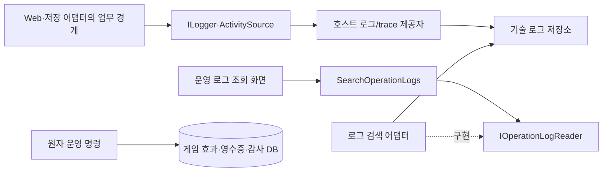

# 운영툴 로그 추적 계약

작성일: 2026-11-04 · 상세 확정: 2026-11-05 · 부모 span 탐색 반영: 2026-11-10 · 설계 v1.10 · 상태: 공통 계약과 구현 경계를 함께 기록, 모든 게임/UE 사건의 계측 완료를 뜻하지 않음

상위 문서: [운영툴 아키텍처](OPERATIONS_TOOL_ARCHITECTURE.md), [1인 개발 제작 계획](SOLO_OPERATIONS_TOOL_PLAN.md). 실제 sink·물리 JSON·버퍼·검색 알고리즘은 [구현 계약 §6](OPERATIONS_TOOL_IMPLEMENTATION_SPEC.md#6-로그의-실제-기록회전검색-구현)에서 확정한다.

사용자가 요청한 로그 추적은 **운영 화면의 사건에서 HTTP 요청·업무 처리·저장 결과·게임 반영 기록을 찾아가는 기능**이다. 모든 로그를 한 화면에 출력하는 것으로 완료하지 않는다. SOLID에 따라 업무 규칙, 기록 생성, 저장/수집, 검색, 표시의 책임을 분리한다.

## 1. 세 가지 기록의 역할

| 기록 | 답하는 질문 | 저장/신뢰 경계 |
|---|---|---|
| 기술 로그와 trace | 어디서 느려지거나 실패했는가, 어느 배포/프로세스가 처리했는가 | 구조화 로그·선택적 span 수집. 유실/샘플링/보존 만료가 가능하므로 지급 증거를 대신하지 않음 |
| 게임 영수증·정산 기록 | 어떤 요청이 실제 게임 데이터를 변경했는가 | 기존 권위 DB의 멱등/거래/정산 기록. 재시작·응답 유실 뒤 결과 판단 근거 |
| 운영 감사 기록 — S3 | 누가 누구에게 어떤 근거로 무엇을 변경했는가 | 변경 효과·멱등 영수증과 같은 트랜잭션에 성공 기록. 기술 로그와 보존 정책 분리 |

조회/로그인/거절도 기술 기록을 남긴다. '지급 버튼을 눌렀다', 'HTTP 200이다', '로그에 완료 문장이 있다'는 사실만으로 게임 반영을 확정하지 않는다. DB 커밋, 서버 재조회, 클라이언트 표시 관측을 각각 구분한다.

현재 운영 조회/로그 검색, [정산 worker](../Backend/ProjectRpg.Backend/Application/DungeonRewardSettlementWorker.cs)의 원래 세션/거래 요청 ID 관측, 선택형 게임 API HTTP 경계와 아이템·재화 거래 서비스의 확정/재생 영수증 연결을 구현했다. 실제 범위와 검증은 [실행 문서](OPERATIONS_TOOL_RUNTIME.md)를 따른다. 그 밖의 게임 업무 ID/저장 구간·UE 사건 연결은 해당 단계에서 추가한다.

## 2. ID와 연결 규칙

| ID | 수명/생성 주체 | 용도 |
|---|---|---|
| `HttpRequestId` | 서버가 HTTP 수신마다 새로 생성 | 로그인 실패·잘못된 입력도 찾을 수 있는 단일 시도 번호 |
| `TraceId`, `SpanId`, `ParentSpanId` | .NET Activity/W3C 컨텍스트 | 짧은 호출 흐름의 구간과 인과 관계 |
| `OperationRequestId` | 지급 등 확정된 업무 요청의 ID, 재전송 시 유지 | HTTP 응답 유실·재시작·다른 trace 사이의 같은 지급 연결 |
| `CaseId` | 운영자가 선택한 사건의 서버 검증 식별자 | 문의/장애 단위 조사. 실제 중복 지급 기준과 연계 |
| `CharacterId`, `RosterId` | 권위 데이터에서 확인한 ID | 대상과 실제 지급 소유 범위 추적 |
| `DungeonSessionId`, `SettlementId/Key` | 기존 세션·정산 기록의 실제 식별자 | UE→backend→worker→정산 결과 연결. 없는 ID를 합성해 실제 기록처럼 표시하지 않음 |
| `TransactionRequestId`, `ItemId` | 게임 영수증/아이템 ID | 재화 증감·아이템 생성/이동/수령 연결 |
| `TradeId`, `TradeCommandRequestId` | 저장된 개인 거래/명령 결과의 실제 UUID | 협상·완료 영수증과 각 HTTP 시도 연결. 일반 거래 영수증/운영 조치/던전 ID와 혼용하지 않음 |
| `EventId`, `Attempt` | 기록마다 고유 ID / 실제 시도 순번 | 중복 수집 제거와 재시도 구분 |

`.NET Activity`의 TraceId/SpanId는 호출 구간을 연결하며, 업무 요청 ID와 목적이 다르다. 이 설계에서는 별도 필드로 유지한다. [Microsoft 분산 추적 개념](https://learn.microsoft.com/en-us/dotnet/core/diagnostics/distributed-tracing-concepts)

- 같은 지급을 세 번 재전송하면 OperationRequestId는 같고 HttpRequestId와 실행 trace는 달라질 수 있다. 새 HTTP 시도를 새 지급으로 계산하지 않는다.
- 짧은 동기/비동기 호출에는 부모-자식 span을 사용한다. 저장 후 실행하는 worker·다음 날 재시도는 새 trace를 시작하고 원래 업무 ID 및 선택적인 원래 trace/span 링크로 연결한다. 한 span을 작업 대기 시간 내내 열어 두지 않는다.
- trace 컨텍스트의 보존/전달 메타데이터는 원래 영수증·정산 ID를 대체하지 않는다. worker가 원래 trace를 받지 못해도 업무 ID로 조사할 수 있어야 한다.
- UE 계측이 trace 전달을 지원하지 않는 구간은 동일 DungeonSessionId/요청·거래 ID로 연결하고 '업무 ID로 연계됨'으로 표시한다. 같은 trace가 실제 전파됐다고 표현하지 않는다.
- 외부 `traceparent`·헤더·RequestId는 신원/권한 증거가 아니다. 형식·길이를 검증하고, 외부 trace와 내부 생성 HttpRequestId·검증된 주체를 구분한다. 어떤 trace ID를 안다고 로그 조회 권한을 얻지 못한다.
- 환경·서비스·인스턴스·배포 버전을 모든 기술 기록에 함께 둔다. 서로 다른 환경의 같은 업무 ID를 자동으로 합치지 않는다.
- 시각만으로 다른 서비스의 인과 관계를 추정하지 않는다. UTC 시각·수집 시각·시도 번호·명시적 ID를 함께 사용하고 시계 차이가 있을 수 있음을 표시한다.

## 3. 최소 구조화 이벤트

필드는 허용 목록으로 직렬화한다. 자유로운 객체/HTTP 본문 덤프는 이벤트 계약이 아니다.

| 묶음 | 필수/선택 필드 |
|---|---|
| 공통 | SchemaVersion, EventId, EventName, TimestampUtc, Level, Environment, Service, InstanceId, BuildVersion |
| 호출 | HttpRequestId(HTTP), TraceId/SpanId(계측 시), ParentSpanId(있으면), OperationName, DurationMs(완료 시) |
| 확정된 맥락 | OperatorId, CharacterId, RosterId, DungeonSessionId, OperationRequestId, TransactionRequestId, CaseId 중 실제 확인한 항목 |
| 결과 | Outcome, ErrorCode, HttpStatus(HTTP), Attempt, Retryable, ResultReference |
| 코드 탐색 | LoggerCategory, 안정된 EventName/수치 이벤트 코드, BuildVersion. 예외에는 정제된 종류·안전한 stack 정보 |

유효한 trace를 수집하지 않는 경우 TraceId/SpanId는 null일 수 있다. 로그가 남았다고 span 저장도 성공했다고 가정하지 않는다. 입력을 파싱하기 전 실패했으면 확인되지 않은 대상/업무 ID를 확정 필드에 넣지 않는다.

이벤트 예시 — 정식 값이 아닌 형식 설명용:

```json
{
  "schemaVersion": 1,
  "eventId": "01bce596-8d58-4d37-ad96-52670b3933df",
  "eventName": "ops.character.query.completed",
  "timestampUtc": "2026-11-04T10:00:00Z",
  "level": "Information",
  "environment": "Development",
  "service": "ProjectRpg.Backend",
  "instanceId": "local-ops-01",
  "buildVersion": "example-build",
  "httpRequestId": "e0b4d89d-9d47-4d17-a3ee-cc373235df64",
  "traceId": "4bf92f3577b34da6a3ce929d0e0e4736",
  "spanId": "00f067aa0ba902b7",
  "operationName": "GetCharacterSummary",
  "characterId": "4c549d8e-289d-4f7c-97db-d810615b8254",
  "outcome": "Succeeded",
  "durationMs": 18,
  "operationRequestId": null
}
```

초기 이벤트 목록은 아래 업무 경계에 한정한다. 메서드 진입마다 같은 사건을 중복 기록하지 않는다.

| 이벤트 계열 | 언제 기록하는가 |
|---|---|
| `ops.http.started/completed` | 요청 수신/최종 응답, 미인증/잘못된 입력 포함 |
| `game.http.started/completed` — 선택 활성화 | `/api`의 서버 생성 시도 번호·실제 Activity·고정 라우트·최종 상태/소요 시간. 업무 ID와 UE 관측을 합성하지 않음 |
| `game.transaction.receipt.committed/replayed` — 선택 활성화 | 일반 아이템/재화·원자 픽업·장비 API가 확인한 확정/재생 영수증의 거래 ID → 실제 HTTP 시도/trace. 신규 반영과 재생을 구분 |
| `game.trade.command.observed` — 선택 활성화 | 개인 거래의 저장된 명령/거절·완료 영수증 관측. 같은 결과 재조회는 새 교환으로 계산하지 않음 |
| `game.storage.returned/failed/canceled` — 선택 활성화 | 일반 아이템/재화의 영수증 조회·커밋 호출 시간/실제 child span·요청한 거래 ID. 명령 성공·커밋/롤백의 증거가 아님 |
| `ops.access.denied` | 운영 인증/권한 거절. 로그인 시도 원문/비밀번호 제외 |
| `ops.character.query.completed/failed` | 캐릭터 검색·상세의 결과와 지연 |
| `ops.storage.query.completed/failed` | 필요한 DB 조회 구간. SQL 원문·파라미터 덤프 제외 |
| `ops.logs.search.completed/failed` | 로그 검색 자체의 범위·소요 시간·잘림 여부. 검색 결과 내용을 재기록하지 않음 |
| `ops.compensation.committed/replayed/conflicted/outcome_unknown` — S3 | 권위 저장 결과에 따른 조치 상태 |
| `game.settlement.attempt.completed/failed` — S2 | 원래 정산 ID·시도와 커밋/정산 상태 연결 |
| `game.projection.observed` — 필요한 UE 연결 단계 | 실제 관측한 데이터 갱신. DB 성공만 보고 생성하지 않음 |

EventName은 검색 계약이다. 이름/필드를 변경하면 SchemaVersion·호환 읽기 정책을 함께 검토한다. 사용자에게 보여주는 한국어 문구 변경이 이벤트 키를 바꾸지 않게 한다. 코드 위치는 LoggerCategory와 해당 BuildVersion 소스의 이벤트 선언으로 찾으며, 절대 개발자 PC 경로를 사용자에게 노출하지 않는다.

### 구현된 게임 HTTP 경계 (2026-11-08)

`Operations:GameApiDiagnosticsEnabled`는 기본 false이며 운영 저장소 활성화가 필요하다. 서버가 요청마다 만든 `HttpRequestId`를 `X-Game-Request-Id`로 반환하고, 실제 W3C Activity가 있을 때만 `X-Game-Trace-Id`를 반환한다. 호출자가 보낸 사용자 정의 추적 헤더를 복사하지 않는다. 같은 업무의 재전송도 HTTP 번호는 다르다. 번호를 아는 것만으로 로그를 읽을 수 없으며 기존 운영자 인증/진단 권한을 적용한다.

HTTP 어댑터 → 순수 Core `IGameHttpObserver` → Infrastructure writer 순서로 분리한다. 시작/완료의 같은 시도 번호, 실제 trace/span/parent, HTTP method와 서버 라우트 템플릿, 상태와 소요 시간만 전달한다. 원래 URL/query·인증·본문·예외 원문·확인되지 않은 주체/업무 ID는 이 관측 모델에 넣지 않는다. 관측기 실패는 업무 응답/예외에 영향을 주지 않는다. 처리된 401/503은 `Rejected`, 전파되는 예외는 `Faulted`, 취소는 `Canceled`이며 미전송 상태를 성공으로 기록하지 않는다. 응답/trace/보존의 정확한 예외와 검증 명령은 [실행 계약](OPERATIONS_TOOL_RUNTIME.md#게임-api-요청-추적)을 따른다.

기존 schemaVersion 1의 허용 이벤트 두 개를 추가했으며 JSON 필드는 유지한다. 검색의 `Complete`는 등록 원본의 읽기 완료다. 비활성 기간·과거 게임 사건·UE/업무 영수증까지 계측됐다는 의미가 아니며, 게임 HTTP와 별도 worker의 trace가 이어졌다고 표시하지 않는다.

### 구현된 거래 영수증 연결 (2026-11-08)

`ItemTransactionService`와 `CurrencyTransactionService`는 저장소의 확정 또는 동일 명령 재생 결과를 받은 뒤에만 순수 Application `IGameTransactionObserver`를 호출한다. 기록 어댑터가 현재 게임 HTTP 경계와 연결하며 관측기 예외는 결과를 바꾸지 않는다. 호출 본문에서 로그 맥락을 추출하거나 로그를 위해 권위 저장소를 다시 조회하지 않는다. 두 이벤트는 같은 schemaVersion 1에 추가하며 기존 JSON 필드는 유지한다.

`TransactionRequestId`는 반환된 영수증, 재화의 `CharacterId`는 확정 결과에서 가져온다. 아이템 actor·원래 세션/소유자·클라이언트 반영 여부를 추정하지 않는다. caller operation/reason/fingerprint/수량/잔액/품목/자격은 기록하지 않는다. 거절과 저장 예외에는 확정 영수증 이벤트를 만들지 않으며, 부재가 롤백 증거는 아니다. HTTP 밖의 호출이나 다른 직접 저장 경로로 계측 범위를 확대하지 않는다. [실행·검색·검증 경계](OPERATIONS_TOOL_RUNTIME.md#아이템재화-영수증과-http-연결)를 따른다.

### 구현된 원자 픽업 연결 (2026-11-08)

`DungeonPickupCommitService`는 같은 Application 관측 포트의 `DungeonPickup` 종류를 사용한다. 저장소가 검증한 예약/수령인/서버·세션 범위에서 실제 커밋 또는 정확한 재생 결과가 돌아온 뒤, 단일 영수증의 거래·캐릭터·아이템 ID와 성공한 세션을 연결한다. 작업 이름은 `DungeonPickup.Commit`, 사건 이름과 JSON schemaVersion 1은 유지한다. 일반 거래에 없는 세션/아이템 필드는 여전히 null이다.

준비 기록·미확정/거절·예외/취소는 확정 사건이 아니다. 관측기 실패는 기존 픽업의 오류 매핑에 들어가지 않으며, 과거 영수증 재생을 새 지급/현재 위치의 재적용으로 계산하지 않는다. 추가 권위 조회나 미검증 본문 파싱 없이 저장된 결과만 사용한다. [실행·증거 경계](OPERATIONS_TOOL_RUNTIME.md#던전-픽업-영수증-연결)는 실제 백엔드 2인 세션/HTTPS/PG·영수증→로그→Razor 연결을 다루며 UE/Steam·클라이언트 표시 관측을 대신하지 않는다.

### 구현된 장비 변경 연결 (2026-11-09)

제작/분해/강화/전승 API의 공통 결과 필터가 서버의 확정 `ItemCommitResponse`만 기존 Application 관측 포트에 전달한다. 실제 거래/Character actor ID와 고정 `Equipment.Craft/Dismantle/Upgrade/Transfer` 종류로 구분하며 Infrastructure가 현재 게임 HTTP 시도/실제 Activity를 연결한다. 추가 권위 조회·본문 파싱·저장 트랜잭션은 없다. 일반 거래/픽업 이벤트와 schemaVersion 1을 유지한다.

권한/규칙/충돌 거절·저장 예외는 확정 영수증이 아니며 관측기 실패는 기존 결과/업무 예외를 바꾸지 않는다. 여러 변경 아이템 중 하나나 현재 세션을 추정해 맥락을 채우지 않는다. 입력/결과 소비·후속 강화/전승 후 재생은 원래 영수증과 연결한다. [실행·검증 경계](OPERATIONS_TOOL_RUNTIME.md#장비-변경-영수증-연결)를 따르며 직접 저장 호출/UE/실제 클라이언트 표시를 검증한 것으로 확대하지 않는다.

### 구현된 개인 거래 명령 관측 (2026-11-09)

Application의 선택형 `ITradeCommandObserver`가 저장된 `TradeSessionResult`와 검증된 참여자에서 실제 거래/명령/캐릭터 ID·명령 enum·상태만 전달하고 Infrastructure가 게임 HTTP 시도/실제 Activity와 연결한다. `tradeId`/`tradeCommandRequestId`는 schemaVersion 1의 선택 필드이며 이전 기록의 누락 값은 null이다. 검색/화면은 이제 10종 ID를 지원하고 현재 계측 구성에 `player-trade` 경계를 추가한다.

신규 실행/동일 결과 재생을 구분하지 않는 관측 계약이다. `CompletedReceiptObserved`는 확정 저장 결과의 완료/해당 교환 계획 존재를 확인한 영수증 관측이며 새 자산 이동 사건이 아니다. `StoredRefusal`도 저장된 거절 결과만 의미한다. 계정/제안·품목/재화·교환 계획/자격/원문 거절은 기록하지 않는다. [실제 양측 거래·관측 실패·권한 검색 검증](OPERATIONS_TOOL_RUNTIME.md#개인-거래-명령-결과-추적)은 API/PG 자산 반영과 클라이언트/Steam 표시를 구분한다.

### 구현된 아이템·재화 저장 호출 (2026-11-09)

`ItemTransactionService`·`CurrencyTransactionService`의 영수증 조회/커밋4개 repository 호출을 선택적 Application 관측 포트로 감싼다. 호스트의 `ProjectRpg.Game.Storage` ActivitySource 어댑터만 HTTP/Activity와 JSONL을 참조한다. 실제 형제 child span과 단조 시간·원래 시도 번호·요청된 `transactionRequestId`를 연결하고 기록 실패·반환·예외·취소에서 호출1회/원래 결과·예외와 부모 Activity 복원을 보존한다. 원문/SQL/금액/주체를 전송하지 않는다.

`Returned`는 명령 거절/조회 미발견도 가능한 호출 반환이고 `Faulted`/`Canceled`는 저장 상태 미확정이다. 확정/재생 영수증과 구분한다. 현재 계측 표시의 다섯 생산 경계 중 `game-storage`는 등록 설정이며 검색 기간 전체·DB 내부/다른 업무 전체 계측의 증거가 아니다. [구현/검증 경계](OPERATIONS_TOOL_RUNTIME.md#아이템재화-거래-저장-구간)를 따른다.

## 4. 생성·수집·검색의 의존 분리



호스트는 구조화 `ILogger` 이벤트를 기록하고 제공자 설정으로 저장 대상을 바꾼다. Core 업무 로직은 제공자와 무관하다. [ASP.NET 로깅 제공자](https://learn.microsoft.com/en-us/aspnet/core/fundamentals/logging/?view=aspnetcore-9.0)

구간 계측은 표준 `ActivitySource`를 사용한다. OpenTelemetry 등 수집 도구를 채택할 경우 호스트의 등록/내보내기 계층에 두고, 업무 클래스마다 수집 SDK를 호출하지 않는다. listener/샘플링 때문에 Activity 생성 결과가 없더라도 업무는 동작해야 한다. [Microsoft 계측 지침](https://learn.microsoft.com/en-us/dotnet/core/diagnostics/distributed-tracing-instrumentation-walkthroughs)

초기 1인 운영 구성:

- backend의 ILogger→Serilog File/Async 어댑터가 허용된 OpsEvent만 고정 운영 디렉터리의 JSONL에 기록한다. UTC 일별/32MiB 회전, 30파일·14일 제한, 4096이벤트 버퍼를 사용한다. JSON console 출력만으로 영속 보관이 완료됐다고 보지 않으며 실제 회전·재시작·드롭을 검증한다.
- S1 검색 어댑터는 등록된 로컬 로그 원본만 제한적으로 읽는다. 파일에 자체 범용 검색 엔진/색인을 만들지 않고 시각·정확한 ID 필터와 읽기 예산을 적용한다.
- 로그가 여러 머신에 분산되거나 읽기 예산 때문에 조사가 반복해서 잘리면 중앙 수집/검색 어댑터로 바꾼다. 이때 Core 검색 계약·사건 ID는 유지한다.
- 범용 대시보드/수집 제품 선정은 비용·호스팅 조건을 확인한 뒤 결정한다. 게임 DB에 모든 기술 로그를 무제한 적재하지 않는다.
- 원자 감사 DB와 기술 로그 저장소는 서로 장애 의미가 다르다. 로그 제공자 장애 때문에 이미 커밋된 지급을 실패/롤백됐다고 표시하지 않는다. 감사 저장 실패는 지급과 함께 롤백한다.

## 5. 운영 화면의 검색 흐름

S1에 검색·캐릭터 상세와 함께 **기본 로그 조회 페이지**를 둔다. 오류 화면의 '추적 번호'를 복사하거나 해당 조회 화면에서 열 수 있다. 운영자 인증과 진단 조회 권한을 적용한다.

| 진입점 | 조회 순서 |
|---|---|
| 조회 오류의 HttpRequestId | 해당 시도 → trace/조회 어댑터 → 오류 코드/배포·인스턴스 |
| 캐릭터와 시간 범위 | 운영 조회·변경 기록 → 관련 던전/거래 ID → 각 기술 로그 |
| 지급 OperationRequestId — S3 | 원자 영수증/감사 결과 → 모든 HTTP 시도 → 커밋 결과와 게임 갱신 관측 |
| 던전 세션 — S2 | 완료 보고 → worker 시도 → 원래 재화/아이템 영수증 → 가방/우편/수령 기록 |

타임라인의 각 항목에는 출처·상태·관측 시각·연결 근거를 표시한다. 직접 trace 관계인지, 업무 ID로 연계한 것인지, 계측하지 않은 구간인지 구분한다. 게임 영수증은 기술 로그 페이지에 복사해 새로운 지급 근거로 만들지 않고 원래 기록을 참조한다.

2026-11-08 구현한 [로그 화면의 연결 탐색](OPERATIONS_TOOL_RUNTIME.md#로그-화면의-연결-탐색)은 초기 8종에 개인 거래/명령 ID를 추가해 현재 10종 ID를 폼과 결과 링크에 연결하고 등록 이벤트 목록을 제안한다. ID 링크는 실제 검색 기간/단일 등록 원본과 선택한 번호만 유지해 새 검색을 시작한다. 이전 AND 조건·커서는 제외하므로 거래의 다른 시도나 trace의 다른 사건을 찾을 수 있다. 이어보기는 원래 조건·고정 기간·보호 커서/EOF를 유지한다. 저장된 유효 ID만 사용하며, span/부모나 없는 업무 관계를 검색 링크로 합성하지 않는다. 기존 운영자 권한·검색 한도·Coverage 의미를 유지한다. 풍부한 합성 JSONL 행으로 한 화면 검증과 실제 공통 HTTP 이벤트 검증을 구분한다.

2026-11-10 [현재 페이지의 부모 span 탐색](OPERATIONS_TOOL_RUNTIME.md#현재-페이지의-부모-span-탐색)은 같은 환경·trace에서 실제 부모 span이 현재 결과에 있을 때 해당 행으로 이동한다. 부모 미포함/미기록·잘못된 문맥·충돌/순환을 구분하고 업무 ID·시간/작업명만으로 관계를 추정하지 않는다. 같은 span의 HTTP 시작/영수증/완료는 여러 사건이며 여러 실행으로 합산하지 않는다. 순수 Web 표시 모델과 PageModel·Razor를 분리하고 추가 I/O·페이지 간 병합 없이 기존 보호 검색 결과만 사용한다.

검색 계약:

- 현재 프로세스의 게임 HTTP/확정 거래/정산 관측 설정은 별도 `instrumentation` metadata와 [화면의 현재 계측 설정](OPERATIONS_TOOL_RUNTIME.md#현재-계측-설정과-과거-로그)으로 표시한다. Core의 `ILogInstrumentationReader`와 호스트 어댑터를 분리하며 Web/화면이 저장 제공자에 직접 의존하지 않는다. `scope=CurrentProcessOnly`, `historicalCoverage=Unknown`으로 설정/현재 writer/등록 경계만 밝힌다. 현재 꺼짐이 이전 보존 사건을 미계측으로 소급 분류하거나 검색에서 제외하지 않는다. 켜짐도 실제 실행/무손실 전달을 보장하지 않는다.
- `OperationLogQuery`는 허용된 환경/서비스, 시작·종료 시각, 정확한 ID, 이벤트/수준, 페이지 크기·커서만 받는다. 임의 SQL·정규식·파일 경로·셸 명령을 받지 않는다.
- 기본 기간 1시간, 한 검색 최대 24시간, 기본 100/최대 200건이며 하나 이상의 정확한 ID 또는 EventName을 요구한다. 화면에 적용 한도를 표시한다. 장기 게임 이력의 7일/30일 범위와 기술 로그 검색의 한도를 혼동하지 않는다.
- 로컬 파일 검색은 요청당 3초·64MiB에서 중지한다. 한도에 도달하면 Coverage=Partial·TruncationReason과 실제 검색한 기간/원본·cursor를 반환하고 '해당 로그 없음'으로 확정하지 않는다.
- 결과는 `Events`, `NextCursor`, `Coverage`, `ObservedAtUtc`, `TruncationReason`을 포함한다. Coverage는 Complete/Partial/Expired/NotInstrumented/Unknown 등 실제 근거를 표현한다. 저장소 장애는 성공한 빈 결과가 아니다. Complete는 선택한 보존 원본의 검색 완료를 뜻하며 모든 사건의 무손실 수집을 보장하지 않는다.
- 수집/보관 계층은 등록 원본·서비스/인스턴스·보존 시간 범위·회전/삭제·마지막 수집 시각의 작은 메타데이터를 유지한다. 검색 어댑터는 이 근거와 배포별 계측 범위로 Coverage를 계산한다. 보존/계측 여부를 모르면 Unknown을 반환하며 없는 기록을 추정하지 않는다.
- 커서는 서버가 등록한 원본과 필터에 묶인 불투명 값이다. 파일 경로를 그대로 받아 열지 않는다. 회전·삭제된 원본의 커서는 만료로 반환하고 새 검색을 안내한다.
- 고정 로그 root 밖, 임의 절대 경로, junction/symlink를 따라 읽지 않는다. 로그 파일을 브라우저에 직접 공개하거나 웹 정적 파일로 제공하지 않는다.
- 로그 원문/메시지를 HTML로 실행하지 않고 길이 제한·이스케이프를 적용한다. 자동 새로고침과 전체 다운로드는 첫 구현에 포함하지 않는다.

## 6. 응답 유실·재시작 사례

1. 운영자 지급 요청 `R`을 HTTP 시도 `H1`/trace `T1`로 받는다.
2. DB에 효과·영수증·감사를 함께 커밋한다. 원자 기록에는 `R`, 확정된 주체/대상, 원래 실행의 `H1`/`T1` 등 연결 가능한 맥락을 저장한다.
3. HTTP 응답이 유실되면 화면은 결과 미확정으로 표시한다. 서버의 성공 기술 로그도 유실될 수 있다.
4. 재시작 뒤 `R`을 같은 입력으로 조회/재전송한다. `H2`/`T2`는 새로 생기고, 저장된 결과를 반환하며 `Replayed`를 기록한다. 새 지급은 없다.
5. 운영자는 `R`로 원자 기록과 두 시도를 함께 찾는다. `T1` 로그가 보존되지 않았으면 원자 기록은 성공, 기술 로그는 부분/유실로 표현한다.

worker 재시도·UE 응답 누락도 같은 원칙으로 조사한다. '로그가 없으니 지급되지 않았다'는 자동 판단이나 자동 보상을 만들지 않는다. 클라이언트 반영 로그가 없으면 표시 갱신은 미확인 상태로 남긴다.

## 7. 민감정보·보존·장애 처리

- 인증 토큰·쿠키·Steam 티켓·DB 연결 문자열·비밀번호·전체 요청/응답 본문은 기록하지 않는다. 일반 기술 로그에는 Steam ID·이름·메일 대신 필요한 내부 ID나 일관된 가명 키를 사용한다. 지급 사유 원문·변경 전후 상세는 접근이 제한된 감사 기록으로 관리한다.
- 정제 전 exception message/SQL 오류에 파라미터·비밀값이 들어갈 수 있다. 알려진 오류 코드·예외 종류·안전한 stack만 허용하고, 문제 분석을 이유로 무조건 원문 덤프하지 않는다. 로거 메서드에 전달하기 전에 최소화한다.
- 기술 로그는 노드당 14일 또는 32MiB 파일 30개 중 먼저 도달한 한도로 보존하며 메타데이터 포함 1GiB를 예산으로 삼는다. Debug는 기본 비활성/문제 분석 때 짧게 활성화다. 실제 이벤트량으로 조정하고 삭제/누락 구간을 검색 결과에 표시한다.
- 영수증·감사에는 기술 로그의 삭제 정책을 적용하지 않는다. v1의 감사 상세·게임 영수증·요청/사건 키는 자동 삭제하지 않고 보존량을 감시한다. 향후 상세 아카이브를 추가해도 중복 키/결과 참조를 유지하며 오래된 요청을 새 지급으로 실행하지 않는다.
- 같은 오류 폭주를 묶고 exporter/버퍼/디스크 용량을 제한한다. critical 업무 결과와 거절 요약은 애플리케이션 수준에서 샘플링 제외로 설계하되, 그 사실이 물리적 무손실 저장을 보장하지는 않는다. trace span 샘플링과 별개로 결과 이벤트를 남긴다.
- 로그 수집 실패·드롭 수·마지막 수집 시각·보존 공간 부족을 별도로 감시한다. 조회/성공한 커밋을 외부 로그 수집기가 복구될 때까지 기다리게 하지 않는다.
- 사건/캐릭터/요청 ID는 로그 검색 필드로 사용한다. 지표의 무제한 label로 넣어 시계열 수가 폭증하지 않도록 한다.
- 운영 로그의 정상 보존은 기능 데이터 정책이다. 개발 검증의 임시 로그 자동 폐기와 혼동하지 않으며, 다른 담당의 Saved/원본 엔진 로그를 회전 정리 대상으로 삼지 않는다.

## 8. 단계별 추적 완료 기준

| 단계 | 완료해야 할 것 | 아직 주장하면 안 되는 것 |
|---|---|---|
| S1 | 운영 HTTP→권한/조회→DB 어댑터→응답의 추적 번호/필드, 재시작 후 로그 검색, 제한/마스킹/인가/부분 검색 표시 | UE 전체 흐름이나 과거 미수집 로그까지 연결됨 |
| S2 | 실제 던전·정산·worker·아이템/재화 영수증·필요한 UE 구간의 ID 연결, 미계측 범위 표시 | 모든 구간에 동일 trace가 자동 전파됨 |
| S3 | 운영 요청·사건 중복·원자 감사·재시도/응답 유실·게임 반영 관측 연결 | HTTP 성공만으로 클라이언트 갱신 완료 |

구현 시 집중 검증:

1. 정상 조회와 권한 거절·DB 시간 초과를 각각 발생시키고 화면의 번호로 해당 시도/구간을 찾는다. 서로 다른 요청·환경이 섞이지 않는지 확인한다.
2. 동시 요청에서 scope가 다른 운영자/캐릭터에 섞이지 않는지, 재시도는 새 HTTP 번호와 같은 업무 ID를 갖는지 확인한다.
3. 테스트용 가짜 비밀값을 헤더·본문·예외에 넣어 출력/저장/검색/내보내기에 포함되지 않는지 확인한다. 실제 자격값은 검사에 쓰지 않는다.
4. 로그 회전·파일 잘림·커서 만료·읽기 예산 초과·수집 장애에서 Partial/Expired/Unavailable 의미와 게임 동작 보존을 확인한다.
5. S3에서 DB 커밋 후 응답 유실·로그 유실·프로세스 재시작을 거쳐 같은 영수증을 찾고 지급은 한 번인지 검증한다. 감사 저장 실패는 게임 효과도 없는지 확인한다.
6. UE/worker는 실제 추가 계측 구간만 성공으로 보고한다. 종전 로그·가상 fixture를 현재 전체 연결의 증거로 취급하지 않는다.

설계 변경 시 이벤트 필드/키·ID 연결·검색 계약·보존 의미를 함께 검토한다. 로그 수집 제품 변경은 Infrastructure/호스트의 변경으로 제한하고 게임 업무 규칙과 감사 원자성을 유지한다.
