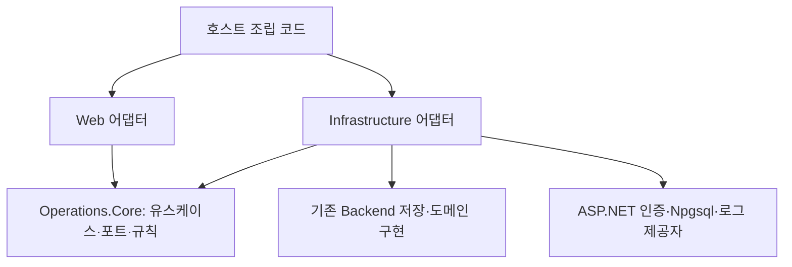
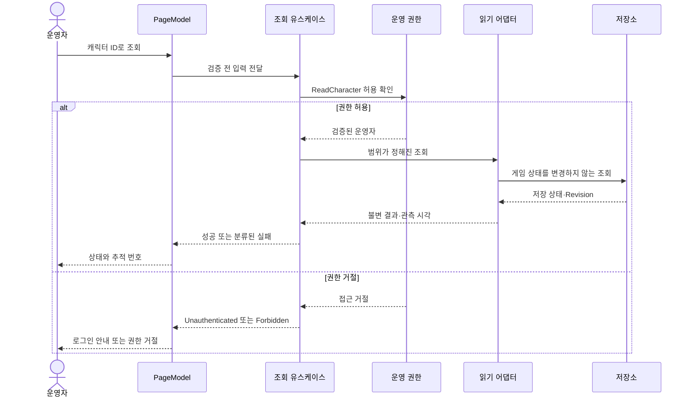

# 운영툴 아키텍처 — SOLID와 유지보수성 우선

작성일: 2026-11-04 · 상세 확정: 2026-11-05 · 설계 v1.1 · 상태: 설계 문서, 제품 코드 미구현

사용자 지시: **SOLID를 지키면서 유지보수하기 용이하게 설계하는 것이 0순위다. 로그 추적도 설계에 포함한다.**

[제작 계획](SOLO_OPERATIONS_TOOL_PLAN.md)은 기능 범위·단계를, 이 문서는 책임·의존 방향을, [로그 추적 계약](OPERATIONS_LOG_TRACING.md)은 사건 연결·검색·보존을 관리한다. 인증 공급자·정확한 DTO/오류·저장/동시성·운영 정책은 [구현 계약 v1](OPERATIONS_TOOL_IMPLEMENTATION_SPEC.md)에서 확정했다. 이후 구현은 네 문서를 함께 따른다. 아래 경로·타입·호출 예시는 신규 설계이며 이미 존재하는 코드가 아니다.

## 1. 결정 요약

| 결정 | 이유와 지킬 경계 |
|---|---|
| 기존 백엔드와 함께 배포하는 운영 모듈 | 1인 개발자의 배포 단위를 유지하면서 게임 HTTP 경로와 운영 기능의 책임을 분리 |
| 작은 `ProjectRpg.Operations.Core` 라이브러리 하나 추가 | 업무 규칙이 ASP.NET·DB·기존 Backend 구현을 참조하지 못하도록 프로젝트 의존 방향으로 제한 |
| 초기 UI는 Razor Pages | 기존 C# 호스트에서 검색·상세·로그 조회 화면을 구성. PageModel은 입력·결과 표현만 담당 |
| 조회와 변경은 별도 유스케이스·포트 | 조회 코드에서 지급·만료 정리·리스 해제를 실행할 수 있는 의존성을 제거 |
| 외부 경계에만 인터페이스 | 저장·인증·로그 검색처럼 교체/실패가 존재하는 경계에 계약을 두고 순수 규칙·유스케이스는 구체 클래스로 구성 |
| 변경의 원자성은 한 커밋 포트가 소유 | 지급·영수증·감사 기록을 각각 저장한 뒤 성공으로 묶는 오류 방지 |
| 구조화 로그와 감사 기록을 별도 저장 경로로 연결 | 로그 공급자 교체·샘플링·로그 유실이 게임 처리 근거를 바꾸지 않음 |
| 기능별로 필요한 추상화만 추가 | S1 제작 때 미래 제재·예약·대량 처리용 빈 클래스나 프레임워크를 만들지 않음 |

Razor Pages는 페이지별 `PageModel`과 렌더링을 분리할 수 있고 기존 ASP.NET 호스트에 등록할 수 있다. 이를 화면 어댑터로 사용한다. 프레임워크 기능이 업무 규칙의 위치를 결정하게 하지 않는다. [Microsoft Razor Pages 문서](https://learn.microsoft.com/en-us/aspnet/core/razor-pages/?view=aspnetcore-9.0)

## 2. SOLID를 코드 검토 기준으로 바꾸기

| 원칙 | 이 설계에서의 적용 | 위반 사례/거절 기준 |
|---|---|---|
| SRP — 변경 이유 분리 | 화면 표현, 업무 순서, 지급 규칙, DB 읽기/커밋, 인증, 로그 전달을 각 책임에 배치 | PageModel이 SQL을 작성하거나, 지급 서비스가 로그 파일 회전·화면 문구까지 관리 |
| OCP — 필요한 확장 지점 | 저장/인증/로그 검색 어댑터 교체 시 유스케이스 유지. 새 조치는 새 유스케이스와 명시적 등록으로 추가 | 하나의 `AdminManager`에 조치 이름 switch와 모든 정책을 계속 추가 |
| LSP — 같은 계약의 같은 의미 | Memory와 PostgreSQL의 없음·실패·잘림·중복·충돌 의미를 일치시킴. 조회는 양쪽 모두 게임 상태를 변경하지 않음 | Memory에서는 중복 지급하거나, 같은 읽기 인터페이스의 한 구현만 세션을 정리 |
| ISP — 소비자가 필요한 기능만 | 캐릭터 검색, 인벤토리 조회, 로그 검색, 보상 커밋 포트를 분리 | 조회 핸들러가 계정 생성·정산·티켓·지급을 포함한 큰 저장소 인터페이스에 직접 의존 |
| DIP — 업무가 경계를 소유 | 포트와 업무 결과 타입은 Core, 구현은 호스트의 Infrastructure. 조립은 Host 한 곳 | Core에서 Npgsql/HttpContext/ClaimsPrincipal/기존 Backend 저장소/로그 제품 SDK 참조 |

원칙을 지킨다는 이유로 모든 클래스에 같은 이름의 인터페이스를 추가하지 않는다. 인터페이스를 추가할 때는 **소비자, 교체할 외부 의존성, 보장할 의미**를 설명할 수 있어야 한다. 현재 필요하지 않은 범용 Repository, UnitOfWork, 명령 버스, 공통 CRUD 기반 클래스는 도입하지 않는다. 기능마다 필요한 업무 계약을 먼저 정한다.

## 3. 물리 구조와 의존 방향

```text
Backend/
  ProjectRpg.Operations.Core/             # 신규 작은 클래스 라이브러리
    Access/                              # IOperatorAccess, OperatorActor, 권한 이름
    Characters/                          # 조회 유스케이스·읽기 포트·불변 결과
    Inventory/                           # 조회 유스케이스·읽기 포트·페이지 계약
    Wallets/                             # 조회 유스케이스·읽기 포트
    Diagnostics/                         # 로그 검색 유스케이스·검색 포트
    Compensation/                        # S3 시작 시 추가할 규칙·커밋 계약
    Common/                              # 실제 여러 기능이 쓰는 Result·페이지 타입만
  ProjectRpg.Backend/                     # 기존 실행 호스트
    Operations/
      Hosting/                           # AddOperations / MapOperations, 구성 검증
      Web/                               # PageModel·ViewModel·HTTP 매핑·인증 어댑터
      Infrastructure/
        Reads/                           # 부작용 없는 PG/Memory 조회 구현
        Commands/                        # S3의 원자 변경 구현
        Diagnostics/                     # 로그 검색 어댑터·구조화 이벤트 기록
    Pages/Ops/                           # Search·Character·Diagnostics .cshtml
  ProjectRpg.Operations.Tests/            # 구현 시 추가할 집중 계약/통합 검사
```

새 런타임 프로젝트는 Core 하나다. Core의 TFM은 구현 당시 호스트와 맞춘다. 현재 소스의 `net9.0`은 관측값이며 신규 운영 배포 버전을 확정한 것은 아니다. 실제 배포 전 지원 중 런타임과의 호환성을 확인한다. 기존 게임 코드 전체의 프로젝트 분리나 런타임 업그레이드는 이 설계 문서 작업에 포함하지 않는다. Web/Infrastructure는 처음에는 기존 호스트 내부의 논리 모듈로 두고, 별도 배포 필요가 확인될 때 물리 분리를 검토한다.

아래 화살표는 실행 순서가 아니라 **컴파일 의존 방향**이다.



- Core는 표준 런타임 외에 호스트·웹·DB·수집 제품을 참조하지 않는다. Backend→Core 단방향 ProjectReference로 Core→Backend 순환 참조를 방지한다.
- Web는 Core의 유스케이스·결과만 사용한다. Infrastructure·기존 Repository·직접 SQL에 접근하지 않는다.
- 기존 저장소 재사용/변환은 Infrastructure 내부에서 한다. 오래된 모델을 Core나 ViewModel에 그대로 노출하지 않는다.
- `Hosting`만 구체 어댑터를 등록한다. 유스케이스에서 `IServiceProvider`로 구현을 찾아 쓰지 않는다.
- 요청별 권한 컨텍스트·유스케이스·어댑터는 기본 Scoped, 불변 정책·데이터 소스는 적합한 경우 Singleton이다. DB 연결/트랜잭션은 작업 범위에서 열고 종료한다. Singleton에 요청의 HttpContext·운영자·연결을 보관하지 않는다.
- 이 경계는 구현 시 참조/네임스페이스 검사로 확인한다. 폴더가 나뉘었다는 사실만으로 준수를 인정하지 않는다.

## 4. 책임과 최소 인터페이스

| 구성 요소 | 책임 | 의존할 수 있는 것 |
|---|---|---|
| Search/Character/Diagnostics PageModel | 입력 바인딩, 유스케이스 호출, HTTP/화면 상태 선택 | Core 유스케이스·Web 변환기 |
| `SearchCharacters`, `GetCharacterSummary` | 운영 권한·입력 검사 후 조회 순서 결정 | `IOperatorAccess`, `ICharacterReadStore` |
| `GetInventoryPage`, `GetWallet` | 대상/조회 범위 검증과 결과 반환 | 해당 읽기 포트·운영 권한 |
| `SearchOperationLogs` | 허용 필터·기간/건수 제한과 검색 권한 적용 | `IOperationLogReader`, 운영 권한 |
| 순수 규칙 클래스 | 범위·한도·정규화·정책 판정 | 입력 값·불변 정책. 파일/HTTP/DB 없음 |
| 읽기 어댑터 | 저장 데이터를 불변 조회 모델로 변환 | PG 읽기 연결 또는 검증된 부작용 없는 Memory snapshot |
| `IssueCompensation` — S3 | 권한, 입력 정규화·템플릿 선택, 안전한 커밋 요청 | 운영 권한·불변 정책·`ICompensationCommitter` |
| `ICompensationCommitter` 구현 — S3 | 동시성 재검사·데이터 변경·영수증·성공 감사의 단일 원자 커밋 | 동일 DB 연결/트랜잭션과 검증된 공통 저장 규칙 |

계약 형태 예시다. 참조되는 결과 모델은 아래 의미를 고정한 뒤 구현한다. 예시를 컴파일 완료된 코드로 간주하지 않는다.

```csharp
public interface IOperatorAccess
{
    Task<Result<OperatorActor>> AuthorizeAsync(
        OpsCapability capability, CancellationToken cancellationToken);
}

public interface ICharacterReadStore
{
    Task<Result<Page<CharacterHeader>>> SearchAsync(
        CharacterLookup query, CancellationToken cancellationToken);
    Task<Result<CharacterHeader>> FindAsync(
        Guid characterId, CancellationToken cancellationToken);
}

public interface IOperationLogReader
{
    Task<Result<OperationLogPage>> SearchAsync(
        OperationLogQuery query, CancellationToken cancellationToken);
}

// S3에서만 추가. AuthorizeAsync가 확정한 actor만 전달한다.
public interface ICompensationCommitter
{
    Task<CompensationCommitResult> CommitAsync(
        CompensationIntent intent, OperatorActor actor,
        CancellationToken cancellationToken);
}
```

`IOperatorAccess`의 호스트 구현은 검증된 운영 인증 세션만 해석한다. 브라우저가 보낸 OperatorId나 게임 Bearer를 운영자 신원으로 사용하지 않는다. 각 유스케이스가 권한 확인부터 실행하므로, 화면 외 호출 경로를 추가해도 권한 검사를 생략하지 않는다. 한 명의 운영자에게 필요한 capability를 설정으로 부여하며 역할 관리 UI는 만들지 않는다.

`Result<T>`는 성공 값 또는 분류된 실패 중 하나다. 성공인데 값이 null이거나, 실패를 빈 목록으로 반환하는 모델을 만들지 않는다. 검색 결과 0건은 성공한 빈 페이지, 단일 대상 부재는 NotFound다. 사용자가 취소한 작업은 취소로 전달하며 저장 장애로 바꾸지 않는다.

| Core 결과 | Web 매핑 요약 | 의미 |
|---|---|---|
| InvalidInput | 400/필드 오류 | 잘못된 ID·필터·한도 |
| Unauthenticated / Forbidden | API 401/403, 페이지는 로그인 안내/권한 거절 | 인증 부재와 권한 부족 구분 |
| NotFound | 404/대상 없음 | 해당 단일 대상이 없음 |
| DependencyUnavailable | 503/조회 불가 | DB·로그 저장소 장애. 이전 값을 최신값으로 표시하지 않음 |
| Conflict — S3 | 409/재확인 필요 | 요청 ID 충돌·낡은 상태·사건 중복 |
| Committed / Replayed — S3 | 성공·원래 작업번호 | 실제 변경과 같은 요청의 재조회 구분 |
| CommitOutcomeUnknown — S3 | 503 + 결과 미확정·원래 작업번호 | 전송/커밋 도중 연결 단절. 새 ID로 재지급하지 않음 |

예상 가능한 저장 장애는 어댑터에서 분류하고 상세 예외는 기술 로그에 남긴다. 프로그래밍 오류를 모두 정상 실패로 숨기지 않으며 호스트 예외 경계에서 추적 번호를 포함해 처리한다.

## 5. 실제 코드에 따른 재사용 경계

| 현재 코드에서 확인한 사실 | 설계 결정 |
|---|---|
| [ApiAuthenticationMiddleware](../Backend/ProjectRpg.Backend/Authentication/ApiAuthenticationMiddleware.cs)는 `/api`에만 적용 | `/ops`가 자동으로 보호되지 않으므로 운영 인증/인가를 명시적으로 등록 |
| [API rate limit](../Backend/ProjectRpg.Backend/Authentication/ApiRateLimitMiddleware.cs)도 `/api` 범위 | 운영 로그인·조회·변경의 제한을 별도 등록. 게임 제한을 넓혀 운영툴을 억지로 포함하지 않음 |
| [IGameRepository](../Backend/ProjectRpg.Backend/Data/IGameRepository.cs)는 인증·세션·정산·인벤토리 읽기/쓰기를 함께 포함 | Core에 주입하지 않고 좁은 읽기 포트로 보호 |
| [PostgresGameRepository](../Backend/ProjectRpg.Backend/Data/PostgresGameRepository.cs)의 `GetDungeonSessionAsync`, `GetActiveDungeonSessionForCharacterAsync`는 `CleanupExpiredDungeonSessionsAsync` 실행 | 운영 읽기에서 재사용 금지. 저장된 상태·만료 시각을 SELECT하는 snapshot 조회 추가 |
| [Memory 구현](../Backend/ProjectRpg.Backend/Data/InMemoryGameRepository.cs)의 같은 조회도 만료 정리 실행 | Memory에도 별도 잠금 내 복사 snapshot 필요. PG만 읽기 전용으로 만들고 대체 가능하다고 주장하지 않음 |
| [성장 저장소](../Backend/ProjectRpg.Backend/Data/ICharacterProgressionRepository.cs)의 LoadProgressionAsync는 정산을 반영할 수 있음 | 운영 성장 표시는 GetStoredProgressionSummaries 의미의 저장값 조회만 사용 |
| [PostgresItemRepository](../Backend/ProjectRpg.Backend/Data/PostgresItemRepository.cs)의 소유자 조회는 limit이 있고 커서 없음 | 제한 목록을 전체 목록으로 보여주지 않음. 운영 전용 제한/커서 조회로 보완 |
| [PostgresEconomyRepository](../Backend/ProjectRpg.Backend/Data/PostgresEconomyRepository.cs)의 지갑은 활성 통화 정의만 반환 | S1에서는 '활성 재화'로 명시. 과거 비활성 재화 조사 요구는 S2 조회 계약에서 별도 처리 |
| 일반 재화/아이템 commit은 각 저장소가 연결·트랜잭션을 소유 | 두 공개 commit과 감사 저장을 순서대로 호출해 원자 지급이라고 하지 않음 |
| [정산 커밋 저장소](../Backend/ProjectRpg.Backend/Data/PostgresDungeonRewardCommitRepository.cs)는 같은 연결/트랜잭션을 전달하는 기존 구현이 있음 | S3의 운영 커밋도 같은 원자 경계를 사용하되, 던전 정산 자격/ID를 위조하지 않음 |
| [정산 worker](../Backend/ProjectRpg.Backend/Application/DungeonRewardSettlementWorker.cs)에 상태 로그가 있음 | 기존 로그를 재사용하되 전체 추적/검색이 완성됐다고 가정하지 않음. 공통 필드와 원래 요청 연결을 보강 |

기존 읽기 메서드라도 사용 전에 부작용을 확인한다. 적합하지 않은 기존 메서드를 운영툴에 맞추려고 게임 동작을 광범위하게 변경하지 않는다. 필요한 공유 순수 규칙의 추출은 S3 구현에서 직접 관련된 범위만 검증한다.

## 6. S1 조회 동작



- 화면은 유스케이스를 직접 호출한다. 같은 프로세스의 `/ops/api`를 HTTP로 다시 호출하지 않는다. S1 JSON 조회 엔드포인트도 동일 유스케이스의 Web 어댑터로 제공한다.
- 정확한 Steam ID/캐릭터 GUID 검색부터 제공한다. 기본 상세와 재화/인벤토리/세션 패널은 각각 실패 상태를 표시한다. 한 패널의 장애 때문에 다른 결과를 성공한 빈 데이터로 바꾸지 않는다.
- PG 조회는 읽기 전용 트랜잭션 또는 충분히 제한된 SELECT로 실행하며 만료 정리·잠금 해제·정산 재시도를 수행하지 않는다. 여러 SQL을 하나의 일관된 snapshot이라고 표시할 때만 같은 연결의 적절한 읽기 트랜잭션으로 묶는다.
- 세션은 저장 상태·저장된 만료 시각·관측 시각을 함께 반환한다. 시간이 지났다는 계산은 표시 정책일 뿐 DB 상태 전이가 아니다. 게임의 실제 입장 권한을 새로 결정하지 않는다.
- 인벤토리 페이지는 안정된 아이템 ID 등 고유 키로 정렬하고 마지막 키를 커서로 사용한다. 커서는 대상/필터에 묶고 서버에서 검증한다. 이동·소비가 있는 현재 데이터의 여러 페이지를 고정된 전체 snapshot이라고 보장하지 않는다.
- 페이지 크기/조회 시간·기간은 제작 계획의 한도로 제한하고, `HasMore`, `NextCursor`, `ObservedAtUtc`를 반환한다. 잘림·보존 만료·지원 범위 밖은 로그 검색에도 같은 방식으로 명시한다.
- Core에서는 int64를 유지하고 Web JSON에서는 정확한 문자열로 전달한다. ViewModel이 문화권/시간대/표시 문구를 책임진다.
- 요청 단위 trace와 저장 어댑터 구간 로그를 남기며, 자세한 기록·검색 규칙은 로그 추적 계약을 따른다.

## 7. 인증과 호스트 조립

GitHub OAuth scheme `OperationsGitHub`, cookie scheme `OperationsCookie`, 정책 `OperationsAccess`를 사용한다. 검증한 GitHub 숫자 ID 한 개의 허용 목록과 PG 서버 세션으로 운영자 신원을 연결한다. 유휴 30분/절대 8시간, PKCE·폐기·CSRF와 접근 제한은 구현 계약 §2를 따른다. 실제 앱 자격/계정 ID/주소만 배포 입력이다. 임의 헤더·Player/Administrator/GameServer 토큰으로 운영 세션을 발급하지 않는다.

인가 정책은 해당 scheme을 명시한다. 다른 인증 scheme의 신원이 운영 권한으로 섞이지 않도록 하는 ASP.NET 구성을 사용한다. [특정 scheme으로 인가하기](https://learn.microsoft.com/en-us/aspnet/core/security/authorization/authorize-with-a-specific-scheme?view=aspnetcore-9.0)

호스트의 논리 순서는 오류/추적 컨텍스트 → Ops ingress/익명 경로 제한 → 라우팅·명시적 인증/인가 → 인증 주체 요청 제한 → 입력/엔드포인트다. 기존 `/api`의 Bearer 인증/요청 제한 순서는 유지하고, `/ops`는 운영 scheme·정책으로 보호한다. 실제 미들웨어 연결이 이 순서와 경로별 정책을 지키는지 구현 시 검증한다.

- `AddOperations(configuration, environment)`는 설정 검증·Core 유스케이스·필요한 어댑터·인증/인가를 등록한다. `MapOperations`는 허용된 페이지와 필요한 엔드포인트만 매핑한다.
- 기본 비활성. 활성 상태인데 인증/로그 검색 경로 등 필수 설정이 누락되면 기동 검증에서 실패한다. 개발 테스트용 인증 우회가 운영 환경에서 활성화되지 않게 한다.
- 모든 Ops 페이지에 정책을 적용하고 익명 경로는 로그인 시작/콜백에 필요한 최소 범위만 허용한다. 운영 JSON은 401/403을 반환하며 로그인 HTML로 리디렉션하지 않는다.
- 서버 인증 세션에서 신원을 재확인하고 로그아웃·만료·허용 목록에서 제거된 운영자의 접근을 차단한다. cookie의 보안 속성과 변경 폼/로그아웃의 CSRF 검사를 적용한다.
- 정책 없는 신규 Ops 경로를 등록하면 검증에서 실패하도록 경로/인가 검사 목록을 둔다. URL을 `/ops`로 정한 것만으로 권한 경계를 확보했다고 간주하지 않는다.

## 8. S3의 원자 변경과 확장

S1에는 아래 코드를 만들지 않지만, 읽기/쓰기 분리와 저장 계약이 나중에 충돌하지 않도록 경계를 확정한다.

`IssueCompensation`은 권한과 고정 템플릿·입력을 검증하고 `CompensationIntent`를 만든다. intent에는 환경, 요청 ID, 사건 키, 대상, 템플릿 버전, 정규화된 지급 내용과 사유를 넣는다. 운영자·현재 게임 상태·최종 결과를 브라우저 입력으로 신뢰하지 않는다.

`ICompensationCommitter`는 다음을 하나의 원자 단위로 실행한다.

1. 요청 ID의 기존 영수증을 확인한다. 같은 정규화 입력이면 원래 결과, 다른 입력이면 충돌을 반환한다. 이미 커밋된 결과의 재조회는 현재 가방 상태로 재계산하지 않는다.
2. 새 요청은 실제 소유자·사건 중복·템플릿 유효성·한도·리스/Revision을 저장 경계에서 다시 확인한다. 필요한 잠금과 unique 제약은 권위 저장소가 소유한다.
3. 기존 게임 쓰기와 호환되는 순서로 잠금을 획득한다. 다른 명령이 owner→재화 순서로 잡는 잠금을 운영 명령이 반대로 잡지 않도록 실제 호출 순서를 대조한다.
4. 지급 효과와 영수증·성공 감사·연결 ID를 같은 연결/트랜잭션에 기록한다. 실패하면 함께 롤백한다.
5. 커밋 확정 후 성공 결과를 반환한다. 커밋 응답 유실은 실패 확정으로 처리하지 않고 원래 ID로 결과를 조회한다.

공유 연결과 트랜잭션을 명시적으로 사용하는 Npgsql 패턴을 Infrastructure 내부에 한정한다. Core의 메서드 인자에 `NpgsqlConnection`이나 범용 SQL 실행 콜백을 넣지 않는다. [Npgsql 기본 사용·트랜잭션](https://www.npgsql.org/doc/basic-usage.html#transactions)

원자 저장 안의 일관된 정책 평가에 필요한 순수 규칙은 공유할 수 있다. HTTP 어댑터/일반 public commit의 중첩 호출로 연결이 분리되게 하지 않는다. 게임 변경 전에 별도 `IAuditWriter`를 호출하거나, 성공 뒤 비동기 감사 기록만 남기는 방식도 금지한다. 실패/거절의 기술 로그는 원자 성공 감사와 별개다.

향후 제재는 `ApplyAccountRestriction` 유스케이스와 해당 정책/저장 경계로 추가한다. 대량 보상은 대상별 같은 단일 지급 계약을 호출하는 작업 실행 계층을 추가한다. 기존 조회 핸들러나 하나의 거대 운영 관리자에 기능을 누적하지 않는다. 기능 등록 코드·필요한 스키마 변경은 OCP 위반이 아니며, 변화가 실제로 필요한 경계만 수정한다.

## 9. 로그 추적이 구조에 들어가는 위치

- Web의 공통 요청 경계가 신뢰할 수 있는 HTTP 요청 번호·환경·배포 버전과 trace scope를 시작하고 응답 상태를 기록한다.
- 저장/외부 호출 어댑터가 구간·소요 시간·재시도·분류된 오류를 기록한다. 업무 결과는 유스케이스 반환 결과에서 기록하고, DB 커밋과 로그 출력의 성공을 혼동하지 않는다.
- Core에는 로그 제품 SDK나 로그 파일 경로를 전달하지 않는다. `ILogger`/`ActivitySource` 기록과 수집 설정은 호스트/어댑터에 둔다. 로그 검색은 Core가 소유한 `IOperationLogReader`로 분리한다.
- 호스트 내부의 요청 범위 `OperationsRequestContext`가 서버 생성 HttpRequestId·현재 trace/배포 맥락을 불변 값으로 제공한다. S3 커밋 어댑터는 이 값을 성공 감사의 원래 실행 참조로 기록한다. Core에 HttpContext나 로깅 서비스를 전달하기 위해 업무 계약을 확장하지 않는다.
- 기록 공급자와 검색 어댑터를 교체해도 조회/지급 정책은 유지한다. 감사·멱등 기록은 로그 검색 저장소를 대신 이용하지 않는다.
- S1부터 요청 로그와 기본 추적 번호 검색을 제공한다. S2에서 던전/worker/UE의 업무 ID 연결을 확장하고 S3에서 운영 요청과 원자 감사 결과를 연결한다.
- 기술 로그에 없다는 사실만으로 지급 실패/미지급을 판정하지 않는다. 표본 수집·유실·보존 만료를 화면에서 구분한다.

필드·검색 흐름·로그 유실·보존·민감정보 규칙·추적 검증은 [로그 추적 계약](OPERATIONS_LOG_TRACING.md)을 기준으로 한다.

## 10. 검증과 유지보수 기준

| 범위 | 구현 시 필요한 검증 |
|---|---|
| 의존 방향 | Core가 Backend/ASP.NET/Npgsql/수집 SDK를 참조하지 않음. Web에서 Infrastructure·SQL 호출 없음. 조립 외 서비스 탐색 없음 |
| 권한 | 모든 Ops 경로와 유스케이스에서 개인 운영 권한 확인. 게임 토큰/위조 운영자/익명/만료 세션 거절 |
| 읽기 계약 | 양 저장소의 같은 없음/실패/잘림 의미. 만료 세션을 조회해도 원본 상태·영수증·리스 불변 |
| 조회 표현 | 한 패널 장애, 큰 int64, 안정 커서, 조회 중 변경, 부분/오래된 관측 표시 |
| 로그 | 요청→어댑터→결과 연결, 로그 조회 권한, 민감정보 제거, 잘림/유실/미계측 구분 |
| S3 저장 | 동시 중복·다른 입력 충돌·원정대 범위 중복·응답 유실·재시작·감사 실패 시 전체 롤백 |
| 회귀 범위 | 게임 Bearer·요청 제한·정산/우편의 기존 계약 유지. 실제 변경과 직접 관련된 검사만 실행 |

순수 규칙은 입출력으로, 유스케이스는 작은 포트 대역으로, 어댑터는 실제 PG/호스트 연결로 확인한다. Memory가 DB 잠금·격리·재시작 복구를 증명하지는 않는다. 클래스 수·인터페이스 수·코드 커버리지 수치만으로 설계를 합격시키지 않는다.

유지보수 시나리오의 예상 수정 범위:

| 변경 | 바뀌어야 하는 곳 | 유지되어야 하는 곳 |
|---|---|---|
| 화면 레이아웃/문구 | Razor/ViewModel | 유스케이스·저장·지급 규칙 |
| DB 조회 방식/인덱스 | 해당 Read 어댑터·필요한 migration | Web·Core 조회 의미 |
| 로그 수집/검색 제품 | 호스트 설정·로그 검색 어댑터 | 업무 정책·감사 기록 원자성 |
| 운영 로그인 공급자 | 인증 어댑터·호스트 설정 | 조회/지급 유스케이스 |
| 새 보상 종류 | 해당 정책·명령·저장 규칙/등록 | 기존 조회·다른 조치의 정책 |

## 11. 구현 단위와 배포 입력

1. **기반과 조회 첫 흐름:** Core 경계·호스트 조립·개인 인증·정확한 ID 검색·기본 상세·구조화 요청 로그를 함께 연결한다.
2. **S1 완성:** 읽기 전용 재화/가방/우편/세션 패널과 기본 로그 검색 페이지, 부분 실패·커서·추적 검증을 마무리한다.
3. **S2 조사:** 원래 정산/영수증/worker/UE 사건의 연결과 계측 범위를 확장한다.
4. **S3:** 허용된 아이템 1종·1개의 우편 지급, 기간 제재/해제를 각각의 유스케이스로 구현한다.
5. **S4:** 공지·Open/Drain, 외부 감시/webhook, pgBackRest 백업·복구 절차를 연결한다. 대량 작업은 v1 밖이다.

로그인 방식·로그 공급자/할당량·첫 보상 템플릿/반영 시점·제재/점검 정책은 구현 계약에서 확정했다. 실제 계정 ID·OAuth 자격·관리 주소·영속 경로·허용 품목·감시/백업 자격만 배포 입력으로 남는다. 이 값은 Core 의존 방향을 바꾸지 않는다.

설계의 완료 기준은 책임/의존 방향, S1~S4 상세 계약, 기존 코드의 부작용/동시성 경계, 로그와 운영 정책, 요구사항별 검증 기준이 확정되는 것이다. 구현 계약 §11~12에 완료 범위와 검증 인계를 기록했다. 실제 기능 완료는 이후 구현·검증 기록으로 판단한다.
