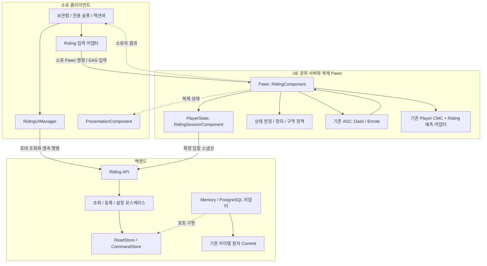
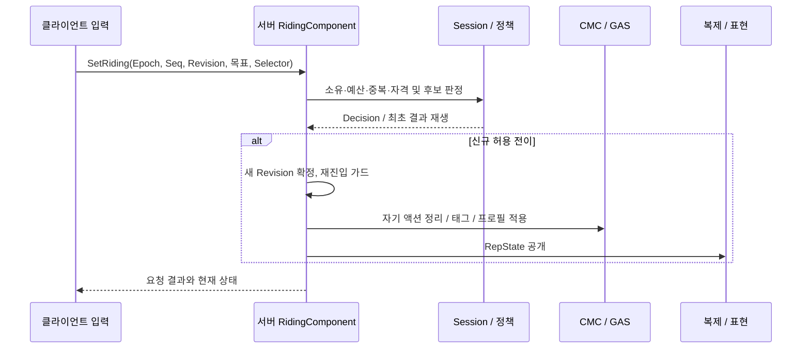

# Riding System 아키텍처 v1

- 작성: 2026-11-06 / 담당: `riding-architecture-20261106`
- 상태: **아키텍처 문서 작성 완료. 아래 신규 타입·포트·호출 순서는 구현 예정이며 제품 코드는 아직 없다.**
- 기준: 게시 `92fdb7bf`와 [Riding 상세 설계](RIDING_SYSTEM_DESIGN.md). 게임 규칙·수치·API/DB 계약은 상세 설계가 기준이고, 이 문서는 책임·의존·연결 방법을 정의한다.
- 이번 산출물: 아키텍처와 구현 분할. C++ 골격, 백엔드, 에셋 생성 및 런타임 검증은 포함하지 않는다.

## 1. 구조 결정

**기존 플레이어 Pawn을 계속 조종하며, 같은 ASC와 CMC 위에 Riding 상태·이동 정책·표현을 연결한다.**
탈것은 데이터와 표시용 mesh다. 서버의 탑승 상태가 이동/입력/외형으로 투영되며, 이 세 영역이 각각 탑승 여부를 결정하지 않는다.

| 결정 | 이유와 경계 |
|---|---|
| 기능은 Project_RPG 내부 `Riding/`에 구성 | 현재 인증·전투·이동과 연결되는 게임 기능이다. v1에서 새 플러그인/범용 탈것 프레임워크를 만들지 않는다. |
| 보유·쿨타임은 PlayerState, 현재 탑승은 Pawn | Pawn 사망/교체로 이동기 쿨타임을 초기화하지 않고, 새 Pawn은 도보로 시작한다. |
| MountDefinition과 RidingPolicy 분리 | 외형을 추가해도 실행 코드·공통 성능·쿨타임이 달라지지 않는다. |
| 상태 확정은 RidingComponent 한 곳 | GAS 태그, UI, 모델 로드 콜백은 상태의 소비자다. |
| 실제 이동은 기존 CMC | 위치 전송 RPC, BP Tick 위치 변경, 별도 탈것 Pawn 빙의를 추가하지 않는다. |
| 영속 등록은 백엔드 단일 트랜잭션 | 아이템 소비·해금·영수증을 함께 확정한다. UE에서 순서대로 HTTP 두 번 호출해 구현하지 않는다. |
| UIManager는 LocalPlayerSubsystem | 계정/캐릭터·World 교체와 화면 수명을 구분하고, 서버 권위나 DB 상태를 소유하지 않는다. |



화살표는 호출/데이터 흐름이다. `RidingComponent ↔ ASC`는 실행 요청과 제한된 결과 콜백이며, 서로의 내부 상태를 직접 쓰는 의존을 허용한다는 뜻이 아니다. 원격 관찰자는 공개 RepState와 CMC 이동만 받는다.

## 2. 상태와 수명의 소유자

| 상태 | 단일 소유자 | 수명 / 공개 범위 |
|---|---|---|
| 보유 MountId·보유 revision | 백엔드 Roster | 영속. Player/해당 게임 서버에 인증된 조회만 제공 |
| 선택·즐겨찾기·전용 슬롯 | 백엔드 Character | 영속. 로비에서 변경, 현재 세션에서는 입장 snapshot 사용 |
| 승인 보유 snapshot·준비 상태 | 서버 RidingSessionComponent | 인증된 PlayerState 세션. 클라이언트 캐시로 권한을 만들지 않음 |
| DashReadyAt·EmoteReadyAt·CombatLockUntil | 서버 RidingSessionComponent | 단조 시계. 소유자에는 UI용 남은 시간/시각 투영만 전달 |
| Mode·MountId·StateRevision·ActionSequence | RidingComponent | 현재 Pawn/Epoch. 공개 `FRPGRidingRepState` 하나로 복제 |
| 요청 고수위/최근 결과 | RidingSessionComponent | 연결 문맥 안에서 Epoch별 구분. 예산은 Epoch 교체로 초기화하지 않음 |
| GAS grant·Mounted GE·실행 레코드 | RidingComponent와 해당 Ability | 소유 핸들만 회수. 실행 레코드는 Epoch/ExecutionId로 식별 |
| 미확인 move·예측 RMS | 기존 CMC의 Riding 어댑터 / Dash Ability | 소유 클라이언트 예측 수명. 서버 확정 상태보다 우선하지 않음 |
| 모델·AnimLayer·FX·카메라 보정 | PresentationComponent | Pawn의 로컬 표현. 서버에서 시각 에셋 로드 불필요 |
| 요청 중 표시·영속 명령 저널 | RidingUIManager | LocalPlayer 인증 문맥. 토큰을 저널에 기록하지 않음 |
| IMC/binding·키 설정 제공자 | 로컬 Riding 입력 어댑터 | LocalPlayer+World+현재 Pawn. 다른 입력/창의 소유권 보존 |

`RiderEpoch`는 정렬할 수 없는 GUID다. 새 Epoch의 채택은 현재 Pawn/PlayerState 바인딩에서만 허용한다. 다른 Epoch가 담긴 늦은 RPC 결과가 새 세션을 설치할 수 없다.
동일 Epoch 안에서 `(StateRevision, ActionSequence)`를 비교하고, 동일한 버전은 멱등 적용한다. 카운터 overflow 전 새 Epoch로 바인딩한다.
연결 세대, Pawn Epoch, 영속 revision, 이동 prediction key는 다른 목적의 값이며 하나로 합치지 않는다.

## 3. UE 구성과 좁은 호출 계약

아래 메서드명은 구현 시 사용할 계약 이름이다. 기존 API라고 가정하지 않는다. UObject/컴포넌트는 게임 스레드에서 조율하고, 판정 함수는 값 입력/출력으로 분리한다.

| 신규 구성 | 담당 / 주요 포트 | 금지하는 책임 |
|---|---|---|
| `URPGMountDefinition` | 안정 MountId·외형 soft reference·소켓·자세·표시 액션 | 보유 여부·속도/쿨타임 인스턴스 |
| `URPGRidingPolicy` | 불변 공통 프로필·프로토콜/카탈로그 버전 | 클라이언트가 수정하는 런타임 권한 |
| `FRPGRidingStatePolicy` | `EvaluateCommand(Context, Command) → Decision` 순수 판정. 실패 사유·목표 상태 반환 | 월드 변경·RPC·GAS·HTTP |
| `URPGRidingSessionComponent` | `ApplyAdmissionSnapshot`, `ResolveSelector`, `TryReserveAction`, `RecordHostileOutcome`, `InvalidateIdentity` | Pawn 이동/mesh 변경 |
| `URPGRidingComponent` | `ServerSetRiding`, `CommitTransition`, `ForceDismount`, `TryBeginAction`, `FinishAction` | SQL·UI 생성·프레임별 HTTP |
| `FRPGRidingMovementProfile` | 승인 상태에서 계산한 속도·가속·제동·회전·지상 제한 값 | 새로운 권위 상태 bool |
| Riding prediction 어댑터 | SavedMove/packed move/response, 상태 보정 후 재실행 | 클라이언트 프로필로 서버 속도 설정 |
| `URPGRidingWorldPolicy` / `ARPGNoRidingVolume` | 맵 기본 정책과 위치/경로 판정. `EvaluatePath(Start, End, Capsule, MountTags)` | 보유/전투/영속 저장 |
| `URPGRidingDashAbility` | GAS 예측·RMS·유한 승인 창 실행, 종료 결과 보고 | 직접 Mounted 변경·별도 쿨타임 타이머 |
| `URPGRidingEmoteAbility` | 제한된 표시 모션과 취소 수명 | 이동·피해·면역 |
| `URPGRidingPresentationComponent` | `ApplyState`, `ReleasePresentation`, async generation 검사 | 탑승 승인·충돌·판정 Notify |
| `URPGRidingUIManager` | 조회/저널 복구/ViewModel, 인증 문맥별 결과 수용 | 보유 권한 발급·로컬 아이템 소비 |
| `FRPGRidingInputProvider` | 기존 `IRPGAdditionalInputProvider` 구현·키 설정 노출 | 저장/서버 명령까지 수행하는 전역 Manager |

현재 플레이어 입력의 어댑터가 명령을 발행하고 provider는 키 설정 계약에 집중한다. 처음부터 위 각 포트를 UObject/interface로 모두 만들지 않는다. 값 정책은 struct/함수, 실제 수명/복제가 필요한 곳만 Component/Subsystem을 쓴다.

### 실제 코드 연결점과 보완 범위

| 확인한 기존 코드 | 연결 방식 |
|---|---|
| [RPGBaseCharacter.cpp](../Source/Project_RPG/Private/Character/RPGBaseCharacter.cpp) | `InitAbilityActorInfo(this, this)` 유지. ASC를 PlayerState로 옮기지 않음 |
| [RPGPlayer.cpp](../Source/Project_RPG/Private/Character/RPGPlayer.cpp) / [RPGPlayerState.h](../Source/Project_RPG/Public/Player/RPGPlayerState.h) | 각 소유 컴포넌트 생성. PossessedBy/OnRep_PlayerState·인증 변경/폐기에서 멱등 바인딩 |
| [RPGPlayerMovementComponent](../Source/Project_RPG/Public/Component/RPGPlayerMovementComponent.h) | 기존 폐기된 Pawn 이동 거절을 최우선으로 유지, 플레이어 전용 prediction container 연결 |
| [RPGCharacterMovementComponent.cpp](../Source/Project_RPG/Private/Component/RPGCharacterMovementComponent.cpp) | 공통 제어 가드를 재사용하며 기본 이동 프로필을 선택하는 확장점 추가. Riding 없는 NPC/도보 계산 보존 |
| [AuthorizedMovement task](../Source/Project_RPG/Public/Ability/AbilityTask/AbilityTask_AuthorizedMovement.h) | `AuthorizedMovementWindow(Ability, Profile)` 사용. RidingPolicy에서 서버가 제한한 profile을 공급; 직업 스킬용 helper에 의존하지 않음 |
| [SecurityValidationComponent.cpp](../Source/Project_RPG/Private/Component/RPGSecurityValidationComponent.cpp) | 일반 속도는 `Movement->GetMaxSpeed()` 관측. Dash만 유한 승인 창, Riding 전체에 이동 보안 면제 금지 |
| [RPGAttributeSet.cpp](../Source/Project_RPG/Private/Attribute/RPGAttributeSet.cpp) / [CombatControl](../Source/Project_RPG/Public/Component/Combat/RPGCombatControlComponent.h) | 승인 피해의 보호막 흡수/HP 결과와 승인 제어 성공 경계에 알림 어댑터 추가. HP 변화 delegate만으로 유효 피격을 추측하지 않음 |
| [RPGAbilitySystemComponent.h](../Source/Project_RPG/Public/Component/RPGAbilitySystemComponent.h) | 기존 서버 활성화 경계에 수동 전투/소모와 Riding 자격 검사 연결. 시스템/패시브·피해 적용 일괄 차단 금지 |
| [추가 입력 계약](../Source/Project_RPG/Public/Input/RPGAdditionalInputProvider.h) / [HUD](../Source/Project_RPG/Public/UI/HUD/RPGHUD.h) | 현재 LocalPlayer/World 키 설정과 HUD 모듈 수명 재사용. 기존 스킬 grant/편성 유지 |

승인 피해 알림은 공격자/피격자, 기존 승인 식별자, 실제 HP/보호막 피해 및 제어 성공을 전달한다. 서버 내부 결과만 소비하며 클라이언트 이벤트와 UI 수치를 경유하지 않는다. 한 적중에서 피해/제어 알림이 중복돼도 하차/타이머 처리는 멱등이며, 후속 DoT 유효 틱은 별도 전투 사건이다.

## 4. 초기화·전이·종료 순서

### 초기화 장벽

1. PlayerState의 현재 인증 문맥을 바인딩한다. CharacterId/SessionId/ConnectionGeneration과 요청 generation을 캡처한다.
2. **확정 입장 권한**에서 서버 snapshot을 조회한다. `HasAuthenticatedCharacter()`나 티켓 소비만으로 확정 입장을 대신하지 않는다.
3. Pawn/ASC 준비 시 RidingComponent가 SessionComponent에 바인딩하고 새 Epoch의 OnFoot 상태를 만든다. 자기 AbilitySet은 해당 ASC에 한 번 지급한다.
4. 정의/정책 hash·snapshot 문맥·ASC·Pawn 준비가 모두 맞을 때 `CanRequestRiding`을 연다. 이 조건들은 임의 순서로 도착할 수 있어 공통 `TryInitializeBinding`에서 재평가한다.
5. 로컬 표시/입력은 바인딩 후 현재 상태를 즉시 읽고 변경을 구독한다. 초기 RepNotify를 놓쳐도 복구한다. Dedicated Server에서는 시각 로드를 시작하지 않는다.

초기 snapshot 실패는 Riding NotReady다. 기존 전투/보상 권한을 폐기하지 않으며 상세 설계의 제한 재조회 정책을 따른다.
새로운 같은-Pawn Epoch도 기존 예측 실행을 먼저 종료하고 도보에서 시작한다. 로그인/캐릭터 변경 시 UI의 옛 HTTP callback과 명령 대기를 분리한다.

### 탑승·교체·하차



검사 거절은 기존 상태를 보존한다. 승인 전 준비가 실패해도 기존 상태를 유지한다. 실제 전이 확정 후 예기치 않은 적용 실패는 새 리비전의 OnFoot로 수렴한다. 외형 로드 실패는 이 실패에 해당하지 않으며 placeholder로 처리한다.
같은 탈것 명령·재전송은 NoChange/최초 결과로 처리하며, 요청 결과와 RepNotify는 같은 버전 적용 함수로 합류한다.
강제 하차는 요청 예산·클라이언트 동의를 기다리지 않는다. 구역/피격/사망/폐기는 서버 내부에서 같은 종료 함수를 사용한다.

### 실행 중단과 종료

1. 바인딩 종료 또는 전이 리비전을 먼저 게시해 오래된 콜백을 무효화한다.
2. 자기 Dash/Emote 실행만 취소하고 해당 RMS·승인 창·실행 delegate를 닫는다.
3. 자기 Mounted GE·프로필을 제거한다. 현재 도보 속도를 다시 계산하며 탑승 전 MaxWalkSpeed/MovementMode/버프 스냅샷을 복원하지 않는다.
4. 로컬의 자기 IMC/binding·자세·FX·카메라 핸들을 해제하고 asset load generation을 폐기한다.
5. Pawn/ASC 종료라면 자기 grant·delegate도 해제한다. 단순 하차에는 grant와 PlayerState 쿨타임을 유지한다.

사망/CC가 이미 이동을 소유하면 그 MOVE_None/외부 RMS를 보존한다. 새 Pawn, World, ASC에 이전 실행의 종료 callback이 접근하지 못하도록 모든 종료에도 Epoch/ExecutionId를 검사한다.

## 5. 이동과 액션의 실행 경계

### 프로필 계산

현재 `BeginWalkSpeedLimit`은 **도보 기본 속도 상한 후 GAS 배율 적용** 계약이다. 이를 전역 최종 속도 상한으로 이름만 바꾸거나 Riding600을 도보 배율에 곱하지 않는다.
공통 CMC에 프로필 선택 확장점을 두고 플레이어가 승인된 Mounted일 때만 Riding 값을 제공한다. NPC와 OnFoot는 기존 공식을 그대로 사용한다.

- 최상위: 권한 폐기/사망/행동 금지 → 자발 이동 0. 외부 강제 이동 소유는 유지한다.
- Mounted 보행: 공통600에서 기존 walk limit·스킬 이동 제약을 더 엄격한 방향으로 적용하고 MoveSpeed/MoveSpeedPercent를 제외한다. 감속 적용은 서버 하차로 처리한다.
- 절대 속도 상한이 필요한 신규 연결점은 단위를 명확히 한 별도 최종 clamp로 설계한다. 기존 base-limit API의 도보 의미를 변경하지 않는다.
- 가속/제동/회전/지상 제한은 동일 버전 프로필에서 계산한다. MaxWalkSpeed만 바꾸고 나머지 값은 이전 상태로 두지 않는다.
- 서버/소유자 재실행이 동일한 프로필 resolver를 사용한다. 최종 승인/외부 제약은 서버 값을 우선한다.

SavedMove는 Epoch/리비전/프로필 버전/액션 키를 보존하고 전이 경계에서 combine하지 않는다. Packed move/response 연결은 기존 Player CMC에서 수행하며, 응답은 서버 상태를 먼저 적용한 뒤 미확인 이동을 재실행한다.
이전 move의 `PrepMoveFor`가 취소된 Dash나 탈것 속도를 되살리지 못해야 한다. GUID가 달라진 경우에는 순서 비교 대신 현재 바인딩과의 일치를 검사한다.
일반 보행과 Dash 모두 **실제 이동 하위 구간**에서 capsule 경로·바닥·금지 구역을 검사한다. Tick 종료 위치나 BeginOverlap만 사용하는 판정은 부족하다. 발판 이동 후 위치도 재평가한다.

### Dash 실행 레코드

`FRPGRidingActionExecution`은 Epoch, StateRevision, ExecutionId, PredictionKey, AbilitySpecHandle, RMS 식별자, 승인 task 참조, 종료 여부를 묶는다. 실행 소유자가 하나의 멱등 종료 경로로 회수한다.

1. 클라이언트는 승인된 Mounted에서만 고정 정책/방향으로 예측한다. 쿨타임 표시는 임시이며 권위 값이 아니다.
2. 서버가 현재 행동/구역/방향/이동 가능한 경로·쿨타임을 검사하고 실행 자원을 준비한다. 준비 실패는 쿨타임을 소비하지 않는다.
3. 서버 승인 경계에서 Session의 쿨타임 예약과 실행 등록을 재진입 없이 함께 확정한다. FX/외부 callback은 그 뒤에 실행한다.
4. 유한 승인 창 안에서 RMS/sweep를 실행하고, 정상 종료/충돌/하차/피격 모두 자기 실행을 닫는다. 승인 뒤 취소는 환불하지 않는다.
5. 서버 거절은 GAS 예측 거절과 상태 보정으로 해당 예측 RMS/FX를 회수한다. 소유자는 서버의 쿨타임 표시로 수렴한다.

현재 보안 컴포넌트의 `ActiveMovementAuthorization`은 단일 창이다. Riding이 별도 승인 창 스택을 가정하면 안 된다.
유효 피격 처리는 **기존 피해 승인 → Riding 강제 하차/자기 창 종료 → 넉백·공중제어 창/이동 시작** 순서를 연결한다. 늦은 Riding 정리는 자기 handle만 종료해 새 외부 승인 창을 제거하지 않는다. 순서를 보장할 수 없는 소비 경로는 Dash 통합 완료 전에 보완/검증한다.

ASC의 수동 전투/소모 자격 판정과 탑승 판정은 같은 서버 게임 스레드에서 현재 행동 상태를 검사한다. 입력 IMC 차단과 별개로 직접 활성화/RPC 경로도 막는다. Mounted 일반 공격 입력은 하차만 요청하고 같은 입력을 새 공격으로 재생하지 않는다.
상호작용은 현재 대상·거리·권한 확인 → 하차 → 대상/세대 재확인 → 한 번 실행하는 어댑터를 두며, 결과 미확정/새 대상에 기존 요청을 이월하지 않는다.

## 6. 영속 저장 아키텍처

백엔드 타입은 `Riding/`의 값 계약·유스케이스, `Data/`의 구현, `Api/RidingApiEndpoints.cs`의 HTTP 어댑터로 분리한다. 기존 `IGameRepository`에 탈것 메서드를 계속 추가하지 않는다.

| 계층 | 책임 / 의존 방향 |
|---|---|
| API | 기존 인증·본문 제한·예산 적용, DTO/오류 매핑 → 유스케이스 |
| Query / Register / Preferences 유스케이스 | 정규화·카탈로그 검증·명령 지문·좁은 저장 포트 호출. HTTP/Npgsql 의존 없음 |
| `IRidingReadStore` | 소유자 보관함/영수증과 검증된 게임 서버 snapshot 조회 |
| `IRidingCommandStore` | 등록/설정의 **원자 작업 전체**를 위임받음. Consume와 Unlock을 따로 노출하지 않음 |
| Memory / PostgreSQL 저장 어댑터 | 현재 권한·lease/정산·예약·revision을 잠금 내부에서 재검사, 전체 commit/rollback |
| Item transaction bridge | 기존 아이템 mutation 검증·리비전·자식 영수증 재사용. 동일 connection/transaction에서 실행 |

참조 구현은 [PostgresItemRepository의 transaction API](../Backend/ProjectRpg.Backend/Data/PostgresItemRepository.cs)와 [장비 transaction 어댑터](../Backend/ProjectRpg.Backend/Data/PostgresItemRepository.EquipmentProgression.cs)다.
장비 전용 `CommitEquipmentInTransactionAsync`를 탈것 API처럼 직접 재사용하지 않고, 필요한 최소 Riding 어댑터에서 공통 `CommitInTransactionAsync`를 호출한다. 외부 `CommitAsync`를 호출해 중첩/별도 transaction을 만들지 않는다.
Memory는 [InMemoryTransactionGate](../Backend/ProjectRpg.Backend/Data/InMemoryTransactionGate.cs)를 공유한다. Riding 전용 lock 안에서 아이템을 별도 확정하면 원자성이 깨진다.

등록의 잠금 순서는 상세 설계 8.4절을 따른다. account 접근 → character → lease → Riding request → roster Riding-state → item owner → item request/행으로 공통 아이템 경계까지 연결하며, 다른 경로가 Riding 잠금을 역으로 취득하지 않게 한다.
아이템 request 잠금은 기존 공통 저장 계약의 자식 RequestId에 대한 잠금이다. 같은 namespace에서 결정적으로 파생해 부모/자식 영수증을 연결한다.
아이템 **한 개 소비·원정대 해금·리비전·두 영수증**이 같은 트랜잭션에 속한다. AlreadyOwned는 소비하지 않는다. 기존 영수증 재생도 현재 인증/소유 범위 검사를 통과해야 한다.

UI HTTP 어댑터와 게임 서버 snapshot 어댑터는 분리한다. 전자는 Player 자격으로 로비 명령, 후자는 서버 자격과 확정 멤버십으로 읽기만 수행한다. 클라이언트 snapshot을 서버 Session에 주입하는 공개 함수/RPC는 제공하지 않는다.
입장 snapshot과 로비 UI 캐시는 출처/세대를 포함한 별도 값 타입으로 구분한다. 서버 쿨타임·Mounted 상태는 DB 저장 대상이 아니다.

## 7. 코드와 에셋 배치

이 목록은 향후 파일 지도다. 이번 문서 예약으로 아래 공통 파일을 선점하지 않는다.

```text
Source/Project_RPG/{Public,Private}/
  Riding/
    RPGRidingTypes, RPGRidingStatePolicy, RPGRidingPolicy
    RPGMountDefinition, RPGMountUnlockFragment
    RPGRidingSessionComponent, RPGRidingComponent
    RPGRidingWorldPolicy, RPGNoRidingVolume
    RPGRidingMovementPrediction, RPGRidingPresentationComponent
    RPGRidingBackendAdapter
    Abilities/RPGRidingDashAbility, RPGRidingEmoteAbility
  UI/Riding/
    RPGRidingUIManager, RPGRidingViewModel
    RPGRidingCollectionWidget, RPGRidingActionBarWidget, RPGRidingShortcutWidget
  Input/RPGRidingInputProvider
Source/Project_RPG/Private/Tests/RPGRiding*Tests.cpp
Backend/ProjectRpg.Backend/
  Riding/                       # 계약·카탈로그·유스케이스·저장 포트
  Data/*Riding*.cs              # Memory/PG, 아이템 transaction bridge
  Api/RidingApiEndpoints.cs
Backend/ProjectRpg.Backend.RidingTests/
Backend/Database/Migrations/<다음 미사용 번호>_riding.sql
Content/Blueprints/Riding/
  Definitions/ Policies/ Abilities/ Animation/ UI/ Mounts/
Scripts/Editor/ExportRidingCatalog.py
Scripts/Tests/Run-RidingTests.ps1
```

UE 타입은 원칙적으로 h/cpp 쌍이며 순수 값 헤더 등은 필요에 맞춘다. 공통 Player/PlayerState/CMC/ASC/입력 dispatch/HUD에는 연결 코드만 추가한다.
`RPGMountUnlockFragment`는 게임 모듈에 둔다. [RPGInventoryRuntime](INVENTORY_PLUGIN.md)에서 Project_RPG/GAS/Riding을 역참조하지 않는다.
에셋의 PrimaryAsset cook 포함·Saddle/AnimLayer·서버 정책 manifest hash를 함께 검사한다. 두 번째 탈것은 같은 실행 타입의 정의/표현 에셋 추가로 연결한다.

## 8. 구현 분할과 완료 기준

상세 설계 M1~M5/R01~R16을 유지하며 각 단계 내부의 순서를 정한다. 문서 완료는 게임 기능 완료가 아니다.

| 단위 | 변경 / 의존 | 필요한 완료 근거 |
|---|---|---|
| M1a 계약 기반 | Types·Definition·Policy·순수 상태 판정·Session 수명 | 잘못된 정의/세대/중복 명령·쿨타임 보존 검사. 제품 기능 flag 꺼짐 |
| M1b Pawn/이동 | Component·Player/PlayerState 바인딩·복제·CMC profile/prediction·기본 표현 | R01~R03/R06. 도보/NPC 회귀·보정 후 옛 상태 복원 없음 |
| M2a 액션/전투 | Dash/Emote·단일 승인 창 연계·피해/제어/수동 행동 가드 | R04~R07. 모든 종료 경로에서 자기 RMS/승인 잔존 없음 |
| M2b 입력/표현 | 추가 provider·명령 dispatch·HUD/슬롯·async 외형 수명 | R08/R09. 기존 편성·키/포커스·원격 표시 보존 |
| M3a 백엔드 | 원자 등록/설정/영수증·Memory/PG·API·서버 snapshot | R10~R14. 실제 PG 경합/응답 유실/복원, 기존 거래/입장 검사 유지 |
| M3b UI/실제 권한 | 보관함/등록 진입·저널 복구·입장 snapshot 소비 | 실제 획득→로비 등록→입장 탑승→재로그인. 테스트 해금 대체 경로 제거 |
| M4 저작 | manifest exporter·두 탈것/구역 정책·즐겨찾기/무작위 | R06/R08/R15. 코드 수정 없는 두 번째 외형 |
| M5 공개 | 실제 입력/GPU·Iris·통합/패키징 | R01~R16 해당 범위와 실서비스 권한 경로. 수치 조정은 계약/검사 함께 갱신 |

M1의 개발용 보유 fixture는 개발 검사에만 주입하고 Shipping/제품 서버에서 사용할 수 없게 한다. M2 서버 전투/피격/구역 가드와 M3 영속 권한이 연결되기 전에 제품 feature flag를 켜지 않는다.
구역 데이터의 본격 배치는 M4지만, M1 이동부터 기본 Deny/경로 판정 포트를 구현한다. 나중에 가드를 붙일 것을 전제로 무제한 탑승 이동을 공개하지 않는다.
공통 소스 변경마다 [로드맵 작업 조율](Online_RPG_Development_Roadmap.md)의 실제 경로/빌드 자원을 새로 예약한다. 단계별 필요한 검증·자기 임시 정리·기능별 커밋/푸시·원격 확인을 수행한다.

## 9. 이번 문서 검토 범위

- 기존 상세 규칙과 클래스 소유·영속 범위·쿨타임·단계/R 번호를 대조했다.
- 실제 Pawn ASC 초기화, CMC 속도/제어·폐기 가드, 보안 승인 창, 입력 provider, 승인 피해·아이템 transaction 연결점을 읽어 설계와 구분했다.
- 신규 API를 기존 구현으로 표시하지 않았으며, 기존 도보 base-limit과 Mounted 최종 프로필, HP 알림과 승인 피해, 인증 식별과 확정 입장을 구분했다.
- 상대 링크·표·문서 형식·변경 범위를 정적으로 검토한다. 문서만 변경하므로 게임 빌드/실행·DB migration은 수행하지 않는다.
- 임시 검증 산출물 생성/삭제 0 bytes, 보관 예외 없음. 현재 런타임 성공 증거는 없으며 향후 구현 검증의 기준은 8절과 상세 설계 10절이다.
