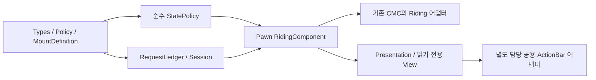

# Riding 코드 설계 — M1 상태·세션·탑승 기반

- 작성: 2026-11-06 / 담당: `riding-code-design-20261106`
- 상태: **M1a 값 로직·Actor 연결과 M1b 기본 외형·CMC 이동/예측·권위 보정 구현. 분리 전체 Editor 빌드/링크·Riding/감속/제어36 통과, 기존 권한 폐기 검사1 실패는14절에 별도 기록했다. 제품 보유 snapshot/API와 다인 네트워크 검증은 후속이다.**
- 기준: [기능 계약](RIDING_SYSTEM_DESIGN.md), [아키텍처와 HUD 인계](RIDING_SYSTEM_ARCHITECTURE.md), 게시 `d546e392`의 관련 기존 소스. 재개 시 게시 HEAD `2971c97c`와 별도 담당의 미커밋 `Docs/ACTION_BAR_CONTEXT.md`/`UI/ActionBar` 계약을 추가 대조했다. 공용 코드의 빌드/검증 완료 주장은 아니다.
- 목적: 첫 구현에서 만들 타입, 접근 제한, 판정 순서, 상태 수명, 검사 기준을 정한다. M2 액션 실행/M3 영속 저장은 포트만 정의하고 구현 완료로 취급하지 않는다.

## 1. 구현 의존과 파일 단위



화살표는 구현 순서/데이터 공급이다. 순수 판정은 컴포넌트·HUD·HTTP에 의존하지 않는다. 공용 ActionBar API가 늦게 확정돼도 Types/Policy/Session 설계를 다시 만들지 않도록 한다.

| 향후 경로 | 내용 | 이번 설계에서 고정할 경계 |
|---|---|---|
| `Public/Riding/RPGRidingTypes.h` | enum·공개 상태/명령/결과/값 view | BP에는 조회용 값만 공개, 서버 상태 setter 없음 |
| `Public/Riding/RPGMountDefinition.h` + Private cpp | PrimaryDataAsset 외형·안정 ID | 이동 성능은 공통 Policy에만 존재 |
| `Public/Riding/RPGRidingPolicy.h` + Private cpp | 프로토콜·공통 튜닝·검증/불변 값 복사 | 에셋 UObject를 SavedMove에 저장하지 않음 |
| `Public/Riding/RPGRidingStatePolicy.h` + Private cpp | 값 입력→허용/거절·전이 계획 | 난수·시계·GAS·월드 접근 없음 |
| `Private/Riding/RPGRidingRequestLedger.h/.cpp` | 고수위·최근32 명령 결과 | 고정 용량, 클라이언트가 저장 용량을 늘릴 수 없음 |
| `Public/Riding/RPGRidingSessionComponent.h` + Private cpp | PlayerState snapshot·예산·공통 시간 | 현재 Pawn의 Mode/mesh를 소유하지 않음 |
| `Public/Riding/RPGRidingComponent.h` + Private cpp | Pawn 바인딩·RPC·단일 전이·공개 복제 | 전이 setter는 private, 승인 권한은 서버만 |
| `Riding/RPGRidingMovementPrediction.h/.cpp` | M1b의 CMC 저장 이동/응답 어댑터 | 기존 Player CMC에 연결, 새 이동 컴포넌트 없음 |
| `Riding/RPGRidingPresentationComponent.h/.cpp` | M1b의 모델/자세·비동기 세대 | 이동/쿨타임 변경 없음 |

`Public`/`Private`는 `Source/Project_RPG/` 아래다. 구현 전 각 변경 파일과 빌드 자원을 별도 예약한다. 이번 문서 작업은 공용 Source를 선점하지 않는다.

## 2. 값 타입과 불변식

아래 C++는 **시그니처 설계 표기**다. USTRUCT/UCLASS/UPROPERTY, export/generated include, forward declaration과 serializer 구현을 생략했으므로 그대로 컴파일할 완성 헤더가 아니다.

```cpp
enum class ERPGRidingMode : uint8 { OnFoot, Mounted };
enum class ERPGRidingAction : uint8 { None, Dash, Emote };
enum class ERPGRidingSelectorKind : uint8 { Specific, Selected, RandomFavorites };

struct FRPGRidingStateKey
{
    FGuid RiderEpoch;
    uint32 StateRevision = 0;
    uint32 ActionSequence = 0;
};

struct FRPGRidingSelector
{
    ERPGRidingSelectorKind Kind = ERPGRidingSelectorKind::Selected;
    FString MountId; // Specific에서만 유효. 수신 길이/ASCII 규격 검사.
};

struct FRPGRidingSetCommand
{
    FGuid RiderEpoch;
    uint32 RequestSeq = 0;
    uint32 ExpectedStateRevision = 0;
    bool bDesiredMounted = false;
    FRPGRidingSelector Selector;
};

struct FRPGRidingMovementProfile
{
    int32 Version = 0; // admitted CatalogVersion
    float Speed = 0, Acceleration = 0, Braking = 0, YawRate = 0;
};

struct FRPGRidingRepState
{
    FRPGRidingStateKey Key;
    ERPGRidingMode Mode = ERPGRidingMode::OnFoot;
    FString MountId;
    int32 DefinitionVersion = 0;
    FRPGRidingMovementProfile Movement;
    ERPGRidingAction Action = ERPGRidingAction::None;
    FGuid ExecutionId;
    double ActionStartServerWorldSeconds = 0;
    float ActionDuration = 0;
    FVector_NetQuantizeNormal ActionDirection{FVector::ZeroVector};
    ERPGRidingEndReason LastEndReason = ERPGRidingEndReason::None;
};
```

`ERPGRidingResultCode`는 상세 설계 4.2절의 Applied/NoChange/NotOwned/NotReady/DefinitionMismatch/InCombat/ActionBlocked/WrongMovementMode/RegionDenied/Busy/StaleState/RateLimited/AuthorityRevoked를 사용한다.
`ERPGRidingEndReason`은 None/Manual/Replacement/Hit/Control/Region/MovementMode/Death/AuthorityRevoked/ContextLost/ExecutionRejected/Completed로 제한한다. UI 문구는 enum에서 매핑하고 서버 내부 오류 문자열을 복제하지 않는다.

| 조건 | 정규 형태 |
|---|---|
| 아직 바인딩되지 않음 | Epoch invalid, revision0, OnFoot, 입력 불가 |
| 새 서버 바인딩 | 서버 생성 Epoch, revision1/actionSequence0, OnFoot |
| OnFoot | MountId 빈 값, DefinitionVersion0, Action=None, ExecutionId invalid, 액션 시각/길이/방향0 |
| Mounted / None | 유효 MountId/정의 버전, 실행 필드는 초기값 |
| Mounted / Dash 또는 Emote | 유효 ExecutionId와 유한 시작시각/길이. Dash XY 정규 방향, Emote 방향0 |
| 하차·교체 | StateRevision 증가. 진행 액션이 있으면 ActionSequence도 증가하고 실행 필드 정리 |
| 액션 시작/종료 | 같은 StateRevision에서 ActionSequence 증가. M1은 항상 None |

Epoch GUID에는 대소 비교를 하지 않는다. 새 Epoch는 **현재 Pawn·PlayerState 바인딩의 서버 상태 복제**로 채택하고, 임의 명령 결과/asset callback은 다른 Epoch를 설치하지 못한다. 이미 폐기한 Epoch로 복귀하지 않는다.
같은 Epoch에서는 `(StateRevision, ActionSequence)` 순서로만 최신을 판단한다. overflow 직전 서버가 실행을 닫고 새 Epoch의 OnFoot를 발행한다. 클라이언트가 Seq/리비전 최대값을 보내 Epoch 교체를 강제할 수 없다.
MountId는 안정 ASCII 1~64자이며 서버 카탈로그에서 찾은 뒤에만 내부 캐시 키로 쓴다. 소유 snapshot 최대512/즐겨찾기32, 수신 필드의 길이/enum/유한성 검사와 엔진 RPC 한도를 적용한다. 무제한 사용자 문자열을 FName으로 먼저 intern하지 않는다.

## 3. 순수 판정과 명령 처리

```cpp
struct FRPGRidingDecision
{
    ERPGRidingResultCode Result;
    ERPGRidingTransition Transition; // None, Mount, Replace, Dismount
    FString ResolvedMountId;
    int32 DefinitionVersion = 0;
};

namespace RPGRidingStatePolicy
{
    FRPGRidingDecision Evaluate(
        const FRPGRidingEvaluationContext& Context,
        const FRPGRidingSetCommand& Command);
    bool IsCanonical(const FRPGRidingRepState& State);
}
```

`EvaluationContext`는 현재 RepState, 서버 권한/준비 플래그, 지면 모드, 행동/제어/전투 잠금, 서버에서 검증한 후보와 구역 결과를 담은 불변 값이다. UObject 참조나 클라이언트 자격 bool은 받지 않는다. 시계는 호출자가 관측한 값으로만 판정한다.
Selector 해석은 Session이 담당한다. 무작위는 새 요청의 적격 후보를 먼저 만들고 서버 난수로 한 번 선택한다. 결과는 전이/최초 영수증에 고정하며, 순수 판정 함수나 재전송에서 재추첨하지 않는다.

명령 처리의 순서:

1. 현재 소유 Pawn/Controller/PlayerState/World·폐기 여부를 확인한다. 유효 서버 Session이 있는 요청은 기존 `FRPGServerRequestBudget{8, 4.0}`을 우선 소비한다. 잘못된 값/중복도 예산을 소비한다.
2. 현재 Epoch, Seq/정규 명령 지문을 검사한다. 기존 결과 재생을 **ExpectedStateRevision 검사보다 먼저** 수행한다. 성공 후 리비전이 바뀌어도 원래 요청을 다른 실패로 바꾸지 않는다.
3. 새 요청은 ExpectedStateRevision이 현재와 같은지 확인한다. 다르면 StaleState이며 새 전이가 없다.
4. 명시적 하차는 보유 snapshot/카탈로그/구역/전투 잠금 때문에 거절하지 않는다. 이미 OnFoot면 NoChange, Mounted면 Dismount. 폐기된 바인딩의 네트워크 요청은 거절하고 서버 내부 정리가 수행한다.
5. 새 탑승/교체는 준비·정의/보유·지면·행동/전투·구역·액션 Busy를 검사한다. 이미 같은 탈것이면 현재 상태의 강제 하차 조건을 먼저 처리한 뒤 NoChange로 수렴한다.
6. 전이 계획의 준비가 성공하면 Component가 한 번 확정하고 결과를 보관한다. 검사 거절/준비 실패는 기존 상태를 유지한다.

서버의 강제 하차는 이 명령 예산/요청 큐를 통과하지 않는다. World 종료/피격/폐기에는 네트워크 요청 폭주와 무관하게 정리한다.

### RequestLedger

연결 Session에 고정 ring32를 두고 항목은 Epoch, Seq, 정규 명령, 최초 결과, 최초 결과의 상태 버전이다. 바인딩 Epoch가 바뀌면 ring/Seq 문맥만 교체하며 연결의 예산과 쿨타임은 유지한다.

| 입력 | 결과 |
|---|---|
| Seq0 / 잘못된 Epoch / 과도한 앞선 Seq | StaleState. 고수위를 클라이언트 값으로 올리지 않음 |
| 고수위 이하·캐시 안·내용 동일 | 최초 결과 재생. 현재 상태/쿨타임은 별도 최신 view로 동봉 |
| 같은 Seq·내용 다름 | StaleState. 기존 항목을 바꾸거나 덮어쓰지 않음 |
| 고수위 이하·캐시 밖 | StaleState. 재실행하지 않음 |
| 허용 범위의 새 Seq | 먼저 고수위/처리 중 항목 예약, 최종 성공/거절을 같은 항목에 기록 |
| 예산 소진 | RateLimited. 새 ledger 항목/고수위 변경 없음. 같은 명령을 나중에 재시도 가능 |

앞선 Seq 검사는 overflow를 피한 넓은 정수 계산으로 `NextExpected`보다 최대1024 앞까지 허용한다. 예약 중 callback 재진입의 같은 Seq는 다시 실행하지 않고 원 실행의 최종 결과를 기다린다.
지문은 DesiredMounted/ExpectedRevision/Selector 의미 필드 전체의 정규 값 비교다. 하차에는 Selector가 없어야 하며, Selected/RandomFavorites의 MountId는 비어 있어야 한다. 숨은 필드가 다른 명령을 동일하게 취급하지 않는다.

## 4. SessionComponent 계약

`URPGRidingSessionComponent : UActorComponent`를 ARPGPlayerState의 default subobject로 둔다. `UPawnExtensionComponentBase`는 Pawn을 전제로 하므로 PlayerState에 사용하지 않는다.

```cpp
// 공개 native 조회: 반환 값은 복사/불변 view. UObject의 내부 가변 참조를 노출하지 않음.
FRPGRidingSessionView GetOwnerView() const;
bool IsReadyFor(const FRPGRidingBindingKey& Binding) const;
void NotifyIdentityContextChanged(); // 서버에서 현재 owner를 직접 읽음

// private: 신뢰된 backend callback / 현재 Pawn Component만 호출
void ApplyAdmissionSnapshot(uint64 RequestSerial, FRPGRidingAdmissionSnapshot&& Snapshot);
void InvalidateContext(ERPGRidingEndReason Reason);
bool TryReserveAction(const FRPGRidingExecutionToken& Token,
                     ERPGRidingAction Action, double ServerNow);
void RecordApprovedHostileOutcome(const FRPGRidingHostileOutcome& Outcome);
```

`BindingKey`는 weak PlayerState/Pawn/Controller/World, 인증된 CharacterId/SessionId/ConnectionGeneration, RiderEpoch를 캡처하는 서버 native 문맥이다. account/세션 식별자는 공개 RepState에 넣지 않는다.
`SessionView`는 준비 상태·표시용 서버시각/쿨타임 종료·스냅샷 revision/소유자 표시 정보이며 OwnerOnly로 전송한다. 내부 ReadyAt와 CombatLockUntil은 서버 단조 시간으로 유지한다.
조회 상태는 WaitingIdentity/WaitingAdmission/LoadingSnapshot/Ready/RetryableFailure/Revoked다. enum 숫자의 크기로 유효성을 판단하지 않는다.

실제 인증 연결:

- [PlayerState](../Source/Project_RPG/Public/Player/RPGPlayerState.h)의 `SetAuthenticatedIdentity`와 `GetBackendConnectionGeneration`은 티켓 소비 문맥이다. `HasAuthenticatedCharacter()`만으로 snapshot을 승인하지 않는다.
- [GameModeBase](../Source/Project_RPG/Public/GameMode/RPGGameModeBase.h)의 `CompleteDungeonAdmission`/`ActivatedAdmissions`가 입장 확정 경계다. 기존 private map을 노출하지 않고, 구현 때 현재 신원/세대를 검사하는 좁은 서버 알림/조회 포트를 이 경계에 추가한다. 아직 존재하는 API가 아니다.
- Session은 확정 알림 또는 동일 문맥의 확정 조회 뒤 전용 backend snapshot을 취득한다. HTTP 완료 시 PlayerState·신원·ConnectionGeneration·RequestSerial·정책 hash를 모두 재검사한다.
- 백엔드 Riding API가 없는 M1 제품 경로는 NotReady로 남는다. 개발 fixture는 Shipping에 없는 검사 전용 진입점으로만 공급하고 일반 RPC/BP setter를 열지 않는다.
- 새 연결의 Dash10초/Emote2초 보호는 최초 인증 문맥을 만들 때 한 번 설정한다. snapshot 재시도/매 Pawn 바인딩마다 다시 설정하지 않는다.

Pawn 교체는 기존 쿨타임/전투 잠금을 보존한다. 서버 프로세스/PlayerState 교체는 상세 설계의 입장 보호 규칙을 적용한다. 다른 신원으로 바뀌면 이전 snapshot/결과를 폐기하고 새 신원으로 초기화하며, 같은 객체 주소 재사용을 신원 유지로 간주하지 않는다.

## 5. PawnComponent 계약과 재진입 처리

`URPGRidingComponent : UPawnExtensionComponentBase`는 ARPGPlayer의 default subobject다. NPC에는 생성하지 않는다. 기존 ASC 준비/ActorInfo 경로를 유지한다.

```cpp
// public: 수명 통지와 읽기 전용 projection
void NotifyOwnerContextChanged();
FRPGRidingRepState GetRidingState() const;
FRPGRidingLocalView GetLocalView() const;
bool TryBuildMovementProfile(FRPGRidingMovementProfile& Out) const;

// 소유 클라이언트의 로컬 명령 façade. Seq/Epoch는 여기서 현재 값으로 구성.
void RequestSetMounted(bool bDesiredMounted, const FRPGRidingSelector& Selector);

// private UFUNCTION RPC: 서버 소유권·현재 binding 검사 필수
void ServerSetRiding(FRPGRidingSetCommand Command); // Server, Reliable
void ClientRidingResult(FRPGRidingCommandResult Result); // Client, Reliable

// native server-only: 다른 전투/권한 시스템을 위한 제한된 종료 포트
void ForceDismount(ERPGRidingEndReason Reason);

// private: 유일한 mutation 경계
void CommitTransition(const FRPGRidingDecision& Decision);
void ApplyAuthoritativeState(const FRPGRidingRepState& State);
void EndOwnedExecution(const FRPGRidingExecutionToken& Token);
void ReleaseBinding();
```

Native server-only도 내부 `HasAuthority`/현재 binding 검사를 수행한다. BlueprintAuthorityOnly 표기만으로 권한을 대신하지 않는다. `ClientRidingResult`는 캐시된 최초 결과와 최신 권위 snapshot을 분리하며, RPC 응답으로 이전 리비전을 현재 상태에 되쓰지 않는다.

전이는 다음 순서로 구현한다.

1. 새 상태를 local 값으로 준비/정규화하고 필요한 정의/핸들을 확인한다. 준비 실패는 기존 상태 유지다.
2. `bApplyingTransition`을 세우고 새 상태 Key를 먼저 저장한다. callback은 이 Key와 현재 바인딩을 다시 검사한다.
3. 자기 이전 실행/GE를 정리하고 새 Mounted 투영·이동 프로필을 적용한다. 완료 뒤 canonical state를 확인한다.
4. 오류나 적용 중 강제 하차가 발생하면 새 리비전의 OnFoot로 수렴한다. 중간 Mounted를 외부 성공 결과로 발행하지 않는다.
5. 정리까지 끝낸 최종 상태만 dirty 표시/OnChanged/요청 결과로 발행한다. Listen Server 로컬 view도 같은 경로로 갱신한다.

재진입을 이유로 ForceDismount를 버리지 않는다. 적용 중에는 고정 크기의 `bForceDismountPending`/이유만 기록하고 외부 성공 알림 전에 처리한다. 폐기/사망 우선, 그 외 이유는 안정된 우선순위를 사용한다. 중첩 상태 변경 큐를 무제한 만들지 않는다.
적용 중 새 사용자 명령은 Busy 결과로 종료하며, ForceDismount의 callback이 다시 같은 정리를 요청해도 한 번만 회수한다. 자신의 끝난 핸들을 먼저 무효화하고 해제해 재진입 이중 해제를 막는다.

## 6. 초기화·복제·종료 연결

| 실제 연결점 | M1에서 할 일 |
|---|---|
| [RPGBaseCharacter의 ASC 초기화](../Source/Project_RPG/Private/Character/RPGBaseCharacter.cpp) | `InitAbilityActorInfo(this,this)` 유지. Riding 때문에 ASC 소유자를 변경하지 않음 |
| [RPGPlayer PossessedBy](../Source/Project_RPG/Private/Character/RPGPlayer.cpp) | startup의 최초/재진입/이미 초기화 분기에서 동일한 멱등 준비 평가. 사망/폐기된 분기를 우회하지 않음 |
| OnRep_PlayerState / PawnClientRestart | 로컬 ASC/Controller가 늦게 준비되는 순서도 재평가. 서버에서만 grant, 클라이언트는 준비된 spec을 기다림 |
| UnPossessed / EndPlay / OnUnregister | 현재 바인딩 폐기→자기 실행·delegate·표현 정리. 같은 종료 중복 호출 허용 |
| 신원 변경/폐기·월드 종료 | Session의 pending callback 무효화와 Pawn 도보 종료. 타 시스템 cleanup 대행 금지 |

`GetLifetimeReplicatedProps`에서 공개 RepState와 OwnerOnly view를 구분한다. 현재 프로젝트처럼 push model을 쓰면 실제 값 확정 후 해당 프로퍼티를 dirty로 표시하고 필요 시 ForceNetUpdate한다. 서버 상태 변경을 RepNotify가 실행해 줄 것이라 가정하지 않는다.
최신 상태 비교/적용은 RepNotify, ClientResult의 최신 snapshot, CMC correction response가 공유한다. Owner의 예측 표시와 관찰자의 현재 상태 표시를 분리하되 복수 authoritative Mode를 만들지 않는다.
Actor relevancy 재진입·HUD 재생성은 현재 snapshot만으로 복구한다. 새 바인딩 식별 전에 도착한 응답은 적용하지 않으며, 초기 복제 상태가 준비되면 조회/요청 가능 상태를 다시 평가한다.

종료 시 보존할 것: Session의 같은 신원 쿨타임, 타 능력/GE/RMS, 현재 다른 입력/카메라 소유자, 기존 스킬 편성. 회수할 것: 자기 grant(ASC 종료 때), Mounted GE, 실행 핸들, weak binding/delegate, 로드 요청 세대, 공용 호스트 등록 handle.

## 7. M1b 이동·표현과 공용 HUD에 넘길 값

`FRPGRidingMovementProfile`은 Key·정책 버전·WalkSpeed/Acceleration/Braking/YawRate·지상 제한의 불변 값이다. 기본값은 상세 설계를 따른다. Mounted=false일 때는 프로필 override가 없고 기존 도보 함수를 그대로 사용한다.
[PlayerMovementComponent](../Source/Project_RPG/Private/Component/RPGPlayerMovementComponent.cpp)의 폐기된 Pawn 이동 거절은 Riding 조회보다 먼저 유지한다. 공통 CMC의 도보 base-limit/GAS 공식은 변경하지 않고 승인된 Riding branch를 추가한다.
M1a에는 bool 복제만으로 이동 완료를 선언하지 않는다. M1b에서 SavedMove/packed response·구간 sweep/구역/발판 이동을 연결하고 R02/R03/R06을 확인해야 한다. 엔진 override/serializer의 최종 시그니처는 실제 설치 엔진 헤더 대조 및 컴파일로 확정한다.

표현에는 StateKey/MountId/정의 버전만 넘기고 비동기 load generation을 추가한다. callback의 Pawn/World/Key/MountId/generation이 현재와 같을 때만 모델을 설치한다. 서버 상태가 Mounted인데 외형 로드가 실패하면 placeholder이며 서버 속도를 도보로 바꾸지 않는다.

공용 HUD 인계는 `actionbar-context-20261106`의 `Docs/ACTION_BAR_CONTEXT.md`와 `UI/ActionBar/**`가 기준이다. 재개 시 실제 헤더/호출이 생성되어 아래 어댑터 시그니처를 맞췄다. **완료된 것은 코드 연결 설계이며 실제 Riding/C++ 구현이나 공용 UI 통합 완료가 아니다.** 공용 파일은 상대 담당의 검증·게시 전 작업 상태이므로 구현 시 최종 계약을 재조회한다.
`FRPGRidingLocalView`에는 아래만 포함하며 공용 타입으로 변환하는 코드는 `RPGRidingQuickSlotAdapter` 한 곳에 둔다.

- 현재 LocalPlayer/World/Pawn의 바인딩 token, StateKey, Ready/Mounted, 탈것 표시값.
- ActionId/아이콘/현재 키·활성/차단 이유·서버시각 기반 쿨타임 view.
- 논리 RidingShortcut의 설정/저장 상태와 명령을 실행할 현재 세대.

공용 호스트가 물리 슬롯/키/페이지를 결정한다. 화면 전환이 서버 Mode를 바꾸거나 쿨타임을 초기화할 수 없다. M1 타입/Session/상태 판정은 이 인계와 독립적이며 공용 QuickSlot/HUD/Controller와 다른 담당의 현재 HttpWebManager/Backend 변경은 이번 작업에서 수정하지 않는다.

### 실제 공용 API를 소비하는 어댑터

```cpp
class FRPGRidingQuickSlotAdapter final : public IRPGActionBarProvider
{
public:
    APawn* GetActionBarPawn() const override;
    const URPGActionBarProfile* GetActionBarProfile() const override;
    FRPGActionBarActionView ReadAction(FName ActionId) const override;
    void PressAction(FName ActionId) override;
    void ReleaseAction(FName ActionId) override;
private:
    TWeakObjectPtr<URPGRidingComponent> Riding;
    TWeakObjectPtr<APawn> BoundPawn;
    FGuid BoundEpoch;
};
```

컴포넌트의 로컬 바인딩이 `TSharedPtr<FRPGRidingQuickSlotAdapter>`를 보유하고 승인 Mounted에서 `Slots->GetActionBarContext()->Activate(Adapter.ToSharedRef())`로 설치한다. 공용 context도 shared provider를 보유하지만 provider는 컴포넌트/Pawn을 weak 참조해 소유 순환을 만들지 않는다.
프로필은 컴포넌트의 UPROPERTY로 로드/유지하고 provider가 조회한다. Dedicated Server에서는 이 로컬 UI 프로필을 로드하거나 provider를 생성하지 않는다. 원격 Pawn에도 로컬 입력 호스트를 설치하지 않는다.

| 공용 계약 | Riding 구현 규칙 |
|---|---|
| `URPGActionBarProfile` | `ProfileId=Riding`, 안정 ActionId `dash/emote/dismount` 3개. Label/Icon은 profile entry, 성능/권한은 Riding. 최대8개 제한 준수 |
| `LeftWidgetClass` / `CenterWidgetClass` | 최초 연결은 둘 다 null로 native 좌측 바 사용·탑승 중 직업 중앙 표시 숨김. HUD 담당 presenter가 원래 위젯을 보존/복귀하며 Riding은 부모 Canvas 미편집 |
| `SkillSlot` / `InputTag` | 기존 물리 입력을 재사용할 동작만 명시 연결. `INDEX_NONE`은 추가 입력 경로. 같은 물리 키를 기존 슬롯과 Riding IMC 양쪽에 동시에 바인딩하지 않음 |
| `ReadAction` | 현재 Pawn/Epoch/승인 Mounted/ActionId 재검사 후 bAvailable·KeyLabel·CooldownRemaining/Duration 반환. 쿨타임은 서버 시각 투영으로 계산, 조회 중 상태 변경/에셋 로드/RPC 없음 |
| `PressAction` | 현재 상태를 다시 읽고 Dash/Emote는 GAS, dismount는 명시적 `RequestSetMounted(false, empty selector)`로 전달. 허용되지 않는 ID 무시. UI 활성 값만으로 서버 검사를 생략하지 않음 |
| `ReleaseAction` | v1 세 액션은 누를 때 한 번 실행하므로 release로 재발동하거나 승인된 Dash를 취소하지 않음. 자기 로컬 press bookkeeping만 정리. 하차/강제 취소는 서버 상태 경로가 담당 |
| `Context->GetRevision()` | 공용 UI 전환 revision. Riding StateRevision/ActionSequence와 별개이며 서로 대입하지 않음 |
| `PressAction(Source, Id, ExpectedRevision)` / `ReleaseInput(Source)` | 전용 IMC도 이 단일 경로로 합류. 입력 시작 시 저장한 context/revision/Source에 release를 전달하고 새 context에 옛 입력을 전달하지 않음 |
| `Deactivate(ExpectedProvider)` | 자신이 설치한 shared provider identity로만 해제. 전체 Shutdown은 Pawn/context 소유자에게 맡김. 옛 provider 종료가 후속 provider를 제거하지 않음 |

동일 Pawn/Epoch에서 탈것만 교체하면 같은 provider/profile을 유지하고 ReadAction이 현재 상태를 읽는다. 새 Epoch는 기존 provider를 회수한 뒤 새 인스턴스로 연결한다. 단순 HUD 재생성은 Pawn context/provider를 재생성하거나 쿨타임을 초기화하지 않는다.
Activate/Deactivate가 전환 중이라 false를 반환하면 자기 바인딩을 재검사한 뒤 게임 스레드의 다음 갱신에서 한 번 재평가한다. 다른 provider가 현재 표시를 소유한 경우 Riding이 매 프레임 Activate해 되빼앗지 않는다. 공용 우선순위/복귀 정책이 필요한 기능 경합은 호스트 담당과 계약 후 연결한다.
보유한 delegate/재시도 핸들은 종료 시 제거한다. provider의 현재성 검사는 raw UObject 주소뿐 아니라 weak 참조와 Epoch를 사용한다. 종료 직후 ReadAction/PressAction이 불려도 빈 view/무동작으로 수렴한다.

공용 API의 제공 범위와 남은 인계는 다음처럼 구분한다.

- `FRPGActionBarActionView::UnavailableReason`은 공용 HUD 담당이 2026-11-08 추가한 지역화 표시 필드다. RidingLocalView의 차단 사유 enum을 문구로 변환해 제공하며 서버 내부 오류 문자열을 노출하지 않는다. 공용 native 셀은 비활성일 때 이 사유를 툴팁으로 읽고, 빈 값에는 공통 안내를 표시한다. 실제 Riding 제공자의 값 전달은 해당 어댑터 구현에서 연결한다. 최신 계약은 [공통 액션바](ACTION_BAR_CONTEXT.md)를 따른다.
- `IRPGActionBarProvider`는 액션 실행 인터페이스다. `RidingShortcut`의 Selected/Specific/RandomFavorites 배정·드래그 저장 포트는 포함하지 않는다. 기존 배열을 변조하거나 `ReadAction`에 저장 부작용을 넣지 않고 별도 배정 인계로 연결한다.
- 공용 `OnChanged`는 전환/구조 변경 알림이다. Riding 상태/쿨타임 이벤트로 provider를 재설치하지 않는다. 실제 widget의 ReadAction 갱신 경로를 소비하고 필요할 때 별도 값 갱신 계약을 인계한다.

## 8. 구현 순서와 회귀 검사 계약

| 순서 | 변경 묶음 | 핵심 반례 / 통과 기준 |
|---|---|---|
| 1 | Types·정의/Policy·순수 판정 | OnFoot 정규화·미보유/금지 구역·사망/CC·하차는 NotReady에서도 가능·외형/성능 분리 |
| 2 | Ledger·Session의 값 상태 | 중복32/오래된Seq/다른본문/큰점프·overflow·RateLimited·재진입·재추첨0·Pawn 교체 쿨타임 보존 |
| 3 | Pawn/PlayerState 컴포넌트·수명/복제 | 초기화 순서 교환·중복 Possess·오래된 HTTP/다른 신원·강제 하차 재진입·자기 핸들만 종료 |
| 4 | CMC prediction·프로필·구역·기본 외형 | R01~R03/R06/R08 중 M1 범위, 80~160ms/5% 손실·중도 참가·도보/NPC 회귀 |
| 5 | M2 액션/서버 전투 가드·HUD 제공자 | 기존 아키텍처 M2a/M2b. 공용 계약 인계 후 단일 입력 dispatch와 R09 통합 |

문서의 반례는 향후 구현에 필요한 회귀 계약이다. 이번에는 테스트 코드를 만들거나 게임 검사를 실행하지 않는다. 소스 구현 시 기능별 검증/자기 임시 정리/커밋·푸시를 수행한다.
UI 제공자 단위 성공, 실제 HUD 통합, 전체 탑승 기능 완료를 각각 구분한다. 제품 보유 snapshot과 M2 서버 행동 가드가 없는 M1 개발 단계에서 feature flag를 공개 활성화하지 않는다.

## 9. 검토와 남은 인계

현재 소스의 Pawn 소유 ASC, PlayerState 티켓 세대, GameMode 입장 확정 경계, 공통 요청 budget, PawnExtension의 소유자 가정, Player CMC 폐기 가드를 대조했다. 상세 설계의 상태/요청/쿨타임/공용 HUD 책임과 일치하도록 위 계약을 작성했다.
문서 검증은 상대 링크·표·코드 fence·필수 계약/공백 검토다. 제품 코드/실제 RPC serializer·UHT/CMC correction·Iris 실행 성공 증거는 아직 없다.
공용 provider/context/profile 시그니처 대조와 Riding 어댑터 설계까지 완료했다. 차단 사유는 공용 `UnavailableReason`으로 전달하며, 논리 슬롯 배정은 별도 포트의 인계 항목이다. 실제 구현 착수 때 최신 [작업 조율](Online_RPG_Development_Roadmap.md)과 상대 담당이 검증·게시한 계약 파일을 다시 읽는다.
임시 산출물 생성/삭제 0 bytes, 보관 예외 없음.

## 10. M1a 첫 기반 구현 — 2026-11-06

실제 소스는 [Riding 타입](../Source/Project_RPG/Public/Riding/RPGRidingTypes.h), [공통 정책](../Source/Project_RPG/Public/Riding/RPGRidingPolicy.h), [MountDefinition](../Source/Project_RPG/Public/Riding/RPGMountDefinition.h), [순수 판정](../Source/Project_RPG/Public/Riding/RPGRidingStatePolicy.h)과 각각의 Private cpp 8개다.
앞 절의 시그니처는 설계 기록이고 이 4쌍에 대한 최종 선언은 실제 헤더를 따른다. 기존 Player/PlayerState/CMC/ASC·공용 HUD/입력 파일을 수정하지 않았다.

- 안정 ID/명령 형식·정규 상태·Epoch 내 순서 비교를 구현했다. 다른 Epoch를 GUID 대소로 비교하지 않는다.
- Policy를 검증한 값 복사로 내보낸다. manifest hash 미설정은 실패하며, 실패 시 이전 성공 출력이 남지 않는다. v1 authoring 범위는 속도1~5000, 가속/제동1~20000, 회전1~1080, Dash거리1~5000·시간0.05~5·쿨타임0.05~10초(시간 이하 쿨타임 금지), 전투 잠금0.05~60초, Emote시간0.05~3·쿨타임0.05~2초다. 모두 유한 값을 요구하며 기본 성능600/900cm·0.6초/10초는 유지한다.
- Mount는 성능 필드 없이 외형 soft reference/안정 ID를 소유한다. 서버용 metadata 검사는 로드하지 않고, Editor DataValidation은 참조와 Saddle socket을 실제 해석한다. catalog 최대512/중복 ID를 검사한다. manifest exporter/cook/두 모델의 저작·애니메이션 호환성 전체 검증은 M4다.
- 순수 판정은 현재 서버 문맥을 받아 Mount/Replace/Dismount/None과 사유를 반환한다. 명시 하차는 준비/전투/지면/액션 제약을 우회하되 오래된 세대·폐기된 권한은 거절한다. 함수 자체는 상태·GAS·월드에 부작용을 만들지 않는다.

유지 회귀는 [RPGRidingFoundationTests](../Source/Project_RPG/Private/Tests/RPGRidingFoundationTests.cpp)의 Values/CanonicalState/AdmissionGuards/Transitions/Authoring 5개다. [집중 러너](../Scripts/Tests/Run-RidingFoundationTests.ps1)는 실제 소스9개를 별도 최소 Editor 모듈로 복사해 UHT/C++/native 검사를 수행하고 finally에 자기 전체 runtime/OBJ/DLL/PDB/cache를 정리한다. 다른 담당의 미완료 소스나 원본 게임 DLL은 사용하지 않는다.
이 검사는 첫 기반의 독립 모듈 검사이며 전체 Project_RPG 타깃·Iris·실제 탑승/외형 검사와 다르다. 다음 구현은 요청 ledger/세션 수명과 Pawn 상태/CMC 연결이다. 이전 절의 임시0 bytes는 문서 설계 당시 기록이다.

검증 결과: `Saved/BuildChecks/RidingFoundation-20261106/d0b26b1a524442ea91b06e426b9ad3fe/Result.json`. 설치형 UE5.8 prebuilt UBT의 사설 최소 모듈 UHT/13단계 컴파일·링크 성공/종료0, 같은 `4E81AAA5…C33427A` DLL의 native5 전부 Success·검사 오류/경고0·UE 종료0. 원본 소스9개의 전후 SHA256이 일치했다. 에디터 기동의 자동화 등록 Error15와 비활성 ACL 플러그인 기본 에셋 Warning4는 검사 시작 전 환경 로그로 별도 보존했으며 전체 로그 무오류 주장은 하지 않는다.
첫 Build.bat 전역 대기는 자기 wrapper만 중단했고, 다음 시도의 컴파일은 성공했지만 에디터 QueryTargets가 같은 대기에 들어가 자기 runtime/query만 중단했다. 러너를 직접 prebuilt UBT·전용 UBA 저장 경로·사전 QueryTargets로 보완한 최종 실행이 위 성공이다. 초기 두 중단을 성공으로 소급하지 않는다.
세 시도의 자기 사본/생성 코드/PCH/OBJ/DLL/PDB/runtime/cache **5,450,374,357 bytes(약5.08GiB)**를 finally 정리, 자기 임시 경로 잔여/예외0. 작은 로그/명령/해시/결과만 로컬에 보존한다. 엔진이 자체 기록하는 사용자 전역 UBT trace와 기존 공유 캐시는 소유권이 혼재하므로 삭제하지 않았다. DLL 해시는 폐기된 검증 당시 증거이며 동일 바이너리의 재실행을 보장하지 않는다.

## 11. M1a 서버 세션 내부 로직 — 2026-11-06

구현 순서 2의 [RequestLedger](../Source/Project_RPG/Private/Riding/RPGRidingRequestLedger.h)와 [Session](../Source/Project_RPG/Private/Riding/RPGRidingSession.h)을 private native 값 로직으로 분리했다. 앞 절의 SessionComponent가 장차 이 객체를 연결당 하나씩 소유한다. 실제 ARPGPlayerState default subobject·GameMode 확정 입장 포트·Pawn RPC·HTTP는 아직 연결하지 않았고, 이 코드 자체가 인증이나 입장 승인의 증거를 만들지 않는다. 공용 HUD/입력은 수정하지 않았다.

- Ledger는 고정32칸, 64비트 중간값의 최대1024 앞선 Seq 허용, 정규 명령 전체 비교, 최초 성공/거절과 당시 상태를 저장한다. 같은 Seq의 다른 내용·삭제된 과거 Seq·0/큰 점프를 거절한다. 처리 중 항목은 ring 회전에서도 보존하고 중복 호출에는 완료 토큰을 발급하지 않는다. 토큰의 Epoch/Seq/서버 GUID가 맞는 최초 완료만 기록한다.
- Session은 연결의 기존 burst8/초당4 예산을 명령과 액션 예약에 공유한다. 중복/잘못된 명령도 먼저 소비하며 소진 시 ledger를 변경하지 않는다. 결과 재생은 ExpectedRevision 검사보다 앞선다. 전이 중 새 요청은 Busy를 기록하고, 명시 하차는 snapshot 미준비에서도 예약할 수 있다. 반환 Disposition의 Pending은 최종 응답이 아니며 원 실행의 완료를 기다린다. 기록된 Receipt.State는 **과거 결과**이고 현재 Pawn 상태로 다시 설치하지 않는다.
- Identity는 서버 어댑터가 검증한 Character/Session GUID·ConnectionGeneration와 PlayerState/Controller/World 문맥 변경마다 새로 만드는 AuthorityContext를 받는다. 실제 소유권 검사는 후속 어댑터의 필수 책임이다. 단순 identity 설치만으로 Ready가 되지 않으며 일치하는 입장 확정·유효 Policy·snapshot 검증까지 필요하다. Policy는 해당 문맥에 한 번만 설치한다.
- Snapshot 요청은 GUID 티켓으로 해당 신원/요청을 고정한다. 이전 시도·다른 신원·폐기 후 콜백을 무시하고, 응답의 프로토콜/카탈로그/hash·Roster·revision>=0·소유 최대512/즐겨찾기32·중복/미보유 선택을 검사한 뒤 한 번 복사한다. 빈 보유 목록은 유효하다. 실패는1/2/4초 재시도 후 새 사용자 요청에만10초 간격 재조회한다. 실제 HTTP 스케줄링·응답 timeout은 후속 어댑터 책임이다.
- 새 신원에 Dash10/Emote2초 보호를 적용한다. 같은 신원 통지·snapshot 재시도·Pawn 재바인딩은 쿨타임/전투 잠금을 초기화하지 않으며, 다른 신원도 연결 요청 예산을 초기화하지 않는다. Pawn 바인딩은 서버 Epoch와 ledger/액션 순서만 교체한다. Revoked는 같은 세션 객체에서 되돌릴 수 없다.
- 승인된 액션의 정규 상태/버전과 단조 시계를 받아 쿨타임을 callback 전에 예약하고, 동일/이전 실행 버전은 거절한다. 승인된 적대 결과는 명령 예산 없이 전투 잠금을 연장한다. 이는 M2 GAS 발동/현재 상태·보유·구역 승인 검사를 대신하지 않는다. 취소/하차에 환불 API는 없으며 seamless travel 시간 복사·표시용 서버 월드 시각 변환은 후속이다.

소유 snapshot의 세션 수명은 Pawn과 독립적이다. 같은 신원에서 Pawn만 바뀌는 동안 도착한 유효 snapshot은 세션에 저장할 수 있으나, 콜백에서 탑승/외형을 적용하지 않는다. Selector 해석/적격 후보와 서버 무작위 선택·단일 Pawn 전이 확정은 다음 컴포넌트 단위에서 연결한다. 이 절은 M1 전체 완료가 아니다.
`BeginCommand`의 Reserved는 요청 처리권 예약이며 탑승 허가가 아니다. 소비자는 현재 소유권/바인딩을 확인하고 후보를 해결한 뒤 기존 StatePolicy로 보유·정의·지면·전투·구역을 판정하고, 단일 전이를 마친 최종 상태만 CompleteCommand에 기록해야 한다. Callback 재진입으로 Epoch가 바뀌거나 폐기되면 이전 완료 토큰은 실패한다.

[Session 회귀](../Source/Project_RPG/Private/Tests/RPGRidingSessionTests.cpp)는 ledger 재생/용량·입장 재시도/유효성·요청 예산/재진입·쿨타임/폐기 수명 6개다. `Scripts/Tests/Run-RidingFoundationTests.ps1 -IncludeSession`으로 실제 소스15개(기존 기반/검사9, 신규5, 기존 예산 헤더1)를 사설 최소 모듈에 복사하여 기반5+세션6을 검사한다. 원본 게임 DLL이나 타 담당 미완료 코드의 통합 검사와 구분한다.

검증 결과: `Saved/BuildChecks/RidingSession-20261106/Completion.json`과 `ecc3febd78f64ecb9398d34ac3b9d380/Result.json`. 사설 UHT/16단계 C++·링크 종료0, 같은 `0AD986B0…6A245DE` DLL에서 native11 Success·검사 오류/경고0·UE 종료0. 입력15 SHA256 전후 일치. 기동 자동화 등록 Error15/ACL 에셋 Warning4는 검사 전 환경 로그이며 검사 중/후 오류0이다. 첫 시도는 새 검사 Flags의 uint32/EAutomationTestFlags 타입 불일치로 컴파일 실패했고, 선언 수정 후 위 최종 검증을 통과했다.
두 시도의 자기 사본/PCH/OBJ/DLL/PDB/runtime/cache **5,394,768,568 bytes(약5.02GiB)**를 finally 폐기했다. 실행/임시 폴더 잔여0, 공유 엔진 trace/cache는 보존했다. 자동 승인 검토가 자기 중복 진단 로그5개의 명시 삭제를 `blocked by policy`로 거절하여 **7,557,731 bytes**는 로컬 정리 예외로 남겼다(담당 riding-session-20261106, 정책 허용/후속 정리 시 삭제). 소스/검사/기능 문서만 게시하며 이 로그는 Git에 포함하지 않는다. 검증 DLL 해시는 폐기 당시의 증거다.

## 12. M1a Actor 연결 — 2026-11-07

[SessionComponent](../Source/Project_RPG/Public/Riding/RPGRidingSessionComponent.h)는 실제 ARPGPlayerState의 default subobject로 생성한다. 기존 인증 setter는 Riding 문맥을 먼저 갱신하고 신원 폐기/EndPlay는 같은 세션을 되살릴 수 없게 폐기한다. GameMode는 ActivatedAdmissions를 외부에 노출하는 대신 HasConfirmedDungeonAdmission으로 현재 PlayerState/Controller/소켓/Driver·캐릭터/Steam/세션/세대·계획 종료/폐기 상태를 매번 대조한다. 확정 입장 직후, Pawn 생성 전에 Riding 문맥을 재평가한다.

[PawnComponent](../Source/Project_RPG/Public/Riding/RPGRidingComponent.h)는 ARPGPlayer에만 생성한다. 엔진 ControllerChanged/Restarted 통지와 주기적 현재 문맥 검사로 바인딩 순서 차이·해제/재등록을 처리하며, 매 RPC 전에 현재 소유 Pawn·Controller·PlayerState·World·입장 자격을 다시 검사한다. 같은 현재 바인딩 재평가는 Epoch를 바꾸지 않는다. Pawn 교체는 이전 컴포넌트 상태를 비우고 새 Epoch의 OnFoot를 발행하며 세션 예산/시간은 보존한다.

- ServerSetRiding은 연결 ledger를 소비해 중복/오래된 요청을 먼저 판정하고, 새 요청만 snapshot의 Selected/Specific/RandomFavorites를 해석한다. 무작위 후보는 서버에서 보유/정의/제한 없음 조건을 통과한 뒤 한 번 추첨한다. 같은 요청을 재생할 때는 재추첨하지 않는다.
- 기존 ASC의 CurrentHealth·사망/제어/감속/홀딩/회피/방어 태그와 진행 중 Player Ability(타깃 잠금 제외), Walking 모드와 세션 전투 잠금을 판정에 공급한다. 명시 하차는 ASC/snapshot 미준비에서도 허용한다. 실제 승인 피해/적대 결과 producer와 능력 활성화 차단은 M2에서 연결한다.
- 공개 State는 단일 구조로 복제하고 같은 Epoch의 이전 상태는 RepNotify에서 무시한다. ClientResult는 최초 결과/당시 상태와 최신 상태를 분리해 알리며, 응답으로 권위 상태나 다른 Epoch를 설치하지 않는다. OwnerOnly 데이터에는 준비/표시용 쿨타임 종료시각만 포함하며 계정·인증 식별자는 넣지 않는다.
- 상태 변경 callback에서 들어오는 강제 하차는 고정 pending 사유로 처리한다. 폐기/해제는 자기 바인딩을 먼저 끊고 중복 정리를 허용한다. revision overflow 전에 기존 바인딩을 닫고 새 OnFoot Epoch를 만든다. 첫 단위에는 실행/GE/RMS가 없어 다른 능력의 핸들을 해제하지 않는다.

제품 보유 API/HTTP transport가 없으므로 제품 경로에서 Ready를 만들지 않는다. Snapshot을 주입하는 친구 접근은 WITH_DEV_AUTOMATION_TESTS에서만 컴파일한다. 정의에 RegionTags가 있으면 실제 구역 어댑터가 연결될 때까지 거절한다. 이동 프로필/예측/충돌·모델/애니메이션·HUD 제공자 및 쿨타임 표시 시각의 주기적 보정은 M1b/M2 후속이다. 이 단위의 Mounted 상태 성공은 실제 탈것 외형/속도나 Iris 다인 통합 성공을 뜻하지 않는다.

[Actor 회귀](../Source/Project_RPG/Private/Tests/RPGRidingActorTests.cpp)는 실제 엔진 Controller/PlayerState/Character/GAS·컴포넌트를 생성해 탑승/교체/중복·Pawn 교체/사망/폐기·강제 하차 재진입·오래된 상태/응답을 검사한다. `Run-RidingFoundationTests.ps1 -IncludeActors`는 기존11+Actor4를 사설 최소 모듈에서 실행한다. [통합 컴파일 러너](../Scripts/Tests/Run-RidingIntegrationCompile.ps1)는 게시 원본 전체 소스와 본인11입력만 overlay하여 프로젝트 UHT 및 실제 Player/PlayerState/GameMode CPP4의 컴파일을 검사한다. 전체 모듈 링크/실행과 구분한다.

검증 근거는 `Saved/BuildChecks/RidingActors-20261106/Completion.json`이다. `5e096586be8c4e7c89c9446f5207f02d`의 UHT/20단계 컴파일·링크/UE 종료0, 같은 `8174E4A0…6C39A29E` DLL의 native15 전부 Success·검사 오류0. 격리 프로젝트의 GameplayCueNotifyPaths 미설정 경고1이 있어 원래 러너의 strictWarnings gate는 false이며 이를 무경고 성공으로 바꾸지 않았다. 기능 검사15는 통과했고, 다음 실행부터 해당 경고를 없애도록 러너가 전용 DefaultGame.ini를 쓰게 보완했다(이 설정 보완은 구문/분기 검토, UE 재실행 없음). `Integration-3e8658121d334ecaadb7430ac3a2a8c5`는 실제 프로젝트 UHT/CPP4 컴파일 종료0·원본 입력11 SHA 일치이며 새 DLL 링크 검사가 아니다. Actor 검사의 입력23 SHA도 현재 소스와 일치했다.
초기에는 pimpl의 생성 코드 수명/복제 매크로 인자/포인터 추론을 수정했고, 검사 월드 중복 초기화로 실패한 실행과 수정된 fixture를 혼동하지 않는다. 통합 첫 시도의 CPP4 컴파일 자체는 성공했으나 불필요하게 감시하던 별도 검사 CPP 수정으로 최종 input gate가 실패하여, 실제 통합 입력11만 고정한 위 최종 시도를 따로 통과했다.
모든 시도의 자기 사본/PCH/OBJ/DLL/PDB/runtime/cache **8,404,536,996 bytes(약7.83GiB)**를 finally 정리했다. 본인 실행/임시 폴더 잔여0·이번 정리 예외0, 작은 로그/명령/해시/결과만 유지한다. 엔진 공용 trace/cache 및 앞 단위에 기록한 로그 정리 예외는 보존했다. 해시는 이미 폐기한 검증 당시의 증거다.

## 13. M1b 기본 외형과 비동기 수명 — 2026-11-08

[PresentationComponent](../Source/Project_RPG/Public/Riding/RPGRidingPresentationComponent.h)는 실제 ARPGPlayer의 default subobject이며 현재 공개 Riding 상태와 로컬 MountDefinition만 읽는다. 서버의 권한/속도/쿨타임을 변경하지 않는다. `GetPresentationDefinition`은 현재 MountId/정의 버전과 유효 metadata가 일치할 때만 읽기 전용 정의를 반환한다.

- Mounted 복원은 최초 BeginPlay·현재 snapshot·OnChanged·재등록/늦은 컴포넌트 준비에서 같은 경로로 수행한다. 같은 Epoch/StateRevision/정의의 액션 통지는 로드를 다시 시작하지 않는다. 다른 Mount/리비전/바인딩·mesh 교체는 이전 요청과 표시를 회수한다.
- `RequestAsyncLoad`로 Mount mesh/AnimClass/RiderPoseLayer를 읽고, 로컬 GUID·현재 Pawn/World/mesh·Epoch/StateRevision/MountId/정의 버전/soft path/offset이 모두 맞을 때만 설치한다. 하차/교체/폐기 후 지연 완료와 중복 완료는 무시한다. 실패는 placeholder/Failed로 유지하며 `RetryPresentation`은 외형만 재시도한다. 서버 Mounted와 이동 자격은 로드 성공 여부로 바뀌지 않는다.
- 표시 root는 기존 `GetMesh()` 아래에 붙여 CMC smoothing을 따른다. MountDefinition의 새 MountOffset은 이 root의 로컬 배치이고 성능과 무관하다. Mount mesh의 충돌/overlap/물리·navigation 영향은 끈다. 원래 actor/capsule/mesh 부착·변환과 다른 표시 컴포넌트는 변경하지 않는다.
- 모델이 준비되기 전/실패 때 기본 엔진 cube placeholder를 별도 비동기 로드하여 표시한다. 준비되면 placeholder를 숨긴다. Dedicated Server에서는 이 경로를 실행하지 않아 시각 에셋/표시 컴포넌트를 만들지 않는다.
- Mount 애니메이션의 skeleton·안장 소켓을 확인하고, `GetPoseView`로 현재 Key·검증된 saddle+RiderOffset의 월드 변환과 PoseLayer를 제공한다. Rider pose Blueprint의 skeleton이 현재 rider mesh와 다르면 anchor view를 내보내지 않는다. 기존 WeaponLoadout이 AnimLayer를 관리하므로 이 단위는 무기 layer를 교체하지 않는다. 실제 Riding 전용 layer의 블렌딩/IK와 소유자 입력 전 preload는 이후 저작/통합 작업이다.
- 애니메이션 초기화가 상태를 바꿀 수 있어 각 엔진 호출 뒤 현재 세대를 재확인한다. 초기화/등록 스택 안에서 하차/교체가 들어오면 물리적 파괴를 해당 호출이 끝날 때까지 보류한다. 정리는 자신의 포인터/세대를 먼저 비운 뒤 파괴하여 해제 callback의 재진입/중복 정리를 허용한다.

[표시 회귀](../Source/Project_RPG/Private/Tests/RPGRidingPresentationTests.cpp)는 실제 Mannequin mesh/skeleton의 비동기 로드, 충돌 없음/부착·캡슐 보존, 액션 통지 멱등성, 교체/Epoch·정의 버전과 늦은 완료, 잘못된 타입/소켓·재시도·재등록, AnimInstance 초기화 중 하차를 검사한다. Mannequin은 검사 입력이며 제품 탈것 모델로 지정하지 않는다. `Run-RidingFoundationTests.ps1 -IncludePresentation`은 기반/세션/Actor15+표시5를 검사한다. 원본 Content는 읽기 junction으로 접근하며 선택 mesh/skeleton SHA를 검사 후 대조하고 링크만 정리한다.
CMC는 기존 도보 속도/제약 계산과 SavedMove·packed move/response가 함께 바뀌어야 하므로 이번 표시 단위에서 속도 override를 활성화하지 않는다. 실제 이동·예측/보정·구역/발판 검증은 다음 M1b 단위다. 제품 보유 API 부재로 제품 경로는 여전히 NotReady이며, 완성된 탑승 자세·GPU 외형/다인 Iris 통합을 이 단위의 단독 검사로 대신하지 않는다.

최종 근거: `Saved/BuildChecks/RidingPresentation-20261108/Completion.json`, native `dd69a8769e414c9a9d019179f45fde33`, 통합 `Integration-97a05427d19d41dda86428e499ee875f`. 사설 UHT/22단계 컴파일·링크0/같은 `B380BCC6…4B07938` DLL native20 Success·검사 오류/경고0·UE0. 원본 소스26·mesh/skeleton2 SHA 불변, 실제 프로젝트 UHT/Player CPP1 컴파일0·입력15 SHA 일치. 기동 자동화 등록 Error15와 ACL4/다른 Content AssetRegistry1 경고는 검사 전 환경 로그로 별도 기록했다.
첫19검사는 모두 Success였으나 원본 GameplayCue 폴더의 미등록 태그 경고10으로 strict gate가 실패했다. 전용 검사 cue 경로로 보완하고 애니메이션 초기화 재진입 보호/회귀를 더한 최종20을 별도로 통과했으며 첫 결과를 무경고 성공으로 바꾸지 않는다. Native와 통합 두 cohort씩 자기 사본/PCH/OBJ/DLL/PDB/runtime/cache **5,667,826,669 bytes(약5.28GiB)** 및 Content 읽기 junction2개를 finally 정리했다. 원본 Content는 보존했고 본인 실행/Temp/새 정리 예외0, 작은 명령/해시/로그/결과만 유지한다. 공유 엔진 trace/cache와 이전 작업의 로그 정리 예외는 보존했다. DLL 해시는 폐기된 당시 증거다.

## 14. M1b CMC 이동과 예측 — 2026-11-08

[기존 Player CMC](../Source/Project_RPG/Private/Component/RPGPlayerMovementComponent.cpp)에 승인 프로필과 [이동 예측 어댑터](../Source/Project_RPG/Public/Riding/RPGRidingMovementPrediction.h)를 연결했다. 별도 Pawn/위치 RPC/Blueprint Tick 이동은 추가하지 않는다. 아래 검증은 고정 게시 사본과 본인 소스에 대한 결과이며 최신 공유 작업 공간 전체의 통합 성공 주장이 아니다.

- `FRPGRidingMovementProfile`은 CatalogVersion과 Speed/Acceleration/Braking/YawRate의 유한·범위 검사된 값이다. 서버 Session의 승인 Policy를 Mounted 전이 때 공개 State에 원자적으로 복사한다. OnFoot는 빈 프로필이며, 프로필 없는 Mounted는 정규 상태가 아니다. 모델/로컬 정의 로드 성공이 이동 속도를 결정하지 않는다.
- 공통 CMC의 가상 resolver는 기본적으로 빈 값을 반환한다. Player만 현재 승인 Mounted를 제공하고 Walking에서 해당 속도/가속/제동/회전률을 사용한다. 사망·행동/이동 금지와 외부 절대 속도 상한/스킬 scalar는 우선한다. Riding에는 도보의 MoveSpeed/MoveSpeedPercent를 곱하지 않는다. 하차 후에는 현재 도보 설정/GAS 값을 다시 계산하며 MaxWalkSpeed/RotationRate/MovementMode의 과거 값을 복원하지 않는다.
- 탑승 중 점프·웅크리기를 거절한다. 서버는 이동 실행 전, 이동 모드 변경 직후, 컴포넌트 tick에 현재 바인딩/준비·생존·제어/감속·지면을 재평가한다. 지면 이탈 시 OnFoot로 전이하면서 엔진의 Falling 모드를 유지한다. 기존 던전 권한 폐기 CMC 차단이 먼저 적용된다.
- SavedMove는 Epoch/StateRevision/ActionSequence/CatalogVersion/ExecutionId를 저장하고 경계가 다르면 combine하지 않는다. Clear는 풀 재사용 상태를 비운다. PrepMoveFor는 과거 Riding 상태/프로필을 다시 설치하지 않는다. 이 단위는 Riding RMS를 생성하지 않으며 M2 Dash의 자기 RMS 제거/재예측은 후속이다.
- New/Pending/Old packed move에는 식별자만 직렬화한다. 클라이언트 속도·거리·지속시간을 받지 않는다. 서버는 현재 상태와 stamp가 다르면 위치가 같거나 Falling 오차 유예 중이어도 권위 보정을 요청하고, 실제 시뮬레이션은 현재 서버 프로필을 쓴다. 이동 중 상태가 변해도 같은 비교를 수행한다.
- 보정 응답은 현재 정규 State와 승인 프로필을 보낸다. MountId는 길이1~64/ASCII이며 배열 할당 전에 상한을 확인한다. 소유자는 이미 복제로 채택한 같은 Epoch의 더 최신 상태만 기본 CMC 보정/재생 예약 전에 설치한다. 다른 Epoch·과거/동일 키는 무시하고 Epoch 채택은 기존 Pawn 상태 복제가 담당한다. 이후 도착한 이전 같은 Epoch RepNotify도 새 상태를 덮어쓰지 않는다. ClientRidingResult는 계속 결과 통지 전용이다.

[이동 회귀](../Source/Project_RPG/Private/Tests/RPGRidingMovementTests.cpp)는 실제 Player CMC/GAS·서버 snapshot fixture를 사용한다. Profile/SavedMoves/Wire/Correction/ServerGuards 5개에서 도보 복원·외부 제약·직접 packed move/response 직렬화·손상된 wire·오래된 보정/재생·지면 이탈·사망을 검사한다. 물리 월드의 실제 바닥과 입력 tick으로 탑승 속도/변위 및 외부 상한도 확인한다. [전용 러너](../Scripts/Tests/Run-RidingMovementTests.ps1)는 게시 HEAD 전체 Source/Config/Plugins에 본인 입력만 overlay하여 전체 Editor UHT/컴파일/링크 후 기존 Riding20·Slow/Control·던전 권한 폐기 회귀와 함께 실행한다. 타 담당의 미게시 소스는 검증 사본에 넣지 않는다. 실패 시 명시 Retry.request 하나당 한 번, 최대120초 분석 창에서만 사본을 유지하고 최종 종료 finally에서 자기 프로세스/사본/읽기 링크를 안전 정리한다.

제품 보유 snapshot/API가 없으므로 제품 경로는 계속 NotReady다. RegionTags 제한 정의는 실제 구역 어댑터까지 거절하며, 움직이는 발판·다인 Iris/지연/손실/재접속·패키징·완성 에셋/자세 검증은 이 단독 회귀의 완료 범위가 아니다. 별도 HUD 담당은 Mounted fixture에 유효 Movement 값을 넣어 새 계약을 소비한다. 공통 HUD 파일은 이 단위에서 편집하지 않는다.

최종 근거는 `Saved/BuildChecks/RidingMovement-20261108/CompletionAudit.json`, 실행 `ebe56cc6bf104c888e526b7f97b64068`의4차다. 게시 `f6fef8c4` 전체 사본+본인19입력의 전체 Editor UHT/컴파일/링크 성공, 같은 DLL의 Riding25·Slow5·Control6 **36개 Success·검사 오류/경고0**, UE 종료0이다. 원본/고정 사본19 SHA도 모두 일치했다. 실제 바닥에서 600 속도의 이동 변위·300 외부 상한·하차 후 현재 도보/GAS 계산을 확인했다. 처음 보호 멤버 접근 컴파일 오류를 수정했고, 실행 중 물리 컨트롤러의 로컬 제어/월드 초기화와 의도된 손상 패킷의 ensure/문자열 정규식 처리를 보완했다. 초기 실패를 최종 성공으로 바꾸지 않는다.

확장한37개 전체 gate는 **false**다. 기존 `ProjectRPG.Online.DungeonAuthorityRevocation.Gameplay`의 `RPGDungeonGameplayRevocationTests.cpp:108` 양성 대조1이 실패했다. 이 fixture는 비활성 NewAction과 임의 key101로 RPC 캐시 생성 성공을 기대하지만 게시 `AdmitGenericReplicatedEvent`는 활성 spec과 실제 activation key를 요구한다. 두 파일이 기준 게시 사본과 같음을 확인했으며 이 단위에서 수정하지 않았다. 독립 기준 DLL 재실행은 하지 않았으므로 기준 실행 실패를 실측했다고 주장하지 않는다. 해당 case의 나머지 폐기 후 로컬/queued CMC 이동 차단 assertion은 통과했지만 전체 case 성공으로 표시하지 않는다. 러너는 실패를 계속 반환하며 이 기존 fixture/계약 조율은 해당 범위의 후속 인계다. 기동 자동화 등록 오류15·환경 ACL 경고 등은 검사 전 로그와 구분한다.

자기 사본/OBJ/DLL/PDB/runtime/cache **6,485,292,014 bytes(약6.04GiB)**와 Content 등 읽기 junction7개를 최종 실패 종료의 finally에서 정리했다. 자기 실행/Temp/새 정리 예외0, 원본 Content/게임 DLL·공유 출력·타 담당 소스는 보존했다. 작은 명령/해시/결과/실패 원인 로그만 유지하며, DLL 해시는 폐기된 당시의 증거다. 기존 로그 정리 자동 승인 거절 예외와 공유 엔진 trace/cache는 이번 정리 범위에 넣지 않았다.
