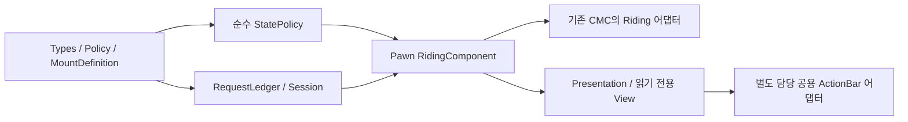

# Riding 코드 설계 — M1 상태·세션·탑승 기반

- 작성: 2026-11-06 / 담당: `riding-code-design-20261106`
- 상태: **M1 상태/이동·기본 외형/구역과 M2 전투 입력/소모품·피해/제어, Dash 서버 이동·GAS/기존 회피 키·LocalPredicted/Iris 전송, Emote 서버 수명·취소·기존 키/HUD·몽타주 인스턴스 연결 구현. 단위 검증과 경계는 코드 설계14~28절을 따른다. 상호작용 하차 연계·제품 보유 API·실제 맵/최종 자세·물리 입력/GPU·패키징과 Emote 실제 NetDriver 검증은 후속이다.**
- 기준: [기능 계약](RIDING_SYSTEM_DESIGN.md), [아키텍처와 HUD 인계](RIDING_SYSTEM_ARCHITECTURE.md), 게시 `d546e392`의 관련 기존 소스. 재개 시 게시 HEAD `2971c97c`와 별도 담당의 미커밋 `Docs/ACTION_BAR_CONTEXT.md`/`UI/ActionBar` 계약을 추가 대조했다. 공용 코드의 빌드/검증 완료 주장은 아니다.
- 목적: 첫 구현의 타입, 접근 제한, 판정 순서, 상태 수명, 검사 기준을 정한다. 최초 문서에서 M2 액션/M3 영속 저장은 포트만 정의했으며 실제 구현 현황과 검증은 위 상태 및 아래 최신 절을 따른다.

## 1. 구현 의존과 파일 단위



화살표는 구현 순서/데이터 공급이다. 순수 판정은 컴포넌트·HUD·HTTP에 의존하지 않는다. 공용 ActionBar API가 늦게 확정돼도 Types/Policy/Session 설계를 다시 만들지 않도록 한다.

| 향후 경로 | 내용 | 이번 설계에서 고정할 경계 |
|---|---|---|
| `Public/Riding/RPGRidingTypes.h` | enum·공개 상태/명령/결과/값 view | BP에는 조회용 값만 공개, 서버 상태 setter 없음 |
| `Public/Riding/RPGMountDefinition.h` + Private cpp | PrimaryDataAsset 외형·안정 ID | 이동 성능은 공통 Policy에만 존재 |
| `Public/Riding/RPGRidingPolicy.h` + Private cpp | 프로토콜·공통 튜닝·검증/불변 값 복사 | 에셋 UObject를 SavedMove에 저장하지 않음 |
| `Public/Riding/RPGRidingStatePolicy.h` + Private cpp | 값 입력→허용/거절·전이 계획 | 난수·시계·GAS·월드 접근 없음 |
| `Private/Riding/RPGRidingRequestLedger.h/.cpp` | 고수위·최근32 명령 결과 | 고정 용량, 클라이언트가 저장 용량을 늘릴 수 없음 |
| `Public/Riding/RPGRidingSessionComponent.h` + Private cpp | PlayerState snapshot·예산·공통 시간 | 현재 Pawn의 Mode/mesh를 소유하지 않음 |
| `Public/Riding/RPGRidingComponent.h` + Private cpp | Pawn 바인딩·RPC·단일 전이·공개 복제 | 전이 setter는 private, 승인 권한은 서버만 |
| `Riding/RPGRidingMovementPrediction.h/.cpp` | M1b의 CMC 저장 이동/응답 어댑터 | 기존 Player CMC에 연결, 새 이동 컴포넌트 없음 |
| `Riding/RPGRidingPresentationComponent.h/.cpp` | M1b의 모델/자세·비동기 세대 | 이동/쿨타임 변경 없음 |

`Public`/`Private`는 `Source/Project_RPG/` 아래다. 구현 전 각 변경 파일과 빌드 자원을 별도 예약한다. 이번 문서 작업은 공용 Source를 선점하지 않는다.

## 2. 값 타입과 불변식

아래 C++는 **시그니처 설계 표기**다. USTRUCT/UCLASS/UPROPERTY, export/generated include, forward declaration과 serializer 구현을 생략했으므로 그대로 컴파일할 완성 헤더가 아니다.

```cpp
enum class ERPGRidingMode : uint8 { OnFoot, Mounted };
enum class ERPGRidingAction : uint8 { None, Dash, Emote };
enum class ERPGRidingSelectorKind : uint8 { Specific, Selected, RandomFavorites };

struct FRPGRidingStateKey
{
    FGuid RiderEpoch;
    uint32 StateRevision = 0;
    uint32 ActionSequence = 0;
};

struct FRPGRidingSelector
{
    ERPGRidingSelectorKind Kind = ERPGRidingSelectorKind::Selected;
    FString MountId; // Specific에서만 유효. 수신 길이/ASCII 규격 검사.
};

struct FRPGRidingSetCommand
{
    FGuid RiderEpoch;
    uint32 RequestSeq = 0;
    uint32 ExpectedStateRevision = 0;
    bool bDesiredMounted = false;
    FRPGRidingSelector Selector;
};

struct FRPGRidingMovementProfile
{
    int32 Version = 0; // admitted CatalogVersion
    float Speed = 0, Acceleration = 0, Braking = 0, YawRate = 0;
};

struct FRPGRidingRepState
{
    FRPGRidingStateKey Key;
    ERPGRidingMode Mode = ERPGRidingMode::OnFoot;
    FString MountId;
    int32 DefinitionVersion = 0;
    FRPGRidingMovementProfile Movement;
    ERPGRidingAction Action = ERPGRidingAction::None;
    FGuid ExecutionId;
    double ActionStartServerWorldSeconds = 0;
    float ActionDuration = 0;
    FVector_NetQuantizeNormal ActionDirection{FVector::ZeroVector};
    ERPGRidingEndReason LastEndReason = ERPGRidingEndReason::None;
};
```

`ERPGRidingResultCode`는 상세 설계 4.2절의 Applied/NoChange/NotOwned/NotReady/DefinitionMismatch/InCombat/ActionBlocked/WrongMovementMode/RegionDenied/Busy/StaleState/RateLimited/AuthorityRevoked를 사용한다.
`ERPGRidingEndReason`은 None/Manual/Replacement/Hit/Control/Region/MovementMode/Death/AuthorityRevoked/ContextLost/ExecutionRejected/Completed로 제한한다. UI 문구는 enum에서 매핑하고 서버 내부 오류 문자열을 복제하지 않는다.

| 조건 | 정규 형태 |
|---|---|
| 아직 바인딩되지 않음 | Epoch invalid, revision0, OnFoot, 입력 불가 |
| 새 서버 바인딩 | 서버 생성 Epoch, revision1/actionSequence0, OnFoot |
| OnFoot | MountId 빈 값, DefinitionVersion0, Action=None, ExecutionId invalid, 액션 시각/길이/방향0 |
| Mounted / None | 유효 MountId/정의 버전, 실행 필드는 초기값 |
| Mounted / Dash 또는 Emote | 유효 ExecutionId와 유한 시작시각/길이. Dash XY 정규 방향, Emote 방향0 |
| 하차·교체 | StateRevision 증가. 진행 액션이 있으면 ActionSequence도 증가하고 실행 필드 정리 |
| 액션 시작/종료 | 같은 StateRevision에서 ActionSequence 증가. M1은 항상 None |

Epoch GUID에는 대소 비교를 하지 않는다. 새 Epoch는 **현재 Pawn·PlayerState 바인딩의 서버 상태 복제**로 채택하고, 임의 명령 결과/asset callback은 다른 Epoch를 설치하지 못한다. 이미 폐기한 Epoch로 복귀하지 않는다.
같은 Epoch에서는 `(StateRevision, ActionSequence)` 순서로만 최신을 판단한다. overflow 직전 서버가 실행을 닫고 새 Epoch의 OnFoot를 발행한다. 클라이언트가 Seq/리비전 최대값을 보내 Epoch 교체를 강제할 수 없다.
MountId는 안정 ASCII 1~64자이며 서버 카탈로그에서 찾은 뒤에만 내부 캐시 키로 쓴다. 소유 snapshot 최대512/즐겨찾기32, 수신 필드의 길이/enum/유한성 검사와 엔진 RPC 한도를 적용한다. 무제한 사용자 문자열을 FName으로 먼저 intern하지 않는다.

## 3. 순수 판정과 명령 처리

```cpp
struct FRPGRidingDecision
{
    ERPGRidingResultCode Result;
    ERPGRidingTransition Transition; // None, Mount, Replace, Dismount
    FString ResolvedMountId;
    int32 DefinitionVersion = 0;
};

namespace RPGRidingStatePolicy
{
    FRPGRidingDecision Evaluate(
        const FRPGRidingEvaluationContext& Context,
        const FRPGRidingSetCommand& Command);
    bool IsCanonical(const FRPGRidingRepState& State);
}
```

`EvaluationContext`는 현재 RepState, 서버 권한/준비 플래그, 지면 모드, 행동/제어/전투 잠금, 서버에서 검증한 후보와 구역 결과를 담은 불변 값이다. UObject 참조나 클라이언트 자격 bool은 받지 않는다. 시계는 호출자가 관측한 값으로만 판정한다.
Selector 해석은 Session이 담당한다. 무작위는 새 요청의 적격 후보를 먼저 만들고 서버 난수로 한 번 선택한다. 결과는 전이/최초 영수증에 고정하며, 순수 판정 함수나 재전송에서 재추첨하지 않는다.

명령 처리의 순서:

1. 현재 소유 Pawn/Controller/PlayerState/World·폐기 여부를 확인한다. 유효 서버 Session이 있는 요청은 기존 `FRPGServerRequestBudget{8, 4.0}`을 우선 소비한다. 잘못된 값/중복도 예산을 소비한다.
2. 현재 Epoch, Seq/정규 명령 지문을 검사한다. 기존 결과 재생을 **ExpectedStateRevision 검사보다 먼저** 수행한다. 성공 후 리비전이 바뀌어도 원래 요청을 다른 실패로 바꾸지 않는다.
3. 새 요청은 ExpectedStateRevision이 현재와 같은지 확인한다. 다르면 StaleState이며 새 전이가 없다.
4. 명시적 하차는 보유 snapshot/카탈로그/구역/전투 잠금 때문에 거절하지 않는다. 이미 OnFoot면 NoChange, Mounted면 Dismount. 폐기된 바인딩의 네트워크 요청은 거절하고 서버 내부 정리가 수행한다.
5. 새 탑승/교체는 준비·정의/보유·지면·행동/전투·구역·액션 Busy를 검사한다. 이미 같은 탈것이면 현재 상태의 강제 하차 조건을 먼저 처리한 뒤 NoChange로 수렴한다.
6. 전이 계획의 준비가 성공하면 Component가 한 번 확정하고 결과를 보관한다. 검사 거절/준비 실패는 기존 상태를 유지한다.

서버의 강제 하차는 이 명령 예산/요청 큐를 통과하지 않는다. World 종료/피격/폐기에는 네트워크 요청 폭주와 무관하게 정리한다.

### RequestLedger

연결 Session에 고정 ring32를 두고 항목은 Epoch, Seq, 정규 명령, 최초 결과, 최초 결과의 상태 버전이다. 바인딩 Epoch가 바뀌면 ring/Seq 문맥만 교체하며 연결의 예산과 쿨타임은 유지한다.

| 입력 | 결과 |
|---|---|
| Seq0 / 잘못된 Epoch / 과도한 앞선 Seq | StaleState. 고수위를 클라이언트 값으로 올리지 않음 |
| 고수위 이하·캐시 안·내용 동일 | 최초 결과 재생. 현재 상태/쿨타임은 별도 최신 view로 동봉 |
| 같은 Seq·내용 다름 | StaleState. 기존 항목을 바꾸거나 덮어쓰지 않음 |
| 고수위 이하·캐시 밖 | StaleState. 재실행하지 않음 |
| 허용 범위의 새 Seq | 먼저 고수위/처리 중 항목 예약, 최종 성공/거절을 같은 항목에 기록 |
| 예산 소진 | RateLimited. 새 ledger 항목/고수위 변경 없음. 같은 명령을 나중에 재시도 가능 |

앞선 Seq 검사는 overflow를 피한 넓은 정수 계산으로 `NextExpected`보다 최대1024 앞까지 허용한다. 예약 중 callback 재진입의 같은 Seq는 다시 실행하지 않고 원 실행의 최종 결과를 기다린다.
지문은 DesiredMounted/ExpectedRevision/Selector 의미 필드 전체의 정규 값 비교다. 하차에는 Selector가 없어야 하며, Selected/RandomFavorites의 MountId는 비어 있어야 한다. 숨은 필드가 다른 명령을 동일하게 취급하지 않는다.

## 4. SessionComponent 계약

`URPGRidingSessionComponent : UActorComponent`를 ARPGPlayerState의 default subobject로 둔다. `UPawnExtensionComponentBase`는 Pawn을 전제로 하므로 PlayerState에 사용하지 않는다.

```cpp
// 공개 native 조회: 반환 값은 복사/불변 view. UObject의 내부 가변 참조를 노출하지 않음.
FRPGRidingSessionView GetOwnerView() const;
bool IsReadyFor(const FRPGRidingBindingKey& Binding) const;
void NotifyIdentityContextChanged(); // 서버에서 현재 owner를 직접 읽음

// private: 신뢰된 backend callback / 현재 Pawn Component만 호출
void ApplyAdmissionSnapshot(uint64 RequestSerial, FRPGRidingAdmissionSnapshot&& Snapshot);
void InvalidateContext(ERPGRidingEndReason Reason);
bool TryReserveAction(const FRPGRidingExecutionToken& Token,
                     ERPGRidingAction Action, double ServerNow);
void RecordApprovedHostileOutcome(const FRPGRidingHostileOutcome& Outcome);
```

`BindingKey`는 weak PlayerState/Pawn/Controller/World, 인증된 CharacterId/SessionId/ConnectionGeneration, RiderEpoch를 캡처하는 서버 native 문맥이다. account/세션 식별자는 공개 RepState에 넣지 않는다.
`SessionView`는 준비 상태·표시용 서버시각/쿨타임 종료·스냅샷 revision/소유자 표시 정보이며 OwnerOnly로 전송한다. 내부 ReadyAt와 CombatLockUntil은 서버 단조 시간으로 유지한다.
조회 상태는 WaitingIdentity/WaitingAdmission/LoadingSnapshot/Ready/RetryableFailure/Revoked다. enum 숫자의 크기로 유효성을 판단하지 않는다.

실제 인증 연결:

- [PlayerState](../Source/Project_RPG/Public/Player/RPGPlayerState.h)의 `SetAuthenticatedIdentity`와 `GetBackendConnectionGeneration`은 티켓 소비 문맥이다. `HasAuthenticatedCharacter()`만으로 snapshot을 승인하지 않는다.
- [GameModeBase](../Source/Project_RPG/Public/GameMode/RPGGameModeBase.h)의 `CompleteDungeonAdmission`/`ActivatedAdmissions`가 입장 확정 경계다. 기존 private map을 노출하지 않고, 구현 때 현재 신원/세대를 검사하는 좁은 서버 알림/조회 포트를 이 경계에 추가한다. 아직 존재하는 API가 아니다.
- Session은 확정 알림 또는 동일 문맥의 확정 조회 뒤 전용 backend snapshot을 취득한다. HTTP 완료 시 PlayerState·신원·ConnectionGeneration·RequestSerial·정책 hash를 모두 재검사한다.
- 백엔드 Riding API가 없는 M1 제품 경로는 NotReady로 남는다. 개발 fixture는 Shipping에 없는 검사 전용 진입점으로만 공급하고 일반 RPC/BP setter를 열지 않는다.
- 새 연결의 Dash10초/Emote2초 보호는 최초 인증 문맥을 만들 때 한 번 설정한다. snapshot 재시도/매 Pawn 바인딩마다 다시 설정하지 않는다.

Pawn 교체는 기존 쿨타임/전투 잠금을 보존한다. 서버 프로세스/PlayerState 교체는 상세 설계의 입장 보호 규칙을 적용한다. 다른 신원으로 바뀌면 이전 snapshot/결과를 폐기하고 새 신원으로 초기화하며, 같은 객체 주소 재사용을 신원 유지로 간주하지 않는다.

## 5. PawnComponent 계약과 재진입 처리

`URPGRidingComponent : UPawnExtensionComponentBase`는 ARPGPlayer의 default subobject다. NPC에는 생성하지 않는다. 기존 ASC 준비/ActorInfo 경로를 유지한다.

```cpp
// public: 수명 통지와 읽기 전용 projection
void NotifyOwnerContextChanged();
FRPGRidingRepState GetRidingState() const;
FRPGRidingLocalView GetLocalView() const;
bool TryBuildMovementProfile(FRPGRidingMovementProfile& Out) const;

// 소유 클라이언트의 로컬 명령 façade. Seq/Epoch는 여기서 현재 값으로 구성.
void RequestSetMounted(bool bDesiredMounted, const FRPGRidingSelector& Selector);

// private UFUNCTION RPC: 서버 소유권·현재 binding 검사 필수
void ServerSetRiding(FRPGRidingSetCommand Command); // Server, Reliable
void ClientRidingResult(FRPGRidingCommandResult Result); // Client, Reliable

// native server-only: 다른 전투/권한 시스템을 위한 제한된 종료 포트
void ForceDismount(ERPGRidingEndReason Reason);

// private: 유일한 mutation 경계
void CommitTransition(const FRPGRidingDecision& Decision);
void ApplyAuthoritativeState(const FRPGRidingRepState& State);
void EndOwnedExecution(const FRPGRidingExecutionToken& Token);
void ReleaseBinding();
```

Native server-only도 내부 `HasAuthority`/현재 binding 검사를 수행한다. BlueprintAuthorityOnly 표기만으로 권한을 대신하지 않는다. `ClientRidingResult`는 캐시된 최초 결과와 최신 권위 snapshot을 분리하며, RPC 응답으로 이전 리비전을 현재 상태에 되쓰지 않는다.

전이는 다음 순서로 구현한다.

1. 새 상태를 local 값으로 준비/정규화하고 필요한 정의/핸들을 확인한다. 준비 실패는 기존 상태 유지다.
2. `bApplyingTransition`을 세우고 새 상태 Key를 먼저 저장한다. callback은 이 Key와 현재 바인딩을 다시 검사한다.
3. 자기 이전 실행/GE를 정리하고 새 Mounted 투영·이동 프로필을 적용한다. 완료 뒤 canonical state를 확인한다.
4. 오류나 적용 중 강제 하차가 발생하면 새 리비전의 OnFoot로 수렴한다. 중간 Mounted를 외부 성공 결과로 발행하지 않는다.
5. 정리까지 끝낸 최종 상태만 dirty 표시/OnChanged/요청 결과로 발행한다. Listen Server 로컬 view도 같은 경로로 갱신한다.

재진입을 이유로 ForceDismount를 버리지 않는다. 적용 중에는 고정 크기의 `bForceDismountPending`/이유만 기록하고 외부 성공 알림 전에 처리한다. 폐기/사망 우선, 그 외 이유는 안정된 우선순위를 사용한다. 중첩 상태 변경 큐를 무제한 만들지 않는다.
적용 중 새 사용자 명령은 Busy 결과로 종료하며, ForceDismount의 callback이 다시 같은 정리를 요청해도 한 번만 회수한다. 자신의 끝난 핸들을 먼저 무효화하고 해제해 재진입 이중 해제를 막는다.

## 6. 초기화·복제·종료 연결

| 실제 연결점 | M1에서 할 일 |
|---|---|
| [RPGBaseCharacter의 ASC 초기화](../Source/Project_RPG/Private/Character/RPGBaseCharacter.cpp) | `InitAbilityActorInfo(this,this)` 유지. Riding 때문에 ASC 소유자를 변경하지 않음 |
| [RPGPlayer PossessedBy](../Source/Project_RPG/Private/Character/RPGPlayer.cpp) | startup의 최초/재진입/이미 초기화 분기에서 동일한 멱등 준비 평가. 사망/폐기된 분기를 우회하지 않음 |
| OnRep_PlayerState / PawnClientRestart | 로컬 ASC/Controller가 늦게 준비되는 순서도 재평가. 서버에서만 grant, 클라이언트는 준비된 spec을 기다림 |
| UnPossessed / EndPlay / OnUnregister | 현재 바인딩 폐기→자기 실행·delegate·표현 정리. 같은 종료 중복 호출 허용 |
| 신원 변경/폐기·월드 종료 | Session의 pending callback 무효화와 Pawn 도보 종료. 타 시스템 cleanup 대행 금지 |

`GetLifetimeReplicatedProps`에서 공개 RepState와 OwnerOnly view를 구분한다. 현재 프로젝트처럼 push model을 쓰면 실제 값 확정 후 해당 프로퍼티를 dirty로 표시하고 필요 시 ForceNetUpdate한다. 서버 상태 변경을 RepNotify가 실행해 줄 것이라 가정하지 않는다.
최신 상태 비교/적용은 RepNotify, ClientResult의 최신 snapshot, CMC correction response가 공유한다. Owner의 예측 표시와 관찰자의 현재 상태 표시를 분리하되 복수 authoritative Mode를 만들지 않는다.
Actor relevancy 재진입·HUD 재생성은 현재 snapshot만으로 복구한다. 새 바인딩 식별 전에 도착한 응답은 적용하지 않으며, 초기 복제 상태가 준비되면 조회/요청 가능 상태를 다시 평가한다.

종료 시 보존할 것: Session의 같은 신원 쿨타임, 타 능력/GE/RMS, 현재 다른 입력/카메라 소유자, 기존 스킬 편성. 회수할 것: 자기 grant(ASC 종료 때), Mounted GE, 실행 핸들, weak binding/delegate, 로드 요청 세대, 공용 호스트 등록 handle.

## 7. M1b 이동·표현과 공용 HUD에 넘길 값

`FRPGRidingMovementProfile`은 Key·정책 버전·WalkSpeed/Acceleration/Braking/YawRate·지상 제한의 불변 값이다. 기본값은 상세 설계를 따른다. Mounted=false일 때는 프로필 override가 없고 기존 도보 함수를 그대로 사용한다.
[PlayerMovementComponent](../Source/Project_RPG/Private/Component/RPGPlayerMovementComponent.cpp)의 폐기된 Pawn 이동 거절은 Riding 조회보다 먼저 유지한다. 공통 CMC의 도보 base-limit/GAS 공식은 변경하지 않고 승인된 Riding branch를 추가한다.
M1a에는 bool 복제만으로 이동 완료를 선언하지 않는다. M1b에서 SavedMove/packed response·구간 sweep/구역/발판 이동을 연결하고 R02/R03/R06을 확인해야 한다. 엔진 override/serializer의 최종 시그니처는 실제 설치 엔진 헤더 대조 및 컴파일로 확정한다.

표현에는 StateKey/MountId/정의 버전만 넘기고 비동기 load generation을 추가한다. callback의 Pawn/World/Key/MountId/generation이 현재와 같을 때만 모델을 설치한다. 서버 상태가 Mounted인데 외형 로드가 실패하면 placeholder이며 서버 속도를 도보로 바꾸지 않는다.

공용 HUD 인계는 `actionbar-context-20261106`의 `Docs/ACTION_BAR_CONTEXT.md`와 `UI/ActionBar/**`가 기준이다. 재개 시 실제 헤더/호출이 생성되어 아래 어댑터 시그니처를 맞췄다. **완료된 것은 코드 연결 설계이며 실제 Riding/C++ 구현이나 공용 UI 통합 완료가 아니다.** 공용 파일은 상대 담당의 검증·게시 전 작업 상태이므로 구현 시 최종 계약을 재조회한다.
`FRPGRidingLocalView`에는 아래만 포함하며 공용 타입으로 변환하는 코드는 `RPGRidingQuickSlotAdapter` 한 곳에 둔다.

- 현재 LocalPlayer/World/Pawn의 바인딩 token, StateKey, Ready/Mounted, 탈것 표시값.
- ActionId/아이콘/현재 키·활성/차단 이유·서버시각 기반 쿨타임 view.
- 논리 RidingShortcut의 설정/저장 상태와 명령을 실행할 현재 세대.

공용 호스트가 물리 슬롯/키/페이지를 결정한다. 화면 전환이 서버 Mode를 바꾸거나 쿨타임을 초기화할 수 없다. M1 타입/Session/상태 판정은 이 인계와 독립적이며 공용 QuickSlot/HUD/Controller와 다른 담당의 현재 HttpWebManager/Backend 변경은 이번 작업에서 수정하지 않는다.

### 실제 공용 API를 소비하는 어댑터

```cpp
class FRPGRidingQuickSlotAdapter final : public IRPGActionBarProvider
{
public:
    APawn* GetActionBarPawn() const override;
    const URPGActionBarProfile* GetActionBarProfile() const override;
    FRPGActionBarActionView ReadAction(FName ActionId) const override;
    void PressAction(FName ActionId) override;
    void ReleaseAction(FName ActionId) override;
private:
    TWeakObjectPtr<URPGRidingComponent> Riding;
    TWeakObjectPtr<APawn> BoundPawn;
    FGuid BoundEpoch;
};
```

컴포넌트의 로컬 바인딩이 `TSharedPtr<FRPGRidingQuickSlotAdapter>`를 보유하고 승인 Mounted에서 `Slots->GetActionBarContext()->Activate(Adapter.ToSharedRef())`로 설치한다. 공용 context도 shared provider를 보유하지만 provider는 컴포넌트/Pawn을 weak 참조해 소유 순환을 만들지 않는다.
프로필은 컴포넌트의 UPROPERTY로 로드/유지하고 provider가 조회한다. Dedicated Server에서는 이 로컬 UI 프로필을 로드하거나 provider를 생성하지 않는다. 원격 Pawn에도 로컬 입력 호스트를 설치하지 않는다.

| 공용 계약 | Riding 구현 규칙 |
|---|---|
| `URPGActionBarProfile` | `ProfileId=Riding`, 안정 ActionId `dash/emote/dismount` 3개. Label/Icon은 profile entry, 성능/권한은 Riding. 최대8개 제한 준수 |
| `LeftWidgetClass` / `CenterWidgetClass` | 최초 연결은 둘 다 null로 native 좌측 바 사용·탑승 중 직업 중앙 표시 숨김. HUD 담당 presenter가 원래 위젯을 보존/복귀하며 Riding은 부모 Canvas 미편집 |
| `SkillSlot` / `InputTag` | 기존 물리 입력을 재사용할 동작만 명시 연결. `INDEX_NONE`은 추가 입력 경로. 같은 물리 키를 기존 슬롯과 Riding IMC 양쪽에 동시에 바인딩하지 않음 |
| `ReadAction` | 현재 Pawn/Epoch/승인 Mounted/ActionId 재검사 후 bAvailable·KeyLabel·CooldownRemaining/Duration 반환. 쿨타임은 서버 시각 투영으로 계산, 조회 중 상태 변경/에셋 로드/RPC 없음 |
| `PressAction` | 현재 상태를 다시 읽고 Dash/Emote는 GAS, dismount는 명시적 `RequestSetMounted(false, empty selector)`로 전달. 허용되지 않는 ID 무시. UI 활성 값만으로 서버 검사를 생략하지 않음 |
| `ReleaseAction` | v1 세 액션은 누를 때 한 번 실행하므로 release로 재발동하거나 승인된 Dash를 취소하지 않음. 자기 로컬 press bookkeeping만 정리. 하차/강제 취소는 서버 상태 경로가 담당 |
| `Context->GetRevision()` | 공용 UI 전환 revision. Riding StateRevision/ActionSequence와 별개이며 서로 대입하지 않음 |
| `PressAction(Source, Id, ExpectedRevision)` / `ReleaseInput(Source)` | 전용 IMC도 이 단일 경로로 합류. 입력 시작 시 저장한 context/revision/Source에 release를 전달하고 새 context에 옛 입력을 전달하지 않음 |
| `Deactivate(ExpectedProvider)` | 자신이 설치한 shared provider identity로만 해제. 전체 Shutdown은 Pawn/context 소유자에게 맡김. 옛 provider 종료가 후속 provider를 제거하지 않음 |

동일 Pawn/Epoch에서 탈것만 교체하면 같은 provider/profile을 유지하고 ReadAction이 현재 상태를 읽는다. 새 Epoch는 기존 provider를 회수한 뒤 새 인스턴스로 연결한다. 단순 HUD 재생성은 Pawn context/provider를 재생성하거나 쿨타임을 초기화하지 않는다.
Activate/Deactivate가 전환 중이라 false를 반환하면 자기 바인딩을 재검사한 뒤 게임 스레드의 다음 갱신에서 한 번 재평가한다. 다른 provider가 현재 표시를 소유한 경우 Riding이 매 프레임 Activate해 되빼앗지 않는다. 공용 우선순위/복귀 정책이 필요한 기능 경합은 호스트 담당과 계약 후 연결한다.
보유한 delegate/재시도 핸들은 종료 시 제거한다. provider의 현재성 검사는 raw UObject 주소뿐 아니라 weak 참조와 Epoch를 사용한다. 종료 직후 ReadAction/PressAction이 불려도 빈 view/무동작으로 수렴한다.

공용 API의 제공 범위와 남은 인계는 다음처럼 구분한다.

- `FRPGActionBarActionView::UnavailableReason`은 공용 HUD 담당이 2026-11-08 추가한 지역화 표시 필드다. RidingLocalView의 차단 사유 enum을 문구로 변환해 제공하며 서버 내부 오류 문자열을 노출하지 않는다. 공용 native 셀은 비활성일 때 이 사유를 툴팁으로 읽고, 빈 값에는 공통 안내를 표시한다. 실제 Riding 제공자의 값 전달은 해당 어댑터 구현에서 연결한다. 최신 계약은 [공통 액션바](ACTION_BAR_CONTEXT.md)를 따른다.
- `IRPGActionBarProvider`는 액션 실행 인터페이스다. `RidingShortcut`의 Selected/Specific/RandomFavorites 배정·드래그 저장 포트는 포함하지 않는다. 기존 배열을 변조하거나 `ReadAction`에 저장 부작용을 넣지 않고 별도 배정 인계로 연결한다.
- 공용 `OnChanged`는 전환/구조 변경 알림이다. Riding 상태/쿨타임 이벤트로 provider를 재설치하지 않는다. 실제 widget의 ReadAction 갱신 경로를 소비하고 필요할 때 별도 값 갱신 계약을 인계한다.

## 8. 구현 순서와 회귀 검사 계약

| 순서 | 변경 묶음 | 핵심 반례 / 통과 기준 |
|---|---|---|
| 1 | Types·정의/Policy·순수 판정 | OnFoot 정규화·미보유/금지 구역·사망/CC·하차는 NotReady에서도 가능·외형/성능 분리 |
| 2 | Ledger·Session의 값 상태 | 중복32/오래된Seq/다른본문/큰점프·overflow·RateLimited·재진입·재추첨0·Pawn 교체 쿨타임 보존 |
| 3 | Pawn/PlayerState 컴포넌트·수명/복제 | 초기화 순서 교환·중복 Possess·오래된 HTTP/다른 신원·강제 하차 재진입·자기 핸들만 종료 |
| 4 | CMC prediction·프로필·구역·기본 외형 | R01~R03/R06/R08 중 M1 범위, 80~160ms/5% 손실·중도 참가·도보/NPC 회귀 |
| 5 | M2 액션/서버 전투 가드·HUD 제공자 | 기존 아키텍처 M2a/M2b. 공용 계약 인계 후 단일 입력 dispatch와 R09 통합 |

문서의 반례는 향후 구현에 필요한 회귀 계약이다. 이번에는 테스트 코드를 만들거나 게임 검사를 실행하지 않는다. 소스 구현 시 기능별 검증/자기 임시 정리/커밋·푸시를 수행한다.
UI 제공자 단위 성공, 실제 HUD 통합, 전체 탑승 기능 완료를 각각 구분한다. 제품 보유 snapshot과 M2 서버 행동 가드가 없는 M1 개발 단계에서 feature flag를 공개 활성화하지 않는다.

## 9. 검토와 남은 인계

현재 소스의 Pawn 소유 ASC, PlayerState 티켓 세대, GameMode 입장 확정 경계, 공통 요청 budget, PawnExtension의 소유자 가정, Player CMC 폐기 가드를 대조했다. 상세 설계의 상태/요청/쿨타임/공용 HUD 책임과 일치하도록 위 계약을 작성했다.
문서 검증은 상대 링크·표·코드 fence·필수 계약/공백 검토다. 제품 코드/실제 RPC serializer·UHT/CMC correction·Iris 실행 성공 증거는 아직 없다.
공용 provider/context/profile 시그니처 대조와 Riding 어댑터 설계까지 완료했다. 차단 사유는 공용 `UnavailableReason`으로 전달하며, 논리 슬롯 배정은 별도 포트의 인계 항목이다. 실제 구현 착수 때 최신 [작업 조율](Online_RPG_Development_Roadmap.md)과 상대 담당이 검증·게시한 계약 파일을 다시 읽는다.
임시 산출물 생성/삭제 0 bytes, 보관 예외 없음.

## 10. M1a 첫 기반 구현 — 2026-11-06

실제 소스는 [Riding 타입](../Source/Project_RPG/Public/Riding/RPGRidingTypes.h), [공통 정책](../Source/Project_RPG/Public/Riding/RPGRidingPolicy.h), [MountDefinition](../Source/Project_RPG/Public/Riding/RPGMountDefinition.h), [순수 판정](../Source/Project_RPG/Public/Riding/RPGRidingStatePolicy.h)과 각각의 Private cpp 8개다.
앞 절의 시그니처는 설계 기록이고 이 4쌍에 대한 최종 선언은 실제 헤더를 따른다. 기존 Player/PlayerState/CMC/ASC·공용 HUD/입력 파일을 수정하지 않았다.

- 안정 ID/명령 형식·정규 상태·Epoch 내 순서 비교를 구현했다. 다른 Epoch를 GUID 대소로 비교하지 않는다.
- Policy를 검증한 값 복사로 내보낸다. manifest hash 미설정은 실패하며, 실패 시 이전 성공 출력이 남지 않는다. v1 authoring 범위는 속도1~5000, 가속/제동1~20000, 회전1~1080, Dash거리1~5000·시간0.05~5·쿨타임0.05~10초(시간 이하 쿨타임 금지), 전투 잠금0.05~60초, Emote시간0.05~3·쿨타임0.05~2초다. 모두 유한 값을 요구하며 기본 성능600/900cm·0.6초/10초는 유지한다.
- Mount는 성능 필드 없이 외형 soft reference/안정 ID를 소유한다. 서버용 metadata 검사는 로드하지 않고, Editor DataValidation은 참조와 Saddle socket을 실제 해석한다. catalog 최대512/중복 ID를 검사한다. manifest exporter/cook/두 모델의 저작·애니메이션 호환성 전체 검증은 M4다.
- 순수 판정은 현재 서버 문맥을 받아 Mount/Replace/Dismount/None과 사유를 반환한다. 명시 하차는 준비/전투/지면/액션 제약을 우회하되 오래된 세대·폐기된 권한은 거절한다. 함수 자체는 상태·GAS·월드에 부작용을 만들지 않는다.

유지 회귀는 [RPGRidingFoundationTests](../Source/Project_RPG/Private/Tests/RPGRidingFoundationTests.cpp)의 Values/CanonicalState/AdmissionGuards/Transitions/Authoring 5개다. [집중 러너](../Scripts/Tests/Run-RidingFoundationTests.ps1)는 실제 소스9개를 별도 최소 Editor 모듈로 복사해 UHT/C++/native 검사를 수행하고 finally에 자기 전체 runtime/OBJ/DLL/PDB/cache를 정리한다. 다른 담당의 미완료 소스나 원본 게임 DLL은 사용하지 않는다.
이 검사는 첫 기반의 독립 모듈 검사이며 전체 Project_RPG 타깃·Iris·실제 탑승/외형 검사와 다르다. 다음 구현은 요청 ledger/세션 수명과 Pawn 상태/CMC 연결이다. 이전 절의 임시0 bytes는 문서 설계 당시 기록이다.

검증 결과: `Saved/BuildChecks/RidingFoundation-20261106/d0b26b1a524442ea91b06e426b9ad3fe/Result.json`. 설치형 UE5.8 prebuilt UBT의 사설 최소 모듈 UHT/13단계 컴파일·링크 성공/종료0, 같은 `4E81AAA5…C33427A` DLL의 native5 전부 Success·검사 오류/경고0·UE 종료0. 원본 소스9개의 전후 SHA256이 일치했다. 에디터 기동의 자동화 등록 Error15와 비활성 ACL 플러그인 기본 에셋 Warning4는 검사 시작 전 환경 로그로 별도 보존했으며 전체 로그 무오류 주장은 하지 않는다.
첫 Build.bat 전역 대기는 자기 wrapper만 중단했고, 다음 시도의 컴파일은 성공했지만 에디터 QueryTargets가 같은 대기에 들어가 자기 runtime/query만 중단했다. 러너를 직접 prebuilt UBT·전용 UBA 저장 경로·사전 QueryTargets로 보완한 최종 실행이 위 성공이다. 초기 두 중단을 성공으로 소급하지 않는다.
세 시도의 자기 사본/생성 코드/PCH/OBJ/DLL/PDB/runtime/cache **5,450,374,357 bytes(약5.08GiB)**를 finally 정리, 자기 임시 경로 잔여/예외0. 작은 로그/명령/해시/결과만 로컬에 보존한다. 엔진이 자체 기록하는 사용자 전역 UBT trace와 기존 공유 캐시는 소유권이 혼재하므로 삭제하지 않았다. DLL 해시는 폐기된 검증 당시 증거이며 동일 바이너리의 재실행을 보장하지 않는다.

## 11. M1a 서버 세션 내부 로직 — 2026-11-06

구현 순서 2의 [RequestLedger](../Source/Project_RPG/Private/Riding/RPGRidingRequestLedger.h)와 [Session](../Source/Project_RPG/Private/Riding/RPGRidingSession.h)을 private native 값 로직으로 분리했다. 앞 절의 SessionComponent가 장차 이 객체를 연결당 하나씩 소유한다. 실제 ARPGPlayerState default subobject·GameMode 확정 입장 포트·Pawn RPC·HTTP는 아직 연결하지 않았고, 이 코드 자체가 인증이나 입장 승인의 증거를 만들지 않는다. 공용 HUD/입력은 수정하지 않았다.

- Ledger는 고정32칸, 64비트 중간값의 최대1024 앞선 Seq 허용, 정규 명령 전체 비교, 최초 성공/거절과 당시 상태를 저장한다. 같은 Seq의 다른 내용·삭제된 과거 Seq·0/큰 점프를 거절한다. 처리 중 항목은 ring 회전에서도 보존하고 중복 호출에는 완료 토큰을 발급하지 않는다. 토큰의 Epoch/Seq/서버 GUID가 맞는 최초 완료만 기록한다.
- Session은 연결의 기존 burst8/초당4 예산을 명령과 액션 예약에 공유한다. 중복/잘못된 명령도 먼저 소비하며 소진 시 ledger를 변경하지 않는다. 결과 재생은 ExpectedRevision 검사보다 앞선다. 전이 중 새 요청은 Busy를 기록하고, 명시 하차는 snapshot 미준비에서도 예약할 수 있다. 반환 Disposition의 Pending은 최종 응답이 아니며 원 실행의 완료를 기다린다. 기록된 Receipt.State는 **과거 결과**이고 현재 Pawn 상태로 다시 설치하지 않는다.
- Identity는 서버 어댑터가 검증한 Character/Session GUID·ConnectionGeneration와 PlayerState/Controller/World 문맥 변경마다 새로 만드는 AuthorityContext를 받는다. 실제 소유권 검사는 후속 어댑터의 필수 책임이다. 단순 identity 설치만으로 Ready가 되지 않으며 일치하는 입장 확정·유효 Policy·snapshot 검증까지 필요하다. Policy는 해당 문맥에 한 번만 설치한다.
- Snapshot 요청은 GUID 티켓으로 해당 신원/요청을 고정한다. 이전 시도·다른 신원·폐기 후 콜백을 무시하고, 응답의 프로토콜/카탈로그/hash·Roster·revision>=0·소유 최대512/즐겨찾기32·중복/미보유 선택을 검사한 뒤 한 번 복사한다. 빈 보유 목록은 유효하다. 실패는1/2/4초 재시도 후 새 사용자 요청에만10초 간격 재조회한다. 실제 HTTP 스케줄링·응답 timeout은 후속 어댑터 책임이다.
- 새 신원에 Dash10/Emote2초 보호를 적용한다. 같은 신원 통지·snapshot 재시도·Pawn 재바인딩은 쿨타임/전투 잠금을 초기화하지 않으며, 다른 신원도 연결 요청 예산을 초기화하지 않는다. Pawn 바인딩은 서버 Epoch와 ledger/액션 순서만 교체한다. Revoked는 같은 세션 객체에서 되돌릴 수 없다.
- 승인된 액션의 정규 상태/버전과 단조 시계를 받아 쿨타임을 callback 전에 예약하고, 동일/이전 실행 버전은 거절한다. 승인된 적대 결과는 명령 예산 없이 전투 잠금을 연장한다. 이는 M2 GAS 발동/현재 상태·보유·구역 승인 검사를 대신하지 않는다. 취소/하차에 환불 API는 없으며 seamless travel 시간 복사·표시용 서버 월드 시각 변환은 후속이다.

소유 snapshot의 세션 수명은 Pawn과 독립적이다. 같은 신원에서 Pawn만 바뀌는 동안 도착한 유효 snapshot은 세션에 저장할 수 있으나, 콜백에서 탑승/외형을 적용하지 않는다. Selector 해석/적격 후보와 서버 무작위 선택·단일 Pawn 전이 확정은 다음 컴포넌트 단위에서 연결한다. 이 절은 M1 전체 완료가 아니다.
`BeginCommand`의 Reserved는 요청 처리권 예약이며 탑승 허가가 아니다. 소비자는 현재 소유권/바인딩을 확인하고 후보를 해결한 뒤 기존 StatePolicy로 보유·정의·지면·전투·구역을 판정하고, 단일 전이를 마친 최종 상태만 CompleteCommand에 기록해야 한다. Callback 재진입으로 Epoch가 바뀌거나 폐기되면 이전 완료 토큰은 실패한다.

[Session 회귀](../Source/Project_RPG/Private/Tests/RPGRidingSessionTests.cpp)는 ledger 재생/용량·입장 재시도/유효성·요청 예산/재진입·쿨타임/폐기 수명 6개다. `Scripts/Tests/Run-RidingFoundationTests.ps1 -IncludeSession`으로 실제 소스15개(기존 기반/검사9, 신규5, 기존 예산 헤더1)를 사설 최소 모듈에 복사하여 기반5+세션6을 검사한다. 원본 게임 DLL이나 타 담당 미완료 코드의 통합 검사와 구분한다.

검증 결과: `Saved/BuildChecks/RidingSession-20261106/Completion.json`과 `ecc3febd78f64ecb9398d34ac3b9d380/Result.json`. 사설 UHT/16단계 C++·링크 종료0, 같은 `0AD986B0…6A245DE` DLL에서 native11 Success·검사 오류/경고0·UE 종료0. 입력15 SHA256 전후 일치. 기동 자동화 등록 Error15/ACL 에셋 Warning4는 검사 전 환경 로그이며 검사 중/후 오류0이다. 첫 시도는 새 검사 Flags의 uint32/EAutomationTestFlags 타입 불일치로 컴파일 실패했고, 선언 수정 후 위 최종 검증을 통과했다.
두 시도의 자기 사본/PCH/OBJ/DLL/PDB/runtime/cache **5,394,768,568 bytes(약5.02GiB)**를 finally 폐기했다. 실행/임시 폴더 잔여0, 공유 엔진 trace/cache는 보존했다. 자동 승인 검토가 자기 중복 진단 로그5개의 명시 삭제를 `blocked by policy`로 거절하여 **7,557,731 bytes**는 로컬 정리 예외로 남겼다(담당 riding-session-20261106, 정책 허용/후속 정리 시 삭제). 소스/검사/기능 문서만 게시하며 이 로그는 Git에 포함하지 않는다. 검증 DLL 해시는 폐기 당시의 증거다.

## 12. M1a Actor 연결 — 2026-11-07

[SessionComponent](../Source/Project_RPG/Public/Riding/RPGRidingSessionComponent.h)는 실제 ARPGPlayerState의 default subobject로 생성한다. 기존 인증 setter는 Riding 문맥을 먼저 갱신하고 신원 폐기/EndPlay는 같은 세션을 되살릴 수 없게 폐기한다. GameMode는 ActivatedAdmissions를 외부에 노출하는 대신 HasConfirmedDungeonAdmission으로 현재 PlayerState/Controller/소켓/Driver·캐릭터/Steam/세션/세대·계획 종료/폐기 상태를 매번 대조한다. 확정 입장 직후, Pawn 생성 전에 Riding 문맥을 재평가한다.

[PawnComponent](../Source/Project_RPG/Public/Riding/RPGRidingComponent.h)는 ARPGPlayer에만 생성한다. 엔진 ControllerChanged/Restarted 통지와 주기적 현재 문맥 검사로 바인딩 순서 차이·해제/재등록을 처리하며, 매 RPC 전에 현재 소유 Pawn·Controller·PlayerState·World·입장 자격을 다시 검사한다. 같은 현재 바인딩 재평가는 Epoch를 바꾸지 않는다. Pawn 교체는 이전 컴포넌트 상태를 비우고 새 Epoch의 OnFoot를 발행하며 세션 예산/시간은 보존한다.

- ServerSetRiding은 연결 ledger를 소비해 중복/오래된 요청을 먼저 판정하고, 새 요청만 snapshot의 Selected/Specific/RandomFavorites를 해석한다. 무작위 후보는 서버에서 보유/정의/제한 없음 조건을 통과한 뒤 한 번 추첨한다. 같은 요청을 재생할 때는 재추첨하지 않는다.
- 기존 ASC의 CurrentHealth·사망/제어/감속/홀딩/회피/방어 태그와 진행 중 Player Ability(타깃 잠금 제외), Walking 모드와 세션 전투 잠금을 판정에 공급한다. 명시 하차는 ASC/snapshot 미준비에서도 허용한다. 실제 승인 피해/적대 결과 producer와 능력 활성화 차단은 M2에서 연결한다.
- 공개 State는 단일 구조로 복제하고 같은 Epoch의 이전 상태는 RepNotify에서 무시한다. ClientResult는 최초 결과/당시 상태와 최신 상태를 분리해 알리며, 응답으로 권위 상태나 다른 Epoch를 설치하지 않는다. OwnerOnly 데이터에는 준비/표시용 쿨타임 종료시각만 포함하며 계정·인증 식별자는 넣지 않는다.
- 상태 변경 callback에서 들어오는 강제 하차는 고정 pending 사유로 처리한다. 폐기/해제는 자기 바인딩을 먼저 끊고 중복 정리를 허용한다. revision overflow 전에 기존 바인딩을 닫고 새 OnFoot Epoch를 만든다. 첫 단위에는 실행/GE/RMS가 없어 다른 능력의 핸들을 해제하지 않는다.

제품 보유 API/HTTP transport가 없으므로 제품 경로에서 Ready를 만들지 않는다. Snapshot을 주입하는 친구 접근은 WITH_DEV_AUTOMATION_TESTS에서만 컴파일한다. 정의에 RegionTags가 있으면 실제 구역 어댑터가 연결될 때까지 거절한다. 이동 프로필/예측/충돌·모델/애니메이션·HUD 제공자 및 쿨타임 표시 시각의 주기적 보정은 M1b/M2 후속이다. 이 단위의 Mounted 상태 성공은 실제 탈것 외형/속도나 Iris 다인 통합 성공을 뜻하지 않는다.

[Actor 회귀](../Source/Project_RPG/Private/Tests/RPGRidingActorTests.cpp)는 실제 엔진 Controller/PlayerState/Character/GAS·컴포넌트를 생성해 탑승/교체/중복·Pawn 교체/사망/폐기·강제 하차 재진입·오래된 상태/응답을 검사한다. `Run-RidingFoundationTests.ps1 -IncludeActors`는 기존11+Actor4를 사설 최소 모듈에서 실행한다. [통합 컴파일 러너](../Scripts/Tests/Run-RidingIntegrationCompile.ps1)는 게시 원본 전체 소스와 본인11입력만 overlay하여 프로젝트 UHT 및 실제 Player/PlayerState/GameMode CPP4의 컴파일을 검사한다. 전체 모듈 링크/실행과 구분한다.

검증 근거는 `Saved/BuildChecks/RidingActors-20261106/Completion.json`이다. `5e096586be8c4e7c89c9446f5207f02d`의 UHT/20단계 컴파일·링크/UE 종료0, 같은 `8174E4A0…6C39A29E` DLL의 native15 전부 Success·검사 오류0. 격리 프로젝트의 GameplayCueNotifyPaths 미설정 경고1이 있어 원래 러너의 strictWarnings gate는 false이며 이를 무경고 성공으로 바꾸지 않았다. 기능 검사15는 통과했고, 다음 실행부터 해당 경고를 없애도록 러너가 전용 DefaultGame.ini를 쓰게 보완했다(이 설정 보완은 구문/분기 검토, UE 재실행 없음). `Integration-3e8658121d334ecaadb7430ac3a2a8c5`는 실제 프로젝트 UHT/CPP4 컴파일 종료0·원본 입력11 SHA 일치이며 새 DLL 링크 검사가 아니다. Actor 검사의 입력23 SHA도 현재 소스와 일치했다.
초기에는 pimpl의 생성 코드 수명/복제 매크로 인자/포인터 추론을 수정했고, 검사 월드 중복 초기화로 실패한 실행과 수정된 fixture를 혼동하지 않는다. 통합 첫 시도의 CPP4 컴파일 자체는 성공했으나 불필요하게 감시하던 별도 검사 CPP 수정으로 최종 input gate가 실패하여, 실제 통합 입력11만 고정한 위 최종 시도를 따로 통과했다.
모든 시도의 자기 사본/PCH/OBJ/DLL/PDB/runtime/cache **8,404,536,996 bytes(약7.83GiB)**를 finally 정리했다. 본인 실행/임시 폴더 잔여0·이번 정리 예외0, 작은 로그/명령/해시/결과만 유지한다. 엔진 공용 trace/cache 및 앞 단위에 기록한 로그 정리 예외는 보존했다. 해시는 이미 폐기한 검증 당시의 증거다.

## 13. M1b 기본 외형과 비동기 수명 — 2026-11-08

[PresentationComponent](../Source/Project_RPG/Public/Riding/RPGRidingPresentationComponent.h)는 실제 ARPGPlayer의 default subobject이며 현재 공개 Riding 상태와 로컬 MountDefinition만 읽는다. 서버의 권한/속도/쿨타임을 변경하지 않는다. `GetPresentationDefinition`은 현재 MountId/정의 버전과 유효 metadata가 일치할 때만 읽기 전용 정의를 반환한다.

- Mounted 복원은 최초 BeginPlay·현재 snapshot·OnChanged·재등록/늦은 컴포넌트 준비에서 같은 경로로 수행한다. 같은 Epoch/StateRevision/정의의 액션 통지는 로드를 다시 시작하지 않는다. 다른 Mount/리비전/바인딩·mesh 교체는 이전 요청과 표시를 회수한다.
- `RequestAsyncLoad`로 Mount mesh/AnimClass/RiderPoseLayer를 읽고, 로컬 GUID·현재 Pawn/World/mesh·Epoch/StateRevision/MountId/정의 버전/soft path/offset이 모두 맞을 때만 설치한다. 하차/교체/폐기 후 지연 완료와 중복 완료는 무시한다. 실패는 placeholder/Failed로 유지하며 `RetryPresentation`은 외형만 재시도한다. 서버 Mounted와 이동 자격은 로드 성공 여부로 바뀌지 않는다.
- 표시 root는 기존 `GetMesh()` 아래에 붙여 CMC smoothing을 따른다. MountDefinition의 새 MountOffset은 이 root의 로컬 배치이고 성능과 무관하다. Mount mesh의 충돌/overlap/물리·navigation 영향은 끈다. 원래 actor/capsule/mesh 부착·변환과 다른 표시 컴포넌트는 변경하지 않는다.
- 모델이 준비되기 전/실패 때 기본 엔진 cube placeholder를 별도 비동기 로드하여 표시한다. 준비되면 placeholder를 숨긴다. Dedicated Server에서는 이 경로를 실행하지 않아 시각 에셋/표시 컴포넌트를 만들지 않는다.
- Mount 애니메이션의 skeleton·안장 소켓을 확인하고, `GetPoseView`로 현재 Key·검증된 saddle+RiderOffset의 월드 변환과 PoseLayer를 제공한다. Rider pose Blueprint의 skeleton이 현재 rider mesh와 다르면 anchor view를 내보내지 않는다. 기존 WeaponLoadout이 AnimLayer를 관리하므로 이 단위는 무기 layer를 교체하지 않는다. 실제 Riding 전용 layer의 블렌딩/IK와 소유자 입력 전 preload는 이후 저작/통합 작업이다.
- 애니메이션 초기화가 상태를 바꿀 수 있어 각 엔진 호출 뒤 현재 세대를 재확인한다. 초기화/등록 스택 안에서 하차/교체가 들어오면 물리적 파괴를 해당 호출이 끝날 때까지 보류한다. 정리는 자신의 포인터/세대를 먼저 비운 뒤 파괴하여 해제 callback의 재진입/중복 정리를 허용한다.

[표시 회귀](../Source/Project_RPG/Private/Tests/RPGRidingPresentationTests.cpp)는 실제 Mannequin mesh/skeleton의 비동기 로드, 충돌 없음/부착·캡슐 보존, 액션 통지 멱등성, 교체/Epoch·정의 버전과 늦은 완료, 잘못된 타입/소켓·재시도·재등록, AnimInstance 초기화 중 하차를 검사한다. Mannequin은 검사 입력이며 제품 탈것 모델로 지정하지 않는다. `Run-RidingFoundationTests.ps1 -IncludePresentation`은 기반/세션/Actor15+표시5를 검사한다. 원본 Content는 읽기 junction으로 접근하며 선택 mesh/skeleton SHA를 검사 후 대조하고 링크만 정리한다.
CMC는 기존 도보 속도/제약 계산과 SavedMove·packed move/response가 함께 바뀌어야 하므로 이번 표시 단위에서 속도 override를 활성화하지 않는다. 실제 이동·예측/보정·구역/발판 검증은 다음 M1b 단위다. 제품 보유 API 부재로 제품 경로는 여전히 NotReady이며, 완성된 탑승 자세·GPU 외형/다인 Iris 통합을 이 단위의 단독 검사로 대신하지 않는다.

최종 근거: `Saved/BuildChecks/RidingPresentation-20261108/Completion.json`, native `dd69a8769e414c9a9d019179f45fde33`, 통합 `Integration-97a05427d19d41dda86428e499ee875f`. 사설 UHT/22단계 컴파일·링크0/같은 `B380BCC6…4B07938` DLL native20 Success·검사 오류/경고0·UE0. 원본 소스26·mesh/skeleton2 SHA 불변, 실제 프로젝트 UHT/Player CPP1 컴파일0·입력15 SHA 일치. 기동 자동화 등록 Error15와 ACL4/다른 Content AssetRegistry1 경고는 검사 전 환경 로그로 별도 기록했다.
첫19검사는 모두 Success였으나 원본 GameplayCue 폴더의 미등록 태그 경고10으로 strict gate가 실패했다. 전용 검사 cue 경로로 보완하고 애니메이션 초기화 재진입 보호/회귀를 더한 최종20을 별도로 통과했으며 첫 결과를 무경고 성공으로 바꾸지 않는다. Native와 통합 두 cohort씩 자기 사본/PCH/OBJ/DLL/PDB/runtime/cache **5,667,826,669 bytes(약5.28GiB)** 및 Content 읽기 junction2개를 finally 정리했다. 원본 Content는 보존했고 본인 실행/Temp/새 정리 예외0, 작은 명령/해시/로그/결과만 유지한다. 공유 엔진 trace/cache와 이전 작업의 로그 정리 예외는 보존했다. DLL 해시는 폐기된 당시 증거다.

## 14. M1b CMC 이동과 예측 — 2026-11-08

[기존 Player CMC](../Source/Project_RPG/Private/Component/RPGPlayerMovementComponent.cpp)에 승인 프로필과 [이동 예측 어댑터](../Source/Project_RPG/Public/Riding/RPGRidingMovementPrediction.h)를 연결했다. 별도 Pawn/위치 RPC/Blueprint Tick 이동은 추가하지 않는다. 아래 검증은 고정 게시 사본과 본인 소스에 대한 결과이며 최신 공유 작업 공간 전체의 통합 성공 주장이 아니다.

- `FRPGRidingMovementProfile`은 CatalogVersion과 Speed/Acceleration/Braking/YawRate의 유한·범위 검사된 값이다. 서버 Session의 승인 Policy를 Mounted 전이 때 공개 State에 원자적으로 복사한다. OnFoot는 빈 프로필이며, 프로필 없는 Mounted는 정규 상태가 아니다. 모델/로컬 정의 로드 성공이 이동 속도를 결정하지 않는다.
- 공통 CMC의 가상 resolver는 기본적으로 빈 값을 반환한다. Player만 현재 승인 Mounted를 제공하고 Walking에서 해당 속도/가속/제동/회전률을 사용한다. 사망·행동/이동 금지와 외부 절대 속도 상한/스킬 scalar는 우선한다. Riding에는 도보의 MoveSpeed/MoveSpeedPercent를 곱하지 않는다. 하차 후에는 현재 도보 설정/GAS 값을 다시 계산하며 MaxWalkSpeed/RotationRate/MovementMode의 과거 값을 복원하지 않는다.
- 탑승 중 점프·웅크리기를 거절한다. 서버는 이동 실행 전, 이동 모드 변경 직후, 컴포넌트 tick에 현재 바인딩/준비·생존·제어/감속·지면을 재평가한다. 지면 이탈 시 OnFoot로 전이하면서 엔진의 Falling 모드를 유지한다. 기존 던전 권한 폐기 CMC 차단이 먼저 적용된다.
- SavedMove는 Epoch/StateRevision/ActionSequence/CatalogVersion/ExecutionId를 저장하고 경계가 다르면 combine하지 않는다. Clear는 풀 재사용 상태를 비운다. PrepMoveFor는 과거 Riding 상태/프로필을 다시 설치하지 않는다. 이 단위는 Riding RMS를 생성하지 않으며 M2 Dash의 자기 RMS 제거/재예측은 후속이다.
- New/Pending/Old packed move에는 식별자만 직렬화한다. 클라이언트 속도·거리·지속시간을 받지 않는다. 서버는 현재 상태와 stamp가 다르면 위치가 같거나 Falling 오차 유예 중이어도 권위 보정을 요청하고, 실제 시뮬레이션은 현재 서버 프로필을 쓴다. 이동 중 상태가 변해도 같은 비교를 수행한다.
- 보정 응답은 현재 정규 State와 승인 프로필을 보낸다. MountId는 길이1~64/ASCII이며 배열 할당 전에 상한을 확인한다. 소유자는 이미 복제로 채택한 같은 Epoch의 더 최신 상태만 기본 CMC 보정/재생 예약 전에 설치한다. 다른 Epoch·과거/동일 키는 무시하고 Epoch 채택은 기존 Pawn 상태 복제가 담당한다. 이후 도착한 이전 같은 Epoch RepNotify도 새 상태를 덮어쓰지 않는다. ClientRidingResult는 계속 결과 통지 전용이다.

[이동 회귀](../Source/Project_RPG/Private/Tests/RPGRidingMovementTests.cpp)는 실제 Player CMC/GAS·서버 snapshot fixture를 사용한다. Profile/SavedMoves/Wire/Correction/ServerGuards 5개에서 도보 복원·외부 제약·직접 packed move/response 직렬화·손상된 wire·오래된 보정/재생·지면 이탈·사망을 검사한다. 물리 월드의 실제 바닥과 입력 tick으로 탑승 속도/변위 및 외부 상한도 확인한다. [전용 러너](../Scripts/Tests/Run-RidingMovementTests.ps1)는 게시 HEAD 전체 Source/Config/Plugins에 본인 입력만 overlay하여 전체 Editor UHT/컴파일/링크 후 기존 Riding20·Slow/Control·던전 권한 폐기 회귀와 함께 실행한다. 타 담당의 미게시 소스는 검증 사본에 넣지 않는다. 실패 시 명시 Retry.request 하나당 한 번, 최대120초 분석 창에서만 사본을 유지하고 최종 종료 finally에서 자기 프로세스/사본/읽기 링크를 안전 정리한다.

제품 보유 snapshot/API가 없으므로 제품 경로는 계속 NotReady다. RegionTags 제한 정의는 실제 구역 어댑터까지 거절하며, 움직이는 발판·다인 Iris/지연/손실/재접속·패키징·완성 에셋/자세 검증은 이 단독 회귀의 완료 범위가 아니다. 별도 HUD 담당은 Mounted fixture에 유효 Movement 값을 넣어 새 계약을 소비한다. 공통 HUD 파일은 이 단위에서 편집하지 않는다.

최종 근거는 `Saved/BuildChecks/RidingMovement-20261108/CompletionAudit.json`, 실행 `ebe56cc6bf104c888e526b7f97b64068`의4차다. 게시 `f6fef8c4` 전체 사본+본인19입력의 전체 Editor UHT/컴파일/링크 성공, 같은 DLL의 Riding25·Slow5·Control6 **36개 Success·검사 오류/경고0**, UE 종료0이다. 원본/고정 사본19 SHA도 모두 일치했다. 실제 바닥에서 600 속도의 이동 변위·300 외부 상한·하차 후 현재 도보/GAS 계산을 확인했다. 처음 보호 멤버 접근 컴파일 오류를 수정했고, 실행 중 물리 컨트롤러의 로컬 제어/월드 초기화와 의도된 손상 패킷의 ensure/문자열 정규식 처리를 보완했다. 초기 실패를 최종 성공으로 바꾸지 않는다.

확장한37개 전체 gate는 **false**다. 기존 `ProjectRPG.Online.DungeonAuthorityRevocation.Gameplay`의 `RPGDungeonGameplayRevocationTests.cpp:108` 양성 대조1이 실패했다. 이 fixture는 비활성 NewAction과 임의 key101로 RPC 캐시 생성 성공을 기대하지만 게시 `AdmitGenericReplicatedEvent`는 활성 spec과 실제 activation key를 요구한다. 두 파일이 기준 게시 사본과 같음을 확인했으며 이 단위에서 수정하지 않았다. 독립 기준 DLL 재실행은 하지 않았으므로 기준 실행 실패를 실측했다고 주장하지 않는다. 해당 case의 나머지 폐기 후 로컬/queued CMC 이동 차단 assertion은 통과했지만 전체 case 성공으로 표시하지 않는다. 러너는 실패를 계속 반환하며 이 기존 fixture/계약 조율은 해당 범위의 후속 인계다. 기동 자동화 등록 오류15·환경 ACL 경고 등은 검사 전 로그와 구분한다.

자기 사본/OBJ/DLL/PDB/runtime/cache **6,485,292,014 bytes(약6.04GiB)**와 Content 등 읽기 junction7개를 최종 실패 종료의 finally에서 정리했다. 자기 실행/Temp/새 정리 예외0, 원본 Content/게임 DLL·공유 출력·타 담당 소스는 보존했다. 작은 명령/해시/결과/실패 원인 로그만 유지하며, DLL 해시는 폐기된 당시의 증거다. 기존 로그 정리 자동 승인 거절 예외와 공유 엔진 trace/cache는 이번 정리 범위에 넣지 않았다.

## 15. 서버 구역 판정과 이동 경계 — 2026-11-08

[WorldPolicy](../Source/Project_RPG/Public/Riding/RPGRidingWorldPolicy.h)는 Game/PIE World의 서버 전용 조회이며 기본값은 Deny다. [RegionVolume](../Source/Project_RPG/Public/Riding/RPGRidingRegionVolume.h)은 명시적 Allow, 그 하위 `ARPGNoRidingVolume`은 항상 Deny다. 정책 Box는 충돌/overlap/navigation/복제를 사용하지 않는다. 기존 캡슐과 실제 맵의 물리 충돌은 CMC가 계속 담당한다.

- 서버 탑승/교체와 무작위 즐겨찾기 후보에 실제 캡슐 위치·정의 RegionTags를 사용한다. OnFoot의 입력이나 클라이언트 구역 ID로 허용을 만들지 않는다. 탑승 중 현재 위치/준비·정책 변화는 기존 서버 가드에서 재평가하고, 거절되면 Region 사유로 현재 리비전의 OnFoot를 발행한다.
- 허용 영역은 캡슐 전체가 Box 안에 들어와야 한다. 금지/제한 영역은 캡슐의 투영 외곽을 Box에 확장해 보수적으로 접촉을 판정한다. 회전·비균일 scale을 반영하며 모서리에서는 실제 둥근 캡슐보다 일찍 거절할 수 있다. 여러 Allow 중 비어 있지 않은 AllowMountTags는 정확한 태그의 교집합을 요구한다. 큰 무제한 Allow와 겹쳐도 작은 제한 영역의 부분 접촉을 우회할 수 없다. 빈 교집합과 모든 Deny가 우선한다.
- 이동 경로를 각 Box 진입/이탈 시점으로 나누어 양 끝과 구간 내부를 평가한다. 얇은 금지 Box를 시작/끝 위치가 모두 바깥인 채 건너뛰어도 첫 접촉 비율을 반환한다. 정규 지면 이동·sweep/slide/step 등 Player CMC의 `MoveUpdatedComponentImpl` 호출에서 이 비율까지만 이동시키고 서버 하차를 먼저 발행한다. 겹침 이벤트나 Tick 빈도에만 의존하지 않는다. 이후 OnFoot는 기존 물리 규칙으로 이동하며 구역 자체를 벽으로 만들지 않는다.
- CMC는 예정 경로의 실제 캡슐 시작점을 전달한다. 비유한 값/현재 위치와 다른 시작점은 거절한다. 상태 통지 callback이 위치를 바꾸면 오래된 이동량을 재적용하지 않는다. 상태가 이동 중 바뀌면 기존 packed move 보정도 요청한다. 게임플레이 권한 폐기 가드가 이 경로보다 우선한다.
- 쿼리마다 현재 살아 있는 정책 액터를 다시 읽는다. 파괴/정책 위치 변경의 오래된 overlap 캐시를 유지하지 않는다. 정책 액터128/태그64 상한, 미등록/잘못된 bounds·비유한 값은 Deny다. 가시성 전환 중이거나 항상 로드할 레벨이 미준비여도 Deny다.

저작 시 정책 액터는 항상 로드되는 레벨에 두고 World Partition의 공간 로딩 기본값을 끈 상태로 유지한다(생성자 기본값). 금지 정책을 포함한 Data Layer/일반 스트리밍 레벨을 임의로 언로드하면서 다른 Allow만 남기는 구성은 지원하지 않는다. 기존 맵에는 Allow를 자동 배치하지 않았다. 이 단위의 native 검사는 합성 Box/서버 Actor이며 실제 맵 배치·World Partition/Data Layer 운용·움직이는 발판·외부 teleport·다인 Iris/GPU/패키징 검증과 구분한다. CMC를 우회하는 이동은 이동 전에 하차하거나 별도 경로 검증을 연결해야 한다. 제품 보유 snapshot/API의 NotReady 경계도 유지한다.

`Run-RidingFoundationTests.ps1 -IncludeWorld`는 실제 지역 코드와 기반/세션/Actor를 최소 모듈로 컴파일·링크하고 기본 Deny/수명, 고속·회전 Box/캡슐 여유, 제한 태그 교집합, 실제 서버 탑승 거절/경계 하차를 검사한다. `Run-RidingIntegrationCompile.ps1 -IncludeWorld`는 게시 전체 프로젝트 사본의 UHT와 실제 CMC/Component/WorldPolicy/Volume CPP4를 집중 컴파일한다. 이는 전체 게임 모듈 링크나 현재 CMC DLL의 실행 검사가 아니다. 이전14절의 전체 Editor/이동 실행 근거와도 별도다.

최종 근거는 `Saved/BuildChecks/RidingRegions-20261108/Completion.json`이다. 게시 `fb5b0176`+본인 고정 입력의 native `c82c4915e02b4706ac687c7b543720f6`에서 UHT/23단계 빌드·링크0·같은 `A2376D59…422571A` DLL의 기존15+구역4 **19 Success·검사 오류/경고0·UE0**, 하차 callback의 위치 변경 후 과거 이동 비율 무효화까지 확인했다. `Integration-50f16a9e8e07444e9e4def2fa4f10c99`는 전체 프로젝트 UHT/실제 CPP4 컴파일0이며 실행 DLL을 만들지 않았다. 두 최종 cohort의 고유 입력30 SHA가 현재 원본과 모두 일치했다.

첫 native19는 모두 Success였지만 월드 컨텍스트 없는 DestroyActor 경고6으로 strict gate가 실패했다. 컨텍스트 보완 후 두 번째19는 오류/경고0이었으나 검증 도중 보강한 callback 보호와 소스가 달라 input gate가 실패했다. 위 마지막19를 별도 최종 근거로 사용하며 앞선 통과 컴파일도 당시 소스와 구분한다. 자기6회 사본/PCH/OBJ/DLL/PDB/runtime/cache **8,537,945,925 bytes(약7.95GiB)**를 finally 폐기했고 실행/Temp/새 정리 예외0이다. 원본 DLL·에셋·공유 출력/trace/cache·이전 로그 정리 예외·타 담당 소스는 보존했고, 작은 결과/명령/해시/원인 로그만 남겼다. 폐기한 DLL 해시는 당시 증거다.

## 16. M2 수동 능력과 공격 입력 차단 — 2026-11-08

[AbilityGate](../Source/Project_RPG/Public/Riding/RPGRidingAbilityGate.h)는 현재 정규 Mounted 상태를 조회한다. 기존 `URPGGameplayAbility::CanActivateAbility`가 이 정책을 호출하므로 해당 계열의 직접 GAS/서버 활성화도 탑승 중 거절한다. 공용 입력 호스트를 새로 만들지 않고 기존 ASC의 태그/핸들 Press·Release 경로에 같은 입력 게이트를 연결했다.

- 비로컬 수동 능력은 태그가 없어도 차단한다. 자동 지급/OnSpawn 패시브는 native `IRPGRidingAbilityPolicy`가 기존 ActivatesOnGrant 정책으로 분류한다. Blueprint/클라이언트가 이 인터페이스를 별도로 구현하거나 권한 bool을 전달하지 않는다. 기존 LocalOnly 표시·사망·순수 TargetLock은 유지하며, TargetLock과 공격 태그를 섞어 수동 전투 차단을 우회하지 않는다. 미래 Riding 전용 native 능력의 분류 포트도 정의했으나 Dash/Emote를 구현한 것은 아니다.
- 이미 활성화된 수동 능력과 강제 HitReact는 새 탑승을 거절한다. 활성 패시브는 탑승을 막지 않는다. HitReact 자체의 실행은 거절하지 않아 Riding이 새 피격 면역을 주지 않는다. 기존 제어/면역 판정, 패시브·버프/디버프·능력 grant를 취소하거나 제거하지 않는다.
- 일반 공격의 태그 입력이나 공격 spec의 직접 핸들 입력은 기존 `RequestSetMounted(false)`만 호출하고 그 Press를 소비한다. 기존 서버의 binding/revision/ledger/예산 검사가 그대로 적용된다. Listen Server에서 하차가 동기 완료돼도 같은 호출에서 공격을 이어서 실행하지 않는다. 커스텀 공격 키나 같은 키에 연결된 여러 spec도 하차 전에 먼저 표시해 두 번째 spec의 활성화를 막는다.
- 소비한 입력의 spec/tag와 거절한 수동 스킬 입력은 Release까지 억제하며 InputPressed를 남기지 않는다. 서버 거절·지연 후 자동 재생하지 않는다. 실제 새 입력 이후에만 기존 도보 경로로 진행한다. Avatar/Epoch/ActorInfo 교체·해제는 자기 입력 억제 상태를 초기화하고, 제거된 spec의 핸들도 정리한다. 물리 키/프로필 세대별 취소는 기존 공용 호스트가 담당한다.

제품 보유 API의 NotReady/비공개 경계를 유지한다. 이 단위는 소모품 커밋/미확정 복구, 실제 피해·보호막/제어 결과의 전투 잠금 갱신·즉시 하차, Dash RMS/Emote 실행을 추가하지 않는다. 새로 저작하는 전투 GAS 능력은 기존 RPG 능력 기반과 이 native 분류/활성화 계약을 사용해야 한다. Riding 자체 수명만 담당하는 native Dash의 직접 GAS 기반/전용 승인 경계는 후속22절을 따른다.

`Run-RidingFoundationTests.ps1 -IncludeAbilities -IncludeWorld`는 기반/세션/Actor/구역과 공통 정책의 GAS fixture를 최소 모듈로 실행한다. fixture의 실제 GAS 활성화/거절·실제 Riding 하차 요청과 입력 억제 정책을 검증하며 실제 게임 ASC/URPGGameplayAbility 구현을 실행한 결과는 아니다. `Run-RidingIntegrationCompile.ps1 -IncludeAbilities`는 게시 전체 사본의 UHT와 실제 ASC/기본 능력/게이트/탈것 컴포넌트 CPP4를 컴파일한다. 전체 게임 DLL 링크·다인 RPC·저장된 실제 입력 에셋/HUD 시연과 구분한다.

최종 근거는 `Saved/BuildChecks/RidingAbilityGate-20261108/Completion.json`이다. 게시 `19965ce7`와 본인 고정 입력의 native `2e823126faa1454e991aee8fb5b86547`에서 UHT/25단계 빌드·링크0·같은 `39CE6CEB…98ADD63` DLL의 기존19+능력/입력4 **23 Success·검사 오류/경고0·UE0**을 확인했다. `Integration-78a6a693a7214024b4300f174444e0b3`의 전체 프로젝트 UHT/실제 CPP4 컴파일0·고유 입력37 SHA 일치다. 기본 능력에 원래 있던 NonInstanced 폐기 예정 API 컴파일 경고는 별도이며 무경고 전체 게임 빌드로 표시하지 않는다.

첫 native23도 통과했으나 이후 공유 입력 그룹의 핸들 Release 균형을 보완했다. 위 최종23은 그 보완까지 포함한 소스이며 첫 결과/컴파일과 구분한다. 자기4회 사본/PCH/OBJ/DLL/PDB/runtime/cache **5,735,603,207 bytes(약5.34GiB)**를 finally 정리했고 실행/Temp/새 정리 예외0이다. 원본 DLL·에셋·공용 출력/trace/cache·타 담당 소스와 이전 로그 예외는 보존했다. 작은 결과/명령/해시/필요 로그만 남겼으며 DLL 해시는 폐기된 당시 증거다.

## 17. M2 소모품 준비와 탑승의 상호 배제 — 2026-11-08

[ConsumeLease](../Source/Project_RPG/Public/Riding/RPGRidingConsumeLease.h)는 서버 게임 스레드의 원래 Pawn에 귀속되는 native 준비 예약이다. 현재 Mounted이면 취득을 거절한다. 기존 ItemCommand의 인증/생존·정의/수량/리비전 검사를 통과한 뒤, GE spec을 만들기 전에 이 예약을 취득한다. 실패하면 기존 PreparationRejected 경로로 끝나 소비 commit을 전송하지 않는다. 정책/보유 snapshot의 Ready를 임의로 만들지 않는다.

- 예약은 기존 `FConsumeEffectTarget`과 함께 소유한다. 기존 Orchestrator가 미확정/효과 대기 때문에 원래 대상을 보존하면 예약도 유지된다. 확정 거절/준비 실패의 Discard, 효과 전달 완료, 생명 변경에 따른 기존 무효과 봉인, 신원 폐기/종료의 대상 정리가 예약 소유권을 해제한다. 재전송 때 원래 요청·효과 대상을 새로 만들거나 아이템을 환불하지 않는다. 이미 적용된 최초 효과의 영수증 재생은 기존 처리대로 통과하며 새 소비 예약을 만들지 않는다.
- 기존 효과 sink의 shared target pin이 GE/게임플레이 callback 동안 예약을 유지한다. callback이 map의 대상을 해제해도 마지막 pin이 끝나기 전에는 새 탑승이 승인되지 않는다. 준비 중 실패한 로컬 scope도 자동 해제한다. 여러 소비 요청은 각기 다른 토큰을 가져 하나의 해제가 다른 요청을 풀지 않는다.
- Riding의 서버 행동 가드는 Pawn의 활성 예약을 조회해 새 탑승/교체를 거절한다. 컴포넌트 Epoch가 바뀌거나 Riding 컴포넌트가 나중에 준비돼도 원래 Pawn의 예약이 유지된다. 다른 Pawn은 이전 예약을 상속하지 않으며 기존 효과 sink의 Pawn/ASC/생명 검사가 후속 Pawn에 효과를 전달하지 않도록 계속 담당한다.
- 예약 저장소는 weak Pawn·유일 토큰만 가지며 Actor를 살려 두지 않는다. Pawn당 토큰64/전체 Pawn1024 상한과 살아 있지 않은 키 정리를 적용한다. 클라이언트·파괴/월드 종료 중 취득과 게임 스레드 밖의 조회는 허용하지 않는다. 다른 스레드에서 마지막 소유권이 해제되면 게임 스레드로 해제를 전달한다. Blueprint/RPC setter와 별도 아이템/HTTP/DB 프로토콜은 추가하지 않는다.

`Run-RidingFoundationTests.ps1 -IncludeConsume -IncludeAbilities -IncludeWorld`는 준비/하차·실제 서버 탑승 거절, 미확정 대상 보존과 pin, 독립 토큰/준비 실패·클라이언트 거절, Pawn 분리/상한을 native 예약과 Riding Actor로 검사한다. 실제 ItemCommand/소비 Orchestrator/GE 전달 파이프라인을 실행한 검사와 구분한다. `Run-RidingIntegrationCompile.ps1 -IncludeConsume`는 게시 전체 사본의 UHT와 실제 ItemCommand/RidingComponent/ConsumeLease CPP3를 집중 컴파일하며, 전체 게임 DLL 링크·실제 소비 회복/HTTP/PG E2E를 뜻하지 않는다. 기존 소비 프로토콜/영수증·복구 코드는 수정하지 않았다.

제품 보유 API의 NotReady·비공개 경계는 유지한다. 승인 피해/보호막·제어 결과의 전투 잠금·즉시 하차, Dash/Emote와 실제 맵/다인 검증은 별도 후속이다.

최종 근거는 `Saved/BuildChecks/RidingConsume-20261108/Completion.json`이다. 게시 `88e1021d`+본인 고정 입력의 native `6124b3dbe0f84b80ab8d86372cca636b`에서 UHT/27단계 빌드·링크0·같은 `5ED76BCA…AEC47B55` DLL의 기존23+소비4 **27 Success·검사 오류/경고0·UE0**을 확인했다. `Integration-d8fb28475a594fd981083ac60e2ca054`의 전체 프로젝트 UHT/실제 CPP3 컴파일0이며 두 최종 cohort의 고유 입력37 SHA가 현재 원본과 일치했다. 이후 게시된 ActionBar 배치 변경은 이 cohort의 실행 입력에 포함하지 않았다.

첫 CPP3 컴파일은 standalone 헤더의 `FWeakObjectPtr` 정의 누락으로 실패했다. 명시 include 보완 이전의 첫 native27은 Success였지만 최종 소스 일치 gate가 실패했으므로 위 최종27/CPP3와 구분한다. 자기4회 사본/PCH/OBJ/DLL/PDB/runtime/cache **5,705,891,837 bytes(약5.31GiB)**를 finally 정리했고 실행/Temp/새 정리 예외0이다. 원본 DLL·에셋·공유 출력/trace/cache·타 담당 변경과 이전 로그 예외는 보존했다. 작은 결과/명령/해시/필요 로그만 남겼으며 폐기한 DLL 해시는 당시 증거다.

## 18. M2 적대 피해 결과와 탑승 전투 잠금 — 2026-11-09

[DamageScope](../Source/Project_RPG/Public/Riding/RPGRidingDamageScope.h)는 기존 AttributeSet의 최종 TakeDamage 적용에서 보호막 흡수와 HP setter 전에 시작하는 서버 stack scope다. 기존 일반 피해/화상 틱의 승인·면역·수치 검사를 변경하지 않고 그 뒤의 실제 HP 손실/보호막 흡수 결과만 소비한다. HP 변화 delegate만으로 공격자를 추측하거나 GE/SetByCaller에 새 승인 bool을 넣지 않는다.

- 현재 Source/Target ASC와 원래 Pawn·같은 서버 World를 검증한다. 적대성은 기존 `RPGCombatFunctionLibrary::IsTargetPawnHostile`와 같은 양측 Controller의 GenericTeamId 불일치 규칙이다. 자기 자신/아군/팀 인터페이스 없음·클라이언트/분리 ASC는 전투 잠금의 근거가 되지 않는다. 기존 전투 적용을 취소하는 새 피해 필터는 아니다.
- 원래 PlayerState의 현재 인증 Context에 유일 토큰을 예약한다. 보호막/HP callback이 끝나기 전 탑승·교체를 거절한다. 같은 세션의 Pawn 교체에도 예약이 남고, 인증 신원/입장 세대 교체는 자기 토큰을 초기화한다. 이전 scope의 늦은 Complete/소멸이 새 Context의 예약·잠금을 변경하지 않는다. 정상 도보·기존 탑승 이동과 명시 하차는 이 임시 예약 때문에 취소하지 않는다.
- 유한·음수 아님·하나 이상 양수인 실제 HP 손실/보호막 흡수가 확인되면 양측의 기존 `RecordApprovedHostileOutcome`를 같은 단조 시각으로 먼저 기록한다. 정책의10초 잠금을 유지/연장하고 소유자 기한을 발행한 뒤, 원래 Riding Epoch에만 Hit 하차를 요청한다. 공격자의 탑승 중 잔존 공격과 보호막이 전부 흡수한 적중도 포함한다. 이후 유효 DoT 틱은 각 최종 적용의 별도 scope로 잠금을 갱신한다.
- 중첩 scope마다 자기 토큰만 해제하며 Complete는 한 번만 소비한다. 결과0/잘못된 값/중도 반환은 영구 잠금을 만들지 않는다. 기존 승인 receipt/효과 재생 방지와 피해·제어·죽음 처리는 기존 경로가 담당하며 새 범용 적중 ledger를 추가하지 않는다. 죽음이 HP callback에서 먼저 처리돼도 원래 인증 세션의 전투 잠금은 남아 재생성 Pawn의 즉시 탑승을 막는다.

`Run-RidingFoundationTests.ps1 -IncludeDamage -IncludeConsume -IncludeAbilities -IncludeWorld`는 실제 native scope와 Riding Actor의 양측 하차/10초 기한, HP·보호막 결과, 첫 하차 callback의 상대 탑승 거절, 중첩/무결과·기존 이동 유지, 팀/권한·ASC와 Pawn/신원 교체를 검사한다. 실제 게임 AttributeSet/Shield/일반 피해·화상 GE 파이프라인을 실행한 결과와 구분한다. `Run-RidingIntegrationCompile.ps1 -IncludeDamage`는 게시 전체 프로젝트의 UHT와 실제 AttributeSet/Component/SessionComponent/DamageScope CPP4를 컴파일하며 전체 게임 DLL 링크·실제 HP/보호막/화상/다인 RPC·HTTP/PG 실행을 뜻하지 않는다.

승인 제어 성공만으로 생기는 잠금/즉시 하차는 다음 경계다. 기존 제어 태그의 Tick 가드는 유지하지만 이를 성공 결과 알림 완료로 표시하지 않는다. 제품 보유 API의 NotReady, Dash/Emote·실제 맵/네트워크 검증도 후속이다.

최종 근거는 `Saved/BuildChecks/RidingDamage-20261109/Completion.json`이다. native `660e8492ff6745af99f9eb789b1cbc7d`는 게시 `7aa3f48f`+본인 고정 입력의 UHT/29단계 빌드·링크0·같은 `4B9C94B1…22F6FBF9` DLL에서 기존27+피해4 **31 Success·검사 오류/경고0·UE0**이다. `Integration-26f2d161791e4eb8948106176d3bc3a8`는 게시 `def31e2e`+본인 고정 입력의 전체 UHT/실제 CPP4 컴파일0이다. 두 게시본 차이는 Backend/운영툴뿐이며 Source/Config/Plugins 차이0·최종 고유 입력41 SHA와 러너2 SHA가 현재 원본과 일치했다.

첫 집중 컴파일은 기존 세션 헤더의 `AController` 전방 선언 누락으로 실패했다. 전방 선언과 양수 피해 입력 검사 보완 이전의 첫 native31은 모두 Success였지만 최종 입력 gate가 실패했으므로 위 최종31과 구분한다. 자기4회 사본/PCH/OBJ/DLL/PDB/runtime/cache **5,735,936,504 bytes(약5.34GiB)**를 finally 정리했고 실행/Temp/새 정리 예외0이다. 원본 DLL·에셋·공유 출력/trace/cache·타 담당 변경과 이전 로그 예외는 보존했다. 작은 결과/명령/해시/필요 로그만 남겼으며 폐기한 DLL 해시는 당시 증거다.

## 19. M2 승인 제어 성공과 탑승 전투 잠금 — 2026-11-09

기존 [DamageScope](../Source/Project_RPG/Public/Riding/RPGRidingDamageScope.h)에 `CompleteControl(ActiveHandle)`을 추가해 피해와 같은 원래 인증 세션의 예약/양측 전투 잠금/단일 완료 수명을 재사용한다. 성공 bool·클라이언트 이벤트·태그 변화만을 결과로 받지 않는다. 현재 양측 Pawn/ASC·서버 World와 원래 Source의 GE Context, 현재 Target ASC의 실제 활성 handle을 대조하고, 억제/제거 대기/기한 만료/분리/다른 source의 효과는 거절한다. 실제 제어 성공이면 양측의10초 잠금을 먼저 기록하고 원래 Riding Epoch에만 Control 하차를 요청한다.

- 기존 기절/경직/감속의 승인 receipt·면역/중복·수명 검사 뒤, GE/상태 변경 callback 전에 scope를 시작한다. 살아 있는 활성 제어가 소유 목록에 들어간 뒤 완료한다. 기절/경직/감속의 원래 활성 효과·패시브/버프를 Riding 정리를 이유로 제거하지 않는다.
- 넉백/공중제어는 교체 정리·GE 적용·이동 창/RMS 생성 동안 같은 세션의 탑승·교체를 막고, 실제 motion 생성까지 성공한 뒤 완료한다. 하차 callback이 정화/취소·사망/생명 교체를 일으키면 자기 handle/실행 수명을 재확인해 재시작하지 않는다. 살아 있는 제어/외부 이동 모드를 Riding이 복원하거나 다른 새 제어의 창을 정리하지 않는다.
- 면역·거절/중도 반환·없는/억제/제거된 효과·지원하지 않는 이동 실패는 새 영구 잠금을 만들지 않는다. 성공 직후 정화돼도 이미 기록한10초 제한은 유지한다. 후속 Airborne→Downed→GettingUp phase나 정화/종료 callback에는 새 완료 호출이 없으며, 기존 receipt 중복 방지가 같은 적중의 재적용을 계속 막는다.
- 피해/제어 어느 쪽으로든 scope 하나의 완료는 한 번만 소비한다. 피해와 제어가 함께 성공하는 기존 적중은 각 최종 적용 경계가 기존 타이머의 최댓값을 유지하며 추가 피해/아이템/새 영속 영수증을 만들지 않는다. 원래 Context/Pawn 교체·중첩 토큰 수명은18절과 같다.

`Run-RidingFoundationTests.ps1 -IncludeControl -IncludeConsume -IncludeAbilities -IncludeWorld`는 실제 GAS duration GE를 사용해 무피해 Control 하차·10초 제한/효과 보존·정화 뒤 잠금 유지, 잘못된 handle/제거/억제/다른 Source/분리 ASC 거절, callback 정화·중첩/재탑승 거절을 기존 피해/Actor 회귀와 실행한다. 합성 duration GE와 실제 scope/Riding Actor 검사이며 제품 제어 컴포넌트 5종이나 실제 넉백/공중 RMS를 실행한 결과와 구분한다. `Run-RidingIntegrationCompile.ps1 -IncludeControl`는 게시 전체 UHT와 실제 제어5/Scope/Attribute CPP7를 컴파일한다. 전체 게임 DLL 링크·제품 제어 파이프라인/다인 RPC·HTTP/PG 실행은 이 단위에 포함하지 않았다.

현재 연결은 성공한 외부 제어의 결과 경계다. 미래 Dash가 자기 RMS/보안 창을 보유한 상태에서 제어를 받는 경우, **Dash 취소/자기 창 회수 → 외부 제어의 이동 창 생성** 순서는 Dash 통합 때 연결·실행 검증해야 한다. 이 단위를 그 순서의 완료 근거로 쓰지 않는다. 제품 보유 API의 NotReady, Dash/Emote·실제 맵/다인 검증도 유지한다.

최종 근거는 `Saved/BuildChecks/RidingControl-20261109/Completion.json`이다. 게시 `e9eff8ca`+본인 고정 입력의 native `c1e1d32b6f7244be85c2dc550dbbf20c`는 UHT/29단계 빌드·링크0·같은 `694F494D…4A790A2F` DLL의 기존31+제어3 **34 Success·검사 오류/경고0·UE0**이다. 같은 게시본의 `Integration-9a3d88766fd04cd0a6e07d513fa08ba4`는 전체 UHT/실제 CPP7 컴파일0이며 두 cohort의 고유 입력46 SHA와 러너2 SHA가 현재 원본과 일치했다.

첫 CPP7도 통과했지만 넉백의 하차 callback 뒤 ASC 분리/생존 재검사를 보강해 최종 CPP7을 다시 컴파일했다. native 입력40은 그 보강의 영향 없이 동일하므로 위 native34를 유지하며 실제 넉백 runtime 재검증으로 표시하지 않는다. 세 시도 모두 통과했고 자기3회 사본/PCH/OBJ/DLL/PDB/runtime/cache **3,127,966,055 bytes(약2.91GiB)**를 finally 정리했다. 실행/Temp/새 정리 예외0·원본 DLL/에셋/공유 출력/trace/cache·타 담당 변경과 이전 로그 예외는 보존했다. 작은 결과/명령/해시/필요 로그만 남겼으며 폐기한 DLL 해시는 당시 증거다.

## 20. M2 Dash 서버 승인과 종료 수명 — 2026-11-09

[DashAdmission](../Source/Project_RPG/Public/Riding/RPGRidingDashAdmission.h)은 서버 정책의 거리/시간과 한 실행의 Epoch/StateRevision/ActionSequence/ExecutionId를 보관하는 native 값이다. Pawn RidingComponent의 private 시작/현재성/종료 포트가 기존 세션 `TryReserveApprovedAction`을 실제 액션 상태와 연결한다. 미래 Riding Dash 능력의 native 접근만 예약했으며 해당 능력 클래스·grant/RPC/BP 활성화·HUD 입력 연결은 아직 추가하지 않았다.

- 시작은 현재 바인딩/키, Mounted/무액션·정상 정의 버전, 현재 ASC의 생존/행동/감속/지상·구역/전투 잠금과 세션 쿨타임을 검사한다. 방향은 유한·정규화 XY만 받는다. 거리/시간은 승인된 정책 사본에서 읽으며 클라이언트 목적지·속도·duration을 받지 않는다. 최초10초 보호는 그대로며 개발 검사만 별도 private fixture로 해제한다.
- trusted native 실행기의 동기 preflight를 호출하고, 그 callback 뒤 같은 현재 세션/키와 모든 가드를 다시 검사한다. 키와 방향은 값으로 캡처한다. 재진입 시작은 Busy다. preflight 거절·도중 하차/신원/생존 변경에는 액션/쿨타임을 승인하지 않는다. 이 callback은 물리/능력 실행기의 내부 포트이며 클라이언트가 제공하는 권한 bool이 아니다.
- 시작 승인은 액션 시퀀스/ExecutionId와 단조 종료 기한을 만들고 기존 공통 예산/세션 Dash 쿨타임을 먼저 소비한 뒤 OwnerState와 액션 상태를 발행한다. Mount StateRevision/프로필은 유지한다. 발행 callback에서 즉시 취소돼도 이미 승인한 쿨타임은 환불하지 않는다. 시작 결과가 Applied여도 실행기는 반환 ticket의 현재성을 다시 확인한 뒤 이동/FX를 만들어야 한다.
- 종료는 현재 서버 바인딩과 정확한 키/ExecutionId/내부 활성 실행을 대조한다. Completed/ExecutionRejected/Manual 종료는 액션 필드만 비우고 시퀀스를 올려 Mounted/기본 이동 프로필을 보존한다. 중복·과거 실행/다른 Epoch 완료는 새 상태를 바꾸지 않는다. 하차/바인딩 폐기는 내부 ticket/기한도 지우며 기존 정책대로 세션 쿨타임을 유지한다. 서버 Tick의 단조 만료도 같은 종료 포트를 사용한다.

`Run-RidingFoundationTests.ps1 -IncludeDashAdmission -IncludeControl -IncludeConsume -IncludeAbilities -IncludeWorld`는 실제 Riding/세션 Actor에서 최초 보호/방향/거절 전제, 정책 복사/원자 상태·타이머, preflight 재진입/상태 변경과 발행 중 취소, 정확한/과거 완료·만료·Pawn 교체/권한을 검사한다. preflight는 검사에서 성공/실패 callback을 주입하므로 실제 capsule sweep/바닥 확인이나 Dash 이동을 검증한 것이 아니다. `Run-RidingIntegrationCompile.ps1 -IncludeDashAdmission`는 게시 전체 UHT와 실제 Component/Session CPP2를 컴파일한다.

이 단위는 **서버 액션 승인/종료 수명**이다. 실제 RMS·보안 창·누적 거리/충돌/낭떠러지 검사·자기 handle 정리, LocalPredicted GAS 시작/거절/보정·입력/grant는 다음 실행기 단위다. 그 실행기는 이 승인 포트 이전의 실제 preflight와 네트워크 입력 예산, 이후 ticket 현재성 재검사 및 자기 자원 종료를 연결해야 한다. Dash 자기 창 취소→외부 제어 이동 시작 순서도 그때 검증한다. 제품 보유 API의 NotReady를 유지하며 지금 제품 Dash를 활성화하지 않는다.

최종 근거는 `Saved/BuildChecks/RidingDashAdmission-20261109/Completion.json`이다. 게시 `7a35731c`+본인 고정 입력의 native `dd0db37d907c4e9697dde7d6dde5ac29`에서 UHT/30단계 빌드·링크0·같은 `2DF498D5…FBEE1BA6` DLL의 기존34+Dash 승인4 **38 Success·검사 오류/경고0·UE0**을 확인했다. 같은 게시본의 `Integration-df102bdb66cb459a82d5bb7219aa41c5`는 전체 UHT/실제 Component/Session CPP2 컴파일0이다. 고유 입력42 SHA·러너2 SHA가 현재 원본과 일치하며 후발 `f988cb24`는 Backend/거래 계약 변경뿐으로 Source/Config/Plugins 차이0이다.

두 시도 모두 통과했고 자기2회 사본/PCH/OBJ/DLL/PDB/runtime/cache **2,847,092,130 bytes(약2.65GiB)**를 finally 정리했다. 실행/Temp/새 정리 예외0·원본 DLL/에셋/공유 출력/trace/cache·타 담당 변경과 이전 로그 예외는 보존했다. 작은 결과/명령/해시/필요 로그만 남겼으며 폐기한 DLL 해시는 당시 증거다.

## 21. M2 실제 서버 Dash 이동과 자원 수명 — 2026-11-09

[DashRuntime](../Source/Project_RPG/Private/Riding/RPGRidingDashRuntime.h)은 Pawn RidingComponent가 소유하는 서버 native 실행기다. `StartServerDash`가20절의 승인을 실제 지형 preflight와 연결하고, 승인 ticket이 여전히 현재일 때만 보안 창과 Engine CMC의 ConstantForce RMS를 만든다. 거리/시간은 승인 정책을 사용하며 현재 서버 위치/XY 방향을 사용한다. 기본900cm/0.6초는1500cm/s RMS이고 클라이언트 목적지나 순간이동 보충은 없다. native 포트만이며 신규 GAS 능력/예측·입력/grant/RPC를 추가하지 않는다.

- 시작은 현재 Capsule/Walking·충돌/Movement 활성, 월드 아래 방향 중력/수직 캡슐, 외부 RMS·애니메이션 root motion 없음과 빈 보안 창을 요구한다. 실제 capsule sweep와 walkable floor가 있는 첫 이동 구간이 양수여야 승인한다. unsupported 중력/자세·벽에 완전히 막힌 시작은 승인/쿨타임/창/RMS를 만들지 않는다. native 창 취득 callback에서 취소/교체돼도 이후 이동을 생성하지 않는다.
- [DashMotionHost](../Source/Project_RPG/Public/Riding/RPGRidingDashMotionHost.h)는 Blueprint 구현 불가 native 인터페이스다. 실제 Player CMC는 기존 Security 컴포넌트에 유한 duration+0.2초/거리+25cm 창을 요청한다. 창에는 원래 컴포넌트의 weak 참조·유일 handle·그 조합을 닫는 native 회수 함수를 보관한다. Movement가 바뀌거나 취득 callback이 새 창을 열어도 늦은 정리가 다른 창을 닫지 않는다. 실제 Security 소스/프로토콜은 수정하지 않는다.
- 실제 Player CMC의 모든 `MoveUpdatedComponentImpl` 구간에 남은3D 누적 이동 예산, capsule sweep와 walkable floor를 적용한다. floor 샘플은 캡슐 반경의 절반(5~25cm 간격)·호출당 최대256개로 제한하며 한계를 넘는 큰 이동도 보수적으로 잘라 종료한다. 기존 구역 경계 제한과 곱해 첫 허용 지점까지만 이동한다. 실제 적용 후 원래 ExecutionId가 같은 구간만 누적한다. 추적 위치와 다른 시작점/비유한 값은 실행을 닫는다.
- 벽/지원하지 않는 바닥/거리 한계는 부족한 이동을 재실행하지 않는다. 벽/바닥 경계 종료는 수평 속도0·현재 물리 실행의 과거 Dash 잔여 이동을 차단하고, 물리 종료 때도 속도를 확정해 절벽으로 자동 관성이 이어지지 않게 한다. 정상 종료/취소는 현재 허용 보행 속도 이하이며 Z 속도·외부 root motion·외부 이동 모드를 복원/제거하지 않는다. Dash 동안 통상 입력 가속은0이다.
- 하차/바인딩 해제/승인 취소/서버 만료·RMS 종료는 먼저 자기 실행 레코드를 분리하고 그 이름의 RMS와 SavedRootMotion, 원래 보안 창만 정리한다. 현재 state를 발행하기 전에 정리하므로 callback의 새 자원을 이전 종료가 지우지 않는다. 넉백/공중제어는 활성 GE/원래 수명 검사를 통과한 뒤 Dash 실행/창을 먼저 회수하고, 수명을 다시 확인한 후 자신의 외부 이동 창/RMS를 만든다. 제어 성공의 양측 잠금/강제 하차는19절의 결과 경계를 그대로 사용한다. 취소는 Dash 쿨타임을 환불하지 않는다.

`Run-RidingFoundationTests.ps1 -IncludeDashMotion -IncludeControl -IncludeConsume -IncludeAbilities -IncludeWorld`는 실제 Physics World/Engine CMC·제품 Runtime/Riding/구역 코드와 **모의 보안 host 및 검사 전용 CMC hook 어댑터**를 사용한다. 실제 이동·누적 거리/입력 방향 유지, 벽/절벽과 종료 후 무입력 정지, 중력 거절, 창/외부 RMS 소유권·제어 선점 순서, 취득 callback 취소/새 창 보존을 기존 회귀와 실행한다. 실제 제품 Player CMC/보안 검증·CombatControl 전체/다인 Iris 실행으로 표시하지 않는다. `Run-RidingIntegrationCompile.ps1 -IncludeDashMotion`는 게시 전체 UHT/실제 Runtime/Component/Player CMC/Knockback/Airborne CPP5를 컴파일한다.

실제 맵/움직이는 발판·외부 teleport·패키징/다인 실행과 LocalPredicted GAS의 시작/거절·RMS ID 매핑·저장 move 취소·grant/입력은 후속이다. 특히 클라이언트 예측/거절 자원은 이 서버 전용 실행기가 정리했다는 근거로 대체하지 않는다. 보유 API의 NotReady와 제품 비공개 경계도 유지한다.

최종 근거는 `Saved/BuildChecks/RidingDashMotion-20261109/Completion.json`이다. 게시 `ad065f67`+본인 고정 입력의 native `034ae649ef994759829695ad727ee3d5`에서 UHT/32단계 빌드·링크0·같은 `96311E0B…2C24C8F6` DLL의 기존38+물리/소유권5 **43 Success·검사 오류/경고0·UE0**이다. 같은 게시본의 `Integration-5bad2342d22244d9af0c69f8cbb56e10`는 전체 UHT/실제 CPP5 컴파일0·고유 입력52 SHA/러너2 SHA가 현재 원본과 일치했다.

첫43/CPP5도 통과했지만 경계 종료 뒤 관성 차단/물리 후 속도 확정과 지원하지 않는 중력/자세 거절을 보강했다. 중간43도 검사 Success였으나 보강 중 입력 일치 gate가 실패했으므로 위 최종43과 구분한다. 자기6회 사본/PCH/OBJ/DLL/PDB/runtime/cache **8,738,278,538 bytes(약8.14GiB)**를 finally 정리했고 실행/Temp/새 정리 예외0이다. 원본 DLL/에셋/공유 출력/trace/cache·타 담당 변경과 이전 로그 예외는 보존했다. 작은 결과/명령/해시/필요 로그만 남겼으며 폐기한 DLL 해시는 당시 증거다.

## 22. M2 Dash GAS 지급·활성화와 HUD 클릭 — 2026-11-09

담당 `riding-dash-gas-20261109`. 서버 이동 실행기를 **ServerOnly GAS 능력**에 연결한 단계다. 설계 목표인 LocalPredicted Dash를 완료한 것은 아니며 Space 물리 입력·클라이언트 RMS/예측 거절·다인 이동은 다음 경계다.

- [native Dash 능력](../Source/Project_RPG/Public/Riding/RPGGameplayAbility_RidingDash.h)은 `UGameplayAbility`와 native `IRPGRidingAbilityPolicy`를 직접 사용한다. 전투용 `URPGGameplayAbility`의 공격/피격·몽타주 면역 수명을 만들지 않는 Riding 전용 capability다. InstancedPerActor·ServerOnly·재진입 금지이며 BP 자식·자동 지급 활성화·전투 무적/비용/쿨타임 GE를 추가하지 않는다. 공통 ASC의 권한 차단과 native Riding 분류를 그대로 사용하고 서버 실행기의 현재 세션·지면·구역·행동/전투 제한 및 공유 요청 예산으로 승인한다. 실제 Player CMC host는 보안 Restricted의 protected action 거절도 창 생성 전에 검사한다.
- RidingComponent가 현재 바인딩/Ready/Mounted·현재 ASC avatar에만 지급한다. SourceObject는 원래 RidingComponent, 서버 추적 값은 **원래 ASC·정확한 spec handle·Epoch/StateRevision**이다. 액션 시작/종료는 같은 지급을 유지하고 하차/교체·unpossess·ASC avatar 손실·unregister/EndPlay는 자기 spec만 회수한다. 같은 클래스의 다른 source/spec은 지우지 않는다. source가 같아도 추적 handle이 다르면 활성화할 수 없고, 클라이언트 입력에서 중복 source spec은 모호하므로 거절한다. 제거/지급 callback 뒤에도 현재 바인딩을 재검사한다.
- `RequestDash()`는 현재 로컬 소유자/서버의 현재 source spec만 찾아 `TryActivateAbility`를 호출한다. owning-client 요청 전송은 기존 GAS 경로를 사용한다. 새 RPC나 클라이언트 목적지/방향/힘 payload를 만들지 않는다. 반환 bool은 GAS 요청 접수 여부이며 최종 서버 이동 성공 영수증이 아니다. 서버는 현재 승인된 CMC 가속의 XY 방향, 정지 시 현재 Pawn 전방 XY를 사용한다. 클라이언트의 준비 표시는 현재 avatar·정규 Mounted·owner-only 준비/쿨타임과 GameState 서버 시계에 의존하며 최종 허용은 서버가 다시 판정한다.
- 능력은 현재 Dash ticket이 끝나면 종료하고 GAS 취소/제거는 원래 ticket만 `ExecutionRejected`로 닫는다. RMS/보안 창과 쿨타임 소유권은21절에 남는다. 승인 발행의 선행 subscriber가 취소하거나 창 취득 callback이 취소하는 경우도 시작 세대/sequence로 식별하고, listener/실행 참조를 먼저 분리한 후 자기 실행만 닫는다. 취소는 쿨타임을 환불하지 않는다.
- 기존 Riding ActionBar 제공자의 **첫 시각 칸에 질주 클릭**을 추가했다. 네 번째 하차/기존 물리 키 매핑과 하단 중앙 배치는 유지한다. provider PressAction→RequestDash만 연결하고 소유자 준비·쿨타임 남은 초를 투영한다. 승인된 전체 쿨타임 길이를 복제하지 않으므로 임의 길이의 진행률은 만들지 않는다. Space/Q 같은 키 라벨이나 별도 입력 호스트/매핑은 추가하지 않았다.

`Run-RidingFoundationTests.ps1 -IncludeDashGAS -IncludeControl -IncludeConsume -IncludeAbilities -IncludeWorld`는 실제 native Dash GAS·Component/Runtime·Physics World와 Engine CMC/모의 보안 host 어댑터로 지급/다른 source·위조 handle/중복 선택 거절, 실제 이동과 능력 완료/쿨타임, 취소, unpossess/avatar 손실/unregister, 승인/창 callback 취소, 서버 방향/막힌 시작을 기존 회귀와 실행한다. 실제 제품 Player CMC/보안 컴포넌트 실행·복제된 원격 client/GAS RPC·GPU 클릭을 대신하지 않는다. `Run-RidingIntegrationCompile.ps1 -IncludeDashGAS`는 게시 전체 UHT 및 실제 능력/Component/Player CMC/HUD 제공자/검사 CPP5를 컴파일한다. 제품 보유 snapshot/API 부재의 NotReady와 공개 비활성 경계는 유지한다.

바인딩 회수는 원래 세션의 Unbind와 빈 상태 확정 후 정확한 spec을 제거한다. 능력 종료 callback이 이미 새 Epoch를 바인딩/탑승했다면 이전 Release/Refresh가 그 상태를 비우거나 OnFoot로 덮어쓰지 않는다. 회귀는 실제 GAS 종료 delegate 안에서 새 바인딩/탑승을 만들고 새 Epoch·grant와 원래 이동/창의 해제를 함께 확인한다. 폐기된 핸들의 명시적 GAS 거절 진단1건은 예상 Warning으로 좁게 등록하며 예상 밖 경고는 계속 실패로 처리한다.

최종 근거는 `Saved/BuildChecks/RidingDashGAS-20261109/Completion.json`이다. 게시 `d9c53e77`+고정 입력의 native `05b6e42c29cd4eeeaa568ee4378c19dc`에서 UHT/34단계 빌드·링크0, 같은 `3557B31B…FBE356B4` DLL의 기존43+Dash GAS6 **49 Success·검사 오류/예상 밖 경고0·UE0**이다. `Integration-e52268686aa14f538153cc72470de49e`의 전체 UHT/제품4+검사1 CPP5 컴파일0과 함께 고유 입력53/러너2 SHA가 현재 원본과 일치했다.

첫 실행은 검사 프레임 번호 재사용으로 착지하지 않아5사례가 실패했다. 프레임/실제 시작 전제를 보강한 다음49개는 Success였지만 의도한 invalid-handle Warning1로 엄격 gate가 실패했다. 경고1건을 좁게 예상 처리하고 회수 callback의 새 세대 덮어쓰기 결함/회귀를 추가한 위 최종 실행과 구분한다. 중간 CPP4/CPP5 성공도 최종 입력의 근거로 대체하지 않는다. 자기7회 사본/PCH/OBJ/DLL/PDB/runtime/cache **8,832,105,907 bytes(약8.226GiB)**를 finally 폐기했고 실행/Temp/새 정리 예외0이다. 작은 결과/해시/필요 로그만 유지하며 원본 DLL/에셋/공유 출력/기존 예외와 타 담당 변경은 보존했다. 폐기한 DLL의 해시는 당시 증거다.

## 23. M2 기존 회피 키와 Dash 입력 — 2026-11-10

담당 `riding-dash-input-20261110`. Riding ActionBar의 Dash entry에 기존 `InputTag.Roll`을 연결했다. 기존 InputConfig의 Roll action/기본 Space 매핑과 현재 사용자 재매핑을 그대로 사용한다. 별도 키 바인딩/MappingContext·저장 설정·Controller 입력 호스트를 추가하지 않는다. Dash는 첫 시각 칸, 수동 하차는 네 번째 skill binding이며 기존 도보 회피의 GAS 지급/몽타주와 저장된 클래스·아이템 슬롯은 바꾸지 않는다.

기존 `BindAbilityInputAction`의 Started→실제 Controller `Input_AbilityInputPressed`→ActionBar `PressTag`→현재 제공자의 Dash→`RequestDash`→기존 GAS 요청 순서다. 탑승 중에는 unavailable/쿨타임 입력도 액션바가 소비하며 도보 회피로 흘리지 않는다. Completed/Canceled는 기존 `ReleaseTag`로 해제한다. 기존 Context의 physical down 기록이 모드 전환에도 유지되므로 도보에서 누른 채 탑승하거나 질주를 누른 채 하차하면 새 release/press가 필요하다. 창 입력 차단과 읽기 재검사도 기존 경계를 사용한다. HUD 키 라벨은 실제 Controller의 `GetCurrentKeyForTag(InputTag.Roll)`을 매번 읽어 변경한 키를 표시하며 Space를 고정 문구로 넣지 않는다.

`Run-ActionBarContextTests.ps1 -IncludeRidingDashInput -RepairWindowSeconds 120`은 게시 전체 Source/Config/Plugins의 사설 Editor 빌드·링크와 native 회귀를 실행한다. opt-in 모드는 본인 provider/test3경로만 overlay한다. 새2사례는 실제 저작 InputConfig/Roll action의 기본 Space, transient runtime 매핑의 K 변경/원본 보존·현재 HUD 라벨, 실제 input binder delegate/Controller/Context/native GAS/서버 RMS 이동을 확인한다. 실제 GAS/Actor test 준비 snapshot과 Physics World/Engine CMC·모의 보안 host를 사용한다. held 전환·중복/Triggered 금지·쿨타임·창·release/cancel도 확인한다. **delegate 직접 실행 검사이며 실제 키보드 장치/EnhancedPlayerInput의 키 평가·도보 회피 몽타주·실 제품 보안 CMC/다인 RPC·GPU 플레이 검증은 아니다.**

ServerOnly 능력/이동과22절의 서버 승인 경계는 유지한다. 클라이언트 RMS 예측·RMS ID 매핑/거절과 저장 move 취소는 아직 구현하지 않았으며, 제품 보유 snapshot/API 부재의 NotReady도 유지한다.

최종 근거는 `Saved/BuildChecks/RidingDashInput-20261110/Completion.json`이다. 게시 `a1e4323f`+본인3입력 고정 사본의 전체 UHT/Editor 빌드·링크와 같은 `DBDE433F…CD4A7AF6` DLL에서 입력2/Dash GAS6/이동5·ActionBar/퀵슬롯/HUD 포함 **40 Success·검사 오류0·입력2의 예상 밖 경고0·UE0**를 확인했다. 기존 예제/서드파티 에셋의 특정 경고139건은 정확한 패턴·건수로 예상 처리한다. 다른 기존 UI·퀵슬롯 사례의 에셋/의도한 거절 경고108건과 기동 자동화 등록 Error15는 입력 성공과 별도로 기록했다. 후발 게시 소스5경로는 거래 저널뿐이며 본인 입력/호출 코드는 바뀌지 않았다.

초기 CPP3 사전 컴파일 후 전체 빌드의 자기 wrapper/UBT를 식별해 종료하고 CL 사용 해제를 확인, 완료된 자기 OBJ를 재사용해 병렬도2→4로 재개했다. 첫 실행40개는 Success였으나 입력 사례에 섞인 기존 에셋 경고139로 엄격 gate가 실패했다. 해당 경고만 좁게 예상 처리한 최종3차를 별도로 기록한다. 최종 overlay3·러너/로컬 드라이버3·InputConfig 에셋1 SHA가 원본과 일치했다. 자기 사전/전체 사본2개와 PCH/OBJ/DLL/PDB/runtime/cache **6,804,798,944 bytes(약6.337GiB)**·읽기 링크7을 finally 정리했고 소유 실행/Temp/새 예외0이다. 원본 DLL/에셋/공유 출력/기존 예외·타 담당은 보존했으며 폐기한 DLL 해시는 당시 증거다.

## 24. M2 Dash RMS 실행 식별과 재생 경계 — 2026-11-10

담당 `riding-dash-replay-20261110`. **클라이언트 예측을 켜기 전의 재생 안전장치**다. 이전 일반 ConstantForce RMS는 SavedMove에 남은 Dash와 다른 능력의 이동을 구분하지 못했다. 이번 단위는 서버 Dash의 실제 source를 전용 native `FRootMotionSource_RPGRidingDash`로 바꾸고, 현재 승인과 맞지 않는 그 source만 재생에서 제거한다. GAS는 여전히 ServerOnly이며 로컬 예측 이동을 시작하지 않는다.

- [전용 source](../Source/Project_RPG/Public/Riding/RPGRidingDashRootMotion.h)는 Epoch/StateRevision/ActionSequence와 ExecutionId를 clone·네트워크 상태와 함께 보관한다. Engine source matching도 이 식별자를 비교하므로 같은 이름/힘이어도 다른 실행은 매칭되지 않는다. 서버가 승인한 ticket에서만 실제 실행기가 값을 채운다. 이 값은 식별/비교용이며 RootMotion이나 수신 move stamp로 Riding 권한 상태를 설치하지 않는다.
- Native wire는 world-space constant force와 유효한 실행 키·GUID, 유한한 시간/힘을 요구한다. UObject curve payload를 추가하지 않고, 역직렬화 생성자도 gravity/Z 누적 무시와 기존 서버 우선순위를 유지한다. 물리/거리 제한과 보안 창 수명은21절에 남는다.
- SavedMove `PrepMoveFor`는 base 재생 전후에 현재 source와 저장 source를 검사한다. 외부 source의 native 재동기화 콜백이 상태를 바꿀 수 있으므로 base 이후에는 최신 상태를 다시 읽는다. 현재 승인 Dash와 정확히 일치한 source는 유지하고 종료/하차·새 mount/epoch/실행 뒤 남은 Dash만 제거한다. **native struct type**으로 소유를 구분하며 이름/접두어로 다른 source를 지우지 않는다. 이전 finish-velocity 명령을 실행하거나 외부 source 시계/가산 속도 기록을 진전시키지 않는다. 제거 뒤 활성 source의 velocity/settings 집계만 다시 계산한다.
- Autonomous owner의 유효한 State RepNotify는 현재·Character 저장 root와 cached SavedMoves/PendingMove를 정리한다. 오래된 RepNotify가 거절되면 새 Dash를 지우지 않는다. 실제 Player CMC는 server correction의 상태 적용→base RMS 수신 뒤에도 같은 검사로 늦은 source 재설치를 막는다. source 제거 외의 도보/Riding 상태·movement mode·montage를 복원하지 않는다. 다른 활성 이동이 없을 때에만 현재 보행 속도로 XY를 제한하고 Z는 유지한다.

`Run-RidingFoundationTests.ps1 -IncludeDashReplay -IncludeControl -IncludeConsume -IncludeAbilities -IncludeWorld`는 실제 native source clone/matching/wire, 같은 이름의 외부 RMS·pending source/가산 기록 보존, Engine SavedMove 재생·외부 재동기화 콜백·종료/오래된 RepNotify를 기존 Riding 회귀와 실행한다. Physics/Engine CMC의 기존 Dash 이동 검사는 제품 Runtime과 모의 보안 host를 사용한다. `Run-RidingIntegrationCompile.ps1 -IncludeDashReplay`는 게시 전체 UHT 및 제품 source/runtime/prediction/component/Player CMC5+검사1 CPP6를 컴파일한다. **실제 원격 RPC·RMS ID 서버/클라이언트 매핑·전체 최신 게임 DLL 링크/GPU/다인 실행 결과가 아니다.**

후속은 GAS prediction key와 승인 profile/입력 intent의 연결 및 로컬 RMS 시작·서버 거절/보정이다. 이번 fingerprint는 현재 서버 ExecutionId를 사용하며, 클라이언트가 아직 알 수 없는 GUID를 예측했다고 취급하지 않는다. 보유 snapshot/API의 NotReady와 제품 공개 비활성도 유지한다.

최종 근거는 `Saved/BuildChecks/RidingDashReplay-20261110/Completion.json`이다. 게시 `e8edb9bd`+고정 입력의 native `e8a57388757b41eca1e350656a787d20`에서 UHT/37단계 빌드·링크0, 같은 `36B287AF…5B2FB139` DLL의 기존49+새5 **54 Success·검사 오류/경고0·UE0**를 확인했다. `Integration-c85ddd0b27f24959b8824d29f6da1bf7`의 전체 UHT/제품5+검사1 CPP6 컴파일0과 고유 입력57/러너2 SHA 일치도 확인했다. 이후 게시 변경은 제작 도구 영역으로 Riding 입력/호출 변경0이다.

첫54/CPP6 성공 뒤 외부 재동기화 callback의 최신 상태 재조회/현재 saved snapshot 정리까지 보강했다. 추가 callback 사례는 Engine group 대입이 source를 clone하는데 포인터 동일성을 기대해1건 실패했고, 실제 foreign LocalID/type와 현재/저장 group의 보존을 검사하도록 고친 위 최종 실행과 구분한다. 자기6회 사본/PCH/OBJ/DLL/PDB/runtime/cache **8,773,829,277 bytes(약8.171GiB)**를 finally 폐기했고 소유 실행/Temp/새 예외0이다. 원본 DLL/에셋/공유 출력/기존 예외·타 담당 변경은 보존했다. 작은 결과/해시/필요 로그만 유지하며 폐기한 DLL 해시는 당시 증거다.

## 25. M2 Dash 승인 프로필과 GAS 활성화 키 — 2026-11-10

담당 `riding-dash-grant-20261110`. 클라이언트가 이후 예측에 사용할 승인 프로필과 실행 ID 계산을 연결한 단위다. 이 절 당시 능력은 **ServerOnly**이며 실제 활성화 키도 엔진의 서버 발급 키다. 현재 LocalPredicted 전환은26절을 따른다. 이 절의 검증을 클라이언트 예측 실행/원격 RPC 검증으로 취급하지 않는다.

- [FRPGRidingDashGrant](../Source/Project_RPG/Public/Riding/RPGRidingDashGrant.h)는 새 grant GUID·RiderEpoch/탑승 revision·정확한 능력 spec handle·카탈로그 버전·승인 거리/시간/쿨타임을 담는다. 서버의 Ready 세션에서 복사하며 `COND_OwnerOnly`로 복제한다. 고정 길이 wire는 유효 범위/유한 수치 또는 완전히 빈 회수값만 허용하고 실패한 역직렬화는 값을 비운다. BP/RPC setter나 권한 주입 API는 없다.
- `SyncDashAbility`는 서버에서만 현재 이동 정책 버전/승인 수치를 함께 확인해 같은 탑승의 grant를 유지한다. 클라이언트 Tick이 수신 프로필을 회수하지 않으며, 이미 빈 서버 grant는 불필요한 dirty/강제 복제를 반복하지 않는다. 하차·재빙의·세션/Avatar 폐기 때 추적 spec과 grant를 먼저 분리한 뒤 능력 제거 callback을 호출한다. 재지급은 새 GUID/handle을 사용한다. `TryGetDashGrant`는 현재 Pawn/Controller/ASC Avatar·SourceObject·spec handle·Epoch/revision/카탈로그가 모두 맞아야 복사하며, 클라이언트는 현재 locally controlled autonomous owner만 허용한다. 늦게 도착한 state/spec/profile 조합은 맞을 때까지 사용할 수 없다.
- `FRPGRidingDashActivation`은 실제 GAS 호출의 grant와 activation key를 값으로 고정한다. `ExecutionFor`는 같은 grant·시작 revision/ActionSequence·key 값/서버 발급 domain에 같은 유효 GUID를 만든다. 실제 활성 primary instance의 키·현재 grant와 일치하는지를 Commit 뒤와 지형 preflight/승인 재검사 뒤, 자원 생성 callback 뒤에 확인한다. 복사한 프로필과 임의 키만으로는 움직일 수 없다. ticket·서버 State·전용 RMS의 식별자가 이 결과를 공유한다.
- 프로필/실행 ID는 실행을 연결하는 값이며 권한 증명이 아니다. 보유·Ready·현재 세대·체력·행동/제어/소모품·지면/구역·전투/쿨타임·요청 budget 및 실제 이동/보안 창의 기존 서버 판정은 유지한다. native 서버 실행기의 키 없는 직접 호출은 기존 서버 승인과 임의 실행 GUID를 유지한다. 거절/취소가 이미 승인한 쿨타임을 환불하지 않으며, callback 중 grant가 바뀌어도 원래 ticket/자기 자원만 종료한다.
- ActionBar는 기존 Roll/재매핑 키 라벨과 서버 시각 기반 남은 시간을 사용하고, 전체 쿨타임 길이를 승인 grant에서 읽는다. 별도 키 바인딩/로컬 쿨타임 권한을 만들지 않는다.

`Run-RidingFoundationTests.ps1 -IncludeDashGrant -IncludeControl -IncludeConsume -IncludeAbilities -IncludeWorld`는 새6사례의 정상/빈/손상 wire, 실행 ID의 세대·key 구분, 실제 grant 지급/하차/재지급·owner-only lifetime 설정, 실제 GAS activation key→State→typed RMS 일치, 비활성/다른 키 거절, 복제 조각 불일치·observer 거절 및 자원 callback 중 grant 교체를 기존 Riding 회귀와 실행한다. OwnerOrdering은 native 역할/복제값 fixture이며 실제 전송 검사가 아니다. 실제 GAS/Physics World/Engine CMC와 기존 모의 보안 host를 사용한다. `Run-RidingIntegrationCompile.ps1 -IncludeDashGrant`는 게시 전체 UHT와 grant/session/component/ability/runtime/HUD 제품6+검사1 CPP7를 컴파일하며 전체 게임 DLL을 링크하지 않는다.

후속은 입력 intent를 원래 GAS activation key와 함께 전달하고, 같은 승인 프로필/실행 식별자로 로컬 RMS를 시작한 뒤 서버 승인/거절·RMS ID 매핑/보정과 다인 실행을 검증하는 것이다. 위25절 당시의 ServerOnly·제품 보유 API NotReady/비공개 경계다. 현재 예측 연결은26절을 따른다.

최종 근거는 `Saved/BuildChecks/RidingDashGrant-20261110/Completion.json`이다. 게시 `baa827a6`+명시 입력의 독립 UHT/39단계 빌드·링크와 `7A650E7A…50FBC28` DLL에서 **native60 Success·검사 오류/경고0·UE0**, 전체 UHT/제품6+검사1 **CPP7 컴파일0**을 확인했다. 고유 입력60/러너2 SHA 일치를 확인했으며 기동 자동화 등록 Error15는 검사 시작 뒤 오류0과 구분한다. 실제 네트워크 전송·클라이언트 예측/보안 CMC 실행·전체 최신 게임 DLL 링크/GPU 결과는 아니다.

초기 검사의 비공개 handle 생성 함수 링크 실패는 공개 spec 생성자를 사용해 고쳤다. 다음 실행은 테스트가 복제 메타데이터 초기화 전에 lifetime 속성을 조회해 엔진 assertion으로 중단됐으며, 정상 초기화 뒤 조회하도록 보완했다. 서버 전용 동기화/빈 grant의 dirty 반복 방지와 소유자12프레임 보존 회귀를 포함한 위 최종 실행과 구분한다. 자기6회 사본/PCH/OBJ/DLL/PDB/runtime/cache **8,813,831,097 bytes(약8.209GiB)**를 finally 폐기했고 소유 실행/Temp/새 정리 예외0이다. 원본 DLL/에셋/공유 출력·다른 담당 변경은 보존했으며 폐기한 DLL 해시는 당시 증거다.

## 26. M2 Dash 로컬 예측과 입력 intent — 2026-11-11

담당 `riding-dash-prediction-20261110`. 25절의 승인 grant/실제 GAS 키를 사용해 능력을 **LocalPredicted**로 전환하고 소유자의 RMS 실행과 서버 승인/종료를 연결한다. 서버의 복제 State·보안 창·세션 쿨타임은 예측 실행기가 수정하지 않는다.

- [입력 intent](../Source/Project_RPG/Public/Riding/RPGRidingDashIntent.h)는 grant GUID·시작 Epoch/revision/ActionSequence·정규 XY 방향만 담는다. 고정 길이 native wire는 손상/비유한/비정규 값·세대/sequence 경계를 거절한다. 기존 ASC의 TargetData 가드는 현재 활성 spec/실제 activation key·수신 rate/sequence를 먼저 확인하고, Dash에만 이 단일 native payload를 허용한다. 다른 전투 능력의 기존 whitelist는 넓히지 않는다.
- 실제 GAS는 소유자의 활성화 RPC 뒤 같은 활성화 범위의 TargetData를 보낸다. 원격 서버 인스턴스는 intent를 최대2초 기다리며 이때 이동 창/쿨타임을 소비하지 않는다. intent 수신 때 현재 grant·서버 활성화 당시 키·세대를 재검사하고 기존 서버 승인/geometry/요청 budget/쿨타임 경계를 실행한다. 로컬 권위 서버의 직접 활성화는 현재 서버 방향을 사용한다. `ClientActivateAbilitySucceed`는 GAS 활성화 확인이며 Dash 이동 승인으로 간주하지 않는다.
- [소유자 실행기](../Source/Project_RPG/Private/Riding/RPGRidingDashPrediction.h)는 현재 locally controlled autonomous Pawn·Avatar/source/spec·승인 grant/실제 client key·소유자 Ready/전투/쿨타임 표시·체력/제어/소모품 및 지면/캡슐 조건을 검사한다. 서버와 같은 식별자의 typed RMS를 즉시 만들고 동일 capsule sweep/floor sampling으로 벽·낭떠러지·거리 제한을 적용한다. 추가 보안 창을 열거나 세션 타이밍을 예약하지 않는다. 추가 자발적 입력은 활성 RMS 동안 차단하고 종료 속도는 현재 보행 정책으로 제한하며 외부 source/Z 속도를 보존한다.
- `GetDashMovementState`는 CMC/SavedMove 전용 projection이다. BP/게임플레이의 `GetRidingState`는 계속 복제된 권위를 읽는다. SavedMove는 예측 실행 식별자와 로컬 누적 거리 사본을 저장한다. 거리는 네트워크 move에 싣지 않으며 현재 같은 실행의 재생에서만 복구한다. 실행 중 move combine은 금지한다. 재생/보정의 현재 상태 검사와 Engine RMS matching은 같은 key/GUID를 사용한다.
- 현재 승인된 같은 실행은 서버 State로 이어지며 별도 RMS를 중복 생성하지 않는다. 거절/종료·다른 grant/세대·소유권/체력/제어/지면/외부 이동 변경·대기 만료는 자기 typed RMS와 Character/SavedMoves/PendingMove 사본만 제거한다. 끝난 action의 세대 상한은 재시도 뒤 도착한 오래된 source도 차단한다. 다른 native source는 이름이 같아도 보존한다. 키가 다른 GAS 거절은 새 실행을 종료하지 않는다.
- HUD는 예측 중 임시 쿨타임과 서버 남은 시간 중 큰 값을 표시한다. 예측 종료 시 임시값을 폐기하며, 서버가 승인한 쿨타임은 취소/하차로 환불하지 않는다. 서버 보유 API의 NotReady/비공개 경계와 기존 Roll/재매핑 입력은 유지한다.

`Run-RidingFoundationTests.ps1 -IncludeDashPrediction -IncludeControl -IncludeConsume -IncludeAbilities -IncludeWorld`는 실제 GAS activation/target-data delegate·Physics World/Engine CMC와 모의 보안 창/전송 fixture를 사용한다. NetDriver/Player/possession handshake를 만들지 않으며 fixture가 protected native MoveAutonomous 진입을 전달한다. 새8사례는 wire·로컬 즉시 이동/권위 보존·서버 intent 대기/승인·실제 engine RMS ID mapper·다른 키/실제 GAS 거절·늦은 상태/RMS·SavedMove 거리 복구와 거절 후 재생·벽/지면 경계·timeout/다른 grant/소유권 상실을 검사한다. `Run-RidingIntegrationCompile.ps1 -IncludeDashPrediction`는 게시 전체 UHT 및 제품10+검사3 CPP13을 컴파일한다. **전송은 native RPC interception/serializer fixture다. 실제 NetDriver 패킷·loss/RTT·Iris 복제·실 제품 보안 CMC/다인·전체 최신 게임 DLL 링크/GPU 검증으로 취급하지 않는다.**

최종 근거는 `Saved/BuildChecks/RidingDashPrediction-20261110/Completion.json`이다. 게시 `43bfe51a`+고정 입력의 독립 UHT/43단계 빌드·링크와 `A0870DF4…735DD2C8` DLL에서 **native68 Success·검사 오류/경고0·UE0**, 전체 UHT/제품10+검사3 **CPP13 컴파일0**을 확인했다. 고유 입력70/러너2 SHA가 현재 원본과 일치한다. 마지막 force 프레임의 지면/거리 제한, 실제 GAS 확인 뒤 서버 취소, 체력0/소유권 상실과 Avatar 폐기 수명도 포함한다. 기동 자동화 등록 Error15는 검사 시작 뒤 오류0과 구분한다.

초기 엔진 RMS 조회의 const 제약과 fixture의 Pawn/Controller 역할·무전송 CMC 진입·SavedMoves 등록/보호 진입 보완 과정은 위 최종과 구분한다. 중간68 Success는 Avatar 정보 폐기 후 종료 RPC의 GAS 경고1건으로 엄격 gate에 실패했다. 유효한 소유 문맥에서만 종료를 복제하고 원래 컴포넌트/ASC의 World로 timer를 회수한 최종은 경고0이다. 자기14회 사본/PCH/OBJ/DLL/PDB/runtime/cache **21,093,783,753 bytes(약19.645GiB)**를 finally 폐기했으며 소유 실행/Temp/새 정리 예외0이다. 원본 게임 DLL/Intermediate/에셋·타 담당 변경은 보존했고 엔진 도구의 공유 진단 trace는 별도 삭제하지 않았다. 폐기한 DLL 해시는 당시 증거다.

## 27. M2 Iris Dash intent 전송 — 2026-11-12

담당 `riding-netdriver-20261112`. 게시 `c9552ea6`의 실제 IpNetDriver/Iris 연결에서 소유자 Dash 예측은 시작되지만 서버가 정상 TargetData를 `InvalidTargetData`로 거절하는 결함을 재현했다. Iris의 GAS TargetData serializer는 파생 구조체의 리플렉션 descriptor를 사용한다. native `NetSerialize`만 구현하고 필드를 등록하지 않았던 intent는 값이 전송되지 않았다. 26절의 native RPC interception/직접 serializer 검사는 이 경로를 실행하지 않았다.

- `FRPGRidingDashIntent`의 grant GUID·시작 state key·방향 세 필드를 `UPROPERTY`로 등록한다. 별도 권한 필드나 RPC는 추가하지 않는다. 기존 native 고정 길이 serializer와 서버의 단일 payload/수치·방향·현재 spec/key·grant·state 검사는 유지한다. Iris 수신도 ASC의 같은 검증을 통과한 뒤에만 서버 이동 승인을 시도한다.
- 유지할 `ProjectRPG.Riding.DashPrediction.ReflectedWire` 검사는 native wire와 별도로 리플렉션 직렬화의 정확한 grant/state key/정규 XY 방향 왕복을 확인한다. Iris 지원 빌드에서는 실제 descriptor에 세 필드가 모두 포함되는지도 확인한다. `Run-RidingFoundationTests.ps1 -IncludeDashPrediction`의 엄격한 예상 목록에도 새 검사를 추가하고, 실행기 구문·선언9개와 실제 통과한 native9의 일치를 확인했다. 별도 Foundation 사본의 전체 빌드/실행은 반복하지 않았다.
- 실제 네트워크 검증은 게시 전체 게임 모듈과 위 수정 입력을 고정한 사설 Editor에서 서버·소유자·관전자 세 프로세스, 실제 product ASC/Player CMC/보안 컴포넌트, Iris·지연 80~160ms·손실 5%를 사용한다. 정상 승인, 서버의 기존 외부 보안 창 때문에 거절되는 예측, 승인 도중 강제 하차와 쿨타임 보존·소유 RMS/SavedMoves 정리, 관전자에 대한 raw owner-only grant 비복제를 검사한다. 강제 보정 요청은 사설 probe에서만 설정하며 엔진의 이동 보정/RMS ID mapping 처리는 그대로 실행한다.

검증의 Ready/보유 승인·바닥은 사설 dev fixture이며 bootstrap GameInstance/온라인 서비스는 기본 GameInstance/Null로 대체한다. 제품 보유 API의 NotReady/비공개 경계는 유지한다. 이 결과를 실제 보유 API·Steam 인증/원격 장비·GPU/물리 키 입력 검증으로 확대하지 않는다. 검증 실행기·probe·결과는 `Saved/BuildChecks/RidingNetDriver-20261112/`에 로컬로 보존한다.

최종 근거는 위 경로의 `Completion.json`이다. 게시 `c9552ea6`+제품2소스 수정의 전체 Editor/UHT/링크 성공 뒤, 실제 세 네트워크 프로세스와 별도 native 프로세스가 모두 **`9708F7DC…BD4C27A`** DLL을 사용했다. 세 시나리오·관전자 raw grant 비복제·실제 RMS ID mapping을 통과했으며 정상 서버 이동 **768.842cm**, 소유자 보정41회/매핑 최대1을 기록했다. 같은 DLL의 **native9 Success·검사 오류/경고0·종료0**, 기존 사설 소스1283개 불변·명시 제품/fixture/probe 입력 해시 일치를 확인했다. 네트워크 로그의 Error/SecurityViolation/Fatal은0이며 엔진/에셋·미설정 backend·Iris descriptor/모듈 기동 경고는 별도 보존했다. native 기동 자동화 등록 Error15도 검사 구간 오류0과 구분한다.

초기 사설 probe 컴파일 오류와 자기 빌드 메모리 조정, 실행기의 기동 제한/로그 동시 읽기/빈 인자 중단은 최종 결과와 구분한다. 네트워크 통과 뒤 native 실행 인자를 보완하고 **동일 DLL/제품/검증 입력을 재대조해** 별도 native 검사를 완료했다. 자기 사본/PCH/OBJ/DLL/PDB/runtime/cache **6,705,571,578 bytes(약6.245GiB)**와 원본 Content를 가리키던 읽기 링크7개를 finally 폐기했고 Temp/소유 실행/새 정리 예외0이다. 원본 DLL/Intermediate/에셋·다른 담당 변경과 엔진 공유 진단 trace는 보존했다. 폐기한 DLL 해시는 당시 증거다.

## 28. M2 Emote 실행과 Dash 선점 — 2026-11-12

담당 `riding-emote-20261112`. [전용 Emote 능력](../Source/Project_RPG/Public/Riding/RPGGameplayAbility_RidingEmote.h)은 source-owned **ServerOnly GAS**로 실행한다. 클라이언트는 현재 소유 spec을 기존 GAS 경로로 요청하며 실행 시간·프로필·종료 이유·실행 ID를 전송하지 않는다. 서버는 현재 Pawn/Controller/ASC Avatar·정확한 source/spec/탑승 세대, Ready·생존·행동/제어·소모품/피해 예약·지면/구역·전투 잠금과 Emote 쿨타임을 검사한다. 클라이언트의 표시상 준비 판정은 서버 승인을 대신하지 않는다.

- `FRPGRidingSession::CopyEmoteProfile`에서 승인 정책의 최대3초 실행/최대2초 공통 재사용 간격을 복사한다. `BeginEmote`는 서버 전용 실행 ticket과 단조 deadline을 만들고 세션 budget/쿨타임을 먼저 예약한 뒤 상태를 발행한다. 거절은 쿨타임을 소비하지 않으며, 승인 뒤 취소·하차·탈것/Pawn 교체는 기존 세션의 남은 시간을 환불하지 않는다. 새로운 인증 연결의 초기2초 보호를 유지한다.
- 이동 속도/가속 입력이 생기면 기존 서버 CMC의 문맥 검사와 능력 watch에서 Emote만 끝낸다. 이동 입력이나 이동속도를 차단하지 않는다. 피격/제어·공중 이동·사망·신원/Avatar 해제·교체/하차는 기존 탑승 종료 경로와 결합하며 현재 자기 ticket만 종료한다. 정상 deadline 종료도 GAS/상태를 함께 정리한다. Emote는 RMS/보안 이동 창·피해/면역을 만들지 않는다.
- Dash는 진행 중 Emote를 **한 번의 ActionSequence 증가**로 대체한다. Emote→None→Dash의 중간 상태를 발행하지 않으며 기존 Emote 쿨타임을 유지한다. 원래 Emote의 종료 callback은 새 Dash와 일치하지 않아 새 실행을 지울 수 없다. owner Dash 예측은 원래 authoritative Emote key에서 시작하고, 승인 전 `GetRidingState`는 Emote를 유지한다. 거절되면 원래 권위 projection으로 돌아간다. 서버에서 intent를 기다리는 Dash가 있으면 새 Emote는 시작하지 않는다.
- Riding 제공자의 두 번째 시각 칸은 **기존 첫 스킬 슬롯의 현재 재매핑 키**를 사용한다. 새 물리 키 매핑이나 클래스 편성을 만들지 않고 기존 dispatch/누른 키 억제를 재사용한다. 첫 칸 Dash/기존 회피 키와 네 번째 하차도 유지한다. Emote 클릭/키는 `RequestEmote` 하나로 연결한다. HUD는 서버 시각 기준 Emote 남은 초를 표시하며, 승인된 전체 쿨타임 프로필을 별도로 복제하지 않으므로 임의 길이의 비율 게이지를 만들지 않는다.
- 시각 컴포넌트는 현재 public 상태와 owner Dash 이동 projection을 읽어 전용 mount model에서만 Emote 몽타주를 비동기로 재생한다. 실행 key/ID·모델 수명 token을 확인하고 서버 경과 시간에 맞춰 시작한다. root motion/잘못된 스켈레톤·길이/누락 에셋은 시각 재생만 거절한다. 재생 전후의 인스턴스 집합에서 이번 실행을 식별하고 해당 instance ID만 정리하며 같은 에셋의 더 새로운 재생은 보존한다. 늦은 로드와 몽타주 callback은 새 실행/모델을 되살리거나 지우지 못한다. 캐릭터 transform/캡슐·무기 AnimLayer는 수정하지 않는다.

`Run-RidingFoundationTests.ps1 -IncludeEmote -IncludePresentation -IncludeControl -IncludeConsume -IncludeAbilities -IncludeWorld`는 Emote 승인/보호 시간·중복/거절·이동 취소·Dash 원자 선점·위조 source/지면·승인 정책·하차/재탑승·발행 callback·Avatar 해제와 owner 예측 선점을 기존 회귀에 추가한다. 실제 Engine GAS/CMC 및 기존 모의 보안 host를 사용한다. 시각 검사는 읽기 전용 mannequin/Idle 에셋과 transient 몽타주로 실제 재생·종료/오래된 callback·같은 에셋의 다른 인스턴스 보존·root motion 거절을 검사한다. 분리 모듈은 Iris descriptor 회귀에 필요한 `IrisCore`를 명시적으로 링크한다.

`Run-RidingIntegrationCompile.ps1 -IncludeEmote`는 게시 전체 UHT와 수정된 제품/유지 검사 CPP를 고정 사본에서 컴파일한다. 전체 게임 DLL 링크/실제 HUD 클릭·물리 입력/GPU·Emote NetDriver 전송/Steam 검증을 대신하지 않는다. 실제 탈것 두 종과 전용 Emote 모션 저작, 보유 API의 Ready 연결은 후속이며 제품 경로의 NotReady/비공개는 유지한다.

최종 근거는 `Saved/BuildChecks/RidingEmote-20261112/Completion.json`이다. 게시 `965e47ab`+고정 입력의 분리 UHT/48단계 빌드·링크0과 실제 로드한 **`43C60B3D…62052C69`** DLL에서 **native85 Success·검사 오류/경고0·종료0**을 확인했다. Emote7/owner Dash 선점1/시각3 새 검사와 기존 회귀를 포함한다. 게시 전체 UHT/관련 **CPP20** 컴파일 성공 뒤 마지막 시각 구현/fixture 보완은 **CPP2**로 재검사했다. 고유 소스79/러너2/읽기 전용 에셋5 SHA 일치를 확인했으며 기동 자동화 등록 Error15는 검사 구간 오류0과 구분한다. HUD 경로와 유지할 HUD 검사 CPP는 컴파일 근거이며 실제 HUD/물리 키 실행으로 표시하지 않는다.

초기 분리 실행기의 IrisCore 링크 누락, 몽타주 fixture/인스턴스 추적 및 시각 컴파일 보완 과정의 실패는 위 최종과 구분한다. 원본 에셋은 저장하지 않았으며 root-motion 거절 fixture의 메모리 플래그도 검사 범위에서 복구한다. 자기9회 사본/PCH/OBJ/DLL/PDB/runtime/cache **14,911,903,638 bytes(약13.888GiB)**와 Content 읽기 링크4개를 finally 폐기했고 Temp/소유 실행/새 정리 예외0이다. 원본 게임 DLL/Intermediate/에셋·다른 담당 변경과 엔진 공유 진단 trace는 보존했다. 폐기한 DLL 해시는 당시 증거다.

## 29. M2 서버 상호작용의 하차와 재검사 — 2026-11-12

담당 `riding-interaction-20261112`. [FRPGRidingInteractionScope](../Source/Project_RPG/Public/Riding/RPGRidingInteractionScope.h)는 서버 게임 스레드에서 **원래 대상 검사 → 하차 완료 → 재검사 → 한 번 실행**을 묶는 동기 경계다. 기존 획득·조사 RPC의 도메인 검사를 보존하며 새로운 신원/속도/권한 RPC를 만들지 않는다. Player Character의 possession도 유지한다.

- 원래 Pawn·Controller·PlayerState·대상·Riding 컴포넌트와 epoch/revision/action sequence를 고정한다. 대상 검사를 호출하기 전 Pawn별 배타 예약을 두어 검사/하차/실행 callback이 새 탑승이나 중첩 실행으로 추월하지 못하게 한다. `BuildGuards`가 이 예약을 검사한다. 다른 Pawn은 독립적이다.
- 먼저 기존 거리·권한·유효성 검사를 통과해야 `ForceDismount(Manual)`로 이동/Dash·Emote를 정리한다. 상태 전환 중의 재진입은 대기 작업을 만들지 않고 거절한다. 하차 뒤 같은 Pawn/possession/epoch와 정확히 예상한 on-foot 상태를 확인하고 도메인 검사를 다시 호출한다. 파괴/교체·접속 세대·거리/권한 변경은 실행0회로 끝난다. 거절 뒤 자동 재탑승이나 원래 입력의 자동 재생은 없다.
- `ServerPickupItem`은 기존 인증·거리·가용성·획득 계획 검사를 먼저 수행한다. 하차 전후에 같은 소유자/접속 세대·Steam/session·드롭 ID·아이템 tag/category/수량·정의 버전·살아 있는 Avatar·투영/백엔드 준비 상태를 확인한다. 하차 callback이 인벤토리를 바꿀 수 있으므로 최신 authoritative records로 같은 요청을 다시 계획한 뒤 기존 `BeginGrant`를 한 번 호출한다. 드롭의 풀 재사용은 같은 포인터여도 새 요청으로 이어받지 않는다.
- `ServerInvestigate`는 확정 입장·현재 체력·대상 거리/가시선을 먼저 확인한다. 하차 전후의 캐릭터/session/접속 세대·Steam·조사 TargetId·서버/endpoint 설정을 고정하고 재검사한 뒤 관측 시각과 EventId를 생성한다. 이후에는 기존 서버 관측/HTTP 재시도 계약을 사용한다.
- 예약은 동기 승인/관측 수명에서 해제된다. 이미 승인한 비동기 획득·조사의 결과 미확정/재시도는 기존 불변 명령을 유지하고 다른 대상으로 이월하지 않는다. 완료 후의 새 탑승을 HTTP 응답까지 불필요하게 붙잡지 않는다. 이 범위는 시간형 상호작용의 전체 hold 수명 예약을 대신하지 않는다.

`Run-RidingFoundationTests.ps1 -IncludeInteraction -IncludeEmote -IncludeControl -IncludeConsume`는 실제 Riding/Engine GAS 상태에 대해 하차 전 거절·두 번의 도메인 검사/단일 실행·callback 재탑승/중첩 거절·하차 후 거리/세대 변경·같은 Pawn의 possession epoch 교체·상태 발행 중 재진입·실행 실패/대상 파괴/예약 해제와 실제 Dash·Emote 실행 중 하차를 검사한다. BeginPlay를 거친 Pawn·물리 지면/CMC·실제 GAS와 모의 보안 host를 사용하며 기존 Riding 회귀도 함께 실행한다. `Run-RidingIntegrationCompile.ps1 -IncludeInteraction`은 게시 전체 UHT와 실제 두 호출자/공통 경계·컴포넌트·유지 검사 CPP5를 독립 사본에서 컴파일한다.

NPC 대화/콘텐츠 화면은 로컬 실행 경로이므로 30절의 전용 승인 경계로 이어서 연결한다. 시간형 상호작용의 전체 수명은 31절로 연결한다. 실제 게임 DLL의 획득/조사·HTTP/PG·Iris 런타임과 HUD/물리 키 검증을 분리 모듈 검사/선택 컴파일 성공으로 표시하지 않는다. 제품 보유 snapshot의 NotReady/비공개 경계는 유지한다.

최종 근거는 `Saved/BuildChecks/RidingInteraction-20261112/Completion.json`이다. 게시 `d77c9f2e`+고정 입력의 분리 UHT/46단계 빌드·링크0과 실제 로드한 **`3E696AB1…3125C6BC`** DLL에서 **native76 Success(신규7/기존69)·검사 오류/경고0·종료0**을 확인했다. 게시 전체 UHT/실제 두 호출자·경계/컴포넌트·유지 검사 **CPP5 컴파일0**, 고유 입력80/러너2 SHA 일치를 확인했다. 첫 검사 환경의 BeginPlay 누락과 후속 액션 검사의 초기2초 보호시간 미충족은 보완본 성공과 구분한다. 엔진 기동 자동화 등록 Error15도 검사 구간 오류0과 구분한다.

자기6회 사본/PCH/OBJ/DLL/PDB/runtime/cache **8,842,054,000 bytes(약8.235GiB)**를 finally 폐기했고 원본 Content 링크 생성0·Temp/소유 실행/새 정리 예외0이다. 원본 게임 DLL/Intermediate/DDC/에셋과 타 담당 변경·공유 진단 trace는 보존했다. 폐기한 DLL 해시는 당시 증거이며 실제 획득·조사 HTTP/PG/Iris 실행을 대신하지 않는다. 완료 기록은 2026-11-13이다.

## 30. M2 NPC·콘텐츠 화면의 하차 승인 — 2026-11-13

담당 `riding-local-interaction-20261113`. [Controller 소유 컴포넌트](../Source/Project_RPG/Public/Riding/RPGRidingLocalInteractionComponent.h)는 Mounted NPC·콘텐츠 입력의 로컬 continuation을 최대 하나 보관한다. 도보 입력은 기존 UI 진입을 유지하고, Mounted 공개 `OpenDialogue` 직접 호출은 승인 우회로 사용하지 못한다. NPC는 기존 로그인/선택 캐릭터·던전/진도·UI 조건을 먼저 확인하며 승인 뒤 실제 화면을 열기 전에 다시 검사한다. 콘텐츠 화면도 소유 LocalPlayer의 UIManager와 PlayerController로 생성한다.

- `IInteractionInterface`의 선택적 읽기 전용 opt-in으로 대상의 서버 거리/설정 검사와 fingerprint를 제공한다. NPC는 유효한 대화 entry ID 목록, 콘텐츠 액터는 위젯 클래스 경로를 UTF-8 MD5 기반 FGuid로 식별한다. 이는 설정 변경 감지이며 인증 자격이 아니다. NPC·콘텐츠 액터는 동적 생성 시에도 서버 참조를 보낼 수 있게 복제한다. 승인되지 않은 다른 상호작용 타입의 서버 실행을 이 RPC로 대체하지 않는다.
- 소유 Controller의 Reliable 서버 RPC는 원래 Pawn/탑승 epoch·revision, 단조 요청 번호, 0.2초 요청 간격, 생존 ASC Avatar, 대상 거리/설정 식별자를 검사한다. 기존 `FRPGRidingInteractionScope` 안에서 하차 전후 재검사와 승인 응답을 한 번 수행한다. 서버는 클라이언트가 보낸 하차 이유/속도/프로필·실행 시간을 받지 않는다. 중복/오래된 번호와 다른 대상·새 탑승에는 원래 요청을 적용하지 않는다.
- 클라이언트는 승인 key만 보관하며 **RPC 응답으로 Riding 상태를 쓰지 않는다**. 같은 원래 Pawn/컴포넌트/PlayerState·epoch와 대상/설정/거리, 승인 key와 정확히 같은 복제 도보 상태가 있어야 callback을 한 번 호출한다. 승인 먼저/상태 먼저 모두 허용하며 더 새로운 탑승·관련 없는 epoch는 폐기한다. callback을 호출하기 전에 pending 상태를 지워 늦거나 중복된 결과로 UI가 재실행되지 않게 한다.
- 승인 대기는 `IsInteracting`에 포함한다. 기존 입력 해제/취소·대상 교체/포커스 해제·UnPossess·Pawn 참조 갱신은 `EndInteract`를 통해 continuation을 취소한다. 컴포넌트 해제/EndPlay, 타깃 파괴/설정 변경·거리 이탈, 새 탑승/다른 세대 및 단조 시각 5초 만료도 취소한다. 서버에서 이미 처리한 하차를 뒤늦은 입력 취소로 되돌리지는 않으며, 취소된 화면/입력을 자동 재생하지 않는다.
- 소유 Character의 possession·캡슐/CMC·복제 상태 소유권은 유지한다. 화면이 열린 전체 시간의 서버 탑승 잠금이나 시간형 hold 전체 수명 예약은 이 경계의 범위가 아니다. 시간형 입력은 31절의 서버 시작 승인·hold 전체 수명 경계를 거쳐 원래 로컬 화면 진입으로 이어진다.

`Run-RidingFoundationTests.ps1 -IncludeLocalInteraction`은 실제 서버/소유자 receipt 구현·Riding 상태와 모의 대상의 승인/거절/중복 요청, 하차 callback의 설정 변경, 응답/상태 도착 순서, 입력 취소에 해당하는 Cancel과 늦은 응답, 타깃/소유 Pawn/컴포넌트/새 탑승/시간 만료, Reliable RPC와 key의 UHT 반영·Unicode fingerprint를 기존 회귀와 검사한다. 복제 도착 순서는 개발용 fixture에서 주입하며 실제 NetDriver/Iris 전송 성공으로 표시하지 않는다. `-IncludeInteraction`을 더하면 앞선 서버 상호작용/Dash 이동 회귀를 함께 실행한다.

`Run-RidingIntegrationCompile.ps1 -IncludeLocalInteraction`은 게시 전체 UHT와 실제 Controller/NPC/콘텐츠/인터페이스/컴포넌트·유지 검사 CPP6를 독립 사본에서 컴파일한다. 실제 화면 클릭·물리 키/게임 DLL·몽타주/네트워크/HTTP/PG/Steam의 통합 실행을 대신하지 않는다. 제품 보유 NotReady/비공개 경계는 유지한다.

최종 근거는 `Saved/BuildChecks/RidingLocalInteraction-20261113/Completion.json`이다. 게시 `c30a5698`+고정 입력의 분리 UHT/38단계 빌드·링크0과 실제 로드한 **`9DB6E2A8…6102566`** DLL에서 **native21 Success(신규6/기존15)·검사 오류/경고0·종료0**을 확인했다. 직전 확장37의 기능 판정은 Success였지만 모의 클라이언트 정리 경고로 엄격 gate가 실패했으며, 역할 복원·클라이언트 Pawn 참조 상실 fixture를 보완한 뒤 관련21을 재검사했다. 전체 게시 UHT/실제 경로 **CPP6 컴파일0** 뒤 바뀐 것은 위 fixture의 두 수명 처리뿐이다. 이전 fixture SHA가 해당 두 변경을 되돌린 메모리 사본과 일치함을 확인했고, 제품 CPP5는 동일하며 최종 fixture는 native에서 다시 컴파일/실행했다. 고유 입력75/러너2의 현재 SHA 일치를 확인했다.

초기 UHT 매개변수/멤버 이름 충돌, 명시 APawn 포인터·콘텐츠 DataTable include 보완과 위 fixture 경고는 최종 성공과 구분한다. 엔진 기동 자동화 등록 Error15도 검사 구간 오류0과 구분한다. 자기6회 사본/PCH/OBJ/DLL/PDB/runtime/cache **11,333,074,332 bytes(약10.555GiB)**를 finally 폐기했고 Temp/소유 실행/링크/새 정리 예외0이다. 원본 게임 DLL/Intermediate/DDC/에셋과 타 담당 변경·공유 진단 trace는 보존했다. 폐기한 DLL 해시는 당시 증거다.

## 31. M2 시간형 상호작용과 탑승 상호 배제 — 2026-11-13

담당 `riding-timed-interaction-20261113`. [서버/소유자 진행 컴포넌트](../Source/Project_RPG/Public/Riding/RPGRidingTimedInteractionComponent.h)는 Controller 수명에서 시작 대기·진행·완료 대기·취소를 관리한다. **서버 시작 승인과 같은 key의 복제 도보 상태 → 원래 BeginInteract/타이머/공용 진행 표시 → 서버 완료 승인 → 원래 Interact 한 번** 순서다. 즉시 입력은 기존 경로를 유지한다. 새 Pawn을 Possess하거나 RPC로 Riding 상태를 쓰지 않는다.

- 클라이언트는 원래 Pawn/대상·설정 식별자·탑승 epoch/revision과 단조 요청 번호만 보낸다. 시간은 RPC 인자가 아니며 서버 대상 `InteractableData.InteractionDuration`에서 읽는다. 유한한 0.1초 초과~60초 이하만 승인한다. 기본 읽기 전용 opt-in은 기존 NPC/콘텐츠의 거리/설정 판정으로 연결하고, 획득물은 드롭 GUID·가용성/동일 세계·기존 ItemCommand의 최대 획득 거리로 검사한다. 조사 액터의 기존 즉시 승인 경로는 바꾸지 않는다.
- 서버는 생존 ASC Avatar·현재 소유 Pawn/PlayerState·대상/설정·duration을 검사하고 기존 동기 `FRPGRidingInteractionScope` 안에서 하차 후 다시 검사한다. 그 안에서 [원래 Pawn의 lease](../Source/Project_RPG/Public/Riding/RPGRidingTimedInteractionLease.h)를 먼저 확보한다. `BuildGuards`는 이 예약을 읽어 일반/교체 탑승을 거절한다. 자기 hold를 취소하고 같은 입력으로 탑승을 재생하지 않는다.
- 서버는 승인 순간의 도보 key와 단조 시작 시각을 고정한다. 완료 시에도 바인딩을 새로 확인하고 같은 Pawn/epoch·대상 식별자/거리·duration·생존/강제 제어 상태와 실제 경과 시간을 재검사한다. 이른 완료는 실행0회로 중단한다. 원래 기록을 지운 뒤에도 완료 callback이 반환할 때까지 같은 lease를 pin해 재진입 탑승이 앞서지 못하게 한다. 원래 획득/조사 RPC의 별도 권한·불변 명령/HTTP 재시도 정책을 대체하지 않으며 새 경제 권한을 발급하지 않는다.
- 진행 중 대상 파괴/재사용·설정/거리/duration 변경, Pawn/탑승 세대·권한/생존/제어 변경은 서버 감시에서 중단한다. 입력 해제·타깃/포커스 교체·UnPossess·명시 취소·컴포넌트 해제/EndPlay도 같은 요청만 해제한다. 오래된 cancel/finish는 새로운 요청 번호/lease에 영향을 주지 않는다. 클라이언트 시작/완료 응답 대기는 5초, 서버 미종료 예약은 승인 duration+10초 이내로 제한하며 정상/실패/중단 때 해제한다.
- Controller는 generation을 캡처한 시작·타이머·완료 callback을 사용한다. 승인 전에는 타이머를 켜지 않고, 완료 응답 전에는 진행을 Completed로 처리하거나 대상 Interact를 실행하지 않는다. 진행 표시 종료 callback이 새 대상/진행을 시작하면 이전 완료는 이를 덮어쓰거나 실행하지 않는다. 취소가 이미 승인/실행한 비동기 작업을 되돌리거나 이전 입력을 재생하지 않는다.

`Run-RidingFoundationTests.ps1 -IncludeTimedInteraction -IncludeLocalInteraction`은 실제 서버/소유자 RPC 구현과 lease/탑승 판정에서 진행 전체 탑승 차단·완료 pin·취소/과거 토큰·조기 완료 거절·하차 중 대상 교체·대상/거리/duration/사망/같은 Pawn의 새 epoch·수명/timeout 해제, 응답/복제 도착 순서·중복 완료·취소/늦은 응답·RPC 반영/클라이언트 duration 인자 부재를 기존 회귀와 검사한다. 경과 시각/복제 상태는 dev-only fixture로 주입하며 실제 네트워크 전송이나 물리 키 입력과 구분한다.

`Run-RidingIntegrationCompile.ps1 -IncludeTimedInteraction`은 게시 전체 UHT와 실제 Controller/획득물/공통 Riding·lease/진행 컴포넌트·유지 검사 및 게시 NPC/콘텐츠 CPP8를 고정 사본에서 컴파일한다. 실제 HUD/키·전체 게임 DLL/NetDriver·HTTP/PG 통합은 별도이며 제품 보유 NotReady/비공개를 유지한다.

최종 근거는 `Saved/BuildChecks/RidingTimedInteraction-20261113/Completion.json`이다. 게시 `951f7e25`+고정 입력의 분리 UHT/41단계 빌드·링크0과 실제 로드한 **`1A93FC65…E0C87A09`** DLL에서 **native28 Success(시간형7/기존 로컬6/공통15)·검사 오류/경고0·종료0**을 확인했다. 게시 전체 UHT/실제 **CPP8 컴파일0**, 고유 입력80/러너2의 현재 SHA 일치를 확인했다. 첫 실제 Controller 컴파일의 상속 Pawn 필드/매개변수 이름 충돌을 보완한 최종 호출자로 다시 컴파일했으며 native 입력은 바뀌지 않았다. 기동 자동화 등록 Error15는 검사 구간 오류0과 구분한다.

자기3회 사본/PCH/OBJ/DLL/PDB/runtime/cache **3,123,598,144 bytes(약2.909GiB)**를 finally 폐기했고 Temp/소유 실행/링크/새 정리 예외0이다. 원본 게임 DLL/Intermediate/DDC/에셋과 타 담당 변경·공유 진단 trace는 보존했다. 폐기한 DLL 해시는 당시 증거이며 실제 HUD/물리 입력/NetDriver·HTTP/PG의 통합 실행과 구분한다.

## 32. M3a1 백엔드 카탈로그와 등록 계획 — 2026-11-13

담당 `riding-domain-20261113`. [RidingCatalog](../Backend/ProjectRpg.Backend/Riding/RidingCatalog.cs)는 서버 정책·탈것 정의/구역 tag·등록 아이템 매핑을 검증하고 불변 사본을 보관한다. [RidingRegistrationRules](../Backend/ProjectRpg.Backend/Riding/RidingRegistration.cs)는 실제 Item V2 모델로 **저장할 제안만** 만든다. 이 단계는 등록 API/영수증 저장·인증·로비 권한·Memory/PG transaction 또는 UE Ready를 구현하지 않는다. 개발 fixture의 horse/wolf는 제품 카탈로그 기본값이 아니다.

- 프로토콜1/양수 CatalogVersion·탈것1~512·등록 매핑0~512·정의당 구역 tag64 이하를 검증한다. MountId는 기존 소문자 ASCII 규칙, 아이템 key는 정확한 Type/Name/Version으로 매핑한다. 중복/누락/잘못된 ID·NaN/범위 위반·효과 소비/장착과 혼합된 등록 역할을 거절한다. 수치 범위는 현재 UE `FRPGRidingPolicyValues::Validate`의 locomotion/Dash/CombatLock/Emote 경계와 맞춘다. 매핑의 역할/스택 한도는 클라이언트가 아닌 신뢰한 서버 manifest 입력이어야 하며 실제 UE fragment 검증/export 연결은 후속이다.
- 입력/반환 컬렉션을 읽기 전용 사본으로 고정하고 hash용 bytes도 새 사본으로 반환한다. hash는 **SHA-256, UTF-8 BOM 없음·LF·마지막 LF 포함**이다. 첫 줄은 `ProjectRPG.Riding.Gameplay/v1`, 다음은 `protocol`, `catalog`, `rideSpeed`, `acceleration`, `braking`, `yawRate`, `dashDistance`, `dashDuration`, `dashCooldown`, `combatLock`, `emoteDuration`, `emoteCooldown` 순서의 `이름=값` 행이다. 두 버전은 invariant 10진수, 각 수치는 IEEE-754 float32 비트의 소문자 hex8이다. decimal/JSON float 출력 차이로 hash가 달라지지 않게 한다.
- 이후 `mount=MountId|DefinitionVersion|Enabled(1/0)|정렬된 comma 구역 tags`, `register=ItemType|ItemName|ItemVersion|MountId|MaximumStackSize|Uses` 행을 쓴다. 탈것 ID·tag, 아이템 Type/Name은 ordinal 정렬하고 아이템 Version은 숫자로 정렬한다. ID 문법이 행/필드 구분자를 금지한다. 데이터 변경은 새 불변 카탈로그 배포로 취급해야 하며 기존 버전의 DB 이력/UE exporter와 cooked hash 호환 연결은 아직 없다.
- 등록 명령은 RequestId·ItemId·ExpectedItemRevision·CatalogVersion을 받는다. CharacterId/RosterId는 향후 저장소가 실제 인증/캐릭터 관계로 결정해야 한다. 지문은 `ProjectRPG.Riding.Register/v1`과 character/roster/request/item/revision/catalog의 이름 있는 LF 행을 SHA-256으로 계산한다. GUID는 lowercase D, 숫자는 invariant decimal이다. 같은 요청 ID의 다른 operation/범위/본문은 영수증 저장 경계에서 충돌 처리해야 한다.
- 자식 아이템 ID는 `Riding.Register/v1`+LF+lowercase 부모 UUID를 SHA-256으로 계산한 첫16 bytes에 UUIDv8/variant 비트를 적용하고 network-order hex로 만든다. 고정 부모 `40000000-0000-0000-0000-000000000001`의 자식은 `20b4b6db-f1d6-8c41-9c73-ba1ef25382b0`이다. hash/ID는 인증 자격이 아니다.
- 판정은 해당 캐릭터의 실제 Inventory/올바른 탭·아이템 ID/CAS revision·Active/수량·유효기한·잠금·거래 예약·현재 매핑/정의 버전/활성 여부·스택 한도를 검사한다. 보유 집합은 v1 최대512이며 새 해금의 roster revision overflow도 거절한다. 귀속 상태는 거래 허용 정책과 다르므로 정의된 귀속 종류 자체를 이유로 등록을 막지 않는다. 장비 성장 상태가 있는 레코드는 등록 대상으로 받지 않는다.
- 이미 보유한 **새 명령**은 위 아이템 자격 검사를 통과한 뒤 AlreadyOwned 계획을 만들며 소비/자식 요청/해금/보유 revision 증가가 없다. 신규 계획은 아이템1 소비·roster revision+1·해금 provenance·자식 요청을 함께 반환한다. 잔량0은 기존 Consumed/Terminal(`""`, -1) tombstone을 사용한다. item mutation의 NewRecord.Revision은 expected 값으로 남기고 공통 저장기가 정확히1 증가시킨다. 원본 레코드/목록을 수정하지 않는다.

**저장소 인계:** account-access→character/lease→Riding request/roster→owner/item 잠금을 실제로 잡고 현재 소유·로비/미정산·예약/DB 시각을 관측해야 한다. 현재 인증/소유 범위로 기존 부모 영수증을 먼저 찾아 원래 결과를 재생한 뒤에만 새 명령에 Plan을 호출한다. 계획은 인증 증명이나 캐시 가능한 권한이 아니며 개별 `IItemRepository.CommitAsync`/HTTP 호출로 소비만 먼저 확정하면 안 된다. 실제 소비·해금·CAS·부모/자식 영수증을 한 connection/transaction에서 commit/rollback하는 Memory/PG 어댑터는 다음 구현이다.

`Run-RidingDomainTests.ps1`은 게시 Backend 사본+명시5입력만 짧은 `Saved/RD/<run8>`에 고정해 실제 Backend 프로젝트/참조 ItemRecordRules와 새 검사 프로젝트를 Release 빌드한다. 정렬/문화권/독립 hash·UUID 기준 벡터, 불변 사본·호환성/한계·등록 역할 독점, 한 개 소비/tombstone/기존 commit schema·AlreadyOwned no-op·소유/탭/CAS/예약/잠금/만료/귀속·잘못된 nested 모델/overflow·명령 의미 필드 지문을 검사한다. 실제 소비/해금 저장·동시 경합·영수증 재생·HTTP/PG/UE를 실행한 결과가 아니다.

최종 근거는 `Saved/BuildChecks/RidingDomain-20261113/Completion.json`이다. 게시 `4d05bd17`+고정5입력의 Release 빌드 **0오류/0경고**, 도메인 **12개/114 assertion·종료0**, 입력/러너 문법·SHA 일치를 확인했다. 첫 실행도 기능 검사는 통과했으나 긴 private NuGet 경로의 PowerShell5 정리에 실패했다. 자기 경로·실행 종료·reparse 없음 확인 후 확장 길이 경로의 파일별 정리로 복구했고, 짧은 경로/자기 NuGet 캐시의 최종 실행은 자동 정리를 통과했다. 초기 제거의 미계측분을 더하지 않은 자기2회 폐기 **최소112,579,656 bytes(107.364MiB)**이며 Temp/PID/링크/정리 예외0이다. 원본 backend 빌드/DB·게임 DLL/에셋·타 담당 변경은 보존했고 폐기한 검사 assembly hash는 당시 증거다.

## 33. M3a2 메모리 원자 등록과 영수증 — 2026-11-13

담당 `riding-memory-20261113`. [IRidingRegistrationStore](../Backend/ProjectRpg.Backend/Riding/RidingStore.cs)는 등록 전체 명령·현재 원정대 보관함·원래 등록 영수증 조회 포트다. [InMemoryGameRepository.Riding](../Backend/ProjectRpg.Backend/Data/InMemoryGameRepository.Riding.cs)가 실제 기존 계정/캐릭터/원정대·던전/정산·공용 아이템/거래 예약 저장소에 연결한다. 계정 문자열은 향후 애플리케이션의 인증 결과, catalog는 서버 구성에서 전달해야 한다. 클라이언트 roster/보유/시각을 받지 않는다. 이 단계는 DI/HTTP 경로에 등록하지 않으며 메모리 재시작 후 보존·PG·설정 저장·입장 snapshot/UE Ready를 제공하지 않는다.

- 기존 Memory의 dungeon→공용 transaction/item→character 잠금을 그대로 사용한다. dungeon은 계정 제재·서비스/입장·미정산 상태를, item gate는 거래 예약·모든 Item V2 쓰기 및 Riding 원정대/요청 상태를 직렬화한다. 별도 Riding 잠금이나 잠금 내부 await/외부 I/O를 만들지 않는다. PG의 행/advisory 잠금 구현과 구분한다.
- 현재 계정 존재/제재·캐릭터 및 원정대 소유를 검사한 뒤 부모 영수증을 먼저 찾는다. 같은 ID의 다른 캐릭터/원정대/본문은 충돌이다. 정상 재생은 원래 payload·시각·결과/당시 revision을 반환하고 최신 인벤토리/CAS/만료/카탈로그 배포·로비/서비스 쓰기 차단을 다시 적용하지 않는다. 최신 보관함은 별도 조회한다. 영수증 조회도 현재 소유/제재 검사를 통과해야 한다.
- 새 요청만 서비스 Open·활성 lease·Waiting/Loading/InProgress/SettlementPending 멤버십·Pending/Processing 정산을 검사한다. 같은 잠금 안의 gate 시각과 실제 아이템/예약으로 32절의 Plan을 평가한다. 다른 부캐도 같은 RosterId를 사용하며 새 해금은 원정대 revision을 한 번 증가시킨다. AlreadyOwned는 부모 영수증만 기록하고 소비·자식 영수증·원정대 revision 쓰기가 없다.
- 신규 소비는 결정적 자식 ID의 기존 공통 영수증이 있으면 충돌로 막으며 이를 소비 성공으로 채택하지 않는다. 공통 `InMemoryItemRepository.CommitAsync`가 실제 revision 증가/tombstone·예약 검사를 수행한다. 이 호출은 바깥의 같은 공용 gate와 아이템 snapshot/rollback 안에 있으므로 아이템 소비만 먼저 공개되지 않는다. 소비·해금·두 영수증을 게시한 뒤 취소가 확인되거나 중간 오류가 나면 전부 이전 값으로 복원한다. 다른 writer는 이 gate가 풀리기 전 상태를 볼 수 없다.
- 부모 영수증은 JSON으로 격리하고 응답마다 새 사본을 반환한다. 자식 영수증과 원래 부모 payload의 일치도 재생/조회 때 확인하며 누락/불일치는 재소비하지 않고 실패한다. 보관함은 정렬된 읽기 전용 사본이다. 같은 RequestId의 다른 기능 namespace는 분리하되 아이템 자식 ID는 공통 Item V2 영수증 공간에서 충돌을 검사한다. v1 영수증 TTL 삭제는 없다.

검사는 `Scripts/Tests/Run-RidingDomainTests.ps1 -IncludeMemory`다. 게시 `2132b0b1` Backend+명시8입력의 사설 `Saved/RM/<run8>`에서 실제 Backend/검사 Release **0오류/0경고**, 기존 도메인12+Memory15=**27개/227 assertion·종료0**을 확인했다. 실제 Item V2/캐릭터/던전 생성·거래 예약과 시작 barrier를 사용해 동일 요청16개, 원정대 부캐/다른 탈것, 예약과 등록8회 경합·기존 결과 재생·현재 소유·로비/CAS/만료·자식 충돌·응답 사본을 검사한다. 제재/서비스·미정산 및 고의 영수증 훼손은 저장 상태 fixture이며 운영 명령/보상 worker E2E가 아니다. 취소 검사는 기존 TimeProvider가 공통 소비 내부 예약 검사 시 취소하도록 하여 실제 아이템/자식 저장 후 바깥 롤백과 같은 요청의 정상 재시도를 확인한다. 제품 코드에 검사용 fault hook은 추가하지 않았다.

첫 검사 파일의 JSON using 누락을 수정한 뒤 최종 통과했고 두 시도 모두 자동 정리했다. 자기 임시 **112,109,852 bytes(106.916MiB)** 폐기·Temp/PID/링크/정리 예외0이며 작은 근거는 `Saved/BuildChecks/RidingMemory-20261113/Completion.json`이다. 이후 게시 `069d20e4`는 이번 Backend/검사/러너·Riding 계약 입력을 바꾸지 않았다. 원본 DB/UE/공유 출력과 타 담당 변경은 보존한다. 실제 PostgreSQL 등록·동시 경합/응답 유실/재시작, 인증 HTTP·UE 연결은 다음 범위다.

## 34. M3a3 PostgreSQL 영속 등록 — 2026-11-13

담당 `riding-postgres-20261113`. [PostgresGameRepository.Riding](../Backend/ProjectRpg.Backend/Data/PostgresGameRepository.Riding.cs)가 기존 `IRidingRegistrationStore`를 구현하고, [PostgresItemRepository.Riding](../Backend/ProjectRpg.Backend/Data/PostgresItemRepository.Riding.cs)은 현재 소유 아이템 잠금/자식 영수증 조회를 공통 Item 저장 경계에 연결한다. 실제 소비는 기존 `CommitInTransactionAsync`이며 별도 연결이나 먼저 확정하는 하위 HTTP 호출을 만들지 않는다. 기존 생성자에 주입된 Item 저장기를 요구한다. DI/인증 HTTP 경로·제품 카탈로그 배포·설정 저장·입장 snapshot/UE Ready는 아직 연결하지 않았다.

- 기존 입장/운영과 같은 service shared→account 접근 잠금 뒤 현재 제재·캐릭터/원정대 소유를 검사하고 캐릭터를 `FOR UPDATE`한다. 같은 요청의 기존 영수증은 현재 아이템/CAS/정의/로비 쓰기 검사보다 먼저 재생한다. 서비스는 재생 때 Open을 요구하지 않지만 현재 계정 제재/소유는 재생·조회에도 적용한다. 타 캐릭터/원정대·본문 재사용은 충돌이다.
- 새 명령은 서비스 Open 및 lease `FOR UPDATE NOWAIT`·진행 멤버십·Pending/Processing 정산을 검사한다. lease 갱신/정리와 잠금 순서가 뒤집히지 않도록 lease 경합도 RequiresLobby로 거절한다. 빈 lease의 입장은 캐릭터 행/FK와 기존 계정 gate로 직렬화한다. 이후 Riding request advisory→전용 roster 상태 행→기존 item-owner/자식 request→현재 소유 item 행 순서로 잠그고 영수증을 재확인한다. roster 기본 행 전체를 UPDATE 잠그지 않는다.
- 잠금을 취득한 현재 DB `clock_timestamp()`와 실제 예약/아이템을 Plan에 전달한다. 같은 트랜잭션 안에서 아이템1 소비·공통 revision/자식 영수증·해금 provenance·원정대 revision·부모 payload를 확정한다. AlreadyOwned는 부모만 기록한다. 자식 ID에 기존 영수증이 있으면 새 소비로 채택하지 않고 충돌이다. 확정 전 오류는 transaction disposal로 전체 롤백한다. commit 응답 불명은 실패/환불로 단정하지 않고 같은 명령으로 원래 결과를 조회/재생하며, DB 교착/serialization 오류만 최대3회 짧은 jitter 재시도를 수행한다.
- [migration15](../Backend/Database/Migrations/0015_riding_registration.sql)는 `riding_roster_state`·`riding_mount_unlocks`·`riding_command_receipts`를 추가한다. 원정대/탈것 PK·revision/정의 버전·지문·결과/자식 형태·기존 아이템 영수증 FK와 지연 부모 FK를 둔다. 기존 v1~v14 SQL은 수정하지 않았다. SQL은 backend 출력/게시 패키지에 포함하며 기존 배포 catalog/SELECT-only 운영 검증 및 명시적 migration 명령을 따른다. 이번 작업은 사설 DB에만 적용했고 운영 DB 적용은 수행하지 않았다. 캐릭터 삭제 플로우는 추가하지 않았으며 공유 해금을 지우는 삭제 경로도 만들지 않았다.
- 부모 payload는 SQL 메타데이터/현재 자식 영수증과 대조하며 조회마다 새 사본을 반환한다. 원래 영수증의 당시 revision과 최신 보관함은 별도 값이다. 보관함은 현재 실제 RosterId 기준으로 정렬된 읽기 전용 사본이며 같은 계정의 다른 world에 전파하지 않는다. 사용자 문자열을 SQL에 이어 붙이지 않는다.

검사는 [Run-RidingPostgresTests.ps1](../Scripts/Tests/Run-RidingPostgresTests.ps1)이다. 게시 `9929a505` Backend+고정8파일/러너1의 사설 사본·라벨 소유 `postgres:17-alpine`/임의 loopback 포트를 사용한다. PG **13개/85 assertion**, 별도 새 프로세스 복구 **1개/2 assertion**, 기존 도메인/Memory **27개/227 assertion**, 기존 배포 검사 **7개**를 통과했다. 세 Release 빌드는 모두 **0오류/0경고**다. 실제 여러 연결의 동일 요청12개/같은 원정대 부캐·거래 예약 경합5회, NOWAIT lease/미정산, 다른 world, 기존 서비스/계정 제재 저장기, 고의 부모 insert 오류 후 전체 롤백, 소비/해금 미확정 상태에서의 입장 차단, 기존 캐릭터/아이템을 둔 실제 v14→v15 배포/재적용0·readonly 검증을 확인했다. 트리거/수동 정산/다른 world 행은 사설 검사 fixture이며 운영 보상 worker/HTTP E2E는 아니다. 새 프로세스 검사는 저장소 클라이언트 재기동이며 DB 서버 재부팅·실제 HTTP 응답 유실 검사가 아니다.

첫 캐릭터 fixture의 DB 이름 길이 초과와 완료된 검사 제어 트랜잭션의 재정리 오류를 수정했다. 성공한 PG 검사 뒤 기존 catalog 고정 개수 회귀도 v15에 맞추고 최종 전체 검증을 통과했다. 자기4회 **255,907,996 bytes(244.053MiB)** 및 사설 PG 컨테이너4개를 정리했고 Temp/PID/링크/정리 예외0이다. 작은 근거는 `Saved/BuildChecks/RidingPostgres-20261113/Completion.json`이며 폐기한 모듈 hash는 당시 증거다. 원본 DB/게임 DLL/공유 빌드 출력·타 담당 변경은 보존했다.

## 35. M3a4 인증 HTTP와 저장소 연결 — 2026-11-13

담당 `riding-http-20261113`. [RidingApiEndpoints](../Backend/ProjectRpg.Backend/Api/RidingApiEndpoints.cs)·[RidingApiContracts](../Backend/ProjectRpg.Backend/Api/RidingApiContracts.cs)가 소유 Player의 아래 경로를 제공한다. [RidingRegistrationServices](../Backend/ProjectRpg.Backend/Data/RidingRegistrationServices.cs)는 Program의 기존 **동일 IGameRepository/공용 item 저장소**를 `IRidingRegistrationStore`로 노출한다. Memory/PG 저장소를 새로 복제하거나 일반 아이템 commit을 Player에게 개방하지 않는다. 기존 bearer 인증/공통 ingress·principal 제한은 유지하며 Administrator/GameServer는 Player 경로를 사용할 수 없다.

| 경로 | 현재 응답/동작 |
|---|---|
| GET `/api/characters/{characterId}/riding` | 실제 원정대 보유 `mounts`·`rosterRevision` 문자열·검증된 현재 catalogVersion/gameplayHash. 비활성은 catalogReady/registrationEnabled=false·catalogVersion/hash=null. `preferencesReady=false`로 아직 구현하지 않은 설정 저장을 구분 |
| POST `.../riding/register` | 정확히 requestId/itemId/expectedItemRevision(정규 10진 문자열)/catalogVersion. 신규 Registered·이미 보유 AlreadyOwned·동일 요청 AlreadyApplied envelope 및 원래 `receipt` |
| GET `.../riding/requests/{requestId}` | 같은 소유 캐릭터의 최초 receipt. 다른 캐릭터/없는 요청은 모두 NotFound로 감추며 현재 자격/소유·부모/자식 일치를 다시 검사 |

응답의 int64 revision은 모두 문자열이다. receipt에는 당시 rosterRevision/시각·원래 itemReceipt/아이템 상태가 있고 내부 지문은 노출하지 않는다. 아이템의 lifecycle/container/owner/bind enum은 기존 Item 계약처럼 문자열이며 state·metadata를 유지한다. 원래 결과와 최신 보유/인벤토리는 다를 수 있으므로 재생 receipt를 최신 상태로 덮어쓰지 않는다. 등록의 임의 MountId/소모량·SteamId/RosterId/속도 필드는 받지 않는다.

- [RidingOptions](../Backend/ProjectRpg.Backend/Configuration/RidingOptions.cs)의 `Riding.Enabled`는 기본 false다. 활성화 시 CatalogVersion·GameplayHash·Policy·Mounts·RegistrationItems로 공통 `RidingCatalog`를 만들고 서버가 기대한 hash와 정확히 일치해야 startup을 통과한다. Mounts 항목은 MountId/DefinitionVersion/Enabled/RegionTags, 등록 항목은 DefinitionType/DefinitionName/DefinitionVersion/MountId/MaximumStackSize/Uses다. 개발 검사 horse 정의를 기본 제품 allowlist로 추가하지 않았다. 검증된 catalog는 깊은 사본이며 구성 객체를 뒤에서 바꿔도 바뀌지 않는다. 제품 manifest exporter/배포 자동화는 후속이다.
- 비활성화/다른 catalog 배포도 이미 확정된 결과를 지우지 않는다. POST는 현재 인증/소유로 기존 영수증을 먼저 조회하고 지문을 대조해 재생하며, 영수증이 없는 새 명령만 RidingDisabled/404다. GET 보유/영수증도 계속 제공한다. catalogReady는 HTTP의 구성 준비 여부이며 게임 서버의 보유/설정/입장 권한 Ready가 아니다.
- 본문은 Content-Length와 실제 스트림을 모두 **16KiB**로 제한한다. application/json이 아니면415, 초과413이며 JSON null/배열/중복·알 수 없는 필드/다른 대소문자·숫자형 또는 비정규 revision·부적절한 GUID/version은400이다. 임의 query도 거절한다. 다른 소유/없는 아이템은 동일 NotFound/404로 감춘다. CAS/본문 충돌·잠금/예약·로비 거절은409, 현재 캐릭터 권한은403, 저장소 불가/영수증 불일치는503이며 최초 요청을 보존해 복구해야 한다. 공통 인증 미들웨어의401/제재·서비스 오류는 기존 계약을 따른다.
- [RidingRequestLimiter](../Backend/ProjectRpg.Backend/Application/RidingRequestLimiter.cs)는 인증된 계정마다 조회/쓰기 별도 token bucket을 사용한다. 각각 burst10, 초당 조회5/쓰기2, 대기열0이다. 캐릭터를 바꿔 우회할 수 없고 429/Retry-After:1을 반환한다. 인증을 통과한 Riding 응답은 오류/재생/비활성도 Cache-Control:no-store다.

검사는 [Run-RidingHttpTests.ps1](../Scripts/Tests/Run-RidingHttpTests.ps1)이다. 게시 `976b2d64` Backend+고정8파일/러너1의 사설 사본에서 실제 Kestrel/bearer/공용 저장소를 사용했다. Memory **7개/156 assertion**, PG **7개/156 assertion**, 실제 전체 Program의 별도 기동2회 **2개/10 assertion**, 합계 **16개/322 assertion** 및 Release **0오류/0경고**를 확인했다. 인증/게임 서버·관리자 거절, 원정대/영수증·아이템 격리, strict/chunked/큰 본문, CAS/로비·독립 예산과 재시도, 기본 비활성·확정 결과 복구, int64 문자열/불변 startup catalog를 검사한다. 실제 Program은 Testing/사설 PG와 설정 binding/공통 DI·HTTP 원래 결과 재생을 사용한다. 집중 host는 공통 인증과 Riding 예산을 실행하며 전체 Program 검사에서는 공통 요청 제한만 꺼 기능별 제한과 구분했다. 실제 Steam·운영 DB/배포·설정 쓰기·할당 게임 서버 snapshot/UE 전송/저널/보관함 UI·UE Ready는 미연결이다.

검사 fixture의 init-only AuthOptions 초기화, 같은 계정의 본문 검사와 실제 요청 예산 간섭, 아직 할당되지 않은 검사 서버 자격을 보완한 뒤 통과했다. 아이템 bind enum도 공통 문자열 형식으로 맞췄다. 자기4회 **232,020,548 bytes(221.272MiB)**·사설 컨테이너4개 폐기·Temp/PID/링크/정리 예외0이며 작은 근거는 `Saved/BuildChecks/RidingHttp-20261113/Completion.json`이다. 원본 DB/UE/공유 빌드 출력·다른 담당 변경은 보존했다. 폐기한 검사 assembly hash는 당시 증거다.

## 36. M3a5 개인 탈것 설정 저장 — 2026-11-13

담당 `riding-preferences-20261113`. [RidingPreferencesRules](../Backend/ProjectRpg.Backend/Riding/RidingPreferences.cs)와 [IRidingPreferencesStore](../Backend/ProjectRpg.Backend/Riding/RidingPreferencesStore.cs)가 선택/즐겨찾기/논리 퀵슬롯 전체 교체를 정의한다. [Memory](../Backend/ProjectRpg.Backend/Data/InMemoryGameRepository.RidingPreferences.cs)·[PG](../Backend/ProjectRpg.Backend/Data/PostgresGameRepository.RidingPreferences.cs)는 기존 등록과 같은 실제 계정/캐릭터/리스·원정대/요청 잠금을 사용한다. 보유는 RosterId 공유를 유지하며 설정은 CharacterId별이다. 아이템/통화·보유 revision·실제 HUD 슬롯/스킬 편성·Mounted 상태를 바꾸지 않는다.

- 미저장 설정은 revision0·selected=null·favorites=[]·Selected/null shortcut이다. 성공한 새 요청마다 설정 revision만1 증가하며 현재 값과 같은 본문도 새 ID이면 CAS 전체 교체다. 예상 revision은0 이상/long.MaxValue 미만의 정규 문자열이며 불일치/overflow는 덮어쓰지 않는다. 빈 선택/즐겨찾기와 RandomFavorites의 빈 후보는 정상이고 자동 선택/추첨을 수행하지 않는다.
- favorites는 최대32·중복 불가·정규 ID이며 ordinal 정렬 후 불변 사본으로 저장/지문화한다. 순서만 다른 재시도는 같은 명령이다. Selected/RandomFavorites shortcut의 mountId는 null, Specific은 유효 보유 ID를 요구한다. 선택·즐겨찾기·Specific 참조는 현재 원정대 보유 및 현재 catalog의 활성 정의를 모두 통과해야 한다. 특정 탈것을 즐겨찾기에 넣을 의무나 자동 보정은 없다. 과거 저장 값은 조회 때 지우지 않으며 게임 서버 snapshot의 현재 적격성 검사는 후속이다.
- `ProjectRPG.Riding.Preferences/v1`의 이름 있는 LF projection에는 실제 character/roster·request·expected revision·nullable 선택·정렬 favorites·shortcut mode/id가 들어간다. 숫자는 invariant decimal, null은 유효 ID가 될 수 없는 `-`다. 등록과 설정은 같은 Riding request ID 공간을 사용하며 같은 ID의 다른 operation/캐릭터/본문은 충돌이다. 부모 원래 payload를 현재 설정 revision/카탈로그·로비 검사보다 먼저 재생하고, 현재 인증/소유 검사는 재생/조회에도 유지한다. 기존 등록 독자의 operation 검사도 역직렬화 전에 수행한다.
- Memory는 기존 dungeon→공용 item/roster→character 잠금 안에서 설정과 부모 영수증을 함께 게시/취소 롤백한다. PG는 service/account→character/lease NOWAIT→Riding request→roster-state→preferences 순서와 같은 connection/transaction을 사용한다. 캐릭터 잠금은 미저장 행의 동시 생성도 보호한다. 설정 upsert·favorites 전체 교체·부모 receipt를 함께 확정하며 다른 명령은 중간 값을 볼 수 없다. DB 교착/serialization만 최대3회 재시도하고 commit 응답 불명은 실패/환불로 단정하지 않는다.
- [migration16](../Backend/Database/Migrations/0016_riding_preferences.sql)은 캐릭터 설정/즐겨찾기 PK·FK와 revision/slot 모드 검사를 추가하고 기존 부모 receipt의 operation/outcome/child 형태 check를 확장한다. 등록 성공만 child 영수증이 있고 설정에는 없다. v1~v15 SQL은 유지하며 실제 v15 등록·소비/자식 영수증을 둔 업그레이드, 새 설정 저장, 재적용0/readonly 검증을 확인했다. 운영 DB 적용은 하지 않았다.

[인증 PUT](../Backend/ProjectRpg.Backend/Api/RidingPreferencesApi.cs) 경로는 `/api/characters/{characterId}/riding/preferences`다. 본문은 requestId·expectedRevision 문자열·selectedMountId(null 허용)·favoriteMountIds 배열·shortcut의 mode/mountId(null 허용)를 모두 명시한다. 중복/알 수 없는 필드·잘못된 모드/참조/리비전은 거절하며 기존16KiB/스트림·Player 권한·계정 쓰기 예산·no-store 규칙을 공유한다. 새 성공은 PreferencesSaved, 같은 명령은 AlreadyApplied와 원래 receipt/preferencesRevision 문자열을 반환한다. 공용 GET requests는 operation으로 등록/설정 원래 결과를 구분하고 타 캐릭터 요청은404로 감춘다. 비활성 catalog에서도 기존 receipt 재생·현재 보유/설정 조회는 유지하되 새 PUT은404/RidingDisabled다.

GET riding은 같은 잠금 안의 보유와 현재 설정을 반환하며 preferencesRevision 문자열·preferences·preferencesReady=true·preferencesEnabled를 추가한다. preferencesReady는 저장 기능의 구현 여부이고 preferencesEnabled는 새 쓰기의 catalog 준비 여부다. **둘 다 게임 서버 탑승/UE Ready가 아니다.** 실제 논리 슬롯 저장까지의 구현이며 공용 좌측 HUD/물리 입력/UE 보관함 화면을 변경하지 않았다.

검사는 [Run-RidingPreferencesTests.ps1](../Scripts/Tests/Run-RidingPreferencesTests.ps1)이다. 게시 `24e0a801` Backend 사본+고정16파일/러너1에서 새 설정 Memory **8개/128 assertion**, PG **8개/139 assertion**, 실제 별도 Program2회 **2개/10 assertion**을 통과했다. 기존 HTTP16/322·PG 저장13/86·새 저장소 프로세스1/2·도메인/Memory27/227 및 배포7검사도 통과해 합계 **75개/914 assertion+배포7**이다. Release 빌드4종 **0오류/0경고**, 입력/러너 SHA·문법을 확인했다. 같은 ID8회/새 ID CAS 경합, 순서/문화권 독립 지문, 잘못된 참조/모드·빈 상태/전체 해제·캐릭터 격리, 등록↔설정 ID 충돌·비활성/리스 후 원래 결과, 메모리 취소·PG 부모 insert 오류의 설정/영수증 롤백, v15→16 기존 등록 보존을 확인했다. 사설 trigger/시계는 검사 fixture이며 제품 fault hook은 없다. 실제 Steam/다중 PC·운영 배포·입장용 게임 서버 snapshot·UE 전송/저널/설정 UI·Ready는 후속이다.

설정/기존 회귀가 통과한 첫 실행 뒤 Memory 취소 롤백 검사까지 포함한 최종 실행을 완료했다. 자기2회 **157,816,417 bytes(150.505MiB)**·사설 PG 컨테이너2개를 정리했고 Temp/PID/링크/정리 예외0이다. 작은 근거는 `Saved/BuildChecks/RidingPreferences-20261113/Completion.json`이며 폐기한 모듈 hash는 당시 증거다. 원본 DB/UE/공유 출력·다른 담당 변경은 보존했다.

## 37. M3a6 게임 서버 입장 snapshot — 2026-11-13

담당 `riding-snapshot-20261113`. [IRidingAdmissionSnapshotStore](../Backend/ProjectRpg.Backend/Riding/RidingAdmissionSnapshot.cs)·[Memory](../Backend/ProjectRpg.Backend/Data/InMemoryGameRepository.RidingSnapshot.cs)·[PG](../Backend/ProjectRpg.Backend/Data/PostgresGameRepository.RidingSnapshot.cs)가 특정 **확정 접속 한 개**의 보유/설정 관측을 제공한다. 기존 동일 Game 저장소를 DI로 사용하고 새 테이블/migration·입장/재연결·제재·공통 인증 소스는 변경하지 않았다.

[서버 전용 GET](../Backend/ProjectRpg.Backend/Api/RidingServerSnapshotApi.cs)은 `/api/game-servers/sessions/{sessionId}/members/{characterId}/riding?connectionGeneration=1&catalogVersion=7&gameplayHash=<lowercase-sha256>`다. query는 이 세 필드만 각각 한 번 허용하며 generation은 양의 정규 int64 문자열, catalogVersion은 양의 정규 int32, hash는 lowercase64다. GameServer principal의 세션이 경로와 같아야 하며 Player/Administrator/telemetry-only는 거절한다. 기존 제한 서버 자격의 읽기 예외를 넓히지 않았다. 서버 ID별 읽기 budget은 기존 Riding 조회 token bucket(burst10/초당5)을 사용한다.

- 실제 할당 server/session과 Loading 또는 InProgress, session/member/character lease의 현재 시각 기준 유효성 및 lease의 동일 session을 검사한다. 캐릭터/원정대 소유 관계와 현재 계정 제재도 검사한다. 현재 generation과 confirmed generation이 요청 값과 모두 같고 disconnectedAt=null/disconnectedGeneration=0이어야 한다. 미확정·끊긴/이전 세대, 이탈/만료 제명 기록은 허용하지 않는다. 없는/다른 멤버는 같은404이며 현재 역할/세션 불일치는403이다.
- Memory는 dungeon→기존 공용 item/roster→character 잠금 안에서 멤버십·보유/설정을 함께 읽는다. PG는 `RepeatableRead`+`SET TRANSACTION READ ONLY`의 한 MVCC snapshot에서 같은 값을 읽는다. 시각은 각각 기존 gate 시계/DB clock_timestamp()이며 클라이언트 시각을 받지 않는다. 읽으면서 입장 확정·세대 증가·리스 갱신·정산/이탈/보유/설정을 수행하지 않는다. PG에는 쓰기 경로의 역순 잠금을 새로 도입하지 않았다.
- 서버에 구성된 검증 catalog가 없으면404/RidingDisabled, 요청한 version/hash와 다르면400/DefinitionMismatch다. 정상 응답은 protocolVersion·serverId·dungeonSessionId/characterId/rosterId·connectionGeneration 문자열·catalogVersion/gameplayHash·rosterRevision/preferencesRevision 문자열·보유/설정과 observedAtUtc/validUntilUtc다. validUntilUtc는 session/member/character lease 만료의 최솟값이며 이미 관측 시각에 지난 결과는 반환하지 않는다. 저장소 불가503에는 원래 문맥의 재시도가 필요하다. 경로 응답은 no-store이며 공통 인증 단계의 거절은 기존 규칙을 따른다.
- 보유 definitionVersion/선택/즐겨찾기는 영속 상태의 관측값이다. 이 값만으로 Mounted/게임플레이 Ready를 부여하거나 과거 저장 참조를 자동 보정하지 않는다. 소비자는 같은 PlayerState/계정·할당 세션·generation·현재 catalog와 유효 기한을 다시 검사하고, 현재 정의의 활성/구역/보유 판정은 기존 서버 Riding policy를 따라야 한다. DB snapshot 시점 이후의 disconnect/새 generation은 늦은 HTTP 완료를 무효화한다. 이 단계에는 그 UE 전송/callback·Ready 소비 구현이 없다.
- 미등록 캐릭터는 mounts=[]·rosterRevision/preferencesRevision 문자열 "0"·빈 기본 설정을 그대로 반환한다. 인벤토리에 등록 아이템이 있어도 해금으로 취급하지 않고 개발 탈것/Selected fallback을 만들지 않는다. 조회 실패도 기존 전투/보상·멤버십 권한을 철회하는 명령이 아니다.

검사는 [Run-RidingSnapshotTests.ps1](../Scripts/Tests/Run-RidingSnapshotTests.ps1)이다. 게시 `bf4dfb1b` Backend+고정8파일/러너1에서 신규 snapshot Memory **8개/141 assertion**·PG **9개/162 assertion**·별도 실제 Program2회 **2개/8 assertion** 및 기존 등록/설정 HTTP **34개/599 assertion**, 합계 **53개/910 assertion**을 통과했다. Release **0오류/0경고**, 입력/러너 SHA·문법을 확인했다. 실제 ticket 발급/소비/확정·generation 교체/끊김, Loading/InProgress·이탈 후 제한 자격·현재 제재, 잘못된 manifest/query·세션/멤버 격리·비활성/미등록·무변경 관측, PG의 다른 session lease/만료, 전체 Program의 GameServer 인증/DI/PG 관측을 확인했다. PG lease 조작은 사설 fixture다. 실제 Steam/UE NetDriver·지연 HTTP callback 적용·입장 통합/Ready·운영 DB 배포는 미실행이다.

첫 성공 뒤 미등록/등록 아이템 보유의 무지급 검사까지 포함해 최종 통과했다. 자기2회 **120,582,822 bytes(114.997MiB)**·사설 PG 컨테이너2개를 정리했고 Temp/PID/링크/정리 예외0이다. 작은 근거는 `Saved/BuildChecks/RidingSnapshot-20261113/Completion.json`이며 폐기한 검사 assembly hash는 당시 증거다. 원본 DB/UE/공유 출력·다른 담당 변경을 보존했다.

## 38. M3a7 UE 입장 snapshot 소비 — 2026-11-14

담당 `riding-ue-admission-20261113`. 기존 `ARPGPlayerState::RefreshRidingContext`의 실제 GameMode 확정 입장 검사를 통과한 뒤 `URPGRidingSessionComponent`가 비공개 [snapshot 어댑터](../Source/Project_RPG/Private/Riding/RPGRidingSnapshot.cpp)를 시작한다. HTTP 매니저 공통 파일을 수정하지 않고 공개 `IRPGDungeonRecoveryHost`에서 서버 runtime/할당 세션/자격·Authorization 적용을 소비한다. GameInstance resolver는 별도 CPP이며 플레이어 token을 사용하지 않는다. 새로운 공개 snapshot setter/BP/RPC는 없다.

- Runtime이 확정 당시 복사한 정책을 요청 ticket에 고정한다. 정확한 GET 경로에 character/session·generation·catalog version/hash를 보내고 게임 스레드 완료 정책·1~30초 timeout을 적용한다. 완료 시 원래 world/authority context·현재 Controller/PlayerState/입장 검사·요청 nonce와 서버 ID/할당 session/endpoint/자격을 다시 검사한다. 자격 교체·새 세대·취소/중복 callback은 원래 결과를 새 접속에 설치할 수 없다.
- JSON은 최대256KiB·깊이8·토큰32,768, 중복 키/보유/즐겨찾기를 거절한다. int64는 정규 비음수 십진 문자열, 버전은 양의 정수 JSON 숫자다. UUID·서버/세션/캐릭터/generation·protocol/catalog/hash·원정대/설정 revision·최대512보유/32즐겨찾기·설정의 보유 참조/모드를 검증한다. 과거 해금 definitionVersion은 관측 메타데이터이며 현재 게임플레이 판정은 기존 승인 정책을 사용한다. 실패 출력은 비우고 인증 값/본문을 로그로 남기지 않는다.
- observedAtUtc/validUntilUtc와 요청 전후 UTC·단조 경과를 함께 검사한다. 남은 유효 시간은 UTC 잔여와 관측 lease 길이에서 전체 왕복 시간을 뺀 값 중 작은 값이다. 미래/오래된 관측 및 이미 만료된 응답은 거절한다. 재시도/만료는 CoreTicker에서 단조 deadline에 도달할 때 한 번 실행하므로 world 일시정지/시간 배율·고정 프레임 시각이 권한 수명을 연장하거나 재시도를 너무 일찍 소진하지 않는다. HTTP 주기 조회 없이 시각만 확인하고 탑승 명령 직전에도 만료를 검사한다.
- 초기 실패는 기존 Runtime의 최대4회/1·2·4초 재시도를 사용한다. 이후 새 검증/예산 통과 탑승 명령만 10초 제한 재시도를 허용한다. 재전송/오래된/잘못된 명령은 HTTP를 시작하지 않는다. Ready/만료 뒤 주기 조회나 이전 탑승 명령의 자동 재실행은 없다. 만료는 Riding Ready/보유 캐시와 현재 탑승만 해제하고 확정 입장·전투/보상 권한·쿨타임/명령 장부/Pawn epoch를 보존한다.
- 같은 인증 접속에서 Pawn만 교체하면 기존 보유/정책을 재사용하고 Pawn epoch만 교체한다. Controller·캐릭터/Steam 식별·session/generation 변경이나 EndPlay는 자기 HTTP/타이머를 취소하고 nonce/보유를 폐기한다. 제품 정책/서버 catalog 미구성에서는 Ready가 열리지 않으며 기본 해금이나 제품 feature flag를 추가하지 않았다. 로비 보관함·등록/설정 HTTP 저널/UI·manifest exporter/실제 탈것 저작은 이 단위에 포함하지 않는다.

[최소 native 실행기](../Scripts/Tests/Run-RidingFoundationTests.ps1)의 `-IncludeSnapshot -SnapshotWireFixture <public-json>`은 실제 백엔드 GET의 공개 JSON을 원문으로 파싱하고, actor 수명 검사는 같은 wire의 시각/접속만 갱신한 fixture와 모의 HTTP 완료를 사용한다. concrete 매니저 resolver만 최소 모듈에서 null fixture로 대체하며 실제 resolver·PlayerState 호출부는 [전체 UHT/관련 CPP 컴파일](../Scripts/Tests/Run-RidingIntegrationCompile.ps1)의 `-IncludeSnapshot`에서 확인한다. 실제 GameMode 입장→UE HTTP→NetDriver/Steam·전체 게임 링크/설치 DLL 실행을 통과했다고 취급하지 않는다.

게시 Backend `418d6afa`+고정 공개 wire exporter에서 기존 실제 HTTP/PG **53개/910 assertion**·Release0오류/경고를 통과했다. 게시 UE `83d937b6`+명시 입력의 최소 UHT/39단계 빌드·링크0, 실제 **`F54355C0…27DC9C30`** DLL의 **native22 Success(신규7/기존15)·검사 오류/경고0·종료0**, 전체 UHT/실제 resolver·PlayerState 포함 **CPP7 컴파일0**을 확인했다. 고유 입력77개/실행기3개 SHA·문법을 확인했다. 처음 malformed fixture가 배열 내부 원소를 참조한 채 Add해 assertion/종료3이 난 시도는 원소 복사 보완 후의 최종 성공과 구분하며 제품 결함으로 기록하지 않는다. 엔진 기동 등록 Error15/ACL경고4도 검사 구간과 구분한다.

자기7회 **8,779,845,533 bytes(8.177GiB)**·사설 PG 컨테이너를 폐기했고 Temp/PID/정리 예외0이다. 공개 JSON·작은 결과/실행 명령·소스/모듈 hash만 `Saved/BuildChecks/RidingUEAdmission-20261113/Completion.json`과 인접 proof에 남겼으며 폐기한 DLL hash는 당시 근거다. 원본 Binaries/Intermediate/DDC/에디터·다른 담당 변경은 보존했다. 실제 UE HTTP/입장 맵·운영 배포는 후속이다.

## 39. M3b1 Player 보관함 조회 계층 — 2026-11-14

담당 `riding-owner-read-20261114`. [소유 조회 DTO/decoder](../Source/Project_RPG/Public/Riding/RPGRidingCollection.h), [Player HTTP](../Source/Project_RPG/Public/Riding/RPGRidingOwnerTransport.h), [문맥별 reader](../Source/Project_RPG/Public/Riding/RPGRidingCollectionReader.h)를 구현했다. `UHttpWebManager::CreatePlayerRidingOwnerTransport`는 기존 Player 인증/endpoint·장비 조회 문맥을 재사용하는 좁은 factory다. 현재 게임 서버 전용 snapshot/입장 Ready·등록/설정 API와 그 권한은 변경하지 않는다.

- HTTP는 `/api/characters/{characterId}/riding` GET 한 건만 수행한다. 외부 상대 경로/본문을 받지 않고 현재 Player Authorization만 사용한다. Dedicated/던전 서버·로그인/로그아웃 전환은 기존 공개 문맥 검사로 배제한다. 완료는 게임 스레드이며 원래 endpoint/account/token을 다시 확인한다. 교체된 자격의 옛401이 새 자격을 무효화하지 않고, 현재401은 기존 인증 상태를 무효화한다. 문맥이 다르면 상태 코드/본문/재시도 값까지 비운다. Cancel/destructor는 자기 요청/delegate만 회수하고 늦은 callback을 generation으로 차단한다.
- 최대256KiB/깊이8/토큰32,768의 JSON, 중복 키/보유/즐겨찾기·잘못된 UUID/ID/날짜·비정규 int64 문자열·숫자 대신 문자열 버전·다른 캐릭터 응답을 거절한다. 원정대/설정 revision, 최대512개 보유와 정의 버전/해금 시각/원래 등록 UUID, 선택/즐겨찾기/논리 슬롯의 보유 참조를 읽는다. 등록 비활성 응답은 null catalogVersion/hash와 false 쓰기 flag를 요구하면서 기존 보유/설정을 유지한다. 미등록은 보유0/revision0으로 읽고 개발 탈것을 추가하지 않는다. 실패 출력은 비운다.
- reader는 소유자가 제공한 현재 endpoint/account/선택 캐릭터/적격 로비 문맥과 실제 Player 자격을 대조한다. 명시 Read만 HTTP를 시작하며 UI 읽기 getter/RefreshContext는 조회를 자동 전송하지 않는다. 계정·캐릭터·endpoint/로비 이탈·인증 손실은 기존 결과와 pending을 즉시 폐기한다. 회복된 인증도 새 명시 조회가 필요하다. 요청 nonce·현재 문맥·응답 characterId를 함께 검사해 다른 화면으로 과거 결과가 넘어가지 않게 한다. 429/503의 제한 Retry-After는 단조 시계로 다음 명시 조회를 제한하며 자동 polling/retry·자산 delta 적용은 없다.
- `HasCredential`과 `CanSend`를 분리해 진행 중 GET도 계속 인증을 확인할 수 있다. 한 요청이 진행 중이라는 이유로 적격 문맥을 폐기하거나, 반대로 인증이 끊긴 캐시를 계속 표시하지 않는다. 소비자는 자신의 현재 로비/선택 문맥을 제공하고 reader를 소유해야 한다. 이번 단위는 조회 계층이며 LocalPlayer/보관함 위젯·로비 메뉴 연결, 등록/설정 명령/영수증 저널은 아직 구현하지 않았다.

검사는 [Run-RidingOwnerReadTests.ps1](../Scripts/Tests/Run-RidingOwnerReadTests.ps1)와 [통합 실행기](../Scripts/Tests/Run-RidingIntegrationCompile.ps1)의 `-IncludeCollection`이다. 게시 `f4af5ae3`+명시 입력에서 실제 Memory Kestrel/Player bearer GET의 보유/빈 원정대/등록 비활성·다른 소유자/Admin403·무효 token401·자격/계정/endpoint 교체 응답 차단·취소 뒤 새 읽기를 확인했다. 같은 계정 부캐는 원정대 보유를 공유하면서 캐릭터 설정은 분리된다. 실제 생산 매퍼 JSON의 malformed/type/중복/정수 경계, 모의 transport의 reader 문맥/인증 손실·실패/Retry-After·종료도 검사했다. native **5개 Success/검사 오류·경고0/종료0**, 분리13단계 빌드·링크0/실제 **`419723A2…E1E19ABB`** DLL, 전체 UHT/실제 **CPP6 컴파일0**, Backend Release0오류/경고와 읽기 후 보유/설정 무변경을 확인했다. 첫 검사 latent lambda의 멤버 캡처 컴파일 실패는 값 캡처 수정 후의 최종 성공과 구분하며, 기동 Error15/ACL경고4도 검사 구간과 구분한다. 실제 제품 factory 실행/로비 UI·PG/Steam·전체 게임 링크/설치 DLL 실행을 통과했다고 취급하지 않는다.

취소한 GET의 consumer callback0과 유효 endpoint/account에서 token 없는 전송 거절까지 포함해 최종 통과했다. 고유30입력/러너2 SHA·문법 확인, 자기6회 **528,290,288 bytes(503.817MiB)**·사본/모듈/토큰 fixture/SDK cache/UserDir·host/UE PID를 정리했고 Temp/PID/예외0이다. 작은 근거는 로컬 `Saved/BuildChecks/RidingOwnerRead-20261114/Completion.json`이며 폐기한 모듈 hash는 당시 증거다. 원본 DLL/Intermediate/DDC·다른 담당 변경은 보존했다.

## 40. M3b2 로비 탈것 보관함 조회 화면 — 2026-11-14

담당 `riding-collection-screen-20261114`. [LocalPlayer subsystem](../Source/Project_RPG/Public/Riding/RPGRidingCollectionSubsystem.h)과 [UMG 화면](../Source/Project_RPG/Public/UI/Riding/RPGRidingCollectionWidget.h)을 기존 준비 로비 메뉴의 **탈것 보관함** 버튼에 연결했다. 기존 Player 조회 factory/reader와 실제 계정/선택 캐릭터·로비 검사를 소비하며 공용 HUD/게임 서버 Ready·백엔드 권한을 수정하지 않는다.

- 첫 LocalPlayer만 reader를 소유한다. Dedicated/할당 던전 서버·다른 로컬 플레이어, 현재 인증/선택 소유/로비 문맥이 없는 상태를 배제한다. 준비 로비·기존 복구/미확정 명령/미저장 편성 장벽은 `CanUseTrading`의 읽기 조건을 재사용한다. 생성/조회 활성화가 탑승/아이템 소비/설정 저장을 수행하지 않는다.
- 열기와 검색·즐겨찾기 필터·문맥/표현 ticker는 HTTP를 자동 전송하지 않는다. **보유 탈것 불러오기**만 reader의 단일 GET을 시작한다. 보유 목록과 저장된 선택/즐겨찾기/논리 빠른 호출, 빈 보유/필터 결과·Loading/실패·Retry-After를 표시한다. 잘못된 응답/서버 본문·GUID/내부 MountId·버전/해시는 사용자 문구로 출력하지 않는다. 즐겨찾기 체크박스는 현재 저장된 즐겨찾기를 보는 필터이며 편집 명령이 아니다.
- UI는 열린 계정/endpoint/캐릭터 문맥을 고정하고 이벤트/0.25초 CoreTicker에서 현재 인증과 적격성을 재평가한다. 선택 변경·인증 손실·로비 이탈은 보관함 닫기와 표시 내용 폐기, 자기 delegate/ticker 제거로 이어진다. 소유 로비는 reader/HTTP와 자기 metadata load handle을 해제하고 현재 허용된 메뉴 버튼으로만 포커스를 돌린다. 부모 NativeDestruct도 같은 회수를 수행한다. 닫기는 멱등이며 옛 HTTP 완료가 새 문맥/창을 되살리지 않는다. 설정/닫기 재진입이 창을 먼저 제거하면 viewport 추가도 중단한다.
- 등록된 `Mount` PrimaryAsset의 경로를 이용해 DataAsset metadata만 비동기 로드한다. 외형 mesh/animation/icon의 soft reference를 동기 로드하거나 별도 actor를 만들지 않는다. 현재 문맥·보유 목록이 바뀌면 자기 streamable handle만 회수한다. 이름이 없으면 **탈것 N**으로 구분하고 이름이 준비되면 행을 갱신한다. 이 경로는 소유권 증명이 아니며 현재 프로젝트에 없는 PrimaryAsset 등록/cook·실제 모델/애니메이션 저작을 대신하지 않는다.
- 이번 단위는 로비의 보유 조회 화면이다. 미보유 전체 카탈로그·등록 물품 선택/소비·선택/즐겨찾기/슬롯 저장·명령 저널/영수증 복구와 플레이 중 보관함/탑승·드래그 배정은 후속이다. 새로운 물리 키/게임플레이 권한·임시 해금을 추가하지 않았다.

검사는 [Run-RidingOwnerReadTests.ps1](../Scripts/Tests/Run-RidingOwnerReadTests.ps1)의 `-Screen`과 [통합 실행기](../Scripts/Tests/Run-RidingIntegrationCompile.ps1)의 `-IncludeCollectionScreen`이다. 최소 모듈은 실제 UMG 위젯/reader/Player HTTP를 로드하고 생산 GET 매퍼 JSON을 사용한다. 위젯 입력·검색/필터·문맥/인증 손실·닫기/실패 상태는 모의 전송이며, 별도 native 검사는 실제 **UMG 버튼 이벤트→reader→UE HTTP→Memory Kestrel/인증/저장소→UMG 표시**를 통과해야 한다. LocalPlayer subsystem과 실제 로비 메뉴/부모는 게시 전체 소스 사본의 UHT/관련 CPP 컴파일로 확인한다. 실제 메뉴/LocalPlayer/factory 실행·metadata asset 로드·게임 뷰포트/GPU/물리 입력·PG/Steam·전체 게임 링크 검증으로 확대해서 기록하지 않는다.

게시 `474eb10b`+고정 입력의 최소 UHT/15단계 빌드·링크0, 실제 **`496BA6DA…8FF19BAD`** 모듈의 **native11 Success(화면6/기존조회5)·검사 오류/경고0·종료0**, 전체 UHT/실제 subsystem·부모/메뉴·위젯/reader/검사 **CPP6 컴파일0**을 확인했다. Backend Release0오류/경고, 실제 UMG→Player GET 표시 및 조회 뒤 저장 상태 무변경, 고유38입력/러너2 SHA·문법도 확인했다. 초기 UHT의 반영 함수 인자 이름 누락·상속 Slot 이름 가림 컴파일 실패는 수정 후 성공과 구분한다. 필터 fixture의 프로그램 SetText만으로 입력 이벤트가 발생한다고 가정한 실패는 실제 OnTextChanged 전송으로 보완했으며 제품 필터 기준을 바꾸지 않았다. 추가 보유 행은 필터용 사설 JSON fixture다. 엔진 기동 Error15/ACL경고4도 검사 구간과 구분한다.

자기8회 **913,765,498 bytes(871.435MiB)**·native/통합 사본/모듈/토큰 fixture/SDK cache/UserDir·host/UE PID를 폐기했고 Temp/PID/정리 예외0이다. 작은 결과/명령/해시는 로컬 `Saved/BuildChecks/RidingCollectionScreen-20261114/Completion.json`에 남겼으며 폐기한 모듈 hash는 당시 근거다. 원본 DLL/Intermediate/DDC·다른 담당 변경을 보존했다.
