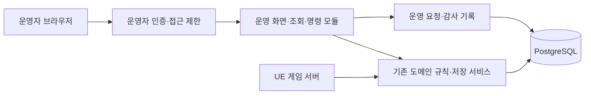

# 1인 개발 MORPG 운영툴 제작 계획

작성일: 2026-11-04 · 상세 확정: 2026-11-05 · 설계 v1 · 대상: Project_RPG의 개발자 겸 운영자 1명

이 문서는 운영툴을 제작할 때 참고할 설계 기준이다. 사용자와 논의한 **1인 개발·운영, 기존 백엔드 활용, 작은 조회 도구부터 단계적 확장**을 구체화했다. 화면·API·수치 한도는 [구현 계약 v1](OPERATIONS_TOOL_IMPLEMENTATION_SPEC.md)에서 확정한 신규 설계다. 운영툴 구현이나 배포 완료, 이미 존재하는 API를 뜻하지 않는다.

진행 상태와 파일 예약은 [개발 로드맵 12절](Online_RPG_Development_Roadmap.md#12-현재-현황과-다음-작업-체크리스트-2026-10-20)에서 관리한다. 본 문서를 운영툴 설계의 기준 문서로 유지하고, 별도 스킬에 같은 설계를 복제하지 않는다.

2026-11-04 후속 사용자 지시로 **SOLID와 유지보수성을 0순위**로 고정하고 로그 추적을 필수 범위에 포함한다. 구체적인 책임·인터페이스·의존 방향은 [아키텍처 설계](OPERATIONS_TOOL_ARCHITECTURE.md), 사건/요청 연결·검색·보존은 [로그 추적 계약](OPERATIONS_LOG_TRACING.md)을 따른다. 이 문서는 기능 범위와 제작 순서를 담당한다.

## 1. 목적과 범위 기준

운영툴의 목적은 개발자 한 명이 **유저의 상태와 문제 원인을 빠르게 확인하고, 필요한 조치를 실수 없이 반복하는 것**이다. 화면 수나 관리 가능한 DB 테이블 수를 성과로 삼지 않는다.

- 첫 목표: 캐릭터 하나를 찾아 현재 상태와 던전 보상 전달 경로를 조사할 수 있다.
- 기존 C# 백엔드·저장 규칙·배포 방식을 활용한다. 처음부터 별도 프론트엔드 빌드 체계, 마이크로서비스, 메시지 브로커, 분석 플랫폼을 추가하지 않는다.
- 운영자는 한 명으로 시작한다. 직원별 역할 편집기, 결재, 부서별 권한 관리, 고객 문의 티켓 시스템 자체 제작은 후속 조건이 생길 때 검토한다.
- 혼자 운영해도 개인 로그인, 게임 자격과의 분리, 처리 이력, 중복 지급 방지, 백업과 복구는 필요하다.
- 업무 한 건의 화면·서버 처리·기록·실패 검증을 완성한 뒤 다음 기능으로 넘어간다. 예상 사용 빈도와 절약 시간을 기록해 우선순위를 정한다.
- 업무 규칙은 웹·DB·인증·로그 수집 구현과 분리하고, 실제 교체/실패 경계에만 좁은 인터페이스를 둔다. 빠른 제작을 위해 책임·권한·원자성을 한 클래스에 섞지 않는다.
- 웹 화면이 필요하지 않은 일회성 작업은 검증된 명령이나 실행 절차로 처리할 수 있다. 지속적으로 사용하는 변경 명령은 웹과 스크립트 모두 같은 운영 권한·기록·중복 방지 규칙을 거친다.

## 2. 현재 코드에서 재사용할 기반과 추가할 부분

2026-11-04 소스 확인 기준이다. 이후 착수할 때 계약과 실제 호출 코드를 다시 대조한다. 표의 '추가할 부분'은 이번 문서 작업에서 구현한 기능이 아니다.

| 영역 | 확인한 현재 기반 | 운영툴 제작 시 필요한 부분 |
|---|---|---|
| 서버·저장 | [백엔드](../Backend/README.md)의 ASP.NET Core·PostgreSQL, 개발용 Memory 저장소 | 같은 저장 모델을 읽는 운영 조회 서비스·웹 화면 |
| 인증 | [BearerAuthenticator](../Backend/ProjectRpg.Backend/Authentication/BearerAuthenticator.cs)의 공용 AdminToken 판별 | 운영자 개인 신원·세션·로그아웃. 기존 관리자 토큰은 브라우저 로그인 수단으로 노출하지 않음 |
| 캐릭터 | [Program.cs](../Backend/ProjectRpg.Backend/Program.cs)의 `/api/characters`는 Player 본인 목록 | 운영자 전용 계정·캐릭터 검색. 플레이어 API의 소유권 제한을 풀지 않음 |
| 재화 | [재화 API](../Backend/ProjectRpg.Backend/Api/EconomyApiEndpoints.cs)의 지갑·요청별 영수증 조회, 관리자에게 허용된 일부 읽기 | 캐릭터·기간별 이력 검색과 운영 보상 명령. 기존 commit은 GameServer 전용 |
| 아이템·우편 | [아이템 API](../Backend/ProjectRpg.Backend/Api/ItemApiEndpoints.cs)·[조회 권한](../Backend/ProjectRpg.Backend/Application/ItemOwnerAccessService.cs), 안정 ID·Revision·거래 영수증 | 관리자 전용 조회·타임라인. 현재 관리자 토큰만으로 일반 아이템 조회·영수증·commit을 사용할 수 있다고 가정하지 않음 |
| 던전 보상 | [정산 worker](../Backend/ProjectRpg.Backend/Application/DungeonRewardSettlementWorker.cs)·[원자 지급 저장소 계약](../Backend/ProjectRpg.Backend/Data/IDungeonRewardCommitRepository.cs) | 정산 상태와 영수증 연결 조회. 운영 보상은 기존 정산과 별도 업무로 정의 |
| 상태 점검 | [health 엔드포인트](../Backend/ProjectRpg.Backend/Api/HealthApiEndpoints.cs)의 live·ready/저장소 응답 | 외부 감시·알림 연결, 정산 지연 등 실제 서비스 문제 신호 |

재사용은 기존 권한을 우회한다는 뜻이 아니다. 예를 들어 [CurrencyTransactionService](../Backend/ProjectRpg.Backend/Application/CurrencyTransactionService.cs)는 실제 게임 서버·던전 멤버 자격을 검사한다. 운영툴에서 가짜 서버 ID나 던전 세션을 만들어 호출하지 않는다. 운영 전용 명령을 추가하고 공통 도메인 규칙·트랜잭션 보장을 재사용한다.

현재 영수증에는 요청별 조회 기반이 있지만, 운영자용 캐릭터·기간별 전체 이력 검색이 이미 제공된다고 가정하지 않는다. 기존 우편도 [캐릭터 소유 아이템 첨부와 수령](REWARD_MAIL.md) 기반이다. 공지 발송·전체 우편·예약 발송 시스템은 별도 기능이다.

## 3. 구성과 배포

- 초기에는 기존 백엔드와 함께 배포하는 작은 모듈로 만든다. 화면은 Razor Pages의 서버 렌더링 HTML·폼·표로 설계하고 필요한 상호작용만 추가한다. PageModel은 화면 어댑터이며 업무 규칙과 SQL을 담지 않는다.
- 업무 규칙·유스케이스·포트는 신규 `Backend/ProjectRpg.Operations.Core/`, 호스트의 `Backend/ProjectRpg.Backend/Operations/`에는 Web/Infrastructure/Hosting을 둔다. `Program.cs`에는 조립·라우팅 연결만 둔다. 구체 구조는 아키텍처 문서를 따르며 이 경로들은 아직 생성한 구현이 아니다.
- `/ops`와 `/ops/api`를 운영 전용 경로로 사용한다. 같은 프로세스여도 운영 경로의 인증 정책을 별도로 적용한다. 기존 Bearer 미들웨어의 실제 경로 처리와 충돌·누락 여부를 검증한다.
- 개발용은 루프백 접근부터 시작한다. 원격 사용 시 관리 도메인/접근 경로를 제한하고 HTTPS·개인 인증을 적용한다. 게임 API를 외부에 열었다고 운영 경로까지 자동 공개하지 않는다.
- 설정은 운영 기능 비활성 상태를 기본으로 하며, 활성화할 때 인증 설정이 불완전하면 접근을 허용하지 않는다. 운영자 한 명의 고정 신원을 시작점으로 삼고 가입·비밀번호 복구 시스템을 직접 만들지 않는다.
- 환경명과 배포 버전을 화면 상단에 항상 표시한다. 개발·검증·운영의 계정 자격·DB·비밀값을 분리하고, 변경 화면에서 연결 환경과 대상을 재확인한다.
- 운영 브라우저에 DB 자격, 공용 AdminToken, GameServer 토큰을 전달하지 않는다. GitHub OAuth의 숫자 ID 허용 목록과 PG 서버 세션·보호 cookie를 사용한다. 유휴 30분/절대 8시간, 로그아웃·Secure/HttpOnly/SameSite·CSRF를 함께 구현한다.

## 4. 단계와 완료 기준

달력상 일정 대신 필요한 시점과 실제 사용 가능 여부로 진행한다. 각 단계는 앞 단계의 기반을 재사용하며, 아래 모든 기능을 게임 콘텐츠 개발의 선행 조건으로 삼지 않는다.

| 단계 | 필요한 시점 | 제작 범위 | 완료 기준 |
|---|---|---|---|
| S1 조회 시작 | 개발 중 | 개인 로그인, 환경 표시, Steam ID/캐릭터 ID 검색, 캐릭터 상세·현재 재화/가방/우편·활성 던전 상태, 구조화 요청 로그·기본 추적 번호 검색 | 운영자만 조회하고 없음/실패/빈 목록을 구분함. 읽기가 게임 상태를 바꾸지 않고 해당 요청의 오류/처리 구간을 찾을 수 있음 |
| S2 보상 조사 | 개발 중 반복 조사 발생 시, 외부 테스트 전 | 던전 참가·정산·재화/아이템 영수증·우편/수령 이력 연결 | 보상이 진행 중인지, 저장됐는지, 현재 어디에 있는지 또는 증거가 부족한지 설명할 수 있음 |
| S3 개별 조치 | 외부 테스트 전 | 한 대상·한 보상 템플릿의 지급부터 시작. 이어서 필요 범위의 계정 제재/해제 | 미리보기·사유·고정 요청 ID·원자 기록·재시도 복구·게임 반영 확인까지 완성. 제재는 실제 서버 경로에서 집행됨 |
| S4 운영 준비 | 실제 서비스 전 | 서비스 장애 알림, 자동 백업·복구 절차, 공지·점검 전환 | 백엔드 중단도 감지하고, 별도 DB 복구를 확인하며, 점검 중 새 입장과 진행 중 세션의 정책이 적용됨 |
| S5 반복 업무 자동화 | 운영 중 실제 반복 비용 확인 후 | 예약·대량 보상, 간단한 통계/내보내기 등 필요한 항목만 | 대상 고정·중복 방지·진행 상태·재시작 복구가 있고 수동 작업보다 관리 부담이 작음 |

**첫 구현 단위는 S1이다.** S2의 전체 타임라인이나 지급 버튼을 S1에 함께 넣지 않는다. S1 안에서도 인증·검색·기본 상세를 먼저 연결하고 재화·가방·우편 패널을 순서대로 완성한다.

## 5. S1 화면과 조회 계약

초기 화면은 검색·캐릭터 상세·기본 로그 조회 세 페이지로 설계한다. 아래 API는 확정한 신규 계약이며 현재 구현된 엔드포인트 목록이 아니다. Razor PageModel과 S1 JSON 엔드포인트가 같은 유스케이스를 직접 호출한다. 정확한 DTO·오류·cursor는 구현 계약 §3~4를 따른다.

| 화면/계약 | 입력 | 표시할 내용 |
|---|---|---|
| `GET /ops/api/characters` | 정확한 Steam ID 또는 캐릭터 GUID | 계정·원정대·캐릭터 ID, 표시 이름, 직업·레벨 등 저장된 기본 정보 |
| `GET /ops/api/characters/{id}` | 확정한 캐릭터 GUID | 기본 정보, 정보별 조회 시각, 활성 던전/리스·정산 상태 |
| `GET /ops/api/characters/{id}/inventory` | 캐릭터 GUID, 페이지 커서 | 가방/장비/우편 구분, 아이템 ID·정의·수량·Revision·잠금·상태 |
| `GET /ops/api/characters/{id}/wallet` | 캐릭터 GUID | 재화 코드·잔액·Revision·실제 소유 범위(Account/Roster/Character) |
| `GET /ops/api/characters/{id}/timeline` — S2 | 캐릭터 GUID·기간·종류·커서 | 던전/정산/거래/운영 요청의 시각·상태·서로 연결되는 ID |

초기 검색은 안정 ID를 우선한다. 이름 검색이 필요해지면 중복 이름을 전제로 후보 목록과 계정/캐릭터 ID를 보여준다. 검색 결과의 첫 행을 자동으로 변경 대상으로 선택하지 않는다.

조회 원칙:

- 서버에서 기간·페이지 크기·실행 시간을 제한한다. 기본 50건/최대 200건, 타임라인 최근 7일/한 요청 최대 30일로 시작하고 실측 후 조정한다. 기존 제한 조회를 전체 목록으로 표시하지 않으며, 안정된 정렬·커서 또는 명시적 잘림 상태를 제공한다.
- 현재 상태와 과거 사건을 구분한다. 여러 조회를 묶었다고 동일 시각의 원자적 snapshot이라고 표시하지 않는다. 조회 시각·Revision과 부분 실패를 각 패널에 표시한다.
- 저장된 리스·heartbeat는 접속 상태 판단의 근거이지 실시간 온라인 여부의 완전한 증거가 아니다. '활성 리스 있음', '최근 관측 시각', '확인 불가'처럼 표시한다.
- 현재 가방에 없다는 사실만으로 미지급을 단정하지 않는다. 수령·소비·이동·삭제/만료 이력과 원래 영수증을 함께 확인한다.
- 이력이 아직 수집되지 않았거나 보존 기간을 지났으면 '기록 없음/확인 불가'를 명시한다. 누락된 과거 기록을 추정해 채우지 않는다.
- 정확한 64비트 재화·Revision 값은 웹에서 반올림되지 않도록 문자열 등 손실 없는 계약을 사용한다. 서버 UTC 시각과 화면 표시 시간대를 구분한다.
- 응답을 공유 캐시에 저장하지 않는다. 토큰·티켓·연결 문자열·비밀 환경값과 불필요한 개인정보는 화면·로그·내보내기에서 제외한다.
- 화면의 추적 번호로 해당 HTTP 시도와 처리 구간을 찾을 수 있어야 한다. 업무 요청 ID와 HTTP/trace ID의 수명, 검색 한도·계측/보존 범위는 로그 추적 계약을 따른다.
- 대용량 조인·전체 DB 스캔 대신 필요한 인덱스와 제한 조회를 먼저 사용한다. 분석용 저장소 분리는 실제 부하가 필요성을 보일 때 검토한다.

## 6. S2의 첫 업무: 던전 보상 문의 조사

예: '오늘 던전을 완료했는데 아이템이 없다.'

1. 계정·원정대·캐릭터와 플레이 시간대를 확정한다.
2. 해당 던전 세션의 참가·완료·포기/제외 상태와 실제 정산 대상을 확인한다.
3. 정산 작업 상태, 재시도 상태, 원래 RequestId와 저장된 영수증을 확인한다.
4. 재화 증가와 아이템 생성/합산, 가방 위치, 초과 우편, 이후 수령·소비 기록을 연결한다.
5. 결과를 '정상 지급 후 이동/소비', '정산 진행/재시도 중', '확정 실패', '기록 부족'으로 표시한다.
6. 미확정 정산은 원래 요청의 결과부터 확인한다. S3의 별도 보상으로 덮지 않으며, 일반 조회 화면에 정산 강제 완료·리스 삭제·입장 잠금 해제를 넣지 않는다.

[현재 던전 보상 계약](DUNGEON_REWARD_INVENTORY_FIRST.md)은 인벤토리 우선·초과 수량만 우편이다. 원래 영수증이 있으면 재지급 위치를 현재 가방 상태로 다시 계산하지 않는다. 운영 보상도 원래 정산이 나중에 성공할 가능성과 중복 여부를 확인해야 한다.

## 7. S3 변경 명령의 최소 계약

### 7.1 개별 보상의 사용자 흐름

`캐릭터 선택 → 조사 근거 확인 → 허용된 아이템 선택(1개 고정) → 사유 입력 → 적용 환경·소유 범위·예상 결과 확인 → 실행 → 같은 요청의 결과 확인`

- v1은 `Ops.Compensation.Item.v1`, 허용 목록의 아이템 1종·1개를 Character 우편에 지급한다. 임의 SQL, 임의 아이템 속성/Revision 편집, 자유로운 재화 덮어쓰기 화면은 제공하지 않는다.
- `POST /ops/api/compensations/preview`, `POST /ops/api/compensations`, `GET /ops/api/actions/{requestId}`로 확인/실행/결과를 분리한다. 대상·템플릿·사유를 확정한 요청 ID를 전송 전에 보존한다. 서버가 정규화 입력의 hash와 원문 계약을 대조한다.
- HTTP 시간 초과는 실패 확정이 아니다. 화면은 '결과 확인 중'으로 전환하고 동일 ID를 조회·재시도한다. 화면 새로고침·다시 로그인 뒤에도 요청 ID로 결과를 찾을 수 있어야 한다.
- 같은 ID·같은 입력은 저장된 결과를 반환한다. 같은 ID의 다른 입력은 충돌로 거절한다. 두 번 클릭하거나 동시 요청해도 효과는 한 번만 발생한다.
- 다른 ID로 같은 사건을 다시 지급하는 실수도 막는다. 사건 번호+실제 소유 범위/ID의 unique 키를 검사하고 최근 보상 이력을 보여준다. v1에는 같은 사건의 추가 지급 override가 없으며 '재시도' 버튼이 새 보상 건을 만들지 않는다.
- 이후 원정대 재화를 추가한다면 부캐마다 지급하지 않도록 실제 원정대 소유 범위를 중복 키로 삼는다. 별도 실제 사건은 새 근거/사건 번호로 처리한다.

### 7.2 원자성·기록

운영 보상은 자체 operation과 출처를 가진다. 존재하지 않는 던전 ID·게임 서버 자격을 만들어 기존 API에 넣거나, 현재 GameServer 전용 API를 관리자에게 일괄 개방하지 않는다.

최소 영속 기록의 의미(정확한 스키마는 구현 계약 §5):

| 필드 | 목적 |
|---|---|
| RequestId·환경·Operation·요청 fingerprint | 재시도와 입력 충돌 판별 |
| OperatorId·요청/완료 시각 | 누가 언제 처리했는지 추적 |
| AccountId·RosterId·CharacterId·실제 지급 소유자 | 대상과 재화 범위 혼동 방지 |
| 사건/근거 ID·사유·템플릿 버전·확정 입력 | 처리 이유와 승인한 내용 보존 |
| 결과 상태·거절 코드·원래 거래/정산/아이템 영수증 ID | 게임 기록과 연결 |
| 변경 전후 잔액·수량·Revision, 생성/변경된 아이템 ID | 지급 결과와 이후 이동 조사 |

초기 개별 조치는 같은 PostgreSQL 트랜잭션에서 **게임 데이터 변경·중복 방지 영수증·성공 감사 기록을 함께 확정**한다. 성공 기록이 저장되지 않으면 데이터 변경도 롤백한다. 인증 실패·거절·실행 오류의 보안 로그는 별도로 남길 수 있지만, 그것으로 지급 성공을 증명하지 않는다.

기존 영수증을 지워서 취소하지 않는다. 회수가 필요해지면 원래 요청과 연결된 별도 명령으로 설계하고, 이미 소비한 아이템·부족한 재화의 처리 정책부터 정한다. 회수는 첫 지급 기능에 자동 포함하지 않는다.

### 7.3 접속 중인 유저와 경합

- 지급은 고유 우편 위치/아이템 ID·한도·동시 수령 계약을 사용한다. 현재 던전 보상의 인벤토리 우선 규칙은 유지한다.
- 활성/경합 리스·저장된 비종료 던전·Pending/Processing 정산이 있으면 실행 시점에 target_busy로 거절한다. character/owner/lease/session의 잠금 순서와 NOWAIT 검사를 구현 계약 §8.1대로 적용한다. 화면의 '오프라인' 표시만으로 허용하지 않는다.
- 리스/Revision 확인과 변경 사이의 경합을 잠금·CAS 등 현재 저장 모델에 맞는 원자 검사로 막는다. 운영툴이 조회한 낡은 값으로 최신 상태를 덮지 않는다.
- 지급 저장 완료와 클라이언트 표시 갱신은 구분한다. v1은 다음 로비/우편 재조회에 나타나는 계약이며 현재 전투 중 즉시 반영을 약속하지 않는다.

### 7.4 제재·해제

계정 단위 기간 제재는 기본 24시간/최대 30일이다. 시작·만료/해제·사유·Revision·처리 ID를 남기고 기존 인증 세션 폐기를 같은 트랜잭션에서 확정한다. 새 로그인·입장/재접속은 공통 계정 잠금 아래 차단한다. 이미 확정된 전투는 강제 퇴장시키지 않으며 남은 파티·heartbeat·정산을 보존한다. 만료/해제 후 재로그인한다. DB 표시 변경만으로 집행 완료를 주장하지 않는다. 채팅 제한은 v1 밖이다.

## 8. S4에서 먼저 갖출 운영 준비

### 알림

- 시작 신호: 외부에서 본 backend/readiness 실패, 저장 실패 증가, 정산 실패/장기 지연, 백업 실패·마지막 성공 시각 초과.
- 같은 프로세스 안의 알림만으로 전체 서비스 중단을 감지할 수 없다. 외부 감시가 기존 health를 확인하게 한다. ready 성공만으로 던전·정산 전체가 정상이라고 간주하지 않는다.
- 한 사람이 대응할 수 있도록 같은 장애를 묶고 최초·지속·복구 알림을 구분한다. 알림에는 환경·현상·첫 확인 시각·관련 요청/세션 ID·첫 대응 절차 링크를 넣고 비밀값을 제외한다.
- 별도 관리 호스트에서 30초 주기·3회 실패/2회 회복을 감시하고 HTTPS webhook으로 전달한다. 기계 상태 조회는 독립된 최소 권한이다. 상세 신호·중복/재시도는 구현 계약 §9.2를 따른다. 초기 운영툴에서 시계열 그래프를 자체 제작하지 않는다.

### 백업·복구

- 운영 DB와 분리된 저장 위치에 자동 백업하고 결과·최근 성공 시각·보존 기간을 확인한다. 백업 자격과 복구 절차는 공개 문서/로그에 적지 않는다.
- 목표 RPO 15분/RTO 4시간, Linux PostgreSQL의 pgBackRest 주 full/일 incremental/연속 WAL을 사용한다. 성공한 full 체인 최소 2개와 필요한 WAL을 보존한다. 실제 저장소 주소/자격은 배포 입력이다. 목표 달성은 실제 복원으로 검증한다.
- 별도 DB로 실제 복구해서 캐릭터·재화·아이템·영수증의 일관성과 재시도 중복 방지를 확인한다. 백업 파일 생성 성공만으로 복구 가능을 주장하지 않는다.
- 전체 DB 복원과 개별 유저 보상은 구분한다. 웹 운영 화면의 일반 버튼으로 운영 DB를 복원하지 않는다. 복원 시 쓰기 중지·진행 중 정산·클라이언트 재접속 절차를 실행 지침에 둔다.

### 공지·점검

공지 한 건과 Open/Drain 상태·표시 시작/종료 예정 시각을 제공한다. Drain은 신규 로그인/던전 생성·참가·출발·입장 확인을 차단하고 기존 전투·정산·인증된 우편 수령은 유지한다. 배포/복구는 진행 세션 소진 뒤 외부 절차로 쓰기를 중지한다. 30분 초과는 알림이며 자동 강제 종료하지 않는다. 화면 문구와 실제 서버 접근 제한을 함께 검증한다.

## 9. 나중으로 미룰 기능과 착수 조건

| 기능 | 검토할 조건 |
|---|---|
| 직원별 권한·결재 | 실제 운영 인력이 늘고 업무 권한이 달라질 때 |
| 전체 우편·예약/대량 보상 | 반복 수동 지급 비용이 커지고 대상 선정·중단/재개 정책이 정해졌을 때 |
| 이벤트/보상 편집기 | 설정 파일·기존 에셋 배포로 처리하기 어려운 운영 빈도가 확인될 때 |
| 경제 분석 대시보드 | 수집할 원천 사건과 답할 질문이 정해지고 기존 제한 조회로 부족할 때 |
| 별도 운영 서비스·프론트엔드 | 독립 배포·장애 격리·화면 복잡도의 실질적 필요가 생길 때 |
| 고객 문의 시스템 자체 제작 | 기존 문의 채널과 사건 번호 기록으로 감당하기 어려울 때 |

대량 처리를 시작하게 되면 제출 당시 대상 목록·템플릿 버전을 고정하고 대상별 중복 키·진행 상태를 저장한다. 취소는 아직 처리하지 않은 대상에 적용하며, 완료한 지급은 자동 취소된 것으로 표시하지 않는다. 이 작업 큐는 S1~S3의 선행 구현 항목이 아니다.

## 10. 기능별 검증 기준

실제 변경 범위에 필요한 검증만 수행한다. 문서 수정만으로 게임 빌드·실행을 추가하지 않는다.

| 변경 범위 | 필요한 핵심 확인 |
|---|---|
| 로그인·조회 | 미인증/Player/GameServer 접근 거절, 운영자 허용, 로그아웃·만료, 비밀값 제외, 대상/범위 분리, 빈 결과/실패/잘림 구분, 상태 변경 없음 |
| 보상 조사 | 가방 지급/초과 우편/수령·소비/진행 중 정산/기록 누락을 구분, 표시 결과와 실제 영수증 대조 |
| 개별 지급 | 같은 요청의 반복·동시 요청·다른 입력 충돌, 다른 ID의 동일 사건 중복, 계정/원정대/캐릭터 범위, 한도·권한·CSRF, 실패 시 전체 롤백 |
| 결과 복구 | DB 확정 직후 응답 유실·프로세스 재시작 뒤 같은 결과 조회, 새 지급 없음, 감사 기록·실제 게임 데이터 일치 |
| 로그 추적 | 요청/업무 ID 구분과 실제 구간 연결, 검색 인가·마스킹·부분 결과, 로그 유실을 지급 실패로 오판하지 않음, 수집기 교체 시 업무 규칙 유지 |
| 게임 연결 | 플레이 중 수령/변경과의 경합, 낡은 Revision 거절, 선언한 클라이언트 반영 시점, 기존 보상·우편 수령 규칙 유지 |
| 제재·점검 | 신규 로그인/기존 세션/던전 입장·현재 파티에 선언한 정책 적용, 만료·해제·진행 중 정산 영향 |
| 운영 준비 | 외부 감시의 중단·복구 감지, 백업 실패 알림, 별도 DB 실제 복구·일관성, 점검 종료 후 정상 접속 |

Memory 확인만으로 PostgreSQL 트랜잭션·프로세스 재시작 복구를 입증하지 않는다. 저장 변경은 격리된 PostgreSQL에서 확인하고, UI 갱신을 보장하는 기능은 필요한 UE 연결만 검증한다. 검증용 사본·DB·캐시는 [AGENTS.md](../AGENTS.md)에 따라 자기 소유 범위를 예약하고 정리한다.

## 11. 다음 담당자의 착수 절차

1. 사용자 요청이 문서 검토인지 실제 제작인지 확인한다. 이 문서의 미완료 목록 자체를 추가 작업 지시로 해석하지 않는다.
2. 로드맵 12절의 최신 완료 기록·조율 표와 이번에 다룰 계약/호출 코드를 읽는다. 기존 운영 기능이 추가돼 있으면 먼저 재사용 가능 여부를 확인한다.
3. 아키텍처·로그 추적·구현 계약을 읽고, 첫 제작 요청이라면 S1의 Core 경계·개인 로그인·정확한 ID 검색·기본 상세·요청 추적을 작은 변경 단위로 연결한다. 확정한 정책에 실제 계정/경로 등 배포 입력을 연결한다.
4. 수정할 실제 경로와 공유 자원을 예약한다. 기존 `Program.cs`·인증·저장소가 다른 담당 범위와 겹치면 독립 작업으로 전환하거나 인계한다.
5. 화면→서버→저장·기록→실패 검증을 연결하고, 선언한 완료 기준을 확인한다. 조회 단계에서 지급·리스 수정 등 변경 기능을 섞지 않는다.
6. 실제 검증으로 계약 변경이 필요하면 결정과 영향·근거를 함께 갱신한다. 완료 기록·검증 범위·인계 사항은 로드맵에 남긴다.
7. 자기 임시 산출물을 정리하고 기능별 커밋·푸시·원격 해시 확인 후 완료 보고한다. 테스트/검증 전용 작업은 저장소의 게시 예외를 따른다.

## 12. 설계 완료 범위

설계 기준: SOLID·유지보수성 최우선, 1인 개발·운영, 기존 C# 호스트와 작은 Core 경계, Razor Pages 화면 어댑터, 개인 로그인, 조회 우선, 별도 운영 명령, 처리 이력·중복 방지, 로그 추적, 업무 단위 검증.

v1의 상세 결정은 [구현 계약](OPERATIONS_TOOL_IMPLEMENTATION_SPEC.md)에 완료했다.

- S1: GitHub 숫자 ID 로그인/PG 세션, 조회 DTO/API/오류/페이지, Serilog 파일/검색·보존 한도.
- S2: 실제 영수증/정산 소스·연결 근거·누락 표시, 게임/운영 영수증 자동 삭제 없음.
- S3: 아이템 1종·1개 우편, 사건 중복·원자 감사·잠금/반영 시점, 기간 제재/해제.
- S4: Open/Drain·공지, 외부 감시/webhook, pgBackRest·RPO/RTO·복구 절차.

설계의 미결 항목은 없다. 실제 계정/비밀값·도메인·영속 경로·지급 품목·백업 저장소는 배포 입력이다. S5는 v1 범위 밖이다. S1~S4 제품 구현·실제 운영 검증은 이후 제작 작업이며 이번 설계 완료와 구분한다.
